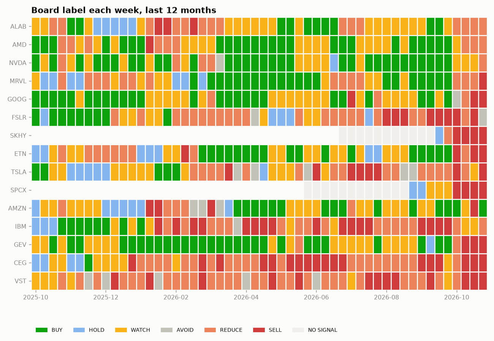
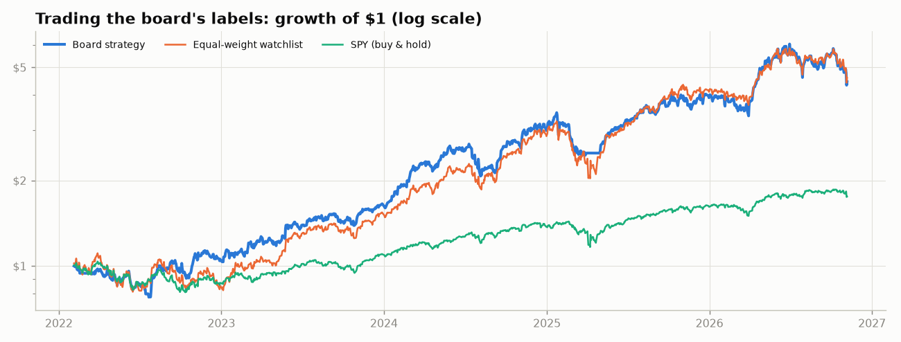
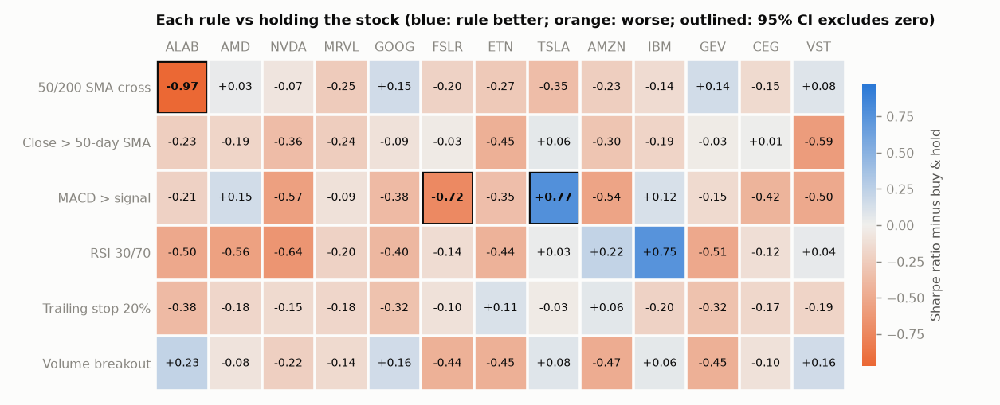
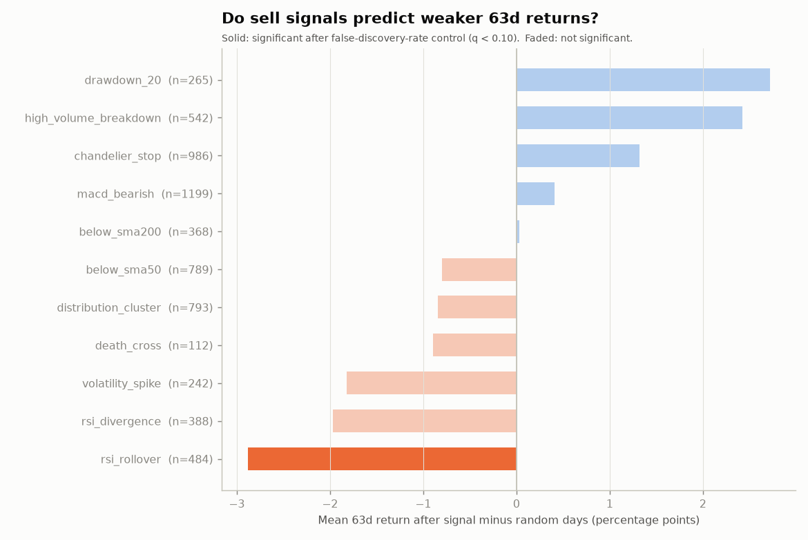
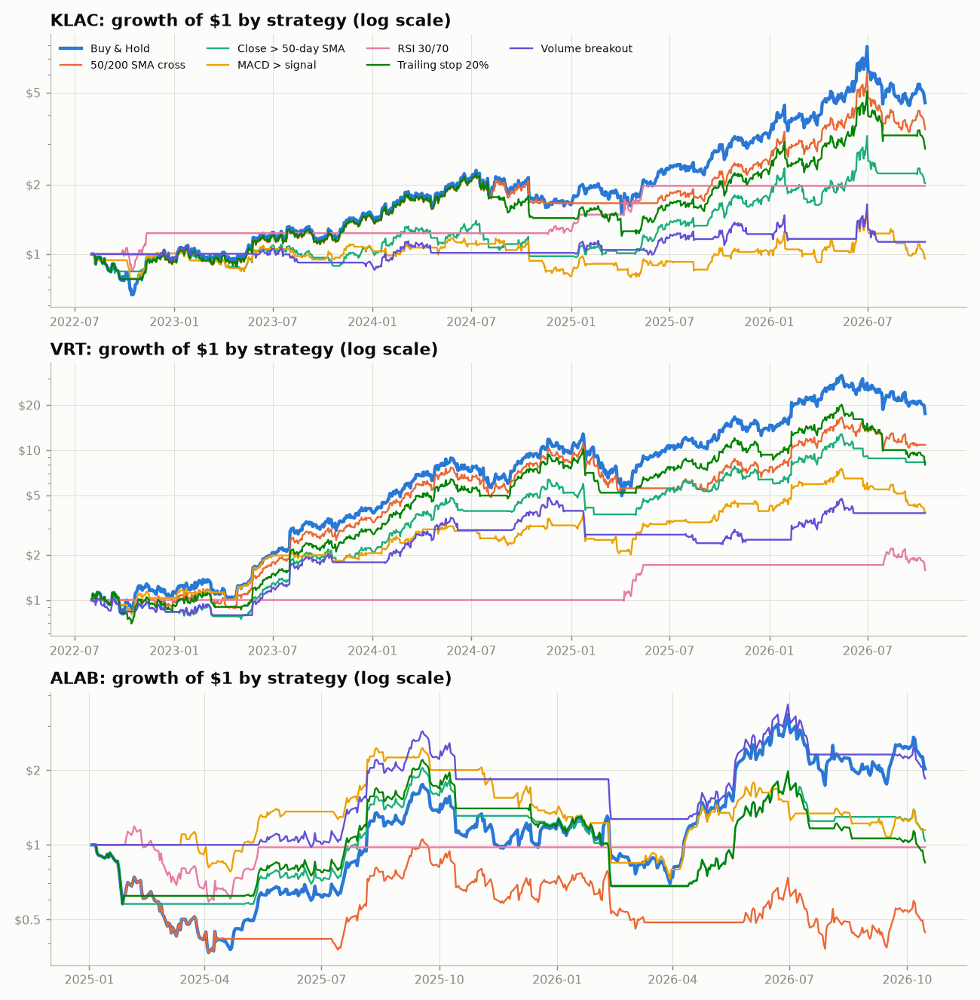
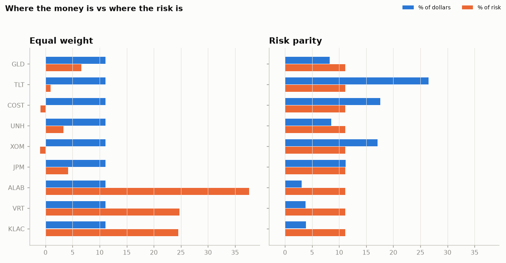

# stock-signal-lab

[](https://github.com/Clairechen163/stock-signal-lab/actions/workflows/tests.yml)
[](https://github.com/Clairechen163/stock-signal-lab/actions/workflows/daily-update.yml)


**A daily buy/sell board for a stock watchlist, built on statistically tested rules and
honest about how well they work: when to buy, when to sell, how to spread risk, and
whether tomorrow is predictable at all.**

> **TL;DR.** After every US trading day, an automated job downloads fresh prices for
> ALAB, AMD, NVDA, MRVL, GOOG, AMZN, IBM, FSLR, SKHY, ETN, GEV, CEG, VST, TSLA and SPCX, labels each one
> BUY, HOLD, WATCH, AVOID, REDUCE or SELL with fixed, published rules, and re-tests
> whether trading those labels has beaten simply holding the same stocks. The rules
> come from an October 2026 study in which **only 1 of 33 popular sell-signal tests
> survived false-discovery-rate control, no trading rule beat buy & hold, and next-day
> returns were unpredictable (best AUC 0.52)**. So the board treats selling as risk
> management, not prediction, and shows its own track record next to every label.
> Before the open and every hour during the session it re-runs the board at each
> stock's latest price, and tests whether deciding before the open has ever beaten
> deciding on the previous close.

The project started from a real situation: in October 2026, AI chip stocks fell for six
straight sessions and I had to decide whether to sell three positions (KLAC, VRT, ALAB).
Online advice offered dozens of "sell signals" (moving-average breaks, RSI, volume
patterns) with no evidence behind them. This repository turns those rules into
hypotheses and tests them with the methods a statistician would use: walk-forward
validation, block bootstrap, Monte Carlo nulls and false-discovery-rate control. It now
applies the same machinery every day to a watchlist.

> Educational research code. Nothing here is investment advice.

---

<!-- LIVE:START (generated by `python -m stocklab update`; edits here are overwritten) -->
## Today's board: data as of the 2026-11-06 close

*Updated automatically after every US trading day by a GitHub Actions workflow. Labels come from fixed, published rules (see [how labels are chosen](#how-the-board-labels-are-chosen)); they are not predictions and not investment advice.*

| Ticker | Action | Close | 1 day | 1 month | Why | Buy zone (pullback / breakout) | Stop |
|---|---|---:|---:|---:|---|---|---:|
| AMZN | **BUY** | 259.30 | -0.3% | +2.1% | buy rank 3/15; +6% vs 200-day average; distribution days | 254.28 / 266.56 | 235.90 |
| FSLR | **AVOID** | 201.14 | +2.7% | +12.5% | -6% vs 200-day average; below 200-day, death cross, 20%+ off high | — | — |
| AMD | **REDUCE** | 449.04 | +11.0% | -27.7% | +8% vs 200-day average; below 50-day, MACD bearish, distribution days, 20%+ off high, volatility spike, below chandelier stop | — | — |
| NVDA | **REDUCE** | 186.64 | +2.8% | -19.0% | -9% vs 200-day average; below 50-day, below 200-day, MACD bearish, distribution days, 20%+ off high, below chandelier stop | — | — |
| IBM | **REDUCE** | 245.00 | -0.9% | +8.1% | -0% vs 200-day average; below 200-day, death cross, MACD bearish, 20%+ off high | — | — |
| ALAB | **REDUCE** | 190.71 | +6.3% | -45.0% | -26% vs 200-day average; below 50-day, below 200-day, MACD bearish, distribution days, 20%+ off high, below chandelier stop | — | — |
| MRVL | **SELL** | 141.20 | +5.7% | -48.6% | -24% vs 200-day average; below 50-day, below 200-day, MACD bearish, distribution days, 20%+ off high, volatility spike, below chandelier stop | — | — |
| ETN | **SELL** | 341.72 | +4.5% | -19.5% | -14% vs 200-day average; below 50-day, below 200-day, MACD bearish, distribution days, 20%+ off high, volatility spike, below chandelier stop | — | — |
| GEV | **SELL** | 774.11 | +0.5% | -22.5% | -18% vs 200-day average; below 50-day, below 200-day, death cross, MACD bearish, distribution days, 20%+ off high, below chandelier stop | — | — |
| GOOG | **SELL** | 283.93 | +0.8% | -17.7% | -16% vs 200-day average; below 50-day, below 200-day, death cross, MACD bearish, distribution days, 20%+ off high, volatility spike, below chandelier stop | — | — |
| SPCX | **SELL**\* | 134.27 | +8.6% | -16.4% | -10% vs 50-day average; below 50-day, MACD bearish, distribution days, 20%+ off high, below chandelier stop (provisional: 103 days of history) | — | — |
| TSLA | **SELL** | 358.22 | +4.2% | -4.5% | -7% vs 200-day average; below 50-day, below 200-day, death cross, MACD bearish, distribution days, 20%+ off high, below chandelier stop | — | — |
| CEG | **SELL** | 249.95 | +4.3% | -12.3% | -10% vs 200-day average; below 50-day, below 200-day, death cross, MACD bearish, distribution days, 20%+ off high, below chandelier stop | — | — |
| VST | **SELL** | 124.80 | +10.6% | -20.1% | -18% vs 200-day average; below 50-day, below 200-day, death cross, MACD bearish, distribution days, 20%+ off high, volatility spike, below chandelier stop | — | — |
| SKHY | **SELL**\* | 127.34 | +2.8% | -25.3% | -24% vs 50-day average; below 50-day, MACD bearish, distribution days, 20%+ off high, below chandelier stop (provisional: 85 days of history) | — | — |

\* Provisional: listed less than 200 trading days ago, so the trend test uses the 50-day average and rules that need a longer history are not scored yet.

What each label means: **BUY**: keep or add if you own it, buy near the pullback entry or on a breakout if you don't; **HOLD**: keep if you own it, wait until it ranks higher if you don't; **WATCH**: keep, tighten your stop if you own it, wait if you don't; **AVOID**: exit, or keep only with a tight stop if you own it, don't buy if you don't; **REDUCE**: trim the position if you own it, don't buy if you don't; **SELL**: exit if you own it, don't buy if you don't.



### Does the board work?

Trading the labels since 2022-02-02 (buy on BUY; exit on SELL, REDUCE or AVOID; weekly, next-day execution, 5 bp costs) returned **+37.0% a year** with a worst drawdown of -29.5%, versus +38.0% and -37.1% for holding every watchlist stock in equal weight. The Sharpe ratio difference is +0.02 (95% block-bootstrap CI [-0.45, +0.50]): **not distinguishable from simply holding the watchlist**. *Stability: same verdict in 4 of the last 4 runs.*

Label by label: BUY labels were followed by -0.3% versus the watchlist average over 21 days (p = 0.72, 217 observations); SELL labels were followed by -0.5% versus the watchlist average over 21 days (p = 0.78, 65 observations).



These tests use stocks chosen today, which flatters every long-only strategy (survivorship bias), so they show whether the labels add anything relative to holding the same stocks, not what to expect in future.

### Do simple buy/sell rules beat buy & hold?

Six common timing rules (the 50/200-day average cross, holding only above the 50-day average, MACD above its signal line, RSI 30/70, a 20% trailing stop, a volume breakout) are backtested on each of the 13 watchlist stocks (SKHY, SPCX not yet: too little history), trading at the next close with 5 bp costs, and compared with simply holding the stock, using a 95% block-bootstrap confidence interval for the difference in Sharpe ratio.

Of 78 rule-by-stock tests, **1 beat buy & hold** and **2 did worse**; about 2.0 of each would be expected by chance, so this is **no more than chance alone would produce**: no rule has shown an edge. Better: MACD > signal on TSLA (+0.77, CI [+0.15, +1.39]). Worse: 50/200 SMA cross on ALAB (-0.97, CI [-1.90, -0.26]); MACD > signal on FSLR (-0.72, CI [-1.40, -0.11]).

Where the rules do help is in drawdowns: **RSI 30/70** made the worst fall shallower by a median 16 percentage points across stocks, at a median Sharpe cost of 0.20, while in the market 27% of the time.

| Rule | Beat holding | Did worse | Median Sharpe vs holding | Median change in worst drawdown | Time in market |
|---|---:|---:|---:|---:|---:|
| 50/200 SMA cross | 0 of 13 | 1 of 13 | -0.15 | about the same | 73% |
| Close > 50-day SMA | 0 of 13 | 0 of 13 | -0.19 | 6 points shallower | 59% |
| MACD > signal | 1 of 13 | 1 of 13 | -0.35 | 7 points shallower | 50% |
| RSI 30/70 | 0 of 13 | 0 of 13 | -0.20 | 16 points shallower | 27% |
| Trailing stop 20% | 0 of 13 | 0 of 13 | -0.18 | 1 points shallower | 87% |
| Volume breakout | 0 of 13 | 0 of 13 | -0.10 | 14 points shallower | 38% |



Per-stock tables with returns, drawdowns and p-values: [`reports/REPORT.md`](reports/REPORT.md).

### Key numbers from the latest full report

*Each line ends with how many of the last runs (one per trading day, up to 10) reached the same verdict: a result that flips from day to day is sitting on its threshold and is best read as noise.*

- Sell-signal event study: **5 of 33** rule-by-horizon tests show significantly weaker returns after the signal once the false discovery rate is controlled (q < 0.10): below_sma50 (5d), below_sma200 (5d), below_sma200 (21d), death_cross (5d), death_cross (21d). *Stability: significant in the last 4 runs: below_sma50 (5d) in 2, below_sma200 (5d) in 2, below_sma200 (21d) in 2, death_cross (5d) in 2, death_cross (21d) in 3.*
- Single-stock rule backtests: of 78 rule-by-stock tests on 13 stocks, **1** had a significantly higher Sharpe ratio than buy & hold and 2 a significantly lower one. About 2.0 of each would be expected by chance with 78 tests: no more than chance alone would produce, so no rule has shown an edge. *Stability: same verdict in 4 of the last 4 runs.*
- Next-day forecasts: **0 of 52** model-vs-baseline tests (4 models x 13 stocks) beat their naive baseline once the false discovery rate is controlled (q < 0.10), with a median out-of-sample AUC of 0.53 (0.50 is a coin flip): no reliable edge (smallest uncorrected p-value 0.057). *Stability: a test survived correction in 0 of the last 4 runs.*
- Risk concentration: in an equal-weight portfolio of 19 assets (13 watchlist stocks plus 6 diversifiers), the watchlist stocks make up 68% of the money and **97% of the risk**; the largest risk contributors are ALAB, MRVL, AMD. Not yet included for lack of history: SKHY, SPCX.
- Pre-market vs close: from 2022-02-03 to 2026-11-05 (239 weekly decisions, both traded at the open), labels set with the pre-market price returned +41.7% a year (worst drawdown -31.8%) against +38.5% (-30.5%) for labels set at the previous close; the two agreed on 90% of stock-weeks. Sharpe ratio difference +0.06 (95% block-bootstrap CI [-0.10, +0.22]): deciding before the open has been **not distinguishable from deciding on the previous close**. *Stability: same verdict in 4 of the last 4 runs.*
- Opening gaps: across 15,248 stock-days (15 watchlist stocks, 2021-11-09 to 2026-11-06), each 1% of opening gap went with a -0.03% move from the open to the close (95% block-bootstrap CI [-0.09%, +0.03%]): no reliable relationship, so the size of a gap has not told you which way the session goes. *Stability: same verdict in 4 of the last 4 runs.*

Live track record: 4 trading days of labels logged since 2026-11-03 in [`reports/board_log.csv`](reports/board_log.csv), so the board can later be judged on signals it published before the prices moved.

Full tables and charts: [`reports/REPORT.md`](reports/REPORT.md).
<!-- LIVE:END -->

<!-- PREMARKET:START (generated by `python -m stocklab premarket`; edits here are overwritten) -->
## Intraday board at 15:49 ET on 2026-11-06

*The same rules as the board above, with each stock's latest trade standing in for today's close (the history before it is still daily closes). Prices are Yahoo Finance minute bars, which carry Nasdaq's real-time last sale and can trail it by a minute or two. Refreshed by GitHub Actions before the US open and every hour during the session, and whenever `python -m stocklab premarket` is run; `python -m stocklab live` redraws it every minute in a terminal. A label at an intraday price is a preview: it can change by the close, and the close-based label is the one that has been tested.*

| Ticker | Label now | Board at last close | Last close | Latest price | Change | Buy zone (pullback / breakout) | Stop | What the move changes |
|---|---|---|---:|---:|---:|---|---:|---|
| AMZN | **BUY** | BUY | 260.21 | 260.36 | +0.1% | 254.33 / 266.56 | 236.74 | — |
| IBM | **REDUCE** (changed) | WATCH | 247.11 | 245.24 | -0.8% | — | — | now below 200-day average (246.19); rule now on: MACD bearish; rule now off: RSI rollover |
| FSLR | **AVOID** | AVOID | 195.76 | 201.69 | +3.0% | — | — | — |
| AMD | **SELL** | SELL | 404.40 | 446.37 | +10.4% | — | — | now above 200-day average (415.00) |
| MRVL | **SELL** | SELL | 133.55 | 139.98 | +4.8% | — | — | — |
| NVDA | **SELL** | SELL | 181.60 | 187.36 | +3.2% | — | — | — |
| ALAB | **SELL** | SELL | 179.47 | 187.58 | +4.5% | — | — | — |
| ETN | **SELL** | SELL | 327.02 | 342.65 | +4.8% | — | — | — |
| GEV | **SELL** | SELL | 770.51 | 778.88 | +1.1% | — | — | — |
| GOOG | **SELL** | SELL | 281.74 | 284.46 | +1.0% | — | — | — |
| TSLA | **SELL** | SELL | 343.69 | 359.54 | +4.6% | — | — | — |
| SPCX | **SELL**\* | SELL* | 123.62 | 133.96 | +8.4% | — | — | — |
| CEG | **SELL** | SELL | 239.65 | 250.75 | +4.6% | — | — | — |
| VST | **SELL** | SELL | 112.89 | 124.43 | +10.2% | — | — | — |
| SKHY | **SELL**\* | SELL* | 123.90 | 126.77 | +2.3% | — | — | — |

The two volume rules keep their value from the last close, because a part-day's volume can't be compared with a full session's, so a label changes here only when the price move switches a price-based rule; the last column says which. A label marked `*` is provisional (short history). The close-based board above stays the reference: it is the one with the longer live track record.

**Does deciding before the open help?** From 2022-02-03 to 2026-11-04 (239 weekly decisions, both traded at the open), labels set with the pre-market price returned +42.5% a year (worst drawdown -31.8%) against +39.2% (-30.5%) for labels set at the previous close; the two agreed on 90% of stock-weeks. Sharpe ratio difference +0.06 (95% block-bootstrap CI [-0.09, +0.23]): deciding before the open has been **not distinguishable from deciding on the previous close**. *Stability: same verdict in 3 of the last 3 runs.* The test uses the official opening price as a stand-in for the last pre-market trade, because free pre-market history only goes back a few days; every run logs real pre-market labels to `reports/premarket_log.csv` for a direct test later.

**Do opening gaps carry into the day?** Across 15,233 stock-days (15 watchlist stocks, 2021-11-09 to 2026-11-05), each 1% of opening gap went with a -0.03% move from the open to the close (95% block-bootstrap CI [-0.08%, +0.03%]): no reliable relationship, so the size of a gap has not told you which way the session goes. *Stability: same verdict in 3 of the last 3 runs.*

Details: [`reports/PREMARKET.md`](reports/PREMARKET.md).
<!-- PREMARKET:END -->

## How the board labels are chosen

Each stock gets two scores at every close, using only data available at that close:

* **Sell-warning score**: the weighted scorecard of 11 trend, momentum, volume and risk
  rules from the [sell-signal playbook](docs/sell-signal-playbook.md) (maximum 15 points;
  rules that need more history than a recent listing has are left out of both the score and
  the maximum).
* **Buy score**: a cross-sectional factor score within the watchlist on that date, from
  12-1 month momentum, 6-month momentum, trend quality (50-day vs 200-day average), low
  volatility and distance from the 52-week high, each winsorised and standardised.

The label is the first rule that matches:

| Label | Rule | If you own it | If you don't |
|---|---|---|---|
| NO SIGNAL | Fewer than 60 trading days of history | No rule-based view yet | No rule-based view yet |
| SELL | Sell-warning score at 60%+ of its maximum, or your own stop-loss is hit | Exit | Don't buy |
| REDUCE | Sell-warning score at 40-59% | Trim the position | Don't buy |
| AVOID | Below its trend line (200-day average), illiquid, or 50%+ below its high | Exit, or keep only with a tight stop | Don't buy |
| WATCH | Sell-warning score at 20-39% | Keep, tighten your stop | Wait |
| BUY | None of the above, buy score in the top half of the watchlist | Keep or add | Buy near the pullback entry or on a breakout |
| HOLD | None of the above, buy score in the bottom half | Keep | Wait until it ranks higher |

Stocks listed less than 200 trading days ago (SPCX in June 2026, the SK Hynix ADR in
July 2026) get a **provisional** label marked `*`: their trend test uses the 50-day
average until a 200-day average exists. For BUY, HOLD and WATCH the board also gives a
pullback entry (nearest moving average below the price), a breakout level (just above the
20-day high) and a stop two ATRs below the entry.

**The pre-market board** applies the same rules each morning with every stock's latest
pre-market trade standing in for today's close (its history is still daily closes, and the
two volume rules keep their value from the last close, since pre-market volume can't be compared
with a full session's). It is tested the same way: five years of
weekly decisions made just before the open, with the official opening price standing in for
the last pre-market trade, against the close-based board on the same days, both trading at
the open. The same view runs every hour during the session (the **intraday board**) and
every minute with `python -m stocklab live`. Labels set at an intraday price have not been
backtested, so they are a preview of the label the close will set.

**The published rule is the tested rule.** One function produces the label for every
stock on every past date, and the board's track record is computed by trading those past
labels: buy on BUY, exit on SELL, REDUCE or AVOID, reviewed weekly, executed at the next
close with trading costs. It is compared with holding every watchlist stock in equal weight,
with a block-bootstrap confidence interval for the Sharpe-ratio difference, and each label's
forward 21-day return is compared with the watchlist average. Every daily run also appends
its labels to [`reports/board_log.csv`](reports/board_log.csv), building a live record of
signals published before the prices moved.

## What it does

| Command | Question it answers | Key methods |
|---|---|---|
| `update` | Refresh everything: data, board, report, signal log and the live section of this README | What the daily GitHub Actions job runs |
| `board` | Which watchlist stocks are a buy, a hold or a sell today, and has that rule worked before? | Rule-based labels, weekly label-trading backtest, block bootstrap, label-by-label t-tests |
| `premarket` | What does the board say at the latest price (pre-market, intraday or after-hours), and does deciding before the open beat deciding on the last close? | 1-minute extended-hours prices, windowed label re-computation, open-as-proxy timing backtest, pooled gap regression with date-block bootstrap |
| `live` | The same board, redrawn in the terminal every minute | Near real-time minute bars; nothing written to disk |
| `sell-check` | What do my sell rules say about each holding today, and at what prices would that change? | Weighted rule scorecard, ATR/chandelier stops, pre-committed stop override |
| `sell-study` | Which sell signals actually predict weaker returns? | Event study, stratified Monte Carlo null, Benjamini-Hochberg FDR |
| `backtest` | Do buy/sell rules beat buy & hold after costs, by more than luck? | Next-day execution, paired circular block bootstrap of Sharpe differences |
| `forecast` | Can tomorrow's move be predicted? What does the model say for the next session? | Walk-forward ML vs naive baselines, binomial and Diebold-Mariano tests |
| `screen` | Which stocks pass the rules, and where should I enter, stop and size? | Winsorised multi-factor z-scores, ATR stops, fixed-risk position sizing |
| `portfolio` | How do I spread risk instead of just dollars? | Ledoit-Wolf covariance, risk parity, minimum variance, walk-forward comparison |
| `report` | All of the above in one Markdown report with charts | Writes `reports/REPORT.md` |

The next-day forecast is reported but **not used by the board**: it has not beaten a
coin flip out of sample, so using it would add noise, not information.

## Quick start

```bash
git clone https://github.com/Clairechen163/stock-signal-lab.git
cd stock-signal-lab
pip install -e ".[dev]"

# Refresh the board, the full report and this README with the latest prices
python -m stocklab update

# Before the open or during the day: the board at the latest prices (refreshes the README)
python -m stocklab premarket

# The same board, redrawn in this window every minute (Ctrl+C to stop)
python -m stocklab live

# Individual modules (default: the stocks in watchlist.csv)
python -m stocklab board
python -m stocklab sell-check NVDA:180 AMD --stop 0.15
python -m stocklab sell-study                        # ~40-stock panel, 5 years
python -m stocklab backtest  --tickers NVDA AMD
python -m stocklab forecast  --tickers NVDA --benchmark SPY
python -m stocklab screen    --capital 100000 --risk 0.01
python -m stocklab portfolio

# No internet? Every command runs offline on simulated prices
python -m stocklab update --source synthetic --out reports/synthetic --readme none
```

On Windows, `python` works the same way; on macOS/Linux you may need `python3`. A run
during US market hours uses the previous close: the unfinished day is ignored.

### Changing the watchlist

Edit [`watchlist.csv`](watchlist.csv): one ticker per row, with an optional `entry_price`
to switch on your personal stop-loss check (anything you put there is public in this
repository). The next run, by hand or by the daily job, uses the new list.

### The daily refresh

[`.github/workflows/daily-update.yml`](.github/workflows/daily-update.yml) runs
`python -m stocklab update` at 22:17 UTC on weekdays, after the US close, and commits the
refreshed README and `reports/` folder. To run it now, open the **Actions** tab, choose
**daily-update** and click **Run workflow**. Commits are authored as the account that owns
the workflow, so no bot account is added to the contributors.

A second workflow, [`premarket-update.yml`](.github/workflows/premarket-update.yml), runs
`python -m stocklab premarket` at 12:47 UTC on weekdays (07:47 New York in winter, 08:47 in
summer), inside the pre-market session, and refreshes the latest-price section. A third,
[`intraday-update.yml`](.github/workflows/intraday-update.yml), runs the same command every
hour during the session (14:07 to 20:07 UTC), so the section shows an intraday board while the
market is open. GitHub starts scheduled runs a few minutes late and skips some at busy times,
so this is hourly, not real-time; `python -m stocklab live` on your own computer refreshes every
minute. That makes up to nine automated commits per trading day; disable **intraday-update**
or **premarket-update** in the Actions tab to keep fewer.

## Original study: the October 2026 sell decision

*A fixed snapshot, kept as a record of how the project started: the analysis of the three
positions I held at the time (KLAC, VRT and ALAB), with prices through 14 October 2026 and a
36-stock panel for the event study. The same tests now run after every US trading day on the
current watchlist, in the sections above. The full report from that run is in
[`docs/original-study-2026-10/REPORT.md`](docs/original-study-2026-10/REPORT.md).*

<details>
<summary><b>Show the October 2026 study</b> (sell-signal event study, rule backtests, forecasts and
portfolio risk for KLAC, VRT and ALAB)</summary>

### 1. Most popular sell signals do not predict weaker returns

Across 33 rule-by-horizon tests on 36 stocks, **only one survived false-discovery-rate
control**: an RSI that was overbought (above 70) and then rolled over below 65 was followed
by 63-day returns of +8.5%, versus +11.4% on random days (q = 0.08).

* The **death cross** looked significant on its own at 21 days (p = 0.04), but with 33 tests
  that is roughly what chance produces (q = 0.47). This is the multiple-testing trap
  that single backtests fall into.
* Several "danger" signals were followed by *higher* returns: after a stock fell 20% below
  its 52-week high, the next 63 days averaged +14.7% vs +11.9% on random days, and
  high-volume breakdowns showed a similar pattern. This is short-term mean reversion.
* Trend and risk signals did **flag tail risk** even without lowering average returns:
  a 10%+ drop followed within 63 days 47% of the time after a death cross and 46% after a
  20% drawdown, versus a 34% base rate.



### 2. No rule beat buy & hold after accounting for uncertainty

On KLAC, VRT and ALAB, no strategy had a significantly higher Sharpe ratio than buy & hold.
Three were **significantly worse**: MACD on KLAC (Sharpe difference −0.89, 95% CI
[−1.57, −0.36]), the volume breakout on KLAC (−0.79, CI [−1.56, −0.08]) and the 50/200-day
cross on ALAB (−0.99, CI [−2.01, −0.24]). Some rules reduced drawdowns at a modest cost; on
VRT, holding only above the 50-day average cut the worst drawdown from −61% to −42% while
the Sharpe ratio went from 1.43 to 1.28.



### 3. Tomorrow's move is not predictable from price and volume

In walk-forward tests over 550 unseen days (193 for ALAB), no model beat the
majority-class baseline in accuracy. The best AUCs were 0.52 (KLAC), 0.52 (VRT) and 0.48
(ALAB), and every regression model had an out-of-sample R² of essentially zero or below versus a
zero-return forecast (Diebold-Mariano p ≥ 0.48). The "next-session forecast" in the
report is therefore shown next to these scores, and should be read as close to a coin flip.
This is the result the efficient-market hypothesis predicts.

### 4. Three chip stocks were most of the risk

In an equal-weight portfolio of nine assets (KLAC, VRT, ALAB plus JPM, XOM, UNH, COST,
TLT and GLD), the three AI-hardware stocks were **33% of the money but 87% of the risk**;
ALAB alone contributed 38%. Risk parity cut expected volatility from 21.6% to 10.4%. In
the monthly-rebalanced walk-forward test (the window starts in 2025, because ALAB listed
in 2024), equal weight earned more (46% vs 24% a year) during the AI rally, but with twice
the drawdown (−13.7% vs −6.7%) and a similar Sharpe ratio (1.82 vs 1.84).



### What this means for the sell decision

On 14 October 2026 the scorecard rated KLAC and VRT **EXIT** (10 and 12 out of 15, with
both trading just above their pre-set 15% stop-losses) and ALAB **REDUCE** (6/15). The
event study adds an important qualification: most of the rules behind those scores
describe a stock that is *already* falling and carrying more tail risk, rather than one
that will underperform on average. That points to treating the sell decision as **risk
management** (honouring pre-committed stops, cutting a position that dominates portfolio
risk) rather than as a prediction, and it motivates the next step below.

</details>

### What came next

The study's conclusion, that selling is risk management rather than prediction, shaped the
daily board above: it keeps the scorecard as a risk filter,
adds a buy-side ranking, publishes one fixed rule for both, and reports the rule's own
track record next to every label. Still open:

* Re-weight the scorecard using event-study evidence instead of hand-set weights.
* Test rules on stocks that crashed and never recovered (e.g. INTC, PYPL) to reduce the
  survivorship bias of a universe chosen in 2026.
* Add an earnings-date flag, since many large moves happen around reports.

## Repository structure

```
src/stocklab/
  data.py                  Yahoo Finance, CSV, or synthetic regime-switching prices
  indicators.py            SMA/EMA, RSI, MACD, ATR, volatility, drawdown (no look-ahead)
  stats.py                 Bootstrap, FDR, Diebold-Mariano, binomial and Monte Carlo tests
  backtest.py              Strategy library and backtest engine with next-day execution
  sell_signals.py          Rule library, holdings scorecard, event study
  board.py                 Daily BUY/HOLD/WATCH/AVOID/REDUCE/SELL labels and their backtest
  premarket.py             Pre-market board, pre-market vs close timing test, opening-gap study
  forecast.py              Feature engineering, walk-forward models, next-session forecast
  screener.py              Filters, factor scoring, entry/stop/position-size plans
  portfolio.py             Shrinkage covariance, risk parity, minimum variance, walk-forward
  plots.py                 Report charts
  findings.py              Headline verdicts, the findings log and their run-to-run stability
  readme.py                Rewrites the live section of this README
  config.py                Reads watchlist.csv
  cli.py                   Command-line interface and report generator
tests/                     56 unit tests, including look-ahead and leakage checks
docs/
  methodology.md           Statistical design and limitations
  sell-signal-playbook.md  How to use and test exit rules
  original-study-2026-10/  Fixed snapshot of the October 2026 study
reports/                   Latest REPORT.md, PREMARKET.md, charts, board.csv and three logs
watchlist.csv              The stocks the board evaluates
.github/workflows/         Tests on every push; after-close, pre-market and hourly intraday refreshes
```

## Statistical design highlights

* **No look-ahead.** Indicators and board labels use only past data (unit-tested by
  shocking future prices); backtests trade at the *next* close; forecasts are walk-forward
  with a gap between train and test; unfinished trading days are dropped.
* **One rule, tested and published.** The board's daily labels and its backtest come from
  the same function, and every published label is logged for a live out-of-sample record.
  The pre-market board is held to the same standard: it is backtested against the
  close-based board on the same days before it is shown.
* **Honest baselines.** Every model is compared with a naive alternative: buy & hold,
  majority class, or a zero-return random walk.
* **Uncertainty, not just point estimates.** Sharpe-ratio differences get block-bootstrap
  confidence intervals that respect volatility clustering.
* **Multiple testing.** 33 rule-by-horizon tests, and every forecast model against its
  baseline across all stocks, are FDR-controlled, so "one rule looked good" isn't mistaken
  for a discovery.
* **Stability, not just significance.** Every run logs its headline verdicts to
  `reports/findings_log.csv`, and each headline says how many of the last 10 runs agreed, so
  a result that flips from one day to the next reads as noise rather than news.
* **Built-in false-positive check.** On synthetic random-walk data, no signal should look
  significant. CI runs the full pipeline offline on every push.

Details: [docs/methodology.md](docs/methodology.md).

## Limitations

Universes chosen today carry survivorship bias, which flatters every long-only backtest
(including the board's); recent listings such as SPCX and SKHY have short histories, so
their labels are provisional and they are left out of tests that need years of data; labels
can switch from week to week; costs are simplified; 2022-2026 was an unusual bull market
for AI stocks; and fundamental data is a current snapshot, so it is used only for today's
screen, never in backtests. These are discussed in the methodology.

## Skills demonstrated

Time-series feature engineering and leakage control · walk-forward cross-validation ·
classification and regression with scikit-learn · resampling inference (block bootstrap,
Monte Carlo) · hypothesis testing and FDR control · forecast evaluation (AUC, Brier,
Diebold-Mariano) · covariance shrinkage and constrained optimisation (SciPy) · packaged
Python with CLI, unit tests and GitHub Actions CI.

## License

MIT. Data from Yahoo Finance is subject to its own terms of use.
