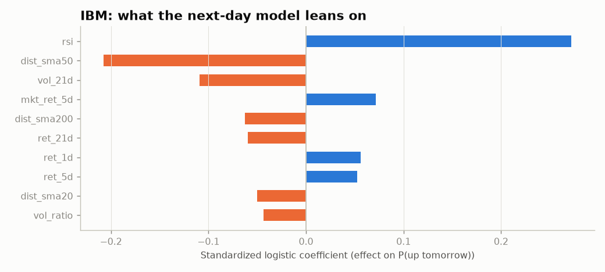
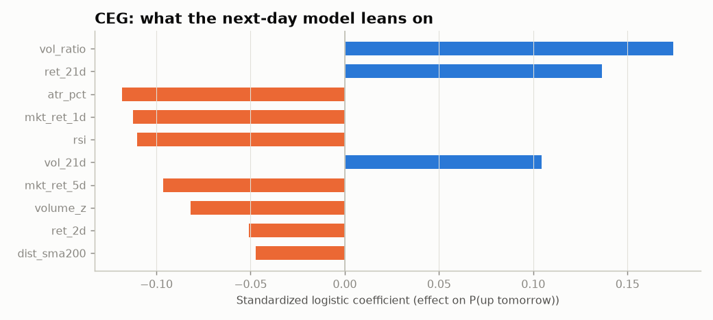
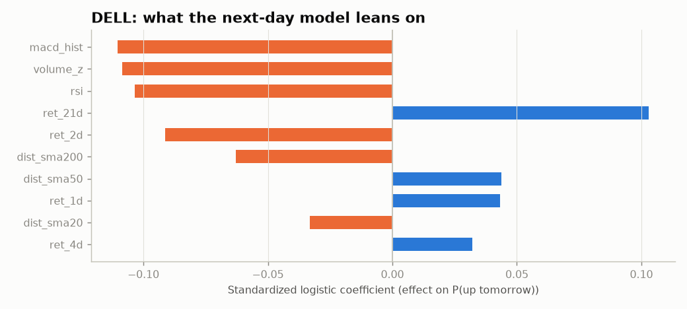

# stocklab report
Generated 2026-11-17 | data source: `yahoo` | history: 5 years | watchlist: ALAB, AMD, NVDA, MRVL, GOOG, FSLR, SKHY, ETN, TSLA, SPCX, AMZN, IBM, GEV, CEG, VST, DELL, TSM, BE

> Educational research code, not investment advice. Past results do not predict future returns.

## 1. Decision board

Data as of the 2026-11-16 close. `*` = provisional (under 200 trading days of history).

| ticker | action | close | 1 day | 1 month | buy rank | sell warnings | pullback entry | breakout | stop | why |
|---|---|---|---|---|---|---|---|---|---|---|
| AMZN | BUY | 257.75 | -3.3% | +3.1% | 5/18 | 1/15 | 257.10 | 271.41 | 238.81 | buy rank 5/18; +5% vs 200-day average; distribution days |
| AMD | WATCH | 504.28 | -5.6% | -4.6% | 2/18 | 4/15 | 463.00 | 586.47 | 380.44 | +19% vs 200-day average; below 50-day, distribution days, 20%+ off high, volatility spike |
| CEG | WATCH | 277.82 | -0.7% | +2.5% | 10/18 | 4/15 | 268.68 | 282.53 | 242.63 | +0% vs 200-day average; death cross, distribution days, 20%+ off high |
| BE | AVOID | 177.28 | -7.7% | -19.9% | 15/18 | 5/15 |  |  |  | -21% vs 200-day average; below 50-day, below 200-day, distribution days, 20%+ off high |
| SPCX | REDUCE* | 137.36 | -1.3% | -5.9% | 6/18 | 5/10 |  |  |  | -8% vs 50-day average; below 50-day, distribution days, 20%+ off high, below chandelier stop (provisional: 109 days of history) |
| IBM | REDUCE | 242.51 | -1.9% | +5.2% | 7/18 | 6/15 |  |  |  | -0% vs 200-day average; below 200-day, death cross, MACD bearish, 20%+ off high |
| ALAB | REDUCE | 202.34 | -8.8% | -29.2% | 8/18 | 8/15 |  |  |  | -21% vs 200-day average; below 50-day, below 200-day, MACD bearish, distribution days, 20%+ off high, below chandelier stop |
| TSLA | REDUCE | 379.74 | -2.7% | +7.1% | 12/18 | 7/15 |  |  |  | -1% vs 200-day average; below 200-day, death cross, MACD bearish, distribution days, 20%+ off high |
| DELL | SELL | 320.55 | -7.0% | -28.9% | 1/18 | 9/15 |  |  |  | -7% vs 200-day average; below 50-day, below 200-day, MACD bearish, distribution days, 20%+ off high, volatility spike, below chandelier stop |
| MRVL | SELL | 145.36 | -7.3% | -36.2% | 3/18 | 9/15 |  |  |  | -22% vs 200-day average; below 50-day, below 200-day, MACD bearish, distribution days, 20%+ off high, volatility spike, below chandelier stop |
| TSM | SELL | 373.45 | -6.3% | -9.5% | 4/18 | 11/15 |  |  |  | -7% vs 200-day average; below 50-day, below 200-day, MACD bearish, distribution days, high-volume breakdown, 20%+ off high, volatility spike, below chandelier stop |
| ETN | SELL | 336.88 | -4.6% | -13.6% | 9/18 | 9/15 |  |  |  | -15% vs 200-day average; below 50-day, below 200-day, MACD bearish, distribution days, 20%+ off high, volatility spike, below chandelier stop |
| GEV | SELL | 763.57 | -4.9% | -17.1% | 11/18 | 11/15 |  |  |  | -20% vs 200-day average; below 50-day, below 200-day, death cross, MACD bearish, distribution days, 20%+ off high, volatility spike, below chandelier stop |
| GOOG | SELL | 281.26 | -3.8% | -16.5% | 13/18 | 10/15 |  |  |  | -16% vs 200-day average; below 50-day, below 200-day, death cross, distribution days, 20%+ off high, volatility spike, below chandelier stop |
| NVDA | SELL | 156.14 | -4.1% | -27.1% | 14/18 | 10/15 |  |  |  | -23% vs 200-day average; below 50-day, below 200-day, MACD bearish, distribution days, high-volume breakdown, 20%+ off high, below chandelier stop |
| VST | SELL | 130.16 | -2.1% | -14.4% | 16/18 | 10/15 |  |  |  | -14% vs 200-day average; below 50-day, below 200-day, death cross, distribution days, 20%+ off high, volatility spike, below chandelier stop |
| SKHY | SELL* | 122.18 | -7.3% | -10.5% | 17/18 | 6/10 |  |  |  | -25% vs 50-day average; below 50-day, MACD bearish, distribution days, 20%+ off high, below chandelier stop (provisional: 91 days of history) |
| FSLR | SELL | 162.45 | -5.2% | -5.9% | 18/18 | 10/15 |  |  |  | -24% vs 200-day average; below 50-day, below 200-day, death cross, MACD bearish, distribution days, 20%+ off high, below chandelier stop |


**Trading the labels** (2022-02-11 to 2026-11-16): buy on BUY, exit on SELL, REDUCE or AVOID, reviewed weekly with next-day execution and 5 bp costs.

| strategy | CAGR | Volatility | Sharpe | Max drawdown | Time invested | Avg holdings |
|---|---|---|---|---|---|---|
| Board strategy | +38.3% | 34.0% | 1.12 | -37.9% | 100% | 6.6 |
| Equal-weight watchlist | +43.7% | 34.3% | 1.23 | -36.8% | 100% | 15.0 |
| SPY (buy & hold) | +13.2% | 17.3% | 0.80 | -22.1% |  |  |

Sharpe difference vs equal weight: -0.11, 95% block-bootstrap CI [-0.59, +0.35].

Forward 21-day return after each label, relative to the watchlist average on the same date (sampled every 21 days, t-test across dates):

| label | observations | dates | mean 21d excess return | hit rate | p_value |
|---|---|---|---|---|---|
| BUY | 242 | 52 | -0.7% | 54% | 0.54 |
| HOLD | 120 | 41 | -0.9% | 41% | 0.50 |
| WATCH | 175 | 52 | +1.7% | 54% | 0.31 |
| AVOID | 37 | 21 | +3.1% | 57% | 0.21 |
| REDUCE | 174 | 51 | -1.9% | 41% | 0.13 |
| SELL | 90 | 37 | -1.0% | 43% | 0.66 |


## 2. Sell check, stock by stock

```
ALAB  REDUCE  (score 8/15, close 202.34 on 2026-11-16)
  RSI 36 | -58.1% from 52-week high
  Triggered:
    - [trend] Close below the 50-day moving average (+1)
    - [trend] Close below the 200-day moving average (+2)
    - [momentum] MACD line below its signal line (+1)
    - [volume] 5+ distribution days in the last 25 sessions (institutional selling) (+1)
    - [risk] 20%+ below the 52-week high (+1)
    - [risk] Close below the chandelier stop (22-day high minus 3x ATR) (+2)
  Levels to watch:
    50-day SMA                 292.10  (price is below, -30.7%)
    200-day SMA                257.72  (price is below, -21.5%)
    Chandelier stop            229.20  (price is below, -11.7%)
```

```
AMD  WATCH  (score 4/15, close 504.28 on 2026-11-16)
  RSI 47 | -22.3% from 52-week high
  Triggered:
    - [trend] Close below the 50-day moving average (+1)
    - [volume] 5+ distribution days in the last 25 sessions (institutional selling) (+1)
    - [risk] 20%+ below the 52-week high (+1)
    - [risk] 21-day volatility 1.5x+ its 1-year median (+1)
  Levels to watch:
    50-day SMA                 555.09  (price is below, -9.2%)
    Chandelier stop            470.16  (price is above, +7.3%)
    200-day SMA                424.46  (price is above, +18.8%)
```

```
NVDA  EXIT  (score 10/15, close 156.14 on 2026-11-16)
  RSI 23 | -34.7% from 52-week high
  Triggered:
    - [trend] Close below the 50-day moving average (+1)
    - [trend] Close below the 200-day moving average (+2)
    - [momentum] MACD line below its signal line (+1)
    - [volume] 5+ distribution days in the last 25 sessions (institutional selling) (+1)
    - [volume] Down day closing below the 50-day average on 1.5x+ average volume (+2)
    - [risk] 20%+ below the 52-week high (+1)
    - [risk] Close below the chandelier stop (22-day high minus 3x ATR) (+2)
  Levels to watch:
    50-day SMA                 213.15  (price is below, -26.7%)
    200-day SMA                203.75  (price is below, -23.4%)
    Chandelier stop            192.63  (price is below, -18.9%)
```

```
MRVL  EXIT  (score 9/15, close 145.36 on 2026-11-16)
  RSI 33 | -54.0% from 52-week high
  Triggered:
    - [trend] Close below the 50-day moving average (+1)
    - [trend] Close below the 200-day moving average (+2)
    - [momentum] MACD line below its signal line (+1)
    - [volume] 5+ distribution days in the last 25 sessions (institutional selling) (+1)
    - [risk] 20%+ below the 52-week high (+1)
    - [risk] 21-day volatility 1.5x+ its 1-year median (+1)
    - [risk] Close below the chandelier stop (22-day high minus 3x ATR) (+2)
  Levels to watch:
    50-day SMA                 227.62  (price is below, -36.1%)
    Chandelier stop            203.10  (price is below, -28.4%)
    200-day SMA                187.26  (price is below, -22.4%)
```

```
GOOG  EXIT  (score 10/15, close 281.26 on 2026-11-16)
  RSI 34 | -29.4% from 52-week high
  Triggered:
    - [trend] Close below the 50-day moving average (+1)
    - [trend] Close below the 200-day moving average (+2)
    - [trend] 50-day average below the 200-day average (+2)
    - [volume] 5+ distribution days in the last 25 sessions (institutional selling) (+1)
    - [risk] 20%+ below the 52-week high (+1)
    - [risk] 21-day volatility 1.5x+ its 1-year median (+1)
    - [risk] Close below the chandelier stop (22-day high minus 3x ATR) (+2)
  Levels to watch:
    200-day SMA                335.85  (price is below, -16.3%)
    50-day SMA                 324.03  (price is below, -13.2%)
    Chandelier stop            315.80  (price is below, -10.9%)
```

```
FSLR  EXIT  (score 10/15, close 162.45 on 2026-11-16)
  RSI 35 | -49.0% from 52-week high
  Triggered:
    - [trend] Close below the 50-day moving average (+1)
    - [trend] Close below the 200-day moving average (+2)
    - [trend] 50-day average below the 200-day average (+2)
    - [momentum] MACD line below its signal line (+1)
    - [volume] 5+ distribution days in the last 25 sessions (institutional selling) (+1)
    - [risk] 20%+ below the 52-week high (+1)
    - [risk] Close below the chandelier stop (22-day high minus 3x ATR) (+2)
  Levels to watch:
    200-day SMA                212.84  (price is below, -23.7%)
    Chandelier stop            184.93  (price is below, -12.2%)
    50-day SMA                 183.72  (price is below, -11.6%)
```

```
SKHY  EXIT  (score 6/10, close 122.18 on 2026-11-16)
  RSI 38 | -38.5% from high since listing
  Only 91 trading days of history; not scored yet: below_sma200, death_cross, volatility_spike
  Triggered:
    - [trend] Close below the 50-day moving average (+1)
    - [momentum] MACD line below its signal line (+1)
    - [volume] 5+ distribution days in the last 25 sessions (institutional selling) (+1)
    - [risk] 20%+ below the high since listing (+1)
    - [risk] Close below the chandelier stop (22-day high minus 3x ATR) (+2)
  Levels to watch:
    50-day SMA                 162.91  (price is below, -25.0%)
    Chandelier stop            135.52  (price is below, -9.8%)
```

```
ETN  EXIT  (score 9/15, close 336.88 on 2026-11-16)
  RSI 38 | -26.5% from 52-week high
  Triggered:
    - [trend] Close below the 50-day moving average (+1)
    - [trend] Close below the 200-day moving average (+2)
    - [momentum] MACD line below its signal line (+1)
    - [volume] 5+ distribution days in the last 25 sessions (institutional selling) (+1)
    - [risk] 20%+ below the 52-week high (+1)
    - [risk] 21-day volatility 1.5x+ its 1-year median (+1)
    - [risk] Close below the chandelier stop (22-day high minus 3x ATR) (+2)
  Levels to watch:
    50-day SMA                 398.73  (price is below, -15.5%)
    200-day SMA                395.42  (price is below, -14.8%)
    Chandelier stop            347.38  (price is below, -3.0%)
```

```
TSLA  REDUCE  (score 7/15, close 379.74 on 2026-11-16)
  RSI 49 | -22.5% from 52-week high
  Triggered:
    - [trend] Close below the 200-day moving average (+2)
    - [trend] 50-day average below the 200-day average (+2)
    - [momentum] MACD line below its signal line (+1)
    - [volume] 5+ distribution days in the last 25 sessions (institutional selling) (+1)
    - [risk] 20%+ below the 52-week high (+1)
  Levels to watch:
    200-day SMA                382.48  (price is below, -0.7%)
    50-day SMA                 375.25  (price is above, +1.2%)
    Chandelier stop            364.56  (price is above, +4.2%)
```

```
SPCX  REDUCE  (score 5/10, close 137.36 on 2026-11-16)
  RSI 45 | -35.0% from high since listing
  Only 109 trading days of history; not scored yet: below_sma200, death_cross, volatility_spike
  Triggered:
    - [trend] Close below the 50-day moving average (+1)
    - [volume] 5+ distribution days in the last 25 sessions (institutional selling) (+1)
    - [risk] 20%+ below the high since listing (+1)
    - [risk] Close below the chandelier stop (22-day high minus 3x ATR) (+2)
  Levels to watch:
    50-day SMA                 148.69  (price is below, -7.6%)
    Chandelier stop            142.60  (price is below, -3.7%)
```

```
AMZN  HOLD  (score 1/15, close 257.75 on 2026-11-16)
  RSI 50 | -9.2% from 52-week high
  Triggered:
    - [volume] 5+ distribution days in the last 25 sessions (institutional selling) (+1)
  Levels to watch:
    50-day SMA                 254.80  (price is above, +1.2%)
    Chandelier stop            247.90  (price is above, +4.0%)
    200-day SMA                244.69  (price is above, +5.3%)
```

```
IBM  REDUCE  (score 6/15, close 242.51 on 2026-11-16)
  RSI 49 | -25.3% from 52-week high
  Triggered:
    - [trend] Close below the 200-day moving average (+2)
    - [trend] 50-day average below the 200-day average (+2)
    - [momentum] MACD line below its signal line (+1)
    - [risk] 20%+ below the 52-week high (+1)
  Levels to watch:
    200-day SMA                242.92  (price is below, -0.2%)
    Chandelier stop            238.92  (price is above, +1.5%)
    50-day SMA                 236.71  (price is above, +2.5%)
```

```
GEV  EXIT  (score 11/15, close 763.57 on 2026-11-16)
  RSI 37 | -35.0% from 52-week high
  Triggered:
    - [trend] Close below the 50-day moving average (+1)
    - [trend] Close below the 200-day moving average (+2)
    - [trend] 50-day average below the 200-day average (+2)
    - [momentum] MACD line below its signal line (+1)
    - [volume] 5+ distribution days in the last 25 sessions (institutional selling) (+1)
    - [risk] 20%+ below the 52-week high (+1)
    - [risk] 21-day volatility 1.5x+ its 1-year median (+1)
    - [risk] Close below the chandelier stop (22-day high minus 3x ATR) (+2)
  Levels to watch:
    200-day SMA                951.16  (price is below, -19.7%)
    50-day SMA                 909.23  (price is below, -16.0%)
    Chandelier stop            781.66  (price is below, -2.3%)
```

```
CEG  WATCH  (score 4/15, close 277.82 on 2026-11-16)
  RSI 55 | -26.2% from 52-week high
  Triggered:
    - [trend] 50-day average below the 200-day average (+2)
    - [volume] 5+ distribution days in the last 25 sessions (institutional selling) (+1)
    - [risk] 20%+ below the 52-week high (+1)
  Levels to watch:
    200-day SMA                277.46  (price is above, +0.1%)
    50-day SMA                 268.68  (price is above, +3.4%)
    Chandelier stop            245.46  (price is above, +13.2%)
```

```
VST  EXIT  (score 10/15, close 130.16 on 2026-11-16)
  RSI 44 | -27.4% from 52-week high
  Triggered:
    - [trend] Close below the 50-day moving average (+1)
    - [trend] Close below the 200-day moving average (+2)
    - [trend] 50-day average below the 200-day average (+2)
    - [volume] 5+ distribution days in the last 25 sessions (institutional selling) (+1)
    - [risk] 20%+ below the 52-week high (+1)
    - [risk] 21-day volatility 1.5x+ its 1-year median (+1)
    - [risk] Close below the chandelier stop (22-day high minus 3x ATR) (+2)
  Levels to watch:
    200-day SMA                151.44  (price is below, -14.0%)
    50-day SMA                 142.79  (price is below, -8.8%)
    Chandelier stop            135.63  (price is below, -4.0%)
```

```
DELL  EXIT  (score 9/15, close 320.55 on 2026-11-16)
  RSI 33 | -45.4% from 52-week high
  Triggered:
    - [trend] Close below the 50-day moving average (+1)
    - [trend] Close below the 200-day moving average (+2)
    - [momentum] MACD line below its signal line (+1)
    - [volume] 5+ distribution days in the last 25 sessions (institutional selling) (+1)
    - [risk] 20%+ below the 52-week high (+1)
    - [risk] 21-day volatility 1.5x+ its 1-year median (+1)
    - [risk] Close below the chandelier stop (22-day high minus 3x ATR) (+2)
  Levels to watch:
    50-day SMA                 488.98  (price is below, -34.4%)
    Chandelier stop            401.85  (price is below, -20.2%)
    200-day SMA                343.65  (price is below, -6.7%)
```

```
TSM  EXIT  (score 11/15, close 373.45 on 2026-11-16)
  RSI 39 | -23.1% from 52-week high
  Triggered:
    - [trend] Close below the 50-day moving average (+1)
    - [trend] Close below the 200-day moving average (+2)
    - [momentum] MACD line below its signal line (+1)
    - [volume] 5+ distribution days in the last 25 sessions (institutional selling) (+1)
    - [volume] Down day closing below the 50-day average on 1.5x+ average volume (+2)
    - [risk] 20%+ below the 52-week high (+1)
    - [risk] 21-day volatility 1.5x+ its 1-year median (+1)
    - [risk] Close below the chandelier stop (22-day high minus 3x ATR) (+2)
  Levels to watch:
    50-day SMA                 428.86  (price is below, -12.9%)
    200-day SMA                401.90  (price is below, -7.1%)
    Chandelier stop            387.60  (price is below, -3.7%)
```

```
BE  WATCH  (score 5/15, close 177.28 on 2026-11-16)
  RSI 40 | -48.7% from 52-week high
  Triggered:
    - [trend] Close below the 50-day moving average (+1)
    - [trend] Close below the 200-day moving average (+2)
    - [volume] 5+ distribution days in the last 25 sessions (institutional selling) (+1)
    - [risk] 20%+ below the 52-week high (+1)
  Levels to watch:
    50-day SMA                 242.54  (price is below, -26.9%)
    200-day SMA                223.66  (price is below, -20.7%)
    Chandelier stop            177.06  (price is above, +0.1%)
```

## 3. Which sell signals actually work? (event study)

Panel: 46 stocks, 5 years. Null hypothesis: returns after a signal look like returns on random days from the same stocks.

| rule | horizon | events | mean_after_signal | mean_random_days | difference | p_value | q_value | drop10_after_signal | drop10_base_rate | verdict |
|---|---|---|---|---|---|---|---|---|---|---|
| below_sma50 | 5d | 1076 | +0.48% | +0.69% | -0.21% | 0.142 | 0.669 | 40% | 36% | weak (not significant) |
| below_sma50 | 21d | 1061 | +2.26% | +3.09% | -0.83% | 0.019 | 0.247 | 40% | 36% | weak (not significant) |
| below_sma50 | 63d | 1001 | +8.65% | +10.20% | -1.55% | 0.022 | 0.247 | 40% | 36% | weak (not significant) |
| below_sma200 | 5d | 521 | +0.91% | +0.63% | +0.29% | 0.854 | 1.000 | 38% | 36% | no edge |
| below_sma200 | 21d | 503 | +1.63% | +2.77% | -1.15% | 0.021 | 0.247 | 38% | 36% | weak (not significant) |
| below_sma200 | 63d | 474 | +9.58% | +9.03% | +0.54% | 0.693 | 1.000 | 38% | 36% | no edge |
| death_cross | 5d | 156 | +1.62% | +0.65% | +0.97% | 0.981 | 1.000 | 42% | 36% | no edge |
| death_cross | 21d | 148 | +2.54% | +2.90% | -0.36% | 0.366 | 0.872 | 42% | 36% | weak (not significant) |
| death_cross | 63d | 142 | +14.89% | +9.69% | +5.20% | 0.988 | 1.000 | 42% | 36% | no edge |
| rsi_divergence | 5d | 502 | +0.43% | +0.79% | -0.36% | 0.098 | 0.663 | 37% | 36% | weak (not significant) |
| rsi_divergence | 21d | 495 | +3.26% | +3.49% | -0.23% | 0.357 | 0.872 | 37% | 36% | weak (not significant) |
| rsi_divergence | 63d | 487 | +10.96% | +11.68% | -0.72% | 0.271 | 0.872 | 37% | 36% | weak (not significant) |
| rsi_rollover | 5d | 644 | +1.84% | +0.76% | +1.07% | 1.000 | 1.000 | 33% | 36% | no edge |
| rsi_rollover | 21d | 634 | +3.70% | +3.43% | +0.26% | 0.699 | 1.000 | 33% | 36% | no edge |
| rsi_rollover | 63d | 621 | +10.41% | +11.59% | -1.18% | 0.133 | 0.669 | 33% | 36% | weak (not significant) |
| macd_bearish | 5d | 1623 | +0.99% | +0.72% | +0.27% | 0.956 | 1.000 | 35% | 36% | no edge |
| macd_bearish | 21d | 1605 | +3.40% | +3.24% | +0.16% | 0.677 | 1.000 | 35% | 36% | no edge |
| macd_bearish | 63d | 1524 | +11.53% | +10.74% | +0.78% | 0.879 | 1.000 | 35% | 36% | no edge |
| distribution_cluster | 5d | 1078 | +0.67% | +0.73% | -0.05% | 0.395 | 0.872 | 36% | 36% | weak (not significant) |
| distribution_cluster | 21d | 1064 | +2.83% | +3.25% | -0.42% | 0.166 | 0.684 | 36% | 36% | weak (not significant) |
| distribution_cluster | 63d | 1022 | +10.25% | +10.90% | -0.66% | 0.218 | 0.799 | 36% | 36% | weak (not significant) |
| high_volume_breakdown | 5d | 766 | +0.82% | +0.68% | +0.14% | 0.734 | 1.000 | 34% | 36% | no edge |
| high_volume_breakdown | 21d | 733 | +3.63% | +3.02% | +0.61% | 0.886 | 1.000 | 34% | 36% | no edge |
| high_volume_breakdown | 63d | 701 | +12.60% | +10.11% | +2.48% | 0.994 | 1.000 | 34% | 36% | no edge |
| drawdown_20 | 5d | 408 | +1.86% | +0.83% | +1.03% | 0.998 | 1.000 | 51% | 36% | no edge |
| drawdown_20 | 21d | 398 | +2.75% | +3.78% | -1.02% | 0.100 | 0.663 | 51% | 36% | weak (not significant) |
| drawdown_20 | 63d | 376 | +13.91% | +12.76% | +1.15% | 0.765 | 1.000 | 51% | 36% | no edge |
| volatility_spike | 5d | 348 | +0.96% | +0.77% | +0.19% | 0.710 | 1.000 | 47% | 36% | no edge |
| volatility_spike | 21d | 330 | +3.19% | +3.39% | -0.20% | 0.396 | 0.872 | 47% | 36% | weak (not significant) |
| volatility_spike | 63d | 329 | +10.81% | +11.40% | -0.59% | 0.351 | 0.872 | 47% | 36% | weak (not significant) |
| chandelier_stop | 5d | 1364 | +0.91% | +0.72% | +0.19% | 0.879 | 1.000 | 37% | 36% | no edge |
| chandelier_stop | 21d | 1345 | +3.50% | +3.24% | +0.26% | 0.755 | 1.000 | 37% | 36% | no edge |
| chandelier_stop | 63d | 1278 | +12.15% | +10.79% | +1.36% | 0.969 | 1.000 | 37% | 36% | no edge |

**0 of 33 rule-by-horizon tests** show significantly weaker returns after the signal (q < 0.10).


## 4. Strategy backtests

Not included: SKHY (only 91 trading days of history, needs 452); SPCX (only 109 trading days of history, needs 452).

### ALAB (2025-01-03 to 2026-11-16)

| strategy | Total return | CAGR | Max drawdown | Volatility | Sharpe | Round trips | Time in market | Sharpe vs B&H | 95% CI | p-value |
|---|---|---|---|---|---|---|---|---|---|---|
| Buy & Hold | +40.8% | +20.2% | -63.2% | +97.1% | 0.68 | 0 | 100% |  |  |  |
| 50/200 SMA cross | -69.1% | -46.8% | -74.0% | +87.8% | -0.28 | 2 | 76% | -0.95 | [-1.87, -0.25] | 0.02 |
| Close > 50-day SMA | +7.6% | +4.0% | -66.4% | +69.7% | 0.41 | 10 | 51% | -0.27 | [-1.34, +0.68] | 0.59 |
| MACD > signal | +14.8% | +7.7% | -70.4% | +65.0% | 0.44 | 21 | 49% | -0.24 | [-1.39, +0.94] | 0.68 |
| RSI 30/70 | +3.7% | +2.0% | -50.3% | +37.9% | 0.24 | 1 | 17% | -0.44 | [-2.17, +1.29] | 0.61 |
| Trailing stop 20% | -11.8% | -6.5% | -69.1% | +71.7% | 0.27 | 10 | 55% | -0.41 | [-1.52, +0.56] | 0.43 |
| Volume breakout | +91.8% | +41.9% | -55.7% | +63.0% | 0.87 | 4 | 41% | +0.19 | [-0.98, +1.36] | 0.74 |

### AMD (2022-09-02 to 2026-11-16)

| strategy | Total return | CAGR | Max drawdown | Volatility | Sharpe | Round trips | Time in market | Sharpe vs B&H | 95% CI | p-value |
|---|---|---|---|---|---|---|---|---|---|---|
| Buy & Hold | +540.3% | +55.8% | -63.0% | +58.6% | 1.05 | 0 | 100% |  |  |  |
| 50/200 SMA cross | +372.8% | +44.9% | -39.1% | +49.1% | 1.00 | 1 | 65% | -0.05 | [-0.60, +0.46] | 0.85 |
| Close > 50-day SMA | +147.5% | +24.2% | -49.9% | +44.0% | 0.71 | 36 | 54% | -0.34 | [-0.94, +0.27] | 0.28 |
| MACD > signal | +281.5% | +37.7% | -42.4% | +41.7% | 0.97 | 39 | 50% | -0.08 | [-0.62, +0.44] | 0.77 |
| RSI 30/70 | +46.2% | +9.5% | -54.7% | +32.6% | 0.44 | 3 | 33% | -0.61 | [-1.62, +0.27] | 0.21 |
| Trailing stop 20% | +152.8% | +24.8% | -58.9% | +49.8% | 0.69 | 11 | 71% | -0.36 | [-0.87, +0.15] | 0.19 |
| Volume breakout | +162.0% | +25.9% | -36.9% | +37.2% | 0.80 | 10 | 38% | -0.24 | [-0.93, +0.35] | 0.46 |

### NVDA (2022-09-02 to 2026-11-16)

| strategy | Total return | CAGR | Max drawdown | Volatility | Sharpe | Round trips | Time in market | Sharpe vs B&H | 95% CI | p-value |
|---|---|---|---|---|---|---|---|---|---|---|
| Buy & Hold | +1063.5% | +79.7% | -36.9% | +49.0% | 1.44 | 0 | 100% |  |  |  |
| 50/200 SMA cross | +503.0% | +53.6% | -34.7% | +43.3% | 1.21 | 1 | 84% | -0.23 | [-0.70, +0.17] | 0.29 |
| Close > 50-day SMA | +346.8% | +43.0% | -39.1% | +39.0% | 1.11 | 38 | 69% | -0.33 | [-0.90, +0.25] | 0.26 |
| MACD > signal | +152.9% | +24.8% | -46.7% | +34.4% | 0.81 | 40 | 51% | -0.62 | [-1.33, +0.13] | 0.09 |
| RSI 30/70 | +39.5% | +8.3% | -22.6% | +18.8% | 0.51 | 2 | 8% | -0.92 | [-2.07, -0.02] | 0.07 |
| Trailing stop 20% | +640.9% | +61.3% | -36.6% | +44.9% | 1.29 | 8 | 90% | -0.15 | [-0.56, +0.16] | 0.41 |
| Volume breakout | +211.5% | +31.2% | -19.8% | +26.3% | 1.16 | 7 | 31% | -0.28 | [-1.11, +0.51] | 0.53 |

### MRVL (2022-09-02 to 2026-11-16)

| strategy | Total return | CAGR | Max drawdown | Volatility | Sharpe | Round trips | Time in market | Sharpe vs B&H | 95% CI | p-value |
|---|---|---|---|---|---|---|---|---|---|---|
| Buy & Hold | +227.0% | +32.7% | -60.8% | +67.4% | 0.75 | 0 | 100% |  |  |  |
| 50/200 SMA cross | +41.5% | +8.6% | -65.2% | +57.7% | 0.43 | 2 | 68% | -0.32 | [-0.81, +0.10] | 0.18 |
| Close > 50-day SMA | +65.8% | +12.8% | -51.5% | +52.7% | 0.49 | 36 | 58% | -0.27 | [-0.85, +0.27] | 0.36 |
| MACD > signal | +101.6% | +18.2% | -62.5% | +50.2% | 0.58 | 44 | 51% | -0.18 | [-0.89, +0.49] | 0.63 |
| RSI 30/70 | +51.3% | +10.4% | -32.1% | +29.4% | 0.49 | 2 | 20% | -0.27 | [-1.16, +0.76] | 0.59 |
| Trailing stop 20% | +79.0% | +14.9% | -53.3% | +57.0% | 0.52 | 15 | 77% | -0.23 | [-0.75, +0.21] | 0.35 |
| Volume breakout | +76.0% | +14.5% | -46.2% | +42.0% | 0.53 | 11 | 36% | -0.23 | [-1.10, +0.52] | 0.60 |

### GOOG (2022-09-02 to 2026-11-16)

| strategy | Total return | CAGR | Max drawdown | Volatility | Sharpe | Round trips | Time in market | Sharpe vs B&H | 95% CI | p-value |
|---|---|---|---|---|---|---|---|---|---|---|
| Buy & Hold | +164.0% | +26.1% | -30.2% | +31.7% | 0.89 | 0 | 100% |  |  |  |
| 50/200 SMA cross | +151.5% | +24.6% | -29.4% | +25.9% | 0.98 | 2 | 76% | +0.09 | [-0.38, +0.58] | 0.72 |
| Close > 50-day SMA | +85.6% | +15.9% | -22.2% | +23.6% | 0.74 | 34 | 63% | -0.15 | [-0.84, +0.54] | 0.67 |
| MACD > signal | +30.8% | +6.6% | -20.5% | +21.6% | 0.41 | 42 | 50% | -0.48 | [-1.16, +0.16] | 0.16 |
| RSI 30/70 | +28.3% | +6.1% | -20.4% | +18.3% | 0.42 | 4 | 25% | -0.47 | [-1.33, +0.39] | 0.27 |
| Trailing stop 20% | +47.0% | +9.6% | -40.4% | +29.7% | 0.46 | 6 | 92% | -0.43 | [-0.87, -0.05] | 0.04 |
| Volume breakout | +105.6% | +18.8% | -17.4% | +19.4% | 0.98 | 8 | 46% | +0.09 | [-0.71, +0.91] | 0.82 |

### FSLR (2022-09-02 to 2026-11-16)

| strategy | Total return | CAGR | Max drawdown | Volatility | Sharpe | Round trips | Time in market | Sharpe vs B&H | 95% CI | p-value |
|---|---|---|---|---|---|---|---|---|---|---|
| Buy & Hold | +27.3% | +5.9% | -60.0% | +55.2% | 0.38 | 0 | 100% |  |  |  |
| 50/200 SMA cross | +10.2% | +2.4% | -51.1% | +41.7% | 0.26 | 4 | 59% | -0.12 | [-0.74, +0.45] | 0.69 |
| Close > 50-day SMA | +30.2% | +6.5% | -46.8% | +40.4% | 0.35 | 29 | 50% | -0.02 | [-0.57, +0.53] | 0.95 |
| MACD > signal | -61.6% | -20.4% | -74.1% | +40.8% | -0.36 | 48 | 50% | -0.73 | [-1.40, -0.02] | 0.04 |
| RSI 30/70 | +30.1% | +6.5% | -42.8% | +30.4% | 0.35 | 2 | 27% | -0.02 | [-1.00, +0.79] | 0.96 |
| Trailing stop 20% | +6.3% | +1.5% | -54.7% | +45.3% | 0.25 | 11 | 69% | -0.12 | [-0.62, +0.36] | 0.62 |
| Volume breakout | -28.7% | -7.8% | -53.8% | +32.2% | -0.09 | 14 | 37% | -0.47 | [-1.32, +0.31] | 0.28 |

### ETN (2022-09-02 to 2026-11-16)

| strategy | Total return | CAGR | Max drawdown | Volatility | Sharpe | Round trips | Time in market | Sharpe vs B&H | 95% CI | p-value |
|---|---|---|---|---|---|---|---|---|---|---|
| Buy & Hold | +158.1% | +25.4% | -34.5% | +34.0% | 0.84 | 0 | 100% |  |  |  |
| 50/200 SMA cross | +59.8% | +11.8% | -35.7% | +30.5% | 0.52 | 2 | 83% | -0.32 | [-0.72, +0.01] | 0.09 |
| Close > 50-day SMA | +33.3% | +7.1% | -37.5% | +24.5% | 0.40 | 44 | 65% | -0.43 | [-1.07, +0.22] | 0.18 |
| MACD > signal | +37.3% | +7.9% | -25.8% | +22.4% | 0.45 | 48 | 50% | -0.39 | [-1.11, +0.29] | 0.27 |
| RSI 30/70 | +15.7% | +3.6% | -18.6% | +11.5% | 0.36 | 1 | 5% | -0.48 | [-1.41, +0.61] | 0.34 |
| Trailing stop 20% | +183.6% | +28.3% | -23.6% | +30.9% | 0.96 | 2 | 94% | +0.13 | [-0.09, +0.36] | 0.31 |
| Volume breakout | +21.6% | +4.8% | -29.3% | +18.1% | 0.35 | 10 | 38% | -0.49 | [-1.26, +0.38] | 0.26 |

### TSLA (2022-09-02 to 2026-11-16)

| strategy | Total return | CAGR | Max drawdown | Volatility | Sharpe | Round trips | Time in market | Sharpe vs B&H | 95% CI | p-value |
|---|---|---|---|---|---|---|---|---|---|---|
| Buy & Hold | +38.3% | +8.1% | -65.0% | +58.3% | 0.42 | 0 | 100% |  |  |  |
| 50/200 SMA cross | -26.4% | -7.1% | -56.8% | +40.1% | 0.01 | 4 | 47% | -0.41 | [-1.30, +0.42] | 0.33 |
| Close > 50-day SMA | +56.8% | +11.3% | -41.1% | +38.5% | 0.47 | 42 | 52% | +0.05 | [-0.71, +0.82] | 0.91 |
| MACD > signal | +396.5% | +46.6% | -39.8% | +40.8% | 1.14 | 42 | 51% | +0.72 | [+0.08, +1.42] | 0.04 |
| RSI 30/70 | +47.5% | +9.7% | -52.7% | +40.3% | 0.43 | 4 | 43% | +0.01 | [-0.73, +0.72] | 0.98 |
| Trailing stop 20% | +41.0% | +8.6% | -47.9% | +45.0% | 0.41 | 11 | 71% | -0.02 | [-0.67, +0.59] | 0.96 |
| Volume breakout | +40.5% | +8.5% | -35.4% | +25.7% | 0.44 | 9 | 18% | +0.02 | [-0.91, +0.93] | 0.97 |

### AMZN (2022-09-02 to 2026-11-16)

| strategy | Total return | CAGR | Max drawdown | Volatility | Sharpe | Round trips | Time in market | Sharpe vs B&H | 95% CI | p-value |
|---|---|---|---|---|---|---|---|---|---|---|
| Buy & Hold | +104.3% | +18.6% | -40.0% | +34.1% | 0.67 | 0 | 100% |  |  |  |
| 50/200 SMA cross | +32.5% | +7.0% | -41.4% | +27.9% | 0.38 | 2 | 74% | -0.29 | [-0.90, +0.34] | 0.34 |
| Close > 50-day SMA | +31.1% | +6.7% | -41.4% | +23.3% | 0.39 | 35 | 63% | -0.28 | [-1.00, +0.39] | 0.45 |
| MACD > signal | -3.8% | -0.9% | -28.7% | +22.8% | 0.07 | 50 | 50% | -0.60 | [-1.31, +0.09] | 0.09 |
| RSI 30/70 | +94.0% | +17.1% | -22.0% | +21.6% | 0.84 | 4 | 33% | +0.17 | [-0.53, +0.90] | 0.66 |
| Trailing stop 20% | +109.6% | +19.3% | -24.2% | +29.9% | 0.74 | 3 | 87% | +0.07 | [-0.35, +0.51] | 0.74 |
| Volume breakout | +3.1% | +0.7% | -36.1% | +18.8% | 0.13 | 11 | 45% | -0.54 | [-1.48, +0.36] | 0.25 |

### IBM (2022-09-02 to 2026-11-16)

| strategy | Total return | CAGR | Max drawdown | Volatility | Sharpe | Round trips | Time in market | Sharpe vs B&H | 95% CI | p-value |
|---|---|---|---|---|---|---|---|---|---|---|
| Buy & Hold | +121.9% | +21.0% | -37.5% | +31.5% | 0.77 | 0 | 100% |  |  |  |
| 50/200 SMA cross | +66.1% | +12.9% | -28.7% | +22.8% | 0.65 | 3 | 72% | -0.12 | [-0.80, +0.55] | 0.73 |
| Close > 50-day SMA | +52.5% | +10.6% | -42.6% | +25.2% | 0.53 | 27 | 60% | -0.24 | [-0.76, +0.35] | 0.37 |
| MACD > signal | +112.3% | +19.7% | -43.1% | +23.9% | 0.88 | 30 | 50% | +0.11 | [-0.46, +0.82] | 0.72 |
| RSI 30/70 | +175.4% | +27.4% | -16.5% | +17.4% | 1.48 | 8 | 35% | +0.71 | [-0.29, +1.60] | 0.13 |
| Trailing stop 20% | +68.5% | +13.3% | -45.9% | +30.3% | 0.57 | 3 | 92% | -0.20 | [-0.44, -0.00] | 0.08 |
| Volume breakout | +64.3% | +12.6% | -25.9% | +17.0% | 0.78 | 10 | 40% | +0.01 | [-0.88, +0.91] | 0.97 |

### GEV (2025-01-13 to 2026-11-16)

| strategy | Total return | CAGR | Max drawdown | Volatility | Sharpe | Round trips | Time in market | Sharpe vs B&H | 95% CI | p-value |
|---|---|---|---|---|---|---|---|---|---|---|
| Buy & Hold | +100.5% | +45.9% | -38.3% | +56.1% | 0.96 | 0 | 100% |  |  |  |
| 50/200 SMA cross | +133.0% | +58.3% | -38.3% | +54.6% | 1.12 | 1 | 97% | +0.16 | [+0.00, +0.48] | 0.14 |
| Close > 50-day SMA | +79.1% | +37.2% | -32.7% | +43.7% | 0.95 | 15 | 63% | -0.01 | [-0.62, +0.61] | 0.97 |
| MACD > signal | +60.6% | +29.3% | -31.0% | +41.9% | 0.83 | 17 | 48% | -0.13 | [-0.94, +0.68] | 0.75 |
| RSI 30/70 | +18.9% | +9.9% | -35.0% | +35.0% | 0.44 | 1 | 32% | -0.51 | [-1.70, +0.57] | 0.41 |
| Trailing stop 20% | +44.2% | +22.0% | -45.9% | +49.9% | 0.65 | 5 | 87% | -0.31 | [-0.87, +0.20] | 0.27 |
| Volume breakout | +24.5% | +12.6% | -24.6% | +33.4% | 0.53 | 3 | 35% | -0.43 | [-1.57, +0.80] | 0.49 |

### CEG (2022-11-02 to 2026-11-16)

| strategy | Total return | CAGR | Max drawdown | Volatility | Sharpe | Round trips | Time in market | Sharpe vs B&H | 95% CI | p-value |
|---|---|---|---|---|---|---|---|---|---|---|
| Buy & Hold | +203.7% | +31.8% | -50.7% | +49.3% | 0.80 | 0 | 100% |  |  |  |
| 50/200 SMA cross | +96.8% | +18.3% | -50.7% | +43.4% | 0.60 | 3 | 72% | -0.20 | [-0.68, +0.22] | 0.35 |
| Close > 50-day SMA | +141.4% | +24.5% | -40.9% | +37.3% | 0.77 | 48 | 57% | -0.03 | [-0.61, +0.52] | 0.92 |
| MACD > signal | +30.5% | +6.8% | -41.5% | +36.9% | 0.36 | 41 | 49% | -0.44 | [-1.08, +0.18] | 0.18 |
| RSI 30/70 | +105.8% | +19.7% | -28.6% | +32.3% | 0.71 | 3 | 37% | -0.09 | [-0.88, +0.67] | 0.82 |
| Trailing stop 20% | +97.4% | +18.4% | -52.8% | +43.7% | 0.60 | 9 | 84% | -0.20 | [-0.67, +0.25] | 0.36 |
| Volume breakout | +86.0% | +16.7% | -30.0% | +30.6% | 0.66 | 9 | 39% | -0.15 | [-0.87, +0.60] | 0.69 |

### VST (2022-09-02 to 2026-11-16)

| strategy | Total return | CAGR | Max drawdown | Volatility | Sharpe | Round trips | Time in market | Sharpe vs B&H | 95% CI | p-value |
|---|---|---|---|---|---|---|---|---|---|---|
| Buy & Hold | +469.3% | +51.5% | -48.8% | +52.1% | 1.06 | 0 | 100% |  |  |  |
| 50/200 SMA cross | +433.7% | +49.2% | -48.8% | +44.0% | 1.13 | 3 | 68% | +0.07 | [-0.27, +0.47] | 0.71 |
| Close > 50-day SMA | +53.3% | +10.7% | -67.2% | +38.0% | 0.46 | 45 | 63% | -0.60 | [-1.20, +0.04] | 0.06 |
| MACD > signal | +66.6% | +13.0% | -49.0% | +37.2% | 0.52 | 47 | 51% | -0.54 | [-1.16, +0.12] | 0.10 |
| RSI 30/70 | +193.1% | +29.3% | -27.3% | +26.8% | 1.09 | 3 | 21% | +0.03 | [-0.77, +0.78] | 0.95 |
| Trailing stop 20% | +222.1% | +32.2% | -56.3% | +44.6% | 0.85 | 9 | 88% | -0.21 | [-0.65, +0.22] | 0.34 |
| Volume breakout | +278.5% | +37.4% | -31.2% | +31.4% | 1.18 | 9 | 43% | +0.11 | [-0.68, +0.97] | 0.78 |

### DELL (2022-09-02 to 2026-11-16)

| strategy | Total return | CAGR | Max drawdown | Volatility | Sharpe | Round trips | Time in market | Sharpe vs B&H | 95% CI | p-value |
|---|---|---|---|---|---|---|---|---|---|---|
| Buy & Hold | +833.3% | +70.5% | -59.6% | +58.2% | 1.20 | 0 | 100% |  |  |  |
| 50/200 SMA cross | +385.8% | +45.9% | -50.8% | +51.0% | 0.99 | 3 | 69% | -0.21 | [-0.74, +0.20] | 0.35 |
| Close > 50-day SMA | +1326.9% | +88.7% | -27.5% | +49.3% | 1.52 | 21 | 67% | +0.32 | [-0.17, +0.85] | 0.22 |
| MACD > signal | +141.4% | +23.4% | -57.7% | +43.1% | 0.69 | 45 | 52% | -0.51 | [-1.13, +0.19] | 0.14 |
| RSI 30/70 | +141.8% | +23.5% | -23.7% | +27.0% | 0.91 | 4 | 28% | -0.29 | [-1.23, +0.59] | 0.56 |
| Trailing stop 20% | +989.4% | +76.9% | -55.9% | +51.5% | 1.35 | 7 | 82% | +0.16 | [-0.27, +0.58] | 0.50 |
| Volume breakout | +378.1% | +45.3% | -37.8% | +43.2% | 1.07 | 11 | 45% | -0.13 | [-0.83, +0.53] | 0.69 |

### TSM (2022-09-02 to 2026-11-16)

| strategy | Total return | CAGR | Max drawdown | Volatility | Sharpe | Round trips | Time in market | Sharpe vs B&H | 95% CI | p-value |
|---|---|---|---|---|---|---|---|---|---|---|
| Buy & Hold | +398.1% | +46.7% | -36.8% | +39.4% | 1.17 | 0 | 100% |  |  |  |
| 50/200 SMA cross | +156.4% | +25.2% | -36.8% | +36.1% | 0.80 | 2 | 81% | -0.37 | [-0.88, +0.10] | 0.15 |
| Close > 50-day SMA | +190.3% | +29.0% | -28.8% | +31.6% | 0.96 | 37 | 68% | -0.21 | [-0.73, +0.36] | 0.46 |
| MACD > signal | +126.5% | +21.6% | -32.1% | +28.6% | 0.83 | 44 | 49% | -0.34 | [-0.96, +0.23] | 0.28 |
| RSI 30/70 | +36.8% | +7.8% | -23.0% | +17.1% | 0.52 | 3 | 13% | -0.65 | [-1.64, +0.25] | 0.21 |
| Trailing stop 20% | +226.1% | +32.6% | -30.6% | +36.7% | 0.95 | 6 | 91% | -0.22 | [-0.57, +0.12] | 0.22 |
| Volume breakout | +77.0% | +14.6% | -26.8% | +26.4% | 0.65 | 11 | 46% | -0.52 | [-1.29, +0.19] | 0.18 |

### BE (2022-09-02 to 2026-11-16)

| strategy | Total return | CAGR | Max drawdown | Volatility | Sharpe | Round trips | Time in market | Sharpe vs B&H | 95% CI | p-value |
|---|---|---|---|---|---|---|---|---|---|---|
| Buy & Hold | +636.2% | +61.1% | -67.8% | +90.1% | 0.96 | 0 | 100% |  |  |  |
| 50/200 SMA cross | +241.1% | +34.1% | -71.9% | +75.0% | 0.76 | 4 | 63% | -0.20 | [-0.77, +0.34] | 0.52 |
| Close > 50-day SMA | +385.3% | +45.8% | -53.1% | +69.7% | 0.87 | 31 | 52% | -0.09 | [-0.66, +0.40] | 0.73 |
| MACD > signal | +192.8% | +29.3% | -60.0% | +65.9% | 0.70 | 41 | 50% | -0.26 | [-1.00, +0.41] | 0.44 |
| RSI 30/70 | +147.7% | +24.2% | -61.8% | +47.0% | 0.69 | 4 | 47% | -0.27 | [-1.12, +0.67] | 0.58 |
| Trailing stop 20% | +167.5% | +26.5% | -66.7% | +73.8% | 0.67 | 19 | 60% | -0.30 | [-0.81, +0.16] | 0.24 |
| Volume breakout | +275.5% | +37.2% | -58.1% | +61.0% | 0.80 | 11 | 30% | -0.16 | [-0.95, +0.55] | 0.67 |


## 5. Next-day forecasts

Not included: SKHY (only 91 trading days of history, needs 452); SPCX (only 109 trading days of history, needs 452).

### ALAB

Walk-forward test on 216 unseen days (2026-01-07 to 2026-11-13).

| model | accuracy | always-majority accuracy | p (beats majority) | AUC | Brier | strategy Sharpe | buy & hold Sharpe |
|---|---|---|---|---|---|---|---|
| Majority class (baseline) | 0.519 | 0.519 | 0.527 | 0.458 | 0.25 | 0.74 | 0.74 |
| Logistic regression | 0.495 | 0.519 | 0.773 | 0.498 | 0.257 | 0.208 | 0.74 |
| Gradient boosting | 0.477 | 0.519 | 0.902 | 0.459 | 0.282 | 0.299 | 0.74 |

| model | RMSE (bps) | R2 out-of-sample vs zero | direction hit rate | DM p (beats zero) |
|---|---|---|---|---|
| Zero / random walk (baseline) | 650.8 | 0.0 |  |  |
| Ridge regression | 667.4 | -0.0516 | 0.472 | 0.946 |
| Gradient boosting | 683.7 | -0.1037 | 0.458 | 0.992 |

Forecast for the next session:

```
  P(up) | Logistic regression      58.4%
  P(up) | Gradient boosting        67.8%
  P(up) | historical base rate     51.7%
  expected return (ridge)          +1.49%
  80% range low                    -8.55%
  80% range high                   +12.62%
  daily volatility                 +8.12%
```

Best out-of-sample AUC **0.498**; smallest p-value against a naive baseline 0.773, before correcting for the four models tested here and the other stocks (the corrected count is in the summary).


### AMD

Walk-forward test on 550 unseen days (2024-09-06 to 2026-11-13).

| model | accuracy | always-majority accuracy | p (beats majority) | AUC | Brier | strategy Sharpe | buy & hold Sharpe |
|---|---|---|---|---|---|---|---|
| Majority class (baseline) | 0.507 | 0.533 | 0.892 | 0.491 | 0.25 | 1.115 | 1.25 |
| Logistic regression | 0.493 | 0.533 | 0.973 | 0.486 | 0.256 | 0.502 | 1.25 |
| Gradient boosting | 0.465 | 0.533 | 0.999 | 0.475 | 0.27 | 0.341 | 1.25 |

| model | RMSE (bps) | R2 out-of-sample vs zero | direction hit rate | DM p (beats zero) |
|---|---|---|---|---|
| Zero / random walk (baseline) | 406.7 | 0.0 |  |  |
| Ridge regression | 408.6 | -0.0095 | 0.493 | 0.696 |
| Gradient boosting | 413.6 | -0.0343 | 0.487 | 0.963 |

Forecast for the next session:

```
  P(up) | Logistic regression      57.5%
  P(up) | Gradient boosting        43.9%
  P(up) | historical base rate     51.6%
  expected return (ridge)          +1.02%
  80% range low                    -8.42%
  80% range high                   +11.42%
  daily volatility                 +7.65%
```

Best out-of-sample AUC **0.486**; smallest p-value against a naive baseline 0.696, before correcting for the four models tested here and the other stocks (the corrected count is in the summary).


### NVDA

Walk-forward test on 550 unseen days (2024-09-06 to 2026-11-13).

| model | accuracy | always-majority accuracy | p (beats majority) | AUC | Brier | strategy Sharpe | buy & hold Sharpe |
|---|---|---|---|---|---|---|---|
| Majority class (baseline) | 0.522 | 0.522 | 0.517 | 0.511 | 0.25 | 0.656 | 0.656 |
| Logistic regression | 0.504 | 0.522 | 0.815 | 0.529 | 0.253 | 0.444 | 0.656 |
| Gradient boosting | 0.5 | 0.522 | 0.857 | 0.478 | 0.27 | 0.373 | 0.656 |

| model | RMSE (bps) | R2 out-of-sample vs zero | direction hit rate | DM p (beats zero) |
|---|---|---|---|---|
| Zero / random walk (baseline) | 280.1 | 0.0 |  |  |
| Ridge regression | 280.8 | -0.0047 | 0.52 | 0.567 |
| Gradient boosting | 287.9 | -0.0563 | 0.516 | 0.948 |

Forecast for the next session:

```
  P(up) | Logistic regression      59.7%
  P(up) | Gradient boosting        52.3%
  P(up) | historical base rate     53.7%
  expected return (ridge)          +0.47%
  80% range low                    -3.78%
  80% range high                   +4.91%
  daily volatility                 +3.37%
```

Best out-of-sample AUC **0.529**; smallest p-value against a naive baseline 0.567, before correcting for the four models tested here and the other stocks (the corrected count is in the summary).


### MRVL

Walk-forward test on 550 unseen days (2024-09-06 to 2026-11-13).

| model | accuracy | always-majority accuracy | p (beats majority) | AUC | Brier | strategy Sharpe | buy & hold Sharpe |
|---|---|---|---|---|---|---|---|
| Majority class (baseline) | 0.535 | 0.535 | 0.517 | 0.473 | 0.249 | 0.855 | 0.855 |
| Logistic regression | 0.544 | 0.535 | 0.351 | 0.557 | 0.251 | 0.87 | 0.855 |
| Gradient boosting | 0.527 | 0.535 | 0.65 | 0.561 | 0.255 | 0.624 | 0.855 |

| model | RMSE (bps) | R2 out-of-sample vs zero | direction hit rate | DM p (beats zero) |
|---|---|---|---|---|
| Zero / random walk (baseline) | 481.5 | 0.0 |  |  |
| Ridge regression | 485.6 | -0.017 | 0.529 | 0.826 |
| Gradient boosting | 488.2 | -0.0279 | 0.513 | 0.9 |

Forecast for the next session:

```
  P(up) | Logistic regression      45.3%
  P(up) | Gradient boosting        70.2%
  P(up) | historical base rate     52.6%
  expected return (ridge)          -0.25%
  80% range low                    -9.68%
  80% range high                   +10.15%
  daily volatility                 +7.75%
```

Best out-of-sample AUC **0.561**; smallest p-value against a naive baseline 0.351, before correcting for the four models tested here and the other stocks (the corrected count is in the summary).


### GOOG

Walk-forward test on 550 unseen days (2024-09-06 to 2026-11-13).

| model | accuracy | always-majority accuracy | p (beats majority) | AUC | Brier | strategy Sharpe | buy & hold Sharpe |
|---|---|---|---|---|---|---|---|
| Majority class (baseline) | 0.524 | 0.524 | 0.517 | 0.486 | 0.25 | 1.054 | 1.055 |
| Logistic regression | 0.542 | 0.524 | 0.209 | 0.537 | 0.252 | 0.457 | 1.055 |
| Gradient boosting | 0.527 | 0.524 | 0.449 | 0.529 | 0.262 | 0.976 | 1.055 |

| model | RMSE (bps) | R2 out-of-sample vs zero | direction hit rate | DM p (beats zero) |
|---|---|---|---|---|
| Zero / random walk (baseline) | 201.1 | 0.0 |  |  |
| Ridge regression | 202.8 | -0.017 | 0.536 | 0.899 |
| Gradient boosting | 207.3 | -0.0628 | 0.52 | 0.996 |

Forecast for the next session:

```
  P(up) | Logistic regression      40.5%
  P(up) | Gradient boosting        33.3%
  P(up) | historical base rate     53.0%
  expected return (ridge)          +0.03%
  80% range low                    -4.10%
  80% range high                   +4.35%
  daily volatility                 +3.29%
```

Best out-of-sample AUC **0.537**; smallest p-value against a naive baseline 0.209, before correcting for the four models tested here and the other stocks (the corrected count is in the summary).


### FSLR

Walk-forward test on 550 unseen days (2024-09-06 to 2026-11-13).

| model | accuracy | always-majority accuracy | p (beats majority) | AUC | Brier | strategy Sharpe | buy & hold Sharpe |
|---|---|---|---|---|---|---|---|
| Majority class (baseline) | 0.516 | 0.516 | 0.517 | 0.468 | 0.25 |  | 0.091 |
| Logistic regression | 0.518 | 0.516 | 0.483 | 0.531 | 0.251 | -0.128 | 0.091 |
| Gradient boosting | 0.513 | 0.516 | 0.585 | 0.525 | 0.261 | -0.056 | 0.091 |

| model | RMSE (bps) | R2 out-of-sample vs zero | direction hit rate | DM p (beats zero) |
|---|---|---|---|---|
| Zero / random walk (baseline) | 364.3 | 0.0 |  |  |
| Ridge regression | 365.1 | -0.0044 | 0.498 | 0.643 |
| Gradient boosting | 376.0 | -0.0652 | 0.482 | 0.999 |

Forecast for the next session:

```
  P(up) | Logistic regression      60.9%
  P(up) | Gradient boosting        69.9%
  P(up) | historical base rate     49.0%
  expected return (ridge)          +0.81%
  80% range low                    -3.02%
  80% range high                   +4.78%
  daily volatility                 +3.02%
```

Best out-of-sample AUC **0.531**; smallest p-value against a naive baseline 0.483, before correcting for the four models tested here and the other stocks (the corrected count is in the summary).


### ETN

Walk-forward test on 550 unseen days (2024-09-06 to 2026-11-13).

| model | accuracy | always-majority accuracy | p (beats majority) | AUC | Brier | strategy Sharpe | buy & hold Sharpe |
|---|---|---|---|---|---|---|---|
| Majority class (baseline) | 0.525 | 0.525 | 0.517 | 0.465 | 0.25 | 0.425 | 0.425 |
| Logistic regression | 0.507 | 0.525 | 0.815 | 0.511 | 0.255 | 0.534 | 0.425 |
| Gradient boosting | 0.524 | 0.525 | 0.551 | 0.526 | 0.259 | 0.206 | 0.425 |

| model | RMSE (bps) | R2 out-of-sample vs zero | direction hit rate | DM p (beats zero) |
|---|---|---|---|---|
| Zero / random walk (baseline) | 247.7 | 0.0 |  |  |
| Ridge regression | 249.4 | -0.0138 | 0.529 | 0.788 |
| Gradient boosting | 256.4 | -0.0712 | 0.498 | 0.995 |

Forecast for the next session:

```
  P(up) | Logistic regression      58.5%
  P(up) | Gradient boosting        29.1%
  P(up) | historical base rate     54.0%
  expected return (ridge)          +0.61%
  80% range low                    -4.95%
  80% range high                   +6.49%
  daily volatility                 +4.43%
```

Best out-of-sample AUC **0.526**; smallest p-value against a naive baseline 0.551, before correcting for the four models tested here and the other stocks (the corrected count is in the summary).


### TSLA

Walk-forward test on 550 unseen days (2024-09-06 to 2026-11-13).

| model | accuracy | always-majority accuracy | p (beats majority) | AUC | Brier | strategy Sharpe | buy & hold Sharpe |
|---|---|---|---|---|---|---|---|
| Majority class (baseline) | 0.504 | 0.504 | 0.517 | 0.455 | 0.25 | 0.749 | 0.749 |
| Logistic regression | 0.531 | 0.504 | 0.108 | 0.511 | 0.253 | 0.828 | 0.749 |
| Gradient boosting | 0.533 | 0.504 | 0.093 | 0.526 | 0.262 | 0.818 | 0.749 |

| model | RMSE (bps) | R2 out-of-sample vs zero | direction hit rate | DM p (beats zero) |
|---|---|---|---|---|
| Zero / random walk (baseline) | 367.7 | 0.0 |  |  |
| Ridge regression | 373.1 | -0.0294 | 0.495 | 0.97 |
| Gradient boosting | 377.5 | -0.0542 | 0.509 | 0.989 |

Forecast for the next session:

```
  P(up) | Logistic regression      46.7%
  P(up) | Gradient boosting        59.8%
  P(up) | historical base rate     50.9%
  expected return (ridge)          +0.15%
  80% range low                    -4.62%
  80% range high                   +5.17%
  daily volatility                 +3.81%
```

Best out-of-sample AUC **0.526**; smallest p-value against a naive baseline 0.093, before correcting for the four models tested here and the other stocks (the corrected count is in the summary).


### AMZN

Walk-forward test on 550 unseen days (2024-09-06 to 2026-11-13).

| model | accuracy | always-majority accuracy | p (beats majority) | AUC | Brier | strategy Sharpe | buy & hold Sharpe |
|---|---|---|---|---|---|---|---|
| Majority class (baseline) | 0.516 | 0.516 | 0.517 | 0.449 | 0.25 | 0.718 | 0.719 |
| Logistic regression | 0.538 | 0.516 | 0.163 | 0.555 | 0.25 | 1.034 | 0.719 |
| Gradient boosting | 0.511 | 0.516 | 0.618 | 0.522 | 0.261 | 0.322 | 0.719 |

| model | RMSE (bps) | R2 out-of-sample vs zero | direction hit rate | DM p (beats zero) |
|---|---|---|---|---|
| Zero / random walk (baseline) | 211.7 | 0.0 |  |  |
| Ridge regression | 213.5 | -0.0171 | 0.544 | 0.859 |
| Gradient boosting | 221.2 | -0.0917 | 0.518 | 1.0 |

Forecast for the next session:

```
  P(up) | Logistic regression      49.5%
  P(up) | Gradient boosting        41.7%
  P(up) | historical base rate     51.3%
  expected return (ridge)          +0.09%
  80% range low                    -3.30%
  80% range high                   +3.60%
  daily volatility                 +2.69%
```

Best out-of-sample AUC **0.555**; smallest p-value against a naive baseline 0.163, before correcting for the four models tested here and the other stocks (the corrected count is in the summary).


### IBM

Walk-forward test on 550 unseen days (2024-09-06 to 2026-11-13).

| model | accuracy | always-majority accuracy | p (beats majority) | AUC | Brier | strategy Sharpe | buy & hold Sharpe |
|---|---|---|---|---|---|---|---|
| Majority class (baseline) | 0.549 | 0.549 | 0.518 | 0.462 | 0.248 | 0.494 | 0.494 |
| Logistic regression | 0.522 | 0.549 | 0.908 | 0.469 | 0.254 | 0.595 | 0.494 |
| Gradient boosting | 0.511 | 0.549 | 0.967 | 0.498 | 0.265 | 0.603 | 0.494 |

| model | RMSE (bps) | R2 out-of-sample vs zero | direction hit rate | DM p (beats zero) |
|---|---|---|---|---|
| Zero / random walk (baseline) | 253.6 | 0.0 |  |  |
| Ridge regression | 256.1 | -0.0199 | 0.522 | 0.913 |
| Gradient boosting | 256.2 | -0.0209 | 0.515 | 0.854 |

Forecast for the next session:

```
  P(up) | Logistic regression      49.6%
  P(up) | Gradient boosting        48.6%
  P(up) | historical base rate     55.2%
  expected return (ridge)          +0.04%
  80% range low                    -2.09%
  80% range high                   +2.20%
  daily volatility                 +1.67%
```

Best out-of-sample AUC **0.498**; smallest p-value against a naive baseline 0.854, before correcting for the four models tested here and the other stocks (the corrected count is in the summary).



### GEV

Walk-forward test on 211 unseen days (2026-01-14 to 2026-11-13).

| model | accuracy | always-majority accuracy | p (beats majority) | AUC | Brier | strategy Sharpe | buy & hold Sharpe |
|---|---|---|---|---|---|---|---|
| Majority class (baseline) | 0.531 | 0.531 | 0.528 | 0.471 | 0.25 | 0.649 | 0.65 |
| Logistic regression | 0.502 | 0.531 | 0.815 | 0.508 | 0.257 | 0.353 | 0.65 |
| Gradient boosting | 0.531 | 0.531 | 0.528 | 0.531 | 0.268 | 0.991 | 0.65 |

| model | RMSE (bps) | R2 out-of-sample vs zero | direction hit rate | DM p (beats zero) |
|---|---|---|---|---|
| Zero / random walk (baseline) | 338.0 | 0.0 |  |  |
| Ridge regression | 344.7 | -0.0401 | 0.55 | 0.819 |
| Gradient boosting | 351.2 | -0.0796 | 0.526 | 0.919 |

Forecast for the next session:

```
  P(up) | Logistic regression      71.8%
  P(up) | Gradient boosting        58.8%
  P(up) | historical base rate     54.2%
  expected return (ridge)          +1.75%
  80% range low                    -4.48%
  80% range high                   +8.39%
  daily volatility                 +4.93%
```

Best out-of-sample AUC **0.531**; smallest p-value against a naive baseline 0.528, before correcting for the four models tested here and the other stocks (the corrected count is in the summary).


### CEG

Walk-forward test on 508 unseen days (2024-11-05 to 2026-11-13).

| model | accuracy | always-majority accuracy | p (beats majority) | AUC | Brier | strategy Sharpe | buy & hold Sharpe |
|---|---|---|---|---|---|---|---|
| Majority class (baseline) | 0.504 | 0.504 | 0.518 | 0.49 | 0.251 | 0.443 | 0.443 |
| Logistic regression | 0.472 | 0.504 | 0.928 | 0.502 | 0.259 | 0.051 | 0.443 |
| Gradient boosting | 0.474 | 0.504 | 0.916 | 0.466 | 0.275 | -0.215 | 0.443 |

| model | RMSE (bps) | R2 out-of-sample vs zero | direction hit rate | DM p (beats zero) |
|---|---|---|---|---|
| Zero / random walk (baseline) | 351.4 | 0.0 |  |  |
| Ridge regression | 359.0 | -0.044 | 0.476 | 0.981 |
| Gradient boosting | 362.2 | -0.0629 | 0.508 | 0.99 |

Forecast for the next session:

```
  P(up) | Logistic regression      61.8%
  P(up) | Gradient boosting        43.9%
  P(up) | historical base rate     52.1%
  expected return (ridge)          +0.70%
  80% range low                    -4.07%
  80% range high                   +5.70%
  daily volatility                 +3.78%
```

Best out-of-sample AUC **0.502**; smallest p-value against a naive baseline 0.916, before correcting for the four models tested here and the other stocks (the corrected count is in the summary).



### VST

Walk-forward test on 550 unseen days (2024-09-06 to 2026-11-13).

| model | accuracy | always-majority accuracy | p (beats majority) | AUC | Brier | strategy Sharpe | buy & hold Sharpe |
|---|---|---|---|---|---|---|---|
| Majority class (baseline) | 0.518 | 0.518 | 0.517 | 0.474 | 0.25 | 0.749 | 0.749 |
| Logistic regression | 0.489 | 0.518 | 0.92 | 0.475 | 0.262 | 1.254 | 0.749 |
| Gradient boosting | 0.529 | 0.518 | 0.32 | 0.527 | 0.266 | 1.065 | 0.749 |

| model | RMSE (bps) | R2 out-of-sample vs zero | direction hit rate | DM p (beats zero) |
|---|---|---|---|---|
| Zero / random walk (baseline) | 392.6 | 0.0 |  |  |
| Ridge regression | 397.4 | -0.0245 | 0.498 | 0.875 |
| Gradient boosting | 404.0 | -0.0588 | 0.507 | 0.996 |

Forecast for the next session:

```
  P(up) | Logistic regression      58.0%
  P(up) | Gradient boosting        61.7%
  P(up) | historical base rate     52.8%
  expected return (ridge)          +0.75%
  80% range low                    -5.99%
  80% range high                   +7.98%
  daily volatility                 +5.40%
```

Best out-of-sample AUC **0.527**; smallest p-value against a naive baseline 0.320, before correcting for the four models tested here and the other stocks (the corrected count is in the summary).


### DELL

Walk-forward test on 550 unseen days (2024-09-06 to 2026-11-13).

| model | accuracy | always-majority accuracy | p (beats majority) | AUC | Brier | strategy Sharpe | buy & hold Sharpe |
|---|---|---|---|---|---|---|---|
| Majority class (baseline) | 0.522 | 0.522 | 0.517 | 0.464 | 0.25 | 1.139 | 1.139 |
| Logistic regression | 0.52 | 0.522 | 0.551 | 0.504 | 0.255 | 0.394 | 1.139 |
| Gradient boosting | 0.493 | 0.522 | 0.92 | 0.498 | 0.268 | 0.246 | 1.139 |

| model | RMSE (bps) | R2 out-of-sample vs zero | direction hit rate | DM p (beats zero) |
|---|---|---|---|---|
| Zero / random walk (baseline) | 409.5 | 0.0 |  |  |
| Ridge regression | 415.8 | -0.0311 | 0.482 | 0.988 |
| Gradient boosting | 424.9 | -0.0768 | 0.489 | 0.999 |

Forecast for the next session:

```
  P(up) | Logistic regression      59.6%
  P(up) | Gradient boosting        46.4%
  P(up) | historical base rate     51.6%
  expected return (ridge)          +0.21%
  80% range low                    -8.18%
  80% range high                   +9.38%
  daily volatility                 +6.83%
```

Best out-of-sample AUC **0.504**; smallest p-value against a naive baseline 0.551, before correcting for the four models tested here and the other stocks (the corrected count is in the summary).



### TSM

Walk-forward test on 550 unseen days (2024-09-06 to 2026-11-13).

| model | accuracy | always-majority accuracy | p (beats majority) | AUC | Brier | strategy Sharpe | buy & hold Sharpe |
|---|---|---|---|---|---|---|---|
| Majority class (baseline) | 0.511 | 0.533 | 0.857 | 0.472 | 0.25 | 0.907 | 1.189 |
| Logistic regression | 0.522 | 0.533 | 0.711 | 0.533 | 0.249 | 0.999 | 1.189 |
| Gradient boosting | 0.511 | 0.533 | 0.857 | 0.514 | 0.259 | 1.018 | 1.189 |

| model | RMSE (bps) | R2 out-of-sample vs zero | direction hit rate | DM p (beats zero) |
|---|---|---|---|---|
| Zero / random walk (baseline) | 265.0 | 0.0 |  |  |
| Ridge regression | 263.3 | 0.0123 | 0.525 | 0.245 |
| Gradient boosting | 270.7 | -0.0441 | 0.504 | 0.984 |

Forecast for the next session:

```
  P(up) | Logistic regression      51.6%
  P(up) | Gradient boosting        65.5%
  P(up) | historical base rate     51.6%
  expected return (ridge)          +0.80%
  80% range low                    -4.38%
  80% range high                   +6.26%
  daily volatility                 +4.12%
```

Best out-of-sample AUC **0.533**; smallest p-value against a naive baseline 0.245, before correcting for the four models tested here and the other stocks (the corrected count is in the summary).


### BE

Walk-forward test on 550 unseen days (2024-09-06 to 2026-11-13).

| model | accuracy | always-majority accuracy | p (beats majority) | AUC | Brier | strategy Sharpe | buy & hold Sharpe |
|---|---|---|---|---|---|---|---|
| Majority class (baseline) | 0.48 | 0.515 | 0.952 | 0.479 | 0.251 | -0.214 | 1.743 |
| Logistic regression | 0.48 | 0.515 | 0.952 | 0.472 | 0.265 | 0.933 | 1.743 |
| Gradient boosting | 0.502 | 0.515 | 0.739 | 0.489 | 0.266 | 1.046 | 1.743 |

| model | RMSE (bps) | R2 out-of-sample vs zero | direction hit rate | DM p (beats zero) |
|---|---|---|---|---|
| Zero / random walk (baseline) | 654.0 | 0.0 |  |  |
| Ridge regression | 670.8 | -0.052 | 0.469 | 0.998 |
| Gradient boosting | 666.9 | -0.0397 | 0.491 | 0.987 |

Forecast for the next session:

```
  P(up) | Logistic regression      51.4%
  P(up) | Gradient boosting        52.7%
  P(up) | historical base rate     49.6%
  expected return (ridge)          +0.84%
  80% range low                    -9.05%
  80% range high                   +11.82%
  daily volatility                 +8.06%
```

Best out-of-sample AUC **0.489**; smallest p-value against a naive baseline 0.739, before correcting for the four models tested here and the other stocks (the corrected count is in the summary).


## 6. Stock screen and entry plans

| ticker | rank | score | passes_filters | close | momentum_12_1 | momentum_6m | volatility | off_52w_high | forward_pe | pullback_entry | breakout_trigger | stop | stop_% | shares | position_$ | max_loss_$ | filter_notes |
|---|---|---|---|---|---|---|---|---|---|---|---|---|---|---|---|---|---|
| AMD | 1 | +0.81 | True | 504.28 | +113.2% | +19.8% | +81.2% | -22.3% | 28.6 | 463.0 | 586.47 | 380.44 | -17.8% | 12 | 5556.0 | 991.0 |  |
| V | 2 | +0.59 | True | 426.46 | +20.5% | +28.7% | +21.3% | -2.1% | 24.9 | 416.35 | 436.63 | 398.9 | -4.2% | 24 | 9992.0 | 419.0 |  |
| KO | 3 | +0.54 | True | 99.48 | +35.6% | +24.0% | +17.1% | +0.0% | 28.2 | 95.06 | 99.68 | 91.63 | -3.6% | 105 | 9982.0 | 360.0 |  |
| XOM | 4 | +0.52 | True | 166.87 | +55.0% | +5.3% | +26.2% | -10.3% | 13.2 | 162.62 | 186.45 | 154.13 | -5.2% | 61 | 9920.0 | 518.0 |  |
| LLY | 5 | +0.52 | True | 1431.67 | +23.7% | +45.3% | +30.6% | -0.8% | 28.2 | 1364.33 | 1446.39 | 1275.33 | -6.5% | 7 | 9550.0 | 623.0 |  |
| MSFT | 6 | +0.45 | True | 517.99 | +6.0% | +22.8% | +26.9% | -6.8% | 21.4 | 503.06 | 556.91 | 473.21 | -5.9% | 19 | 9558.0 | 567.0 |  |
| JNJ | 7 | +0.43 | True | 282.55 | +33.8% | +24.7% | +24.3% | -1.1% | 24.3 | 272.99 | 286.32 | 259.2 | -5.1% | 36 | 9828.0 | 496.0 |  |
| AAPL | 8 | +0.43 | True | 352.78 | +26.2% | +18.6% | +22.3% | -1.0% | 33.4 | 346.42 | 356.98 | 330.34 | -4.6% | 28 | 9700.0 | 450.0 |  |
| JPM | 9 | +0.29 | True | 338.21 | +11.9% | +13.5% | +20.9% | -6.9% | 13.2 | 330.91 | 352.81 | 316.3 | -4.4% | 30 | 9927.0 | 438.0 |  |
| PG | 10 | +0.23 | True | 173.02 | +10.1% | +23.2% | +20.7% | +0.0% | 23.4 | 164.01 | 173.37 | 157.47 | -4.0% | 60 | 9840.0 | 392.0 |  |
| UNH | 11 | +0.20 | True | 412.02 | +23.9% | +6.6% | +23.6% | -5.0% | 17.7 | 407.99 | 425.83 | 386.78 | -5.2% | 24 | 9792.0 | 509.0 |  |
| LIN | 12 | +0.04 | True | 523.46 | +17.9% | +3.1% | +15.1% | -3.9% | 26.8 | 514.83 | 527.6 | 497.09 | -3.4% | 19 | 9782.0 | 337.0 |  |
| AMT | 13 | +0.02 | True | 190.74 | +6.4% | +9.8% | +28.9% | -2.1% | 27.2 | 187.81 | 195.25 | 178.25 | -5.1% | 53 | 9954.0 | 507.0 |  |
| COST | 14 | -0.11 | True | 1113.74 | +7.4% | +3.8% | +20.4% | +0.0% | 44.5 | 1037.43 | 1115.97 | 999.27 | -3.7% | 9 | 9337.0 | 343.0 |  |
| AMZN | 15 | -0.11 | True | 257.75 | +5.2% | -2.7% | +32.0% | -9.2% | 23.6 | 257.1 | 271.41 | 238.81 | -7.1% | 38 | 9770.0 | 695.0 |  |

## 7. Portfolio construction

Not included: SKHY (only 91 trading days of history, needs 252); SPCX (only 109 trading days of history, needs 252).

Assets: ALAB, AMD, NVDA, MRVL, GOOG, FSLR, ETN, TSLA, AMZN, IBM, GEV, CEG, VST, DELL, TSM, BE, JPM, XOM, UNH, COST, TLT, GLD. Covariance: Ledoit-Wolf shrinkage on the last 252 trading days.

Weights and share of risk (%):

| asset | weight: Equal weight | weight: Inverse volatility | weight: Risk parity | weight: Minimum variance | risk share: Equal weight | risk share: Inverse volatility | risk share: Risk parity | risk share: Minimum variance |
|---|---|---|---|---|---|---|---|---|
| ALAB | 4.5 | 1.8 | 1.2 | 0.0 | 12.4 | 6.6 | 4.6 | 0.0 |
| AMD | 4.5 | 2.5 | 1.4 | 0.0 | 9.5 | 7.4 | 4.6 | 0.0 |
| NVDA | 4.5 | 4.5 | 3.4 | 4.7 | 4.0 | 6.0 | 4.8 | 5.1 |
| MRVL | 4.5 | 2.1 | 1.3 | 0.0 | 10.5 | 6.8 | 4.6 | 0.0 |
| GOOG | 4.5 | 5.3 | 4.6 | 4.4 | 1.9 | 4.0 | 4.8 | 4.8 |
| FSLR | 4.5 | 3.4 | 2.8 | 0.4 | 4.0 | 4.7 | 4.7 | 0.4 |
| ETN | 4.5 | 4.1 | 2.5 | 1.7 | 5.4 | 7.2 | 4.7 | 1.9 |
| TSLA | 4.5 | 3.9 | 2.6 | 0.0 | 4.5 | 6.0 | 4.7 | 0.0 |
| AMZN | 4.5 | 5.1 | 4.1 | 4.0 | 2.2 | 4.3 | 4.7 | 4.4 |
| IBM | 4.5 | 3.7 | 5.4 | 2.4 | 0.9 | 1.4 | 4.8 | 2.6 |
| GEV | 4.5 | 3.2 | 2.3 | 0.7 | 6.2 | 6.4 | 4.7 | 0.8 |
| CEG | 4.5 | 3.6 | 2.8 | 1.6 | 4.4 | 5.4 | 4.7 | 1.8 |
| VST | 4.5 | 3.4 | 2.4 | 0.0 | 5.4 | 6.0 | 4.7 | 0.0 |
| DELL | 4.5 | 2.2 | 1.7 | 0.0 | 7.8 | 5.4 | 4.6 | 0.0 |
| TSM | 4.5 | 4.2 | 2.3 | 0.0 | 5.6 | 7.7 | 4.7 | 0.0 |
| BE | 4.5 | 1.6 | 1.0 | 0.0 | 13.4 | 6.7 | 4.6 | 0.0 |
| JPM | 4.5 | 7.3 | 6.8 | 7.7 | 1.2 | 3.6 | 4.9 | 8.5 |
| XOM | 4.5 | 6.3 | 0.0 | 18.1 | -0.8 | -1.5 | -0.0 | 20.0 |
| UNH | 4.5 | 5.1 | 7.1 | 3.8 | 0.4 | 1.4 | 4.8 | 4.1 |
| COST | 4.5 | 8.0 | 22.2 | 16.9 | -0.9 | -1.5 | 5.1 | 18.6 |
| TLT | 4.5 | 12.9 | 16.8 | 30.0 | 0.3 | 2.1 | 5.4 | 22.9 |
| GLD | 4.5 | 5.9 | 5.3 | 3.7 | 1.8 | 4.1 | 4.8 | 4.1 |

| method | expected volatility | diversification ratio | effective number of bets | largest risk share | largest risk holder |
|---|---|---|---|---|---|
| Equal weight | 27.6% | 1.81 | 12.36 | 13.4% | BE |
| Inverse volatility | 18.2% | 2.16 | 16.54 | 7.7% | TSM |
| Risk parity | 14.0% | 2.47 | 20.97 | 5.4% | TLT |
| Minimum variance | 8.6% | 2.95 | 6.86 | 22.9% | TLT |

Concentration warnings:

- AMD and TSM have correlation 0.70: they tend to fall together
- ETN and GEV have correlation 0.72: they tend to fall together
- CEG and VST have correlation 0.80: they tend to fall together

Out-of-sample comparison, monthly rebalance (2025-04-01 to 2026-11-16):

| method | CAGR | Volatility | Sharpe | Max drawdown |
|---|---|---|---|---|
| Equal weight | +58.7% | +28.8% | 1.75 | -18.0% |
| Inverse volatility | +41.3% | +20.7% | 1.77 | -11.2% |
| Risk parity | +32.0% | +16.1% | 1.81 | -9.3% |
| Minimum variance | +13.9% | +10.1% | 1.34 | -6.8% |


## 8. Opening gaps: do pre-market moves carry into the day?

Across 19,026 stock-days (18 watchlist stocks, 2021-11-18 to 2026-11-16), each 1% of opening gap went with a -0.03% move from the open to the close (95% block-bootstrap CI [-0.08%, +0.03%]): no reliable relationship, so the size of a gap has not told you which way the session goes.

| opening gap | days | avg gap | avg open-to-close | closed above open |
|---|---|---|---|---|
| gap down 3%+ | 785 | -5.2% | +0.33% | 50% |
| down 1-3% | 2920 | -1.7% | +0.09% | 52% |
| within 1% | 11015 | +0.0% | +0.01% | 50% |
| up 1-3% | 3375 | +1.7% | +0.08% | 52% |
| gap up 3%+ | 931 | +5.4% | -0.13% | 47% |

## 9. Deciding before the open vs at the previous close

From 2022-02-14 to 2026-11-13 (239 weekly decisions, both traded at the open), labels set with the pre-market price returned +33.1% a year (worst drawdown -41.1%) against +35.0% (-42.1%) for labels set at the previous close; the two agreed on 89% of stock-weeks. Sharpe ratio difference -0.03 (95% block-bootstrap CI [-0.16, +0.10]): deciding before the open has been **not distinguishable from deciding on the previous close**.

| strategy | CAGR | Volatility | Sharpe | Max drawdown |
|---|---|---|---|---|
| Board on the previous close | +35.0% | 35.2% | 1.03 | -42.1% |
| Board on the pre-market price | +33.1% | 34.6% | 1.00 | -41.1% |
| Equal-weight watchlist | +43.9% | 35.4% | 1.21 | -40.7% |

The pre-market version uses the official opening price as a stand-in for the last pre-market trade (free pre-market history is only days long), which slightly flatters it.
