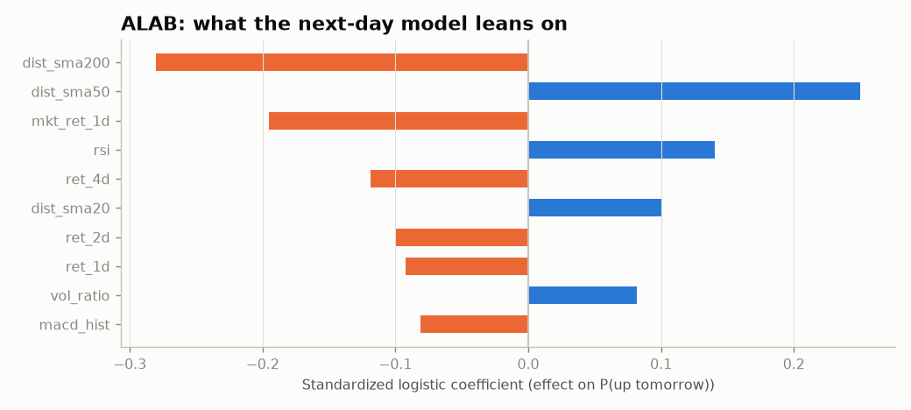

# stocklab report
Generated 2026-11-27 | data source: `yahoo` | history: 5 years | watchlist: ALAB, AMD, NVDA, MRVL, GOOG, FSLR, SKHY, ETN, TSLA, SPCX, AMZN, IBM, GEV, CEG, VST, DELL, TSM, BE

> Educational research code, not investment advice. Past results do not predict future returns.

## 1. Decision board

Data as of the 2026-11-25 close. `*` = provisional (under 200 trading days of history).

| ticker | action | close | 1 day | 1 month | buy rank | sell warnings | pullback entry | breakout | stop | why |
|---|---|---|---|---|---|---|---|---|---|---|
| IBM | WATCH | 243.47 | +3.3% | -2.0% | 5/18 | 4/15 | 242.22 | 257.02 | 227.03 | +1% vs 200-day average; death cross, MACD bearish, 20%+ off high |
| DELL | REDUCE | 297.06 | +0.6% | -40.8% | 1/18 | 8/15 |  |  |  | -15% vs 200-day average; below 50-day, below 200-day, distribution days, 20%+ off high, volatility spike, below chandelier stop |
| AMZN | REDUCE | 244.43 | -3.1% | -3.4% | 3/18 | 6/15 |  |  |  | -1% vs 200-day average; below 50-day, below 200-day, MACD bearish, distribution days, volatility spike |
| MRVL | REDUCE | 130.93 | -0.5% | -46.2% | 6/18 | 8/15 |  |  |  | -31% vs 200-day average; below 50-day, below 200-day, distribution days, 20%+ off high, volatility spike, below chandelier stop |
| SPCX | REDUCE* | 127.44 | +1.3% | -14.2% | 7/18 | 4/10 |  |  |  | -13% vs 50-day average; below 50-day, MACD bearish, distribution days, 20%+ off high (provisional: 116 days of history) |
| TSLA | REDUCE | 380.14 | -1.2% | -6.7% | 8/18 | 8/15 |  |  |  | -0% vs 200-day average; below 200-day, death cross, MACD bearish, distribution days, 20%+ off high, volatility spike |
| BE | REDUCE | 152.89 | -2.3% | -30.0% | 15/18 | 8/15 |  |  |  | -32% vs 200-day average; below 50-day, below 200-day, MACD bearish, distribution days, 20%+ off high, below chandelier stop |
| ALAB | REDUCE | 190.34 | -0.5% | -33.6% | 16/18 | 8/15 |  |  |  | -27% vs 200-day average; below 50-day, below 200-day, distribution days, 20%+ off high, volatility spike, below chandelier stop |
| AMD | SELL | 406.03 | -1.8% | -27.5% | 2/18 | 11/15 |  |  |  | -6% vs 200-day average; below 50-day, below 200-day, MACD bearish, distribution days, high-volume breakdown, 20%+ off high, volatility spike, below chandelier stop |
| TSM | SELL | 342.34 | -2.0% | -21.6% | 4/18 | 11/15 |  |  |  | -15% vs 200-day average; below 50-day, below 200-day, MACD bearish, distribution days, high-volume breakdown, 20%+ off high, volatility spike, below chandelier stop |
| ETN | SELL | 317.81 | -0.5% | -17.0% | 9/18 | 11/15 |  |  |  | -19% vs 200-day average; below 50-day, below 200-day, death cross, MACD bearish, distribution days, 20%+ off high, volatility spike, below chandelier stop |
| GEV | SELL | 715.00 | -0.8% | -20.1% | 10/18 | 12/15 |  |  |  | -25% vs 200-day average; below 50-day, below 200-day, death cross, MACD bearish, distribution days, high-volume breakdown, 20%+ off high, below chandelier stop |
| GOOG | SELL | 270.98 | -2.0% | -14.5% | 11/18 | 10/15 |  |  |  | -19% vs 200-day average; below 50-day, below 200-day, death cross, distribution days, 20%+ off high, volatility spike, below chandelier stop |
| CEG | SELL | 235.28 | -3.9% | -9.0% | 12/18 | 10/15 |  |  |  | -15% vs 200-day average; below 50-day, below 200-day, death cross, MACD bearish, distribution days, 20%+ off high, below chandelier stop |
| NVDA | SELL | 149.30 | -3.9% | -31.5% | 13/18 | 11/15 |  |  |  | -26% vs 200-day average; below 50-day, below 200-day, MACD bearish, distribution days, high-volume breakdown, 20%+ off high, volatility spike, below chandelier stop |
| VST | SELL | 121.32 | +0.5% | -17.3% | 14/18 | 11/15 |  |  |  | -19% vs 200-day average; below 50-day, below 200-day, death cross, MACD bearish, distribution days, 20%+ off high, volatility spike, below chandelier stop |
| SKHY | SELL* | 111.14 | -0.8% | -23.5% | 17/18 | 6/10 |  |  |  | -28% vs 50-day average; below 50-day, MACD bearish, distribution days, 20%+ off high, below chandelier stop (provisional: 98 days of history) |
| FSLR | SELL | 147.88 | -0.1% | -15.9% | 18/18 | 10/15 |  |  |  | -30% vs 200-day average; below 50-day, below 200-day, death cross, MACD bearish, distribution days, 20%+ off high, below chandelier stop |


**Trading the labels** (2022-02-22 to 2026-11-25): buy on BUY, exit on SELL, REDUCE or AVOID, reviewed weekly with next-day execution and 5 bp costs.

| strategy | CAGR | Volatility | Sharpe | Max drawdown | Time invested | Avg holdings |
|---|---|---|---|---|---|---|
| Board strategy | +36.9% | 34.3% | 1.09 | -46.3% | 99% | 6.7 |
| Equal-weight watchlist | +42.7% | 34.9% | 1.19 | -36.8% | 100% | 15.1 |
| SPY (buy & hold) | +13.3% | 17.5% | 0.80 | -22.1% |  |  |

Sharpe difference vs equal weight: -0.11, 95% block-bootstrap CI [-0.65, +0.38].

Forward 21-day return after each label, relative to the watchlist average on the same date (sampled every 21 days, t-test across dates):

| label | observations | dates | mean 21d excess return | hit rate | p_value |
|---|---|---|---|---|---|
| BUY | 235 | 51 | +0.0% | 51% | 0.97 |
| HOLD | 114 | 43 | -0.4% | 49% | 0.77 |
| WATCH | 177 | 55 | +1.8% | 51% | 0.19 |
| AVOID | 53 | 23 | -1.0% | 35% | 0.66 |
| REDUCE | 175 | 51 | -2.1% | 33% | 0.11 |
| SELL | 85 | 35 | +3.6% | 57% | 0.21 |


## 2. Sell check, stock by stock

```
ALAB  REDUCE  (score 8/15, close 190.34 on 2026-11-25)
  RSI 40 | -60.6% from 52-week high
  Triggered:
    - [trend] Close below the 50-day moving average (+1)
    - [trend] Close below the 200-day moving average (+2)
    - [volume] 5+ distribution days in the last 25 sessions (institutional selling) (+1)
    - [risk] 20%+ below the 52-week high (+1)
    - [risk] 21-day volatility 1.5x+ its 1-year median (+1)
    - [risk] Close below the chandelier stop (22-day high minus 3x ATR) (+2)
  Levels to watch:
    50-day SMA                 281.71  (price is below, -32.4%)
    200-day SMA                259.15  (price is below, -26.6%)
    Chandelier stop            222.62  (price is below, -14.5%)
```

```
AMD  EXIT  (score 11/15, close 406.03 on 2026-11-25)
  RSI 38 | -37.5% from 52-week high
  Triggered:
    - [trend] Close below the 50-day moving average (+1)
    - [trend] Close below the 200-day moving average (+2)
    - [momentum] MACD line below its signal line (+1)
    - [volume] 5+ distribution days in the last 25 sessions (institutional selling) (+1)
    - [volume] Down day closing below the 50-day average on 1.5x+ average volume (+2)
    - [risk] 20%+ below the 52-week high (+1)
    - [risk] 21-day volatility 1.5x+ its 1-year median (+1)
    - [risk] Close below the chandelier stop (22-day high minus 3x ATR) (+2)
  Levels to watch:
    50-day SMA                 548.35  (price is below, -26.0%)
    Chandelier stop            454.46  (price is below, -10.7%)
    200-day SMA                432.96  (price is below, -6.2%)
```

```
NVDA  EXIT  (score 11/15, close 149.30 on 2026-11-25)
  RSI 37 | -37.6% from 52-week high
  Triggered:
    - [trend] Close below the 50-day moving average (+1)
    - [trend] Close below the 200-day moving average (+2)
    - [momentum] MACD line below its signal line (+1)
    - [volume] 5+ distribution days in the last 25 sessions (institutional selling) (+1)
    - [volume] Down day closing below the 50-day average on 1.5x+ average volume (+2)
    - [risk] 20%+ below the 52-week high (+1)
    - [risk] 21-day volatility 1.5x+ its 1-year median (+1)
    - [risk] Close below the chandelier stop (22-day high minus 3x ATR) (+2)
  Levels to watch:
    50-day SMA                 203.65  (price is below, -26.7%)
    200-day SMA                202.62  (price is below, -26.3%)
    Chandelier stop            179.84  (price is below, -17.0%)
```

```
MRVL  REDUCE  (score 8/15, close 130.93 on 2026-11-25)
  RSI 35 | -58.6% from 52-week high
  Triggered:
    - [trend] Close below the 50-day moving average (+1)
    - [trend] Close below the 200-day moving average (+2)
    - [volume] 5+ distribution days in the last 25 sessions (institutional selling) (+1)
    - [risk] 20%+ below the 52-week high (+1)
    - [risk] 21-day volatility 1.5x+ its 1-year median (+1)
    - [risk] Close below the chandelier stop (22-day high minus 3x ATR) (+2)
  Levels to watch:
    50-day SMA                 214.99  (price is below, -39.1%)
    Chandelier stop            203.72  (price is below, -35.7%)
    200-day SMA                189.34  (price is below, -30.9%)
```

```
GOOG  EXIT  (score 10/15, close 270.98 on 2026-11-25)
  RSI 36 | -32.0% from 52-week high
  Triggered:
    - [trend] Close below the 50-day moving average (+1)
    - [trend] Close below the 200-day moving average (+2)
    - [trend] 50-day average below the 200-day average (+2)
    - [volume] 5+ distribution days in the last 25 sessions (institutional selling) (+1)
    - [risk] 20%+ below the 52-week high (+1)
    - [risk] 21-day volatility 1.5x+ its 1-year median (+1)
    - [risk] Close below the chandelier stop (22-day high minus 3x ATR) (+2)
  Levels to watch:
    200-day SMA                333.88  (price is below, -18.8%)
    50-day SMA                 315.29  (price is below, -14.1%)
    Chandelier stop            288.70  (price is below, -6.1%)
```

```
FSLR  EXIT  (score 10/15, close 147.88 on 2026-11-25)
  RSI 35 | -53.5% from 52-week high
  Triggered:
    - [trend] Close below the 50-day moving average (+1)
    - [trend] Close below the 200-day moving average (+2)
    - [trend] 50-day average below the 200-day average (+2)
    - [momentum] MACD line below its signal line (+1)
    - [volume] 5+ distribution days in the last 25 sessions (institutional selling) (+1)
    - [risk] 20%+ below the 52-week high (+1)
    - [risk] Close below the chandelier stop (22-day high minus 3x ATR) (+2)
  Levels to watch:
    200-day SMA                209.98  (price is below, -29.6%)
    Chandelier stop            184.34  (price is below, -19.8%)
    50-day SMA                 175.78  (price is below, -15.9%)
```

```
SKHY  EXIT  (score 6/10, close 111.14 on 2026-11-25)
  RSI 39 | -44.0% from high since listing
  Only 98 trading days of history; not scored yet: below_sma200, death_cross, volatility_spike
  Triggered:
    - [trend] Close below the 50-day moving average (+1)
    - [momentum] MACD line below its signal line (+1)
    - [volume] 5+ distribution days in the last 25 sessions (institutional selling) (+1)
    - [risk] 20%+ below the high since listing (+1)
    - [risk] Close below the chandelier stop (22-day high minus 3x ATR) (+2)
  Levels to watch:
    50-day SMA                 153.45  (price is below, -27.6%)
    Chandelier stop            131.89  (price is below, -15.7%)
```

```
ETN  EXIT  (score 11/15, close 317.81 on 2026-11-25)
  RSI 37 | -30.7% from 52-week high
  Triggered:
    - [trend] Close below the 50-day moving average (+1)
    - [trend] Close below the 200-day moving average (+2)
    - [trend] 50-day average below the 200-day average (+2)
    - [momentum] MACD line below its signal line (+1)
    - [volume] 5+ distribution days in the last 25 sessions (institutional selling) (+1)
    - [risk] 20%+ below the 52-week high (+1)
    - [risk] 21-day volatility 1.5x+ its 1-year median (+1)
    - [risk] Close below the chandelier stop (22-day high minus 3x ATR) (+2)
  Levels to watch:
    200-day SMA                394.17  (price is below, -19.4%)
    50-day SMA                 387.62  (price is below, -18.0%)
    Chandelier stop            341.76  (price is below, -7.0%)
```

```
TSLA  REDUCE  (score 8/15, close 380.14 on 2026-11-25)
  RSI 50 | -22.4% from 52-week high
  Triggered:
    - [trend] Close below the 200-day moving average (+2)
    - [trend] 50-day average below the 200-day average (+2)
    - [momentum] MACD line below its signal line (+1)
    - [volume] 5+ distribution days in the last 25 sessions (institutional selling) (+1)
    - [risk] 20%+ below the 52-week high (+1)
    - [risk] 21-day volatility 1.5x+ its 1-year median (+1)
  Levels to watch:
    200-day SMA                381.15  (price is below, -0.3%)
    50-day SMA                 377.17  (price is above, +0.8%)
    Chandelier stop            355.49  (price is above, +6.9%)
```

```
SPCX  REDUCE  (score 4/10, close 127.44 on 2026-11-25)
  RSI 41 | -39.7% from high since listing
  Only 116 trading days of history; not scored yet: below_sma200, death_cross, volatility_spike
  Triggered:
    - [trend] Close below the 50-day moving average (+1)
    - [momentum] MACD line below its signal line (+1)
    - [volume] 5+ distribution days in the last 25 sessions (institutional selling) (+1)
    - [risk] 20%+ below the high since listing (+1)
  Levels to watch:
    50-day SMA                 146.59  (price is below, -13.1%)
    Chandelier stop            124.08  (price is above, +2.7%)
```

```
AMZN  REDUCE  (score 6/15, close 244.43 on 2026-11-25)
  RSI 42 | -13.9% from 52-week high
  Triggered:
    - [trend] Close below the 50-day moving average (+1)
    - [trend] Close below the 200-day moving average (+2)
    - [momentum] MACD line below its signal line (+1)
    - [volume] 5+ distribution days in the last 25 sessions (institutional selling) (+1)
    - [risk] 21-day volatility 1.5x+ its 1-year median (+1)
  Levels to watch:
    50-day SMA                 255.12  (price is below, -4.2%)
    200-day SMA                245.78  (price is below, -0.5%)
    Chandelier stop            244.00  (price is above, +0.2%)
```

```
IBM  WATCH  (score 4/15, close 243.47 on 2026-11-25)
  RSI 55 | -25.0% from 52-week high
  Triggered:
    - [trend] 50-day average below the 200-day average (+2)
    - [momentum] MACD line below its signal line (+1)
    - [risk] 20%+ below the 52-week high (+1)
  Levels to watch:
    200-day SMA                240.91  (price is above, +1.1%)
    50-day SMA                 235.65  (price is above, +3.3%)
    Chandelier stop            235.30  (price is above, +3.5%)
```

```
GEV  EXIT  (score 12/15, close 715.00 on 2026-11-25)
  RSI 37 | -39.1% from 52-week high
  Triggered:
    - [trend] Close below the 50-day moving average (+1)
    - [trend] Close below the 200-day moving average (+2)
    - [trend] 50-day average below the 200-day average (+2)
    - [momentum] MACD line below its signal line (+1)
    - [volume] 5+ distribution days in the last 25 sessions (institutional selling) (+1)
    - [volume] Down day closing below the 50-day average on 1.5x+ average volume (+2)
    - [risk] 20%+ below the 52-week high (+1)
    - [risk] Close below the chandelier stop (22-day high minus 3x ATR) (+2)
  Levels to watch:
    200-day SMA                950.25  (price is below, -24.8%)
    50-day SMA                 883.58  (price is below, -19.1%)
    Chandelier stop            764.56  (price is below, -6.5%)
```

```
CEG  EXIT  (score 10/15, close 235.28 on 2026-11-25)
  RSI 39 | -37.5% from 52-week high
  Triggered:
    - [trend] Close below the 50-day moving average (+1)
    - [trend] Close below the 200-day moving average (+2)
    - [trend] 50-day average below the 200-day average (+2)
    - [momentum] MACD line below its signal line (+1)
    - [volume] 5+ distribution days in the last 25 sessions (institutional selling) (+1)
    - [risk] 20%+ below the 52-week high (+1)
    - [risk] Close below the chandelier stop (22-day high minus 3x ATR) (+2)
  Levels to watch:
    200-day SMA                277.07  (price is below, -15.1%)
    50-day SMA                 264.83  (price is below, -11.2%)
    Chandelier stop            244.01  (price is below, -3.6%)
```

```
VST  EXIT  (score 11/15, close 121.32 on 2026-11-25)
  RSI 41 | -32.4% from 52-week high
  Triggered:
    - [trend] Close below the 50-day moving average (+1)
    - [trend] Close below the 200-day moving average (+2)
    - [trend] 50-day average below the 200-day average (+2)
    - [momentum] MACD line below its signal line (+1)
    - [volume] 5+ distribution days in the last 25 sessions (institutional selling) (+1)
    - [risk] 20%+ below the 52-week high (+1)
    - [risk] 21-day volatility 1.5x+ its 1-year median (+1)
    - [risk] Close below the chandelier stop (22-day high minus 3x ATR) (+2)
  Levels to watch:
    200-day SMA                150.47  (price is below, -19.4%)
    50-day SMA                 139.57  (price is below, -13.1%)
    Chandelier stop            125.58  (price is below, -3.4%)
```

```
DELL  REDUCE  (score 8/15, close 297.06 on 2026-11-25)
  RSI 37 | -49.4% from 52-week high
  Triggered:
    - [trend] Close below the 50-day moving average (+1)
    - [trend] Close below the 200-day moving average (+2)
    - [volume] 5+ distribution days in the last 25 sessions (institutional selling) (+1)
    - [risk] 20%+ below the 52-week high (+1)
    - [risk] 21-day volatility 1.5x+ its 1-year median (+1)
    - [risk] Close below the chandelier stop (22-day high minus 3x ATR) (+2)
  Levels to watch:
    50-day SMA                 456.47  (price is below, -34.9%)
    Chandelier stop            393.26  (price is below, -24.5%)
    200-day SMA                350.23  (price is below, -15.2%)
```

```
TSM  EXIT  (score 11/15, close 342.34 on 2026-11-25)
  RSI 39 | -29.5% from 52-week high
  Triggered:
    - [trend] Close below the 50-day moving average (+1)
    - [trend] Close below the 200-day moving average (+2)
    - [momentum] MACD line below its signal line (+1)
    - [volume] 5+ distribution days in the last 25 sessions (institutional selling) (+1)
    - [volume] Down day closing below the 50-day average on 1.5x+ average volume (+2)
    - [risk] 20%+ below the 52-week high (+1)
    - [risk] 21-day volatility 1.5x+ its 1-year median (+1)
    - [risk] Close below the chandelier stop (22-day high minus 3x ATR) (+2)
  Levels to watch:
    50-day SMA                 418.26  (price is below, -18.2%)
    200-day SMA                402.23  (price is below, -14.9%)
    Chandelier stop            371.74  (price is below, -7.9%)
```

```
BE  REDUCE  (score 8/15, close 152.89 on 2026-11-25)
  RSI 38 | -55.8% from 52-week high
  Triggered:
    - [trend] Close below the 50-day moving average (+1)
    - [trend] Close below the 200-day moving average (+2)
    - [momentum] MACD line below its signal line (+1)
    - [volume] 5+ distribution days in the last 25 sessions (institutional selling) (+1)
    - [risk] 20%+ below the 52-week high (+1)
    - [risk] Close below the chandelier stop (22-day high minus 3x ATR) (+2)
  Levels to watch:
    50-day SMA                 227.84  (price is below, -32.9%)
    200-day SMA                224.04  (price is below, -31.8%)
    Chandelier stop            167.01  (price is below, -8.5%)
```

## 3. Which sell signals actually work? (event study)

Panel: 46 stocks, 5 years. Null hypothesis: returns after a signal look like returns on random days from the same stocks.

| rule | horizon | events | mean_after_signal | mean_random_days | difference | p_value | q_value | drop10_after_signal | drop10_base_rate | verdict |
|---|---|---|---|---|---|---|---|---|---|---|
| below_sma50 | 5d | 1081 | +0.22% | +0.65% | -0.43% | 0.009 | 0.078 | 40% | 36% | useful |
| below_sma50 | 21d | 1061 | +2.03% | +3.06% | -1.03% | 0.004 | 0.066 | 40% | 36% | useful |
| below_sma50 | 63d | 1006 | +8.55% | +10.08% | -1.52% | 0.024 | 0.132 | 40% | 36% | weak (not significant) |
| below_sma200 | 5d | 524 | +0.42% | +0.59% | -0.16% | 0.264 | 0.804 | 38% | 36% | weak (not significant) |
| below_sma200 | 21d | 507 | +0.87% | +2.76% | -1.89% | 0.001 | 0.033 | 38% | 36% | useful |
| below_sma200 | 63d | 476 | +9.54% | +8.98% | +0.56% | 0.682 | 0.960 | 38% | 36% | no edge |
| death_cross | 5d | 155 | +0.18% | +0.63% | -0.45% | 0.182 | 0.669 | 42% | 36% | weak (not significant) |
| death_cross | 21d | 151 | +0.60% | +2.93% | -2.33% | 0.009 | 0.078 | 42% | 36% | useful |
| death_cross | 63d | 142 | +14.42% | +9.60% | +4.82% | 0.979 | 1.000 | 42% | 36% | no edge |
| rsi_divergence | 5d | 503 | +0.43% | +0.75% | -0.32% | 0.121 | 0.572 | 37% | 36% | weak (not significant) |
| rsi_divergence | 21d | 496 | +3.17% | +3.47% | -0.29% | 0.317 | 0.804 | 37% | 36% | weak (not significant) |
| rsi_divergence | 63d | 486 | +10.97% | +11.57% | -0.60% | 0.306 | 0.804 | 37% | 36% | weak (not significant) |
| rsi_rollover | 5d | 646 | +1.83% | +0.71% | +1.11% | 1.000 | 1.000 | 33% | 36% | no edge |
| rsi_rollover | 21d | 641 | +3.67% | +3.37% | +0.30% | 0.725 | 0.960 | 33% | 36% | no edge |
| rsi_rollover | 63d | 624 | +10.39% | +11.41% | -1.01% | 0.167 | 0.669 | 33% | 36% | weak (not significant) |
| macd_bearish | 5d | 1634 | +0.77% | +0.68% | +0.09% | 0.718 | 0.960 | 36% | 36% | no edge |
| macd_bearish | 21d | 1605 | +3.21% | +3.20% | +0.01% | 0.512 | 0.960 | 36% | 36% | no edge |
| macd_bearish | 63d | 1540 | +11.12% | +10.68% | +0.44% | 0.755 | 0.960 | 36% | 36% | no edge |
| distribution_cluster | 5d | 1080 | +0.99% | +0.69% | +0.30% | 0.949 | 1.000 | 35% | 36% | no edge |
| distribution_cluster | 21d | 1066 | +3.14% | +3.21% | -0.07% | 0.441 | 0.910 | 35% | 36% | weak (not significant) |
| distribution_cluster | 63d | 1023 | +10.32% | +10.77% | -0.45% | 0.300 | 0.804 | 35% | 36% | weak (not significant) |
| high_volume_breakdown | 5d | 764 | +0.80% | +0.65% | +0.15% | 0.756 | 0.960 | 34% | 36% | no edge |
| high_volume_breakdown | 21d | 732 | +3.61% | +3.01% | +0.60% | 0.889 | 1.000 | 34% | 36% | no edge |
| high_volume_breakdown | 63d | 697 | +12.69% | +9.99% | +2.70% | 0.992 | 1.000 | 34% | 36% | no edge |
| drawdown_20 | 5d | 406 | +1.34% | +0.79% | +0.55% | 0.946 | 1.000 | 52% | 36% | no edge |
| drawdown_20 | 21d | 400 | +2.03% | +3.69% | -1.66% | 0.020 | 0.132 | 52% | 36% | weak (not significant) |
| drawdown_20 | 63d | 376 | +13.67% | +12.66% | +1.02% | 0.746 | 0.960 | 52% | 36% | no edge |
| volatility_spike | 5d | 351 | +0.90% | +0.72% | +0.18% | 0.702 | 0.960 | 47% | 36% | no edge |
| volatility_spike | 21d | 330 | +3.14% | +3.35% | -0.21% | 0.390 | 0.858 | 47% | 36% | weak (not significant) |
| volatility_spike | 63d | 328 | +10.77% | +11.30% | -0.53% | 0.366 | 0.858 | 47% | 36% | weak (not significant) |
| chandelier_stop | 5d | 1367 | +0.70% | +0.68% | +0.02% | 0.531 | 0.960 | 37% | 36% | no edge |
| chandelier_stop | 21d | 1341 | +3.28% | +3.20% | +0.08% | 0.596 | 0.960 | 37% | 36% | no edge |
| chandelier_stop | 63d | 1280 | +11.86% | +10.74% | +1.12% | 0.936 | 1.000 | 37% | 36% | no edge |

**4 of 33 rule-by-horizon tests** show significantly weaker returns after the signal (q < 0.10).


## 4. Strategy backtests

Not included: SKHY (only 98 trading days of history, needs 452); SPCX (only 116 trading days of history, needs 452).

### ALAB (2025-01-03 to 2026-11-25)

| strategy | Total return | CAGR | Max drawdown | Volatility | Sharpe | Round trips | Time in market | Sharpe vs B&H | 95% CI | p-value |
|---|---|---|---|---|---|---|---|---|---|---|
| Buy & Hold | +32.4% | +16.0% | -63.2% | +99.1% | 0.65 | 0 | 100% |  |  |  |
| 50/200 SMA cross | -70.9% | -48.0% | -74.0% | +90.1% | -0.27 | 2 | 76% | -0.92 | [-1.78, -0.22] | 0.02 |
| Close > 50-day SMA | +7.6% | +4.0% | -66.4% | +69.2% | 0.40 | 10 | 51% | -0.24 | [-1.38, +0.77] | 0.62 |
| MACD > signal | +22.1% | +11.2% | -70.4% | +67.6% | 0.49 | 23 | 50% | -0.16 | [-1.30, +1.01] | 0.79 |
| RSI 30/70 | -2.4% | -1.3% | -50.3% | +44.0% | 0.19 | 1 | 18% | -0.46 | [-2.04, +1.19] | 0.57 |
| Trailing stop 20% | -11.8% | -6.5% | -69.1% | +71.1% | 0.27 | 10 | 55% | -0.38 | [-1.51, +0.62] | 0.44 |
| Volume breakout | +91.8% | +41.2% | -55.7% | +62.5% | 0.86 | 4 | 40% | +0.21 | [-0.97, +1.32] | 0.71 |

### AMD (2022-09-13 to 2026-11-25)

| strategy | Total return | CAGR | Max drawdown | Volatility | Sharpe | Round trips | Time in market | Sharpe vs B&H | 95% CI | p-value |
|---|---|---|---|---|---|---|---|---|---|---|
| Buy & Hold | +424.0% | +48.5% | -63.0% | +59.1% | 0.96 | 0 | 100% |  |  |  |
| 50/200 SMA cross | +280.7% | +37.6% | -39.1% | +50.0% | 0.89 | 1 | 66% | -0.08 | [-0.59, +0.44] | 0.77 |
| Close > 50-day SMA | +147.4% | +24.1% | -49.9% | +44.0% | 0.71 | 37 | 54% | -0.25 | [-0.87, +0.37] | 0.40 |
| MACD > signal | +242.9% | +34.2% | -42.4% | +42.6% | 0.90 | 40 | 51% | -0.06 | [-0.59, +0.46] | 0.81 |
| RSI 30/70 | +17.7% | +4.0% | -54.7% | +34.0% | 0.28 | 3 | 34% | -0.68 | [-1.69, +0.19] | 0.15 |
| Trailing stop 20% | +101.4% | +18.2% | -58.9% | +50.9% | 0.58 | 12 | 72% | -0.38 | [-0.88, +0.09] | 0.13 |
| Volume breakout | +161.9% | +25.8% | -36.9% | +37.2% | 0.80 | 11 | 38% | -0.16 | [-0.83, +0.52] | 0.65 |

### NVDA (2022-09-13 to 2026-11-25)

| strategy | Total return | CAGR | Max drawdown | Volatility | Sharpe | Round trips | Time in market | Sharpe vs B&H | 95% CI | p-value |
|---|---|---|---|---|---|---|---|---|---|---|
| Buy & Hold | +1040.8% | +78.8% | -47.5% | +51.7% | 1.38 | 0 | 100% |  |  |  |
| 50/200 SMA cross | +476.6% | +51.9% | -47.5% | +46.6% | 1.13 | 1 | 85% | -0.25 | [-0.69, +0.15] | 0.22 |
| Close > 50-day SMA | +346.8% | +42.9% | -39.1% | +39.0% | 1.11 | 38 | 69% | -0.27 | [-0.91, +0.36] | 0.41 |
| MACD > signal | +152.9% | +24.8% | -46.7% | +34.4% | 0.81 | 40 | 51% | -0.56 | [-1.35, +0.18] | 0.15 |
| RSI 30/70 | +44.6% | +9.2% | -33.1% | +24.8% | 0.47 | 2 | 7% | -0.91 | [-1.82, +0.03] | 0.06 |
| Trailing stop 20% | +792.5% | +68.6% | -36.6% | +45.1% | 1.38 | 7 | 91% | +0.01 | [-0.40, +0.37] | 0.97 |
| Volume breakout | +211.5% | +31.1% | -19.8% | +26.3% | 1.16 | 7 | 31% | -0.22 | [-1.09, +0.59] | 0.61 |

### MRVL (2022-09-13 to 2026-11-25)

| strategy | Total return | CAGR | Max drawdown | Volatility | Sharpe | Round trips | Time in market | Sharpe vs B&H | 95% CI | p-value |
|---|---|---|---|---|---|---|---|---|---|---|
| Buy & Hold | +174.4% | +27.2% | -61.3% | +68.3% | 0.69 | 0 | 100% |  |  |  |
| 50/200 SMA cross | +27.4% | +6.0% | -65.2% | +58.9% | 0.39 | 2 | 69% | -0.30 | [-0.79, +0.10] | 0.19 |
| Close > 50-day SMA | +65.8% | +12.8% | -51.5% | +52.7% | 0.49 | 36 | 57% | -0.20 | [-0.80, +0.37] | 0.49 |
| MACD > signal | +101.6% | +18.2% | -62.5% | +50.2% | 0.58 | 44 | 51% | -0.11 | [-0.87, +0.55] | 0.77 |
| RSI 30/70 | +36.3% | +7.7% | -32.1% | +31.7% | 0.39 | 2 | 20% | -0.30 | [-1.15, +0.67] | 0.50 |
| Trailing stop 20% | +66.7% | +13.0% | -53.3% | +56.9% | 0.49 | 15 | 76% | -0.20 | [-0.68, +0.28] | 0.42 |
| Volume breakout | +76.0% | +14.4% | -46.2% | +42.0% | 0.53 | 11 | 36% | -0.16 | [-1.08, +0.63] | 0.69 |

### GOOG (2022-09-13 to 2026-11-25)

| strategy | Total return | CAGR | Max drawdown | Volatility | Sharpe | Round trips | Time in market | Sharpe vs B&H | 95% CI | p-value |
|---|---|---|---|---|---|---|---|---|---|---|
| Buy & Hold | +158.2% | +25.4% | -33.8% | +31.8% | 0.87 | 0 | 100% |  |  |  |
| 50/200 SMA cross | +151.5% | +24.6% | -29.4% | +25.9% | 0.98 | 2 | 76% | +0.11 | [-0.37, +0.57] | 0.65 |
| Close > 50-day SMA | +85.6% | +15.9% | -22.2% | +23.6% | 0.74 | 34 | 63% | -0.13 | [-0.79, +0.55] | 0.70 |
| MACD > signal | +27.3% | +5.9% | -25.4% | +21.9% | 0.37 | 43 | 50% | -0.50 | [-1.16, +0.13] | 0.14 |
| RSI 30/70 | +23.6% | +5.2% | -20.4% | +18.6% | 0.36 | 4 | 26% | -0.51 | [-1.30, +0.38] | 0.23 |
| Trailing stop 20% | +55.0% | +11.0% | -40.4% | +29.6% | 0.50 | 6 | 91% | -0.37 | [-0.81, -0.02] | 0.06 |
| Volume breakout | +105.6% | +18.8% | -17.4% | +19.4% | 0.98 | 8 | 46% | +0.11 | [-0.66, +0.89] | 0.78 |

### FSLR (2022-09-13 to 2026-11-25)

| strategy | Total return | CAGR | Max drawdown | Volatility | Sharpe | Round trips | Time in market | Sharpe vs B&H | 95% CI | p-value |
|---|---|---|---|---|---|---|---|---|---|---|
| Buy & Hold | +8.9% | +2.0% | -60.0% | +55.4% | 0.31 | 0 | 100% |  |  |  |
| 50/200 SMA cross | +3.6% | +0.8% | -51.1% | +41.6% | 0.22 | 4 | 58% | -0.09 | [-0.74, +0.45] | 0.74 |
| Close > 50-day SMA | +22.4% | +4.9% | -46.8% | +40.2% | 0.32 | 29 | 49% | +0.01 | [-0.60, +0.56] | 0.97 |
| MACD > signal | -61.6% | -20.4% | -74.1% | +40.8% | -0.36 | 49 | 49% | -0.67 | [-1.30, -0.02] | 0.04 |
| RSI 30/70 | +26.5% | +5.8% | -42.8% | +30.9% | 0.33 | 2 | 28% | +0.02 | [-0.89, +0.79] | 0.96 |
| Trailing stop 20% | -7.2% | -1.8% | -57.9% | +45.3% | 0.18 | 12 | 68% | -0.13 | [-0.62, +0.36] | 0.62 |
| Volume breakout | -18.0% | -4.6% | -53.8% | +31.5% | 0.01 | 13 | 35% | -0.30 | [-1.16, +0.49] | 0.47 |

### ETN (2022-09-13 to 2026-11-25)

| strategy | Total return | CAGR | Max drawdown | Volatility | Sharpe | Round trips | Time in market | Sharpe vs B&H | 95% CI | p-value |
|---|---|---|---|---|---|---|---|---|---|---|
| Buy & Hold | +135.6% | +22.7% | -34.5% | +34.4% | 0.77 | 0 | 100% |  |  |  |
| 50/200 SMA cross | +47.6% | +9.7% | -38.7% | +30.6% | 0.46 | 3 | 84% | -0.31 | [-0.73, +0.05] | 0.10 |
| Close > 50-day SMA | +33.4% | +7.1% | -37.5% | +24.4% | 0.41 | 44 | 65% | -0.36 | [-1.02, +0.30] | 0.24 |
| MACD > signal | +36.8% | +7.8% | -25.8% | +22.3% | 0.45 | 48 | 50% | -0.32 | [-1.07, +0.41] | 0.38 |
| RSI 30/70 | +15.7% | +3.5% | -18.6% | +11.5% | 0.36 | 1 | 5% | -0.41 | [-1.42, +0.70] | 0.41 |
| Trailing stop 20% | +174.4% | +27.2% | -23.6% | +30.8% | 0.94 | 2 | 94% | +0.17 | [-0.09, +0.48] | 0.25 |
| Volume breakout | +21.6% | +4.8% | -29.3% | +18.1% | 0.35 | 10 | 38% | -0.42 | [-1.29, +0.49] | 0.34 |

### TSLA (2022-09-13 to 2026-11-25)

| strategy | Total return | CAGR | Max drawdown | Volatility | Sharpe | Round trips | Time in market | Sharpe vs B&H | 95% CI | p-value |
|---|---|---|---|---|---|---|---|---|---|---|
| Buy & Hold | +25.6% | +5.6% | -65.0% | +58.5% | 0.38 | 0 | 100% |  |  |  |
| 50/200 SMA cross | -26.4% | -7.1% | -56.8% | +40.1% | 0.01 | 4 | 47% | -0.37 | [-1.24, +0.50] | 0.40 |
| Close > 50-day SMA | +32.1% | +6.9% | -41.1% | +38.5% | 0.37 | 43 | 52% | -0.02 | [-0.78, +0.78] | 0.95 |
| MACD > signal | +379.3% | +45.3% | -39.8% | +40.8% | 1.12 | 42 | 51% | +0.73 | [+0.03, +1.43] | 0.04 |
| RSI 30/70 | +47.6% | +9.7% | -52.7% | +40.8% | 0.43 | 4 | 43% | +0.05 | [-0.73, +0.76] | 0.89 |
| Trailing stop 20% | +28.0% | +6.1% | -47.9% | +45.4% | 0.36 | 11 | 71% | -0.03 | [-0.63, +0.65] | 0.94 |
| Volume breakout | +40.5% | +8.4% | -35.4% | +25.7% | 0.44 | 9 | 18% | +0.06 | [-0.81, +1.06] | 0.90 |

### AMZN (2022-09-13 to 2026-11-25)

| strategy | Total return | CAGR | Max drawdown | Volatility | Sharpe | Round trips | Time in market | Sharpe vs B&H | 95% CI | p-value |
|---|---|---|---|---|---|---|---|---|---|---|
| Buy & Hold | +90.0% | +16.6% | -36.4% | +34.1% | 0.62 | 0 | 100% |  |  |  |
| 50/200 SMA cross | +25.7% | +5.6% | -41.4% | +28.2% | 0.33 | 2 | 74% | -0.29 | [-0.94, +0.33] | 0.34 |
| Close > 50-day SMA | +23.9% | +5.3% | -43.9% | +23.3% | 0.34 | 34 | 63% | -0.28 | [-0.96, +0.46] | 0.44 |
| MACD > signal | -4.7% | -1.2% | -28.7% | +23.1% | 0.07 | 51 | 50% | -0.55 | [-1.33, +0.17] | 0.12 |
| RSI 30/70 | +94.0% | +17.1% | -22.0% | +21.6% | 0.84 | 4 | 33% | +0.22 | [-0.52, +0.97] | 0.56 |
| Trailing stop 20% | +65.9% | +12.8% | -28.4% | +30.4% | 0.55 | 3 | 88% | -0.07 | [-0.41, +0.23] | 0.69 |
| Volume breakout | +2.1% | +0.5% | -38.8% | +19.2% | 0.12 | 12 | 46% | -0.50 | [-1.41, +0.43] | 0.28 |

### IBM (2022-09-13 to 2026-11-25)

| strategy | Total return | CAGR | Max drawdown | Volatility | Sharpe | Round trips | Time in market | Sharpe vs B&H | 95% CI | p-value |
|---|---|---|---|---|---|---|---|---|---|---|
| Buy & Hold | +121.1% | +20.8% | -37.5% | +31.7% | 0.76 | 0 | 100% |  |  |  |
| 50/200 SMA cross | +64.8% | +12.7% | -28.7% | +22.7% | 0.64 | 3 | 72% | -0.12 | [-0.89, +0.59] | 0.72 |
| Close > 50-day SMA | +43.6% | +9.0% | -43.2% | +25.3% | 0.47 | 28 | 60% | -0.29 | [-0.77, +0.24] | 0.27 |
| MACD > signal | +112.3% | +19.7% | -43.1% | +23.9% | 0.88 | 30 | 50% | +0.12 | [-0.47, +0.90] | 0.74 |
| RSI 30/70 | +175.4% | +27.3% | -16.5% | +17.4% | 1.48 | 8 | 35% | +0.72 | [-0.29, +1.60] | 0.13 |
| Trailing stop 20% | +67.8% | +13.2% | -45.9% | +30.4% | 0.56 | 3 | 92% | -0.20 | [-0.46, +0.01] | 0.09 |
| Volume breakout | +54.7% | +11.0% | -30.2% | +17.2% | 0.69 | 11 | 40% | -0.07 | [-0.97, +0.86] | 0.87 |

### GEV (2025-01-13 to 2026-11-25)

| strategy | Total return | CAGR | Max drawdown | Volatility | Sharpe | Round trips | Time in market | Sharpe vs B&H | 95% CI | p-value |
|---|---|---|---|---|---|---|---|---|---|---|
| Buy & Hold | +87.7% | +40.1% | -40.4% | +56.5% | 0.88 | 0 | 100% |  |  |  |
| 50/200 SMA cross | +133.0% | +57.2% | -38.3% | +54.2% | 1.11 | 1 | 96% | +0.23 | [+0.00, +0.63] | 0.14 |
| Close > 50-day SMA | +79.1% | +36.6% | -32.7% | +43.4% | 0.94 | 15 | 62% | +0.06 | [-0.58, +0.71] | 0.85 |
| MACD > signal | +60.6% | +28.8% | -31.0% | +41.6% | 0.82 | 17 | 47% | -0.06 | [-0.88, +0.76] | 0.89 |
| RSI 30/70 | +11.3% | +5.9% | -40.4% | +36.0% | 0.34 | 1 | 33% | -0.54 | [-1.67, +0.60] | 0.35 |
| Trailing stop 20% | +44.2% | +21.6% | -45.9% | +49.6% | 0.65 | 5 | 85% | -0.24 | [-0.79, +0.37] | 0.40 |
| Volume breakout | +24.5% | +12.5% | -24.6% | +33.1% | 0.52 | 3 | 35% | -0.36 | [-1.50, +0.89] | 0.57 |

### CEG (2022-11-02 to 2026-11-25)

| strategy | Total return | CAGR | Max drawdown | Volatility | Sharpe | Round trips | Time in market | Sharpe vs B&H | 95% CI | p-value |
|---|---|---|---|---|---|---|---|---|---|---|
| Buy & Hold | +157.2% | +26.3% | -50.7% | +49.4% | 0.72 | 0 | 100% |  |  |  |
| 50/200 SMA cross | +96.8% | +18.2% | -50.7% | +43.3% | 0.60 | 3 | 71% | -0.12 | [-0.61, +0.29] | 0.59 |
| Close > 50-day SMA | +128.2% | +22.6% | -43.6% | +37.2% | 0.73 | 49 | 57% | +0.01 | [-0.52, +0.57] | 0.96 |
| MACD > signal | +18.2% | +4.2% | -48.1% | +37.1% | 0.29 | 42 | 49% | -0.42 | [-1.03, +0.17] | 0.18 |
| RSI 30/70 | +74.3% | +14.7% | -28.7% | +32.6% | 0.58 | 3 | 38% | -0.14 | [-0.92, +0.61] | 0.73 |
| Trailing stop 20% | +67.2% | +13.5% | -56.7% | +44.0% | 0.51 | 9 | 84% | -0.21 | [-0.64, +0.20] | 0.34 |
| Volume breakout | +86.0% | +16.6% | -30.0% | +30.5% | 0.65 | 9 | 39% | -0.06 | [-0.75, +0.69] | 0.85 |

### VST (2022-09-13 to 2026-11-25)

| strategy | Total return | CAGR | Max drawdown | Volatility | Sharpe | Round trips | Time in market | Sharpe vs B&H | 95% CI | p-value |
|---|---|---|---|---|---|---|---|---|---|---|
| Buy & Hold | +409.3% | +47.5% | -48.8% | +52.3% | 1.01 | 0 | 100% |  |  |  |
| 50/200 SMA cross | +412.2% | +47.7% | -48.8% | +43.9% | 1.11 | 3 | 67% | +0.10 | [-0.25, +0.51] | 0.60 |
| Close > 50-day SMA | +47.1% | +9.6% | -67.2% | +37.9% | 0.44 | 45 | 63% | -0.57 | [-1.21, +0.09] | 0.09 |
| MACD > signal | +61.9% | +12.2% | -49.0% | +37.2% | 0.50 | 48 | 51% | -0.51 | [-1.13, +0.18] | 0.13 |
| RSI 30/70 | +173.1% | +27.1% | -27.3% | +27.3% | 1.01 | 3 | 21% | +0.00 | [-0.88, +0.76] | 0.99 |
| Trailing stop 20% | +209.2% | +30.9% | -56.3% | +44.5% | 0.83 | 9 | 87% | -0.18 | [-0.64, +0.30] | 0.47 |
| Volume breakout | +278.5% | +37.4% | -31.2% | +31.4% | 1.18 | 9 | 43% | +0.17 | [-0.62, +1.09] | 0.69 |

### DELL (2022-09-13 to 2026-11-25)

| strategy | Total return | CAGR | Max drawdown | Volatility | Sharpe | Round trips | Time in market | Sharpe vs B&H | 95% CI | p-value |
|---|---|---|---|---|---|---|---|---|---|---|
| Buy & Hold | +745.8% | +66.5% | -59.6% | +59.5% | 1.15 | 0 | 100% |  |  |  |
| 50/200 SMA cross | +350.2% | +43.2% | -52.7% | +52.6% | 0.94 | 3 | 69% | -0.21 | [-0.68, +0.23] | 0.34 |
| Close > 50-day SMA | +1326.9% | +88.6% | -27.5% | +49.3% | 1.52 | 21 | 67% | +0.38 | [-0.12, +0.92] | 0.16 |
| MACD > signal | +141.4% | +23.4% | -57.7% | +43.1% | 0.69 | 45 | 52% | -0.45 | [-1.16, +0.22] | 0.21 |
| RSI 30/70 | +140.8% | +23.3% | -25.6% | +29.7% | 0.85 | 4 | 28% | -0.29 | [-1.18, +0.58] | 0.54 |
| Trailing stop 20% | +965.4% | +75.9% | -55.9% | +51.4% | 1.35 | 7 | 81% | +0.20 | [-0.25, +0.66] | 0.37 |
| Volume breakout | +378.1% | +45.3% | -37.8% | +43.2% | 1.07 | 11 | 45% | -0.08 | [-0.78, +0.60] | 0.81 |

### TSM (2022-09-13 to 2026-11-25)

| strategy | Total return | CAGR | Max drawdown | Volatility | Sharpe | Round trips | Time in market | Sharpe vs B&H | 95% CI | p-value |
|---|---|---|---|---|---|---|---|---|---|---|
| Buy & Hold | +358.8% | +43.8% | -36.8% | +40.4% | 1.10 | 0 | 100% |  |  |  |
| 50/200 SMA cross | +135.0% | +22.6% | -36.8% | +37.2% | 0.73 | 2 | 82% | -0.37 | [-0.88, +0.09] | 0.14 |
| Close > 50-day SMA | +190.3% | +29.0% | -28.8% | +31.5% | 0.96 | 37 | 68% | -0.14 | [-0.71, +0.44] | 0.64 |
| MACD > signal | +118.0% | +20.4% | -32.1% | +28.6% | 0.79 | 45 | 49% | -0.31 | [-0.92, +0.31] | 0.34 |
| RSI 30/70 | +25.4% | +5.5% | -23.0% | +19.3% | 0.37 | 3 | 13% | -0.73 | [-1.65, +0.23] | 0.10 |
| Trailing stop 20% | +212.4% | +31.2% | -30.6% | +36.8% | 0.92 | 6 | 91% | -0.18 | [-0.57, +0.20] | 0.35 |
| Volume breakout | +77.0% | +14.6% | -26.8% | +26.4% | 0.65 | 11 | 46% | -0.45 | [-1.28, +0.31] | 0.25 |

### BE (2022-09-13 to 2026-11-25)

| strategy | Total return | CAGR | Max drawdown | Volatility | Sharpe | Round trips | Time in market | Sharpe vs B&H | 95% CI | p-value |
|---|---|---|---|---|---|---|---|---|---|---|
| Buy & Hold | +472.8% | +51.7% | -67.9% | +90.8% | 0.90 | 0 | 100% |  |  |  |
| 50/200 SMA cross | +165.4% | +26.2% | -71.9% | +75.8% | 0.68 | 4 | 63% | -0.21 | [-0.81, +0.34] | 0.46 |
| Close > 50-day SMA | +337.8% | +42.2% | -53.1% | +69.5% | 0.83 | 31 | 51% | -0.06 | [-0.64, +0.46] | 0.81 |
| MACD > signal | +182.3% | +28.1% | -60.0% | +65.9% | 0.68 | 42 | 50% | -0.21 | [-0.93, +0.41] | 0.54 |
| RSI 30/70 | +147.7% | +24.2% | -61.8% | +47.0% | 0.69 | 4 | 47% | -0.20 | [-1.02, +0.71] | 0.66 |
| Trailing stop 20% | +141.4% | +23.4% | -66.7% | +73.6% | 0.63 | 19 | 60% | -0.26 | [-0.76, +0.22] | 0.29 |
| Volume breakout | +275.5% | +37.1% | -58.1% | +60.9% | 0.80 | 11 | 30% | -0.10 | [-0.92, +0.63] | 0.80 |


## 5. Next-day forecasts

Not included: SKHY (only 98 trading days of history, needs 452); SPCX (only 116 trading days of history, needs 452).

### ALAB

Walk-forward test on 223 unseen days (2026-01-07 to 2026-11-24).

| model | accuracy | always-majority accuracy | p (beats majority) | AUC | Brier | strategy Sharpe | buy & hold Sharpe |
|---|---|---|---|---|---|---|---|
| Majority class (baseline) | 0.516 | 0.516 | 0.527 | 0.461 | 0.25 | 0.677 | 0.678 |
| Logistic regression | 0.498 | 0.516 | 0.727 | 0.505 | 0.257 | 0.35 | 0.678 |
| Gradient boosting | 0.48 | 0.516 | 0.873 | 0.464 | 0.281 | 0.432 | 0.678 |

| model | RMSE (bps) | R2 out-of-sample vs zero | direction hit rate | DM p (beats zero) |
|---|---|---|---|---|
| Zero / random walk (baseline) | 672.7 | 0.0 |  |  |
| Ridge regression | 686.0 | -0.04 | 0.475 | 0.884 |
| Gradient boosting | 703.8 | -0.0944 | 0.453 | 0.99 |

Forecast for the next session:

```
  P(up) | Logistic regression      72.5%
  P(up) | Gradient boosting        67.7%
  P(up) | historical base rate     51.6%
  expected return (ridge)          +1.66%
  80% range low                    -10.56%
  80% range high                   +15.55%
  daily volatility                 +9.99%
```

Best out-of-sample AUC **0.505**; smallest p-value against a naive baseline 0.727, before correcting for the four models tested here and the other stocks (the corrected count is in the summary).



### AMD

Walk-forward test on 551 unseen days (2024-09-16 to 2026-11-24).

| model | accuracy | always-majority accuracy | p (beats majority) | AUC | Brier | strategy Sharpe | buy & hold Sharpe |
|---|---|---|---|---|---|---|---|
| Majority class (baseline) | 0.505 | 0.526 | 0.857 | 0.486 | 0.25 | 0.957 | 1.004 |
| Logistic regression | 0.492 | 0.526 | 0.952 | 0.488 | 0.257 | 0.418 | 1.004 |
| Gradient boosting | 0.486 | 0.526 | 0.972 | 0.493 | 0.267 | 0.645 | 1.004 |

| model | RMSE (bps) | R2 out-of-sample vs zero | direction hit rate | DM p (beats zero) |
|---|---|---|---|---|
| Zero / random walk (baseline) | 414.8 | 0.0 |  |  |
| Ridge regression | 418.7 | -0.0186 | 0.49 | 0.838 |
| Gradient boosting | 424.3 | -0.0461 | 0.508 | 0.986 |

Forecast for the next session:

```
  P(up) | Logistic regression      68.6%
  P(up) | Gradient boosting        79.1%
  P(up) | historical base rate     51.5%
  expected return (ridge)          +2.90%
  80% range low                    -7.64%
  80% range high                   +14.66%
  daily volatility                 +8.44%
```

Best out-of-sample AUC **0.493**; smallest p-value against a naive baseline 0.838, before correcting for the four models tested here and the other stocks (the corrected count is in the summary).


### NVDA

Walk-forward test on 551 unseen days (2024-09-16 to 2026-11-24).

| model | accuracy | always-majority accuracy | p (beats majority) | AUC | Brier | strategy Sharpe | buy & hold Sharpe |
|---|---|---|---|---|---|---|---|
| Majority class (baseline) | 0.515 | 0.515 | 0.517 | 0.512 | 0.251 | 0.47 | 0.471 |
| Logistic regression | 0.506 | 0.515 | 0.681 | 0.512 | 0.255 | 0.373 | 0.471 |
| Gradient boosting | 0.517 | 0.515 | 0.483 | 0.478 | 0.27 | 0.911 | 0.471 |

| model | RMSE (bps) | R2 out-of-sample vs zero | direction hit rate | DM p (beats zero) |
|---|---|---|---|---|
| Zero / random walk (baseline) | 309.6 | 0.0 |  |  |
| Ridge regression | 309.9 | -0.0022 | 0.508 | 0.528 |
| Gradient boosting | 313.2 | -0.0236 | 0.532 | 0.709 |

Forecast for the next session:

```
  P(up) | Logistic regression      27.6%
  P(up) | Gradient boosting        22.4%
  P(up) | historical base rate     53.4%
  expected return (ridge)          -1.07%
  80% range low                    -10.50%
  80% range high                   +9.35%
  daily volatility                 +7.81%
```

Best out-of-sample AUC **0.512**; smallest p-value against a naive baseline 0.483, before correcting for the four models tested here and the other stocks (the corrected count is in the summary).


### MRVL

Walk-forward test on 551 unseen days (2024-09-16 to 2026-11-24).

| model | accuracy | always-majority accuracy | p (beats majority) | AUC | Brier | strategy Sharpe | buy & hold Sharpe |
|---|---|---|---|---|---|---|---|
| Majority class (baseline) | 0.53 | 0.53 | 0.517 | 0.47 | 0.249 | 0.73 | 0.73 |
| Logistic regression | 0.532 | 0.53 | 0.483 | 0.55 | 0.251 | 0.747 | 0.73 |
| Gradient boosting | 0.526 | 0.53 | 0.585 | 0.549 | 0.259 | 0.341 | 0.73 |

| model | RMSE (bps) | R2 out-of-sample vs zero | direction hit rate | DM p (beats zero) |
|---|---|---|---|---|
| Zero / random walk (baseline) | 490.6 | 0.0 |  |  |
| Ridge regression | 494.7 | -0.0167 | 0.534 | 0.821 |
| Gradient boosting | 502.1 | -0.0474 | 0.499 | 0.982 |

Forecast for the next session:

```
  P(up) | Logistic regression      51.3%
  P(up) | Gradient boosting        56.5%
  P(up) | historical base rate     52.3%
  expected return (ridge)          -0.16%
  80% range low                    -10.80%
  80% range high                   +11.76%
  daily volatility                 +8.79%
```

Best out-of-sample AUC **0.550**; smallest p-value against a naive baseline 0.483, before correcting for the four models tested here and the other stocks (the corrected count is in the summary).


### GOOG

Walk-forward test on 551 unseen days (2024-09-16 to 2026-11-24).

| model | accuracy | always-majority accuracy | p (beats majority) | AUC | Brier | strategy Sharpe | buy & hold Sharpe |
|---|---|---|---|---|---|---|---|
| Majority class (baseline) | 0.517 | 0.517 | 0.517 | 0.497 | 0.25 | 0.928 | 0.928 |
| Logistic regression | 0.537 | 0.517 | 0.185 | 0.532 | 0.253 | 0.135 | 0.928 |
| Gradient boosting | 0.526 | 0.517 | 0.351 | 0.538 | 0.261 | 0.317 | 0.928 |

| model | RMSE (bps) | R2 out-of-sample vs zero | direction hit rate | DM p (beats zero) |
|---|---|---|---|---|
| Zero / random walk (baseline) | 202.8 | 0.0 |  |  |
| Ridge regression | 204.8 | -0.0201 | 0.519 | 0.946 |
| Gradient boosting | 208.6 | -0.0575 | 0.521 | 0.993 |

Forecast for the next session:

```
  P(up) | Logistic regression      33.2%
  P(up) | Gradient boosting        45.0%
  P(up) | historical base rate     52.9%
  expected return (ridge)          -0.09%
  80% range low                    -4.59%
  80% range high                   +4.62%
  daily volatility                 +3.60%
```

Best out-of-sample AUC **0.538**; smallest p-value against a naive baseline 0.185, before correcting for the four models tested here and the other stocks (the corrected count is in the summary).


### FSLR

Walk-forward test on 551 unseen days (2024-09-16 to 2026-11-24).

| model | accuracy | always-majority accuracy | p (beats majority) | AUC | Brier | strategy Sharpe | buy & hold Sharpe |
|---|---|---|---|---|---|---|---|
| Majority class (baseline) | 0.517 | 0.517 | 0.517 | 0.475 | 0.25 |  | -0.074 |
| Logistic regression | 0.525 | 0.517 | 0.383 | 0.535 | 0.251 | 0.058 | -0.074 |
| Gradient boosting | 0.515 | 0.517 | 0.551 | 0.525 | 0.261 | 0.242 | -0.074 |

| model | RMSE (bps) | R2 out-of-sample vs zero | direction hit rate | DM p (beats zero) |
|---|---|---|---|---|
| Zero / random walk (baseline) | 362.9 | 0.0 |  |  |
| Ridge regression | 363.8 | -0.0049 | 0.492 | 0.649 |
| Gradient boosting | 373.1 | -0.0566 | 0.494 | 0.995 |

Forecast for the next session:

```
  P(up) | Logistic regression      58.6%
  P(up) | Gradient boosting        56.9%
  P(up) | historical base rate     48.8%
  expected return (ridge)          +0.74%
  80% range low                    -4.26%
  80% range high                   +6.00%
  daily volatility                 +3.97%
```

Best out-of-sample AUC **0.535**; smallest p-value against a naive baseline 0.383, before correcting for the four models tested here and the other stocks (the corrected count is in the summary).


### ETN

Walk-forward test on 551 unseen days (2024-09-16 to 2026-11-24).

| model | accuracy | always-majority accuracy | p (beats majority) | AUC | Brier | strategy Sharpe | buy & hold Sharpe |
|---|---|---|---|---|---|---|---|
| Majority class (baseline) | 0.521 | 0.521 | 0.517 | 0.473 | 0.25 | 0.272 | 0.273 |
| Logistic regression | 0.519 | 0.521 | 0.551 | 0.528 | 0.253 | 0.247 | 0.273 |
| Gradient boosting | 0.521 | 0.521 | 0.517 | 0.533 | 0.26 | 0.035 | 0.273 |

| model | RMSE (bps) | R2 out-of-sample vs zero | direction hit rate | DM p (beats zero) |
|---|---|---|---|---|
| Zero / random walk (baseline) | 251.6 | 0.0 |  |  |
| Ridge regression | 252.6 | -0.008 | 0.528 | 0.665 |
| Gradient boosting | 259.7 | -0.0657 | 0.506 | 0.989 |

Forecast for the next session:

```
  P(up) | Logistic regression      71.3%
  P(up) | Gradient boosting        68.8%
  P(up) | historical base rate     53.7%
  expected return (ridge)          +1.01%
  80% range low                    -4.90%
  80% range high                   +7.29%
  daily volatility                 +4.71%
```

Best out-of-sample AUC **0.533**; smallest p-value against a naive baseline 0.517, before correcting for the four models tested here and the other stocks (the corrected count is in the summary).


### TSLA

Walk-forward test on 551 unseen days (2024-09-16 to 2026-11-24).

| model | accuracy | always-majority accuracy | p (beats majority) | AUC | Brier | strategy Sharpe | buy & hold Sharpe |
|---|---|---|---|---|---|---|---|
| Majority class (baseline) | 0.488 | 0.501 | 0.739 | 0.467 | 0.25 | 0.39 | 0.691 |
| Logistic regression | 0.503 | 0.501 | 0.483 | 0.503 | 0.254 | 0.87 | 0.691 |
| Gradient boosting | 0.55 | 0.501 | 0.012 | 0.543 | 0.26 | 0.999 | 0.691 |

| model | RMSE (bps) | R2 out-of-sample vs zero | direction hit rate | DM p (beats zero) |
|---|---|---|---|---|
| Zero / random walk (baseline) | 371.3 | 0.0 |  |  |
| Ridge regression | 375.7 | -0.0239 | 0.492 | 0.949 |
| Gradient boosting | 378.3 | -0.0383 | 0.525 | 0.959 |

Forecast for the next session:

```
  P(up) | Logistic regression      51.6%
  P(up) | Gradient boosting        59.3%
  P(up) | historical base rate     50.6%
  expected return (ridge)          +0.19%
  80% range low                    -5.40%
  80% range high                   +6.11%
  daily volatility                 +4.48%
```

Best out-of-sample AUC **0.543**; smallest p-value against a naive baseline 0.012, before correcting for the four models tested here and the other stocks (the corrected count is in the summary).


### AMZN

Walk-forward test on 551 unseen days (2024-09-16 to 2026-11-24).

| model | accuracy | always-majority accuracy | p (beats majority) | AUC | Brier | strategy Sharpe | buy & hold Sharpe |
|---|---|---|---|---|---|---|---|
| Majority class (baseline) | 0.514 | 0.514 | 0.517 | 0.459 | 0.25 | 0.541 | 0.542 |
| Logistic regression | 0.544 | 0.514 | 0.08 | 0.552 | 0.249 | 0.898 | 0.542 |
| Gradient boosting | 0.51 | 0.514 | 0.585 | 0.528 | 0.262 | -0.097 | 0.542 |

| model | RMSE (bps) | R2 out-of-sample vs zero | direction hit rate | DM p (beats zero) |
|---|---|---|---|---|
| Zero / random walk (baseline) | 213.6 | 0.0 |  |  |
| Ridge regression | 215.6 | -0.0185 | 0.534 | 0.89 |
| Gradient boosting | 224.0 | -0.0995 | 0.515 | 1.0 |

Forecast for the next session:

```
  P(up) | Logistic regression      40.3%
  P(up) | Gradient boosting        52.2%
  P(up) | historical base rate     51.2%
  expected return (ridge)          -0.37%
  80% range low                    -3.97%
  80% range high                   +3.38%
  daily volatility                 +2.88%
```

Best out-of-sample AUC **0.552**; smallest p-value against a naive baseline 0.080, before correcting for the four models tested here and the other stocks (the corrected count is in the summary).


### IBM

Walk-forward test on 551 unseen days (2024-09-16 to 2026-11-24).

| model | accuracy | always-majority accuracy | p (beats majority) | AUC | Brier | strategy Sharpe | buy & hold Sharpe |
|---|---|---|---|---|---|---|---|
| Majority class (baseline) | 0.544 | 0.544 | 0.518 | 0.462 | 0.249 | 0.406 | 0.407 |
| Logistic regression | 0.544 | 0.544 | 0.518 | 0.475 | 0.254 | 0.666 | 0.407 |
| Gradient boosting | 0.515 | 0.544 | 0.921 | 0.491 | 0.267 | 0.463 | 0.407 |

| model | RMSE (bps) | R2 out-of-sample vs zero | direction hit rate | DM p (beats zero) |
|---|---|---|---|---|
| Zero / random walk (baseline) | 254.9 | 0.0 |  |  |
| Ridge regression | 256.9 | -0.0159 | 0.541 | 0.87 |
| Gradient boosting | 258.8 | -0.0307 | 0.51 | 0.927 |

Forecast for the next session:

```
  P(up) | Logistic regression      56.6%
  P(up) | Gradient boosting        55.4%
  P(up) | historical base rate     55.2%
  expected return (ridge)          +0.28%
  80% range low                    -2.36%
  80% range high                   +2.98%
  daily volatility                 +2.08%
```

Best out-of-sample AUC **0.491**; smallest p-value against a naive baseline 0.518, before correcting for the four models tested here and the other stocks (the corrected count is in the summary).


### GEV

Walk-forward test on 218 unseen days (2026-01-14 to 2026-11-24).

| model | accuracy | always-majority accuracy | p (beats majority) | AUC | Brier | strategy Sharpe | buy & hold Sharpe |
|---|---|---|---|---|---|---|---|
| Majority class (baseline) | 0.523 | 0.523 | 0.527 | 0.477 | 0.25 | 0.496 | 0.497 |
| Logistic regression | 0.495 | 0.523 | 0.811 | 0.503 | 0.259 | 0.201 | 0.497 |
| Gradient boosting | 0.523 | 0.523 | 0.527 | 0.518 | 0.273 | 0.789 | 0.497 |

| model | RMSE (bps) | R2 out-of-sample vs zero | direction hit rate | DM p (beats zero) |
|---|---|---|---|---|
| Zero / random walk (baseline) | 343.2 | 0.0 |  |  |
| Ridge regression | 350.3 | -0.0419 | 0.541 | 0.818 |
| Gradient boosting | 360.5 | -0.1036 | 0.518 | 0.961 |

Forecast for the next session:

```
  P(up) | Logistic regression      64.9%
  P(up) | Gradient boosting        76.4%
  P(up) | historical base rate     53.8%
  expected return (ridge)          +1.06%
  80% range low                    -4.85%
  80% range high                   +7.34%
  daily volatility                 +4.70%
```

Best out-of-sample AUC **0.518**; smallest p-value against a naive baseline 0.527, before correcting for the four models tested here and the other stocks (the corrected count is in the summary).


### CEG

Walk-forward test on 515 unseen days (2024-11-05 to 2026-11-24).

| model | accuracy | always-majority accuracy | p (beats majority) | AUC | Brier | strategy Sharpe | buy & hold Sharpe |
|---|---|---|---|---|---|---|---|
| Majority class (baseline) | 0.499 | 0.501 | 0.553 | 0.5 | 0.251 | 0.296 | 0.296 |
| Logistic regression | 0.47 | 0.501 | 0.927 | 0.501 | 0.26 | -0.078 | 0.296 |
| Gradient boosting | 0.476 | 0.501 | 0.883 | 0.468 | 0.275 | -0.139 | 0.296 |

| model | RMSE (bps) | R2 out-of-sample vs zero | direction hit rate | DM p (beats zero) |
|---|---|---|---|---|
| Zero / random walk (baseline) | 352.5 | 0.0 |  |  |
| Ridge regression | 360.2 | -0.0441 | 0.474 | 0.982 |
| Gradient boosting | 362.4 | -0.0571 | 0.513 | 0.983 |

Forecast for the next session:

```
  P(up) | Logistic regression      59.6%
  P(up) | Gradient boosting        82.9%
  P(up) | historical base rate     51.8%
  expected return (ridge)          +0.69%
  80% range low                    -4.46%
  80% range high                   +6.12%
  daily volatility                 +4.10%
```

Best out-of-sample AUC **0.501**; smallest p-value against a naive baseline 0.883, before correcting for the four models tested here and the other stocks (the corrected count is in the summary).


### VST

Walk-forward test on 551 unseen days (2024-09-16 to 2026-11-24).

| model | accuracy | always-majority accuracy | p (beats majority) | AUC | Brier | strategy Sharpe | buy & hold Sharpe |
|---|---|---|---|---|---|---|---|
| Majority class (baseline) | 0.51 | 0.51 | 0.517 | 0.498 | 0.251 | 0.551 | 0.551 |
| Logistic regression | 0.495 | 0.51 | 0.766 | 0.493 | 0.257 | 0.972 | 0.551 |
| Gradient boosting | 0.523 | 0.51 | 0.29 | 0.532 | 0.264 | 0.929 | 0.551 |

| model | RMSE (bps) | R2 out-of-sample vs zero | direction hit rate | DM p (beats zero) |
|---|---|---|---|---|
| Zero / random walk (baseline) | 393.0 | 0.0 |  |  |
| Ridge regression | 394.0 | -0.005 | 0.503 | 0.599 |
| Gradient boosting | 403.7 | -0.0551 | 0.508 | 0.985 |

Forecast for the next session:

```
  P(up) | Logistic regression      47.9%
  P(up) | Gradient boosting        56.3%
  P(up) | historical base rate     52.5%
  expected return (ridge)          +0.11%
  80% range low                    -6.48%
  80% range high                   +7.16%
  daily volatility                 +5.31%
```

Best out-of-sample AUC **0.532**; smallest p-value against a naive baseline 0.290, before correcting for the four models tested here and the other stocks (the corrected count is in the summary).


### DELL

Walk-forward test on 551 unseen days (2024-09-16 to 2026-11-24).

| model | accuracy | always-majority accuracy | p (beats majority) | AUC | Brier | strategy Sharpe | buy & hold Sharpe |
|---|---|---|---|---|---|---|---|
| Majority class (baseline) | 0.515 | 0.515 | 0.517 | 0.462 | 0.25 | 0.987 | 0.988 |
| Logistic regression | 0.501 | 0.515 | 0.766 | 0.495 | 0.257 | -0.111 | 0.988 |
| Gradient boosting | 0.485 | 0.515 | 0.932 | 0.495 | 0.268 | -0.213 | 0.988 |

| model | RMSE (bps) | R2 out-of-sample vs zero | direction hit rate | DM p (beats zero) |
|---|---|---|---|---|
| Zero / random walk (baseline) | 422.7 | 0.0 |  |  |
| Ridge regression | 429.6 | -0.0329 | 0.479 | 0.991 |
| Gradient boosting | 439.4 | -0.0808 | 0.492 | 1.0 |

Forecast for the next session:

```
  P(up) | Logistic regression      51.1%
  P(up) | Gradient boosting        56.0%
  P(up) | historical base rate     51.5%
  expected return (ridge)          +0.19%
  80% range low                    -9.90%
  80% range high                   +11.42%
  daily volatility                 +8.28%
```

Best out-of-sample AUC **0.495**; smallest p-value against a naive baseline 0.766, before correcting for the four models tested here and the other stocks (the corrected count is in the summary).


### TSM

Walk-forward test on 551 unseen days (2024-09-16 to 2026-11-24).

| model | accuracy | always-majority accuracy | p (beats majority) | AUC | Brier | strategy Sharpe | buy & hold Sharpe |
|---|---|---|---|---|---|---|---|
| Majority class (baseline) | 0.515 | 0.528 | 0.739 | 0.462 | 0.25 | 0.732 | 0.985 |
| Logistic regression | 0.523 | 0.528 | 0.618 | 0.529 | 0.251 | 0.817 | 0.985 |
| Gradient boosting | 0.51 | 0.528 | 0.815 | 0.503 | 0.263 | 0.807 | 0.985 |

| model | RMSE (bps) | R2 out-of-sample vs zero | direction hit rate | DM p (beats zero) |
|---|---|---|---|---|
| Zero / random walk (baseline) | 274.0 | 0.0 |  |  |
| Ridge regression | 272.7 | 0.0096 | 0.532 | 0.341 |
| Gradient boosting | 279.8 | -0.0428 | 0.528 | 0.934 |

Forecast for the next session:

```
  P(up) | Logistic regression      60.9%
  P(up) | Gradient boosting        46.7%
  P(up) | historical base rate     51.5%
  expected return (ridge)          +1.08%
  80% range low                    -5.72%
  80% range high                   +8.37%
  daily volatility                 +5.43%
```

Best out-of-sample AUC **0.529**; smallest p-value against a naive baseline 0.341, before correcting for the four models tested here and the other stocks (the corrected count is in the summary).


### BE

Walk-forward test on 551 unseen days (2024-09-16 to 2026-11-24).

| model | accuracy | always-majority accuracy | p (beats majority) | AUC | Brier | strategy Sharpe | buy & hold Sharpe |
|---|---|---|---|---|---|---|---|
| Majority class (baseline) | 0.488 | 0.512 | 0.875 | 0.466 | 0.251 |  | 1.678 |
| Logistic regression | 0.485 | 0.512 | 0.907 | 0.455 | 0.268 | 0.968 | 1.678 |
| Gradient boosting | 0.481 | 0.512 | 0.932 | 0.462 | 0.273 | 1.277 | 1.678 |

| model | RMSE (bps) | R2 out-of-sample vs zero | direction hit rate | DM p (beats zero) |
|---|---|---|---|---|
| Zero / random walk (baseline) | 661.0 | 0.0 |  |  |
| Ridge regression | 681.2 | -0.062 | 0.457 | 1.0 |
| Gradient boosting | 675.8 | -0.0454 | 0.486 | 0.992 |

Forecast for the next session:

```
  P(up) | Logistic regression      58.6%
  P(up) | Gradient boosting        53.2%
  P(up) | historical base rate     49.2%
  expected return (ridge)          +1.66%
  80% range low                    -9.10%
  80% range high                   +13.70%
  daily volatility                 +8.73%
```

Best out-of-sample AUC **0.462**; smallest p-value against a naive baseline 0.907, before correcting for the four models tested here and the other stocks (the corrected count is in the summary).


## 6. Stock screen and entry plans

| ticker | rank | score | passes_filters | close | momentum_12_1 | momentum_6m | volatility | off_52w_high | forward_pe | pullback_entry | breakout_trigger | stop | stop_% | shares | position_$ | max_loss_$ | filter_notes |
|---|---|---|---|---|---|---|---|---|---|---|---|---|---|---|---|---|---|
| V | 1 | +0.65 | True | 424.39 | +22.8% | +31.1% | +22.6% | -2.6% | 24.8 | 418.78 | 436.63 | 400.16 | -4.4% | 23 | 9632.0 | 428.0 |  |
| XOM | 2 | +0.58 | True | 158.08 | +58.2% | +8.9% | +27.1% | -15.0% | 12.7 | 154.15 | 186.45 | 146.3 | -5.1% | 64 | 9866.0 | 503.0 |  |
| LLY | 3 | +0.57 | True | 1392.22 | +20.4% | +23.9% | +29.2% | -3.6% | 27.4 | 1280.71 | 1446.39 | 1195.48 | -6.7% | 7 | 8965.0 | 597.0 |  |
| KO | 4 | +0.57 | True | 97.59 | +28.9% | +22.9% | +17.4% | -1.9% | 27.6 | 96.62 | 99.68 | 92.93 | -3.8% | 103 | 9952.0 | 380.0 |  |
| MSFT | 5 | +0.52 | True | 489.93 | +12.8% | +15.2% | +28.1% | -11.7% | 20.2 | 473.07 | 555.84 | 439.35 | -7.1% | 21 | 9934.0 | 708.0 |  |
| AAPL | 6 | +0.49 | True | 355.58 | +26.1% | +14.0% | +22.4% | -0.2% | 33.6 | 348.54 | 356.98 | 331.42 | -4.9% | 28 | 9759.0 | 479.0 |  |
| JNJ | 7 | +0.45 | True | 273.94 | +33.4% | +19.9% | +25.1% | -3.7% | 23.6 | 266.55 | 284.9 | 253.17 | -5.0% | 37 | 9862.0 | 495.0 |  |
| PG | 8 | +0.35 | True | 173.23 | +11.5% | +20.4% | +20.7% | +0.0% | 23.3 | 167.88 | 173.58 | 161.58 | -3.8% | 59 | 9905.0 | 372.0 |  |
| LIN | 9 | +0.23 | True | 524.61 | +26.5% | +5.2% | +16.6% | -3.7% | 26.8 | 517.46 | 527.6 | 497.63 | -3.8% | 19 | 9832.0 | 377.0 |  |
| COST | 10 | +0.15 | True | 1086.81 | +12.5% | +12.6% | +18.8% | -0.4% | 43.4 | 1045.86 | 1093.89 | 1008.81 | -3.5% | 9 | 9413.0 | 333.0 |  |
| AMT | 11 | +0.06 | True | 184.59 | +6.5% | +0.9% | +30.9% | -5.3% | 26.4 | 179.64 | 195.25 | 169.44 | -5.7% | 55 | 9880.0 | 561.0 |  |
| IBM | 12 | -0.29 | True | 243.47 | -16.0% | -6.6% | +30.6% | -25.0% | 18.4 | 242.22 | 257.02 | 227.03 | -6.3% | 41 | 9931.0 | 623.0 |  |
| DELL | 13 | +0.87 | False | 297.06 | +298.7% | -6.0% | +100.3% | -49.4% | 9.7 | 259.02 | 476.46 | 182.93 | -29.4% | 13 | 3367.0 | 989.0 | below 200-day SMA |
| AMD | 14 | +0.66 | False | 406.03 | +160.5% | -21.6% | +90.0% | -37.5% | 23.0 | 359.52 | 586.47 | 266.49 | -25.9% | 10 | 3595.0 | 930.0 | below 200-day SMA |
| MRVL | 15 | +0.43 | False | 130.93 | +191.2% | -36.0% | +98.1% | -58.6% | 17.8 | 114.28 | 218.78 | 80.99 | -29.1% | 30 | 3428.0 | 999.0 | below 200-day SMA; down >50% from high |

## 7. Portfolio construction

Not included: SKHY (only 98 trading days of history, needs 252); SPCX (only 116 trading days of history, needs 252).

Assets: ALAB, AMD, NVDA, MRVL, GOOG, FSLR, ETN, TSLA, AMZN, IBM, GEV, CEG, VST, DELL, TSM, BE, JPM, XOM, UNH, COST, TLT, GLD. Covariance: Ledoit-Wolf shrinkage on the last 252 trading days.

Weights and share of risk (%):

| asset | weight: Equal weight | weight: Inverse volatility | weight: Risk parity | weight: Minimum variance | risk share: Equal weight | risk share: Inverse volatility | risk share: Risk parity | risk share: Minimum variance |
|---|---|---|---|---|---|---|---|---|
| ALAB | 4.5 | 1.8 | 1.2 | 0.0 | 12.4 | 6.6 | 4.6 | 0.0 |
| AMD | 4.5 | 2.5 | 1.5 | 0.0 | 9.0 | 7.1 | 4.6 | 0.0 |
| NVDA | 4.5 | 3.6 | 2.4 | 1.4 | 5.3 | 6.2 | 4.7 | 1.6 |
| MRVL | 4.5 | 2.1 | 1.3 | 0.0 | 10.2 | 6.7 | 4.6 | 0.0 |
| GOOG | 4.5 | 5.5 | 4.5 | 4.2 | 2.0 | 4.2 | 4.8 | 4.6 |
| FSLR | 4.5 | 3.4 | 2.7 | 0.2 | 4.0 | 4.7 | 4.7 | 0.3 |
| ETN | 4.5 | 4.1 | 2.6 | 2.5 | 5.3 | 7.1 | 4.7 | 2.7 |
| TSLA | 4.5 | 3.9 | 2.5 | 0.0 | 4.5 | 6.1 | 4.7 | 0.0 |
| AMZN | 4.5 | 5.2 | 4.3 | 5.2 | 2.1 | 4.2 | 4.8 | 5.9 |
| IBM | 4.5 | 3.8 | 5.5 | 2.6 | 0.9 | 1.5 | 4.8 | 2.9 |
| GEV | 4.5 | 3.3 | 2.3 | 1.3 | 5.9 | 6.3 | 4.7 | 1.4 |
| CEG | 4.5 | 3.7 | 2.7 | 1.1 | 4.3 | 5.4 | 4.7 | 1.3 |
| VST | 4.5 | 3.5 | 2.4 | 0.3 | 5.2 | 6.0 | 4.7 | 0.3 |
| DELL | 4.5 | 2.2 | 1.6 | 0.0 | 8.1 | 5.6 | 4.6 | 0.0 |
| TSM | 4.5 | 4.0 | 2.1 | 0.0 | 5.8 | 7.6 | 4.7 | 0.0 |
| BE | 4.5 | 1.7 | 1.0 | 0.0 | 12.8 | 6.6 | 4.6 | 0.0 |
| JPM | 4.5 | 7.4 | 6.7 | 7.9 | 1.2 | 3.7 | 4.9 | 8.8 |
| XOM | 4.5 | 6.4 | 0.0 | 18.3 | -0.7 | -1.4 | -0.0 | 20.4 |
| UNH | 4.5 | 5.0 | 7.1 | 3.2 | 0.3 | 1.2 | 4.8 | 3.6 |
| COST | 4.5 | 8.2 | 22.3 | 17.6 | -0.8 | -1.4 | 5.2 | 19.6 |
| TLT | 4.5 | 12.7 | 18.1 | 30.0 | 0.2 | 1.6 | 5.4 | 21.8 |
| GLD | 4.5 | 6.0 | 5.2 | 4.2 | 1.9 | 4.2 | 4.8 | 4.7 |

| method | expected volatility | diversification ratio | effective number of bets | largest risk share | largest risk holder |
|---|---|---|---|---|---|
| Equal weight | 29.6% | 1.76 | 12.63 | 12.8% | BE |
| Inverse volatility | 19.5% | 2.10 | 16.60 | 7.6% | TSM |
| Risk parity | 14.6% | 2.42 | 20.97 | 5.4% | TLT |
| Minimum variance | 9.1% | 2.88 | 6.80 | 21.8% | TLT |

Concentration warnings:

- AMD and TSM have correlation 0.71: they tend to fall together
- NVDA and TSM have correlation 0.70: they tend to fall together
- ETN and GEV have correlation 0.74: they tend to fall together
- CEG and VST have correlation 0.80: they tend to fall together

Out-of-sample comparison, monthly rebalance (2025-04-01 to 2026-11-25):

| method | CAGR | Volatility | Sharpe | Max drawdown |
|---|---|---|---|---|
| Equal weight | +50.9% | +29.8% | 1.53 | -24.5% |
| Inverse volatility | +36.0% | +21.4% | 1.55 | -16.3% |
| Risk parity | +28.4% | +16.4% | 1.60 | -11.4% |
| Minimum variance | +12.3% | +10.2% | 1.19 | -6.8% |


## 8. Opening gaps: do pre-market moves carry into the day?

Across 19,074 stock-days (18 watchlist stocks, 2021-11-29 to 2026-11-25), each 1% of opening gap went with a -0.03% move from the open to the close (95% block-bootstrap CI [-0.09%, +0.02%]): no reliable relationship, so the size of a gap has not told you which way the session goes.

| opening gap | days | avg gap | avg open-to-close | closed above open |
|---|---|---|---|---|
| gap down 3%+ | 811 | -5.2% | +0.31% | 50% |
| down 1-3% | 2923 | -1.7% | +0.06% | 52% |
| within 1% | 10993 | +0.0% | +0.01% | 50% |
| up 1-3% | 3393 | +1.7% | +0.07% | 51% |
| gap up 3%+ | 954 | +5.6% | -0.21% | 46% |

## 9. Deciding before the open vs at the previous close

From 2022-02-23 to 2026-11-24 (239 weekly decisions, both traded at the open), labels set with the pre-market price returned +39.2% a year (worst drawdown -37.7%) against +32.3% (-44.6%) for labels set at the previous close; the two agreed on 89% of stock-weeks. Sharpe ratio difference +0.16 (95% block-bootstrap CI [-0.04, +0.36]): deciding before the open has been **not distinguishable from deciding on the previous close**.

| strategy | CAGR | Volatility | Sharpe | Max drawdown |
|---|---|---|---|---|
| Board on the previous close | +32.3% | 35.4% | 0.97 | -44.6% |
| Board on the pre-market price | +39.2% | 34.7% | 1.13 | -37.7% |
| Equal-weight watchlist | +40.3% | 35.9% | 1.12 | -40.7% |

The pre-market version uses the official opening price as a stand-in for the last pre-market trade (free pre-market history is only days long), which slightly flatters it.
