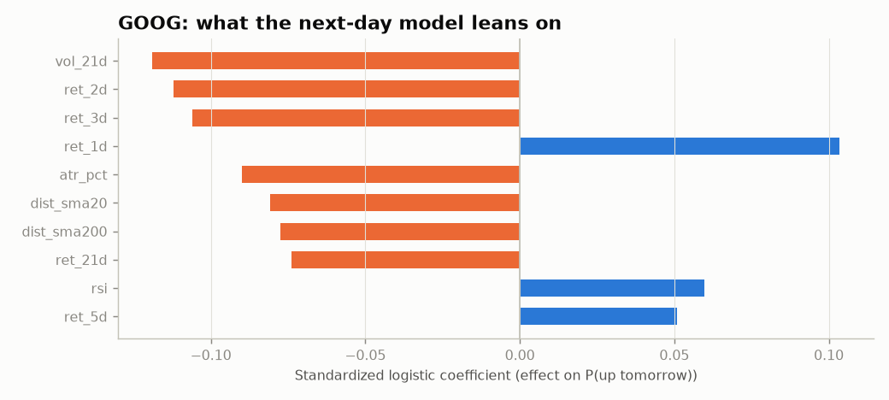
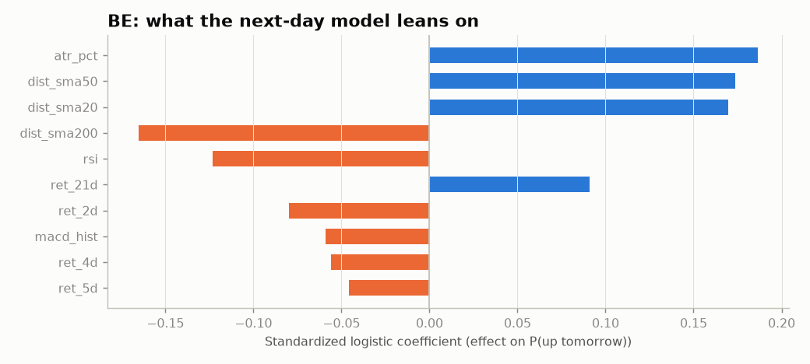

# stocklab report
Generated 2026-11-24 | data source: `yahoo` | history: 5 years | watchlist: ALAB, AMD, NVDA, MRVL, GOOG, FSLR, SKHY, ETN, TSLA, SPCX, AMZN, IBM, GEV, CEG, VST, DELL, TSM, BE

> Educational research code, not investment advice. Past results do not predict future returns.

## 1. Decision board

Data as of the 2026-11-23 close. `*` = provisional (under 200 trading days of history).

| ticker | action | close | 1 day | 1 month | buy rank | sell warnings | pullback entry | breakout | stop | why |
|---|---|---|---|---|---|---|---|---|---|---|
| AMZN | WATCH | 255.39 | +3.5% | +3.0% | 3/18 | 3/15 | 255.07 | 271.41 | 234.32 | +4% vs 200-day average; MACD bearish, distribution days, volatility spike |
| AMD | REDUCE | 453.46 | +6.8% | -12.3% | 2/18 | 6/15 |  |  |  | +5% vs 200-day average; below 50-day, MACD bearish, 20%+ off high, volatility spike, below chandelier stop |
| SPCX | REDUCE* | 133.35 | +4.4% | -9.6% | 6/18 | 4/10 |  |  |  | -10% vs 50-day average; below 50-day, MACD bearish, distribution days, 20%+ off high (provisional: 114 days of history) |
| TSLA | REDUCE | 385.46 | +11.5% | +3.6% | 8/18 | 6/15 |  |  |  | +1% vs 200-day average; death cross, MACD bearish, distribution days, 20%+ off high, volatility spike |
| CEG | REDUCE | 251.72 | +6.0% | -0.5% | 13/18 | 8/15 |  |  |  | -9% vs 200-day average; below 50-day, below 200-day, death cross, MACD bearish, distribution days, 20%+ off high |
| ALAB | REDUCE | 222.12 | +23.2% | -13.6% | 14/18 | 8/15 |  |  |  | -14% vs 200-day average; below 50-day, below 200-day, distribution days, 20%+ off high, volatility spike, below chandelier stop |
| BE | REDUCE | 168.15 | +18.1% | -13.0% | 16/18 | 6/15 |  |  |  | -25% vs 200-day average; below 50-day, below 200-day, MACD bearish, distribution days, 20%+ off high |
| DELL | SELL | 334.91 | +20.5% | -26.6% | 1/18 | 9/15 |  |  |  | -4% vs 200-day average; below 50-day, below 200-day, MACD bearish, distribution days, 20%+ off high, volatility spike, below chandelier stop |
| TSM | SELL | 363.60 | +14.1% | -13.1% | 4/18 | 9/15 |  |  |  | -10% vs 200-day average; below 50-day, below 200-day, MACD bearish, distribution days, 20%+ off high, volatility spike, below chandelier stop |
| MRVL | SELL | 144.74 | +18.4% | -36.7% | 5/18 | 9/15 |  |  |  | -23% vs 200-day average; below 50-day, below 200-day, MACD bearish, distribution days, 20%+ off high, volatility spike, below chandelier stop |
| IBM | SELL | 233.00 | +3.8% | -7.5% | 7/18 | 9/15 |  |  |  | -3% vs 200-day average; below 50-day, below 200-day, death cross, MACD bearish, 20%+ off high, below chandelier stop |
| ETN | SELL | 336.34 | +8.0% | -7.8% | 9/18 | 11/15 |  |  |  | -15% vs 200-day average; below 50-day, below 200-day, death cross, MACD bearish, distribution days, 20%+ off high, volatility spike, below chandelier stop |
| GOOG | SELL | 279.53 | +5.9% | -11.9% | 10/18 | 10/15 |  |  |  | -16% vs 200-day average; below 50-day, below 200-day, death cross, distribution days, 20%+ off high, volatility spike, below chandelier stop |
| GEV | SELL | 756.71 | +8.2% | -7.1% | 11/18 | 10/15 |  |  |  | -20% vs 200-day average; below 50-day, below 200-day, death cross, MACD bearish, distribution days, 20%+ off high, below chandelier stop |
| NVDA | SELL | 165.05 | +31.5% | -21.8% | 12/18 | 9/15 |  |  |  | -19% vs 200-day average; below 50-day, below 200-day, MACD bearish, distribution days, 20%+ off high, volatility spike, below chandelier stop |
| VST | SELL | 123.87 | +7.5% | -11.6% | 15/18 | 11/15 |  |  |  | -18% vs 200-day average; below 50-day, below 200-day, death cross, MACD bearish, distribution days, 20%+ off high, volatility spike, below chandelier stop |
| SKHY | SELL* | 124.28 | +20.0% | -9.3% | 17/18 | 6/10 |  |  |  | -20% vs 50-day average; below 50-day, MACD bearish, distribution days, 20%+ off high, below chandelier stop (provisional: 96 days of history) |
| FSLR | SELL | 146.53 | +6.5% | -14.8% | 18/18 | 10/15 |  |  |  | -30% vs 200-day average; below 50-day, below 200-day, death cross, MACD bearish, distribution days, 20%+ off high, below chandelier stop |


**Trading the labels** (2022-02-18 to 2026-11-23): buy on BUY, exit on SELL, REDUCE or AVOID, reviewed weekly with next-day execution and 5 bp costs.

| strategy | CAGR | Volatility | Sharpe | Max drawdown | Time invested | Avg holdings |
|---|---|---|---|---|---|---|
| Board strategy | +38.7% | 34.2% | 1.13 | -37.9% | 100% | 6.6 |
| Equal-weight watchlist | +44.1% | 34.9% | 1.22 | -36.8% | 100% | 15.1 |
| SPY (buy & hold) | +13.1% | 17.5% | 0.79 | -22.1% |  |  |

Sharpe difference vs equal weight: -0.09, 95% block-bootstrap CI [-0.60, +0.38].

Forward 21-day return after each label, relative to the watchlist average on the same date (sampled every 21 days, t-test across dates):

| label | observations | dates | mean 21d excess return | hit rate | p_value |
|---|---|---|---|---|---|
| BUY | 227 | 51 | -0.9% | 47% | 0.34 |
| HOLD | 114 | 41 | +1.1% | 54% | 0.58 |
| WATCH | 185 | 50 | +0.3% | 52% | 0.86 |
| AVOID | 38 | 20 | -0.0% | 45% | 1.00 |
| REDUCE | 182 | 51 | -0.9% | 45% | 0.52 |
| SELL | 93 | 36 | +2.0% | 64% | 0.34 |


## 2. Sell check, stock by stock

```
ALAB  REDUCE  (score 8/15, close 222.12 on 2026-11-23)
  RSI 46 | -54.0% from 52-week high
  Triggered:
    - [trend] Close below the 50-day moving average (+1)
    - [trend] Close below the 200-day moving average (+2)
    - [volume] 5+ distribution days in the last 25 sessions (institutional selling) (+1)
    - [risk] 20%+ below the 52-week high (+1)
    - [risk] 21-day volatility 1.5x+ its 1-year median (+1)
    - [risk] Close below the chandelier stop (22-day high minus 3x ATR) (+2)
  Levels to watch:
    50-day SMA                 284.51  (price is below, -21.9%)
    200-day SMA                259.09  (price is below, -14.3%)
    Chandelier stop            224.33  (price is below, -1.0%)
```

```
AMD  REDUCE  (score 6/15, close 453.46 on 2026-11-23)
  RSI 43 | -30.2% from 52-week high
  Triggered:
    - [trend] Close below the 50-day moving average (+1)
    - [momentum] MACD line below its signal line (+1)
    - [risk] 20%+ below the 52-week high (+1)
    - [risk] 21-day volatility 1.5x+ its 1-year median (+1)
    - [risk] Close below the chandelier stop (22-day high minus 3x ATR) (+2)
  Levels to watch:
    50-day SMA                 552.30  (price is below, -17.9%)
    Chandelier stop            456.07  (price is below, -0.6%)
    200-day SMA                431.01  (price is above, +5.2%)
```

```
NVDA  EXIT  (score 9/15, close 165.05 on 2026-11-23)
  RSI 43 | -31.0% from 52-week high
  Triggered:
    - [trend] Close below the 50-day moving average (+1)
    - [trend] Close below the 200-day moving average (+2)
    - [momentum] MACD line below its signal line (+1)
    - [volume] 5+ distribution days in the last 25 sessions (institutional selling) (+1)
    - [risk] 20%+ below the 52-week high (+1)
    - [risk] 21-day volatility 1.5x+ its 1-year median (+1)
    - [risk] Close below the chandelier stop (22-day high minus 3x ATR) (+2)
  Levels to watch:
    50-day SMA                 206.08  (price is below, -19.9%)
    200-day SMA                202.99  (price is below, -18.7%)
    Chandelier stop            180.32  (price is below, -8.5%)
```

```
MRVL  EXIT  (score 9/15, close 144.74 on 2026-11-23)
  RSI 39 | -54.2% from 52-week high
  Triggered:
    - [trend] Close below the 50-day moving average (+1)
    - [trend] Close below the 200-day moving average (+2)
    - [momentum] MACD line below its signal line (+1)
    - [volume] 5+ distribution days in the last 25 sessions (institutional selling) (+1)
    - [risk] 20%+ below the 52-week high (+1)
    - [risk] 21-day volatility 1.5x+ its 1-year median (+1)
    - [risk] Close below the chandelier stop (22-day high minus 3x ATR) (+2)
  Levels to watch:
    50-day SMA                 218.77  (price is below, -33.8%)
    Chandelier stop            202.99  (price is below, -28.7%)
    200-day SMA                188.85  (price is below, -23.4%)
```

```
GOOG  EXIT  (score 10/15, close 279.53 on 2026-11-23)
  RSI 40 | -29.9% from 52-week high
  Triggered:
    - [trend] Close below the 50-day moving average (+1)
    - [trend] Close below the 200-day moving average (+2)
    - [trend] 50-day average below the 200-day average (+2)
    - [volume] 5+ distribution days in the last 25 sessions (institutional selling) (+1)
    - [risk] 20%+ below the 52-week high (+1)
    - [risk] 21-day volatility 1.5x+ its 1-year median (+1)
    - [risk] Close below the chandelier stop (22-day high minus 3x ATR) (+2)
  Levels to watch:
    200-day SMA                334.35  (price is below, -16.4%)
    50-day SMA                 317.95  (price is below, -12.1%)
    Chandelier stop            288.45  (price is below, -3.1%)
```

```
FSLR  EXIT  (score 10/15, close 146.53 on 2026-11-23)
  RSI 33 | -54.0% from 52-week high
  Triggered:
    - [trend] Close below the 50-day moving average (+1)
    - [trend] Close below the 200-day moving average (+2)
    - [trend] 50-day average below the 200-day average (+2)
    - [momentum] MACD line below its signal line (+1)
    - [volume] 5+ distribution days in the last 25 sessions (institutional selling) (+1)
    - [risk] 20%+ below the 52-week high (+1)
    - [risk] Close below the chandelier stop (22-day high minus 3x ATR) (+2)
  Levels to watch:
    200-day SMA                210.74  (price is below, -30.5%)
    Chandelier stop            183.82  (price is below, -20.3%)
    50-day SMA                 177.73  (price is below, -17.6%)
```

```
SKHY  EXIT  (score 6/10, close 124.28 on 2026-11-23)
  RSI 44 | -37.4% from high since listing
  Only 96 trading days of history; not scored yet: below_sma200, death_cross, volatility_spike
  Triggered:
    - [trend] Close below the 50-day moving average (+1)
    - [momentum] MACD line below its signal line (+1)
    - [volume] 5+ distribution days in the last 25 sessions (institutional selling) (+1)
    - [risk] 20%+ below the high since listing (+1)
    - [risk] Close below the chandelier stop (22-day high minus 3x ATR) (+2)
  Levels to watch:
    50-day SMA                 155.99  (price is below, -20.3%)
    Chandelier stop            132.02  (price is below, -5.9%)
```

```
ETN  EXIT  (score 11/15, close 336.34 on 2026-11-23)
  RSI 42 | -26.7% from 52-week high
  Triggered:
    - [trend] Close below the 50-day moving average (+1)
    - [trend] Close below the 200-day moving average (+2)
    - [trend] 50-day average below the 200-day average (+2)
    - [momentum] MACD line below its signal line (+1)
    - [volume] 5+ distribution days in the last 25 sessions (institutional selling) (+1)
    - [risk] 20%+ below the 52-week high (+1)
    - [risk] 21-day volatility 1.5x+ its 1-year median (+1)
    - [risk] Close below the chandelier stop (22-day high minus 3x ATR) (+2)
  Levels to watch:
    200-day SMA                394.72  (price is below, -14.8%)
    50-day SMA                 390.63  (price is below, -13.9%)
    Chandelier stop            341.80  (price is below, -1.6%)
```

```
TSLA  REDUCE  (score 6/15, close 385.46 on 2026-11-23)
  RSI 52 | -21.3% from 52-week high
  Triggered:
    - [trend] 50-day average below the 200-day average (+2)
    - [momentum] MACD line below its signal line (+1)
    - [volume] 5+ distribution days in the last 25 sessions (institutional selling) (+1)
    - [risk] 20%+ below the 52-week high (+1)
    - [risk] 21-day volatility 1.5x+ its 1-year median (+1)
  Levels to watch:
    200-day SMA                381.53  (price is above, +1.0%)
    50-day SMA                 376.17  (price is above, +2.5%)
    Chandelier stop            356.19  (price is above, +8.2%)
```

```
SPCX  REDUCE  (score 4/10, close 133.35 on 2026-11-23)
  RSI 44 | -36.9% from high since listing
  Only 114 trading days of history; not scored yet: below_sma200, death_cross, volatility_spike
  Triggered:
    - [trend] Close below the 50-day moving average (+1)
    - [momentum] MACD line below its signal line (+1)
    - [volume] 5+ distribution days in the last 25 sessions (institutional selling) (+1)
    - [risk] 20%+ below the high since listing (+1)
  Levels to watch:
    50-day SMA                 147.42  (price is below, -9.5%)
    Chandelier stop            125.84  (price is above, +6.0%)
```

```
AMZN  WATCH  (score 3/15, close 255.39 on 2026-11-23)
  RSI 48 | -10.1% from 52-week high
  Triggered:
    - [momentum] MACD line below its signal line (+1)
    - [volume] 5+ distribution days in the last 25 sessions (institutional selling) (+1)
    - [risk] 21-day volatility 1.5x+ its 1-year median (+1)
  Levels to watch:
    50-day SMA                 255.07  (price is above, +0.1%)
    200-day SMA                245.38  (price is above, +4.1%)
    Chandelier stop            244.21  (price is above, +4.6%)
```

```
IBM  EXIT  (score 9/15, close 233.00 on 2026-11-23)
  RSI 45 | -28.2% from 52-week high
  Triggered:
    - [trend] Close below the 50-day moving average (+1)
    - [trend] Close below the 200-day moving average (+2)
    - [trend] 50-day average below the 200-day average (+2)
    - [momentum] MACD line below its signal line (+1)
    - [risk] 20%+ below the 52-week high (+1)
    - [risk] Close below the chandelier stop (22-day high minus 3x ATR) (+2)
  Levels to watch:
    200-day SMA                241.38  (price is below, -3.5%)
    Chandelier stop            236.15  (price is below, -1.3%)
    50-day SMA                 235.72  (price is below, -1.2%)
```

```
GEV  EXIT  (score 10/15, close 756.71 on 2026-11-23)
  RSI 41 | -35.6% from 52-week high
  Triggered:
    - [trend] Close below the 50-day moving average (+1)
    - [trend] Close below the 200-day moving average (+2)
    - [trend] 50-day average below the 200-day average (+2)
    - [momentum] MACD line below its signal line (+1)
    - [volume] 5+ distribution days in the last 25 sessions (institutional selling) (+1)
    - [risk] 20%+ below the 52-week high (+1)
    - [risk] Close below the chandelier stop (22-day high minus 3x ATR) (+2)
  Levels to watch:
    200-day SMA                951.02  (price is below, -20.4%)
    50-day SMA                 891.01  (price is below, -15.1%)
    Chandelier stop            761.32  (price is below, -0.6%)
```

```
CEG  REDUCE  (score 8/15, close 251.72 on 2026-11-23)
  RSI 45 | -33.1% from 52-week high
  Triggered:
    - [trend] Close below the 50-day moving average (+1)
    - [trend] Close below the 200-day moving average (+2)
    - [trend] 50-day average below the 200-day average (+2)
    - [momentum] MACD line below its signal line (+1)
    - [volume] 5+ distribution days in the last 25 sessions (institutional selling) (+1)
    - [risk] 20%+ below the 52-week high (+1)
  Levels to watch:
    200-day SMA                277.37  (price is below, -9.2%)
    50-day SMA                 265.60  (price is below, -5.2%)
    Chandelier stop            243.17  (price is above, +3.5%)
```

```
VST  EXIT  (score 11/15, close 123.87 on 2026-11-23)
  RSI 43 | -30.9% from 52-week high
  Triggered:
    - [trend] Close below the 50-day moving average (+1)
    - [trend] Close below the 200-day moving average (+2)
    - [trend] 50-day average below the 200-day average (+2)
    - [momentum] MACD line below its signal line (+1)
    - [volume] 5+ distribution days in the last 25 sessions (institutional selling) (+1)
    - [risk] 20%+ below the 52-week high (+1)
    - [risk] 21-day volatility 1.5x+ its 1-year median (+1)
    - [risk] Close below the chandelier stop (22-day high minus 3x ATR) (+2)
  Levels to watch:
    200-day SMA                150.82  (price is below, -17.9%)
    50-day SMA                 140.36  (price is below, -11.7%)
    Chandelier stop            124.72  (price is below, -0.7%)
```

```
DELL  EXIT  (score 9/15, close 334.91 on 2026-11-23)
  RSI 41 | -43.0% from 52-week high
  Triggered:
    - [trend] Close below the 50-day moving average (+1)
    - [trend] Close below the 200-day moving average (+2)
    - [momentum] MACD line below its signal line (+1)
    - [volume] 5+ distribution days in the last 25 sessions (institutional selling) (+1)
    - [risk] 20%+ below the 52-week high (+1)
    - [risk] 21-day volatility 1.5x+ its 1-year median (+1)
    - [risk] Close below the chandelier stop (22-day high minus 3x ATR) (+2)
  Levels to watch:
    50-day SMA                 466.73  (price is below, -28.2%)
    Chandelier stop            393.45  (price is below, -14.9%)
    200-day SMA                348.50  (price is below, -3.9%)
```

```
TSM  EXIT  (score 9/15, close 363.60 on 2026-11-23)
  RSI 43 | -25.2% from 52-week high
  Triggered:
    - [trend] Close below the 50-day moving average (+1)
    - [trend] Close below the 200-day moving average (+2)
    - [momentum] MACD line below its signal line (+1)
    - [volume] 5+ distribution days in the last 25 sessions (institutional selling) (+1)
    - [risk] 20%+ below the 52-week high (+1)
    - [risk] 21-day volatility 1.5x+ its 1-year median (+1)
    - [risk] Close below the chandelier stop (22-day high minus 3x ATR) (+2)
  Levels to watch:
    50-day SMA                 421.04  (price is below, -13.6%)
    200-day SMA                402.33  (price is below, -9.6%)
    Chandelier stop            373.18  (price is below, -2.6%)
```

```
BE  REDUCE  (score 6/15, close 168.15 on 2026-11-23)
  RSI 42 | -51.4% from 52-week high
  Triggered:
    - [trend] Close below the 50-day moving average (+1)
    - [trend] Close below the 200-day moving average (+2)
    - [momentum] MACD line below its signal line (+1)
    - [volume] 5+ distribution days in the last 25 sessions (institutional selling) (+1)
    - [risk] 20%+ below the 52-week high (+1)
  Levels to watch:
    50-day SMA                 232.24  (price is below, -27.6%)
    200-day SMA                224.02  (price is below, -24.9%)
    Chandelier stop            165.39  (price is above, +1.7%)
```

## 3. Which sell signals actually work? (event study)

Panel: 46 stocks, 5 years. Null hypothesis: returns after a signal look like returns on random days from the same stocks.

| rule | horizon | events | mean_after_signal | mean_random_days | difference | p_value | q_value | drop10_after_signal | drop10_base_rate | verdict |
|---|---|---|---|---|---|---|---|---|---|---|
| below_sma50 | 5d | 1079 | +0.15% | +0.66% | -0.51% | 0.004 | 0.027 | 40% | 36% | useful |
| below_sma50 | 21d | 1061 | +1.94% | +3.08% | -1.14% | 0.001 | 0.011 | 40% | 36% | useful |
| below_sma50 | 63d | 1005 | +8.39% | +10.07% | -1.68% | 0.014 | 0.066 | 40% | 36% | useful |
| below_sma200 | 5d | 522 | +0.24% | +0.59% | -0.35% | 0.091 | 0.377 | 39% | 36% | weak (not significant) |
| below_sma200 | 21d | 507 | +0.63% | +2.76% | -2.13% | 0.000 | 0.011 | 39% | 36% | useful |
| below_sma200 | 63d | 476 | +9.11% | +9.04% | +0.07% | 0.526 | 0.867 | 39% | 36% | no edge |
| death_cross | 5d | 156 | -0.57% | +0.64% | -1.21% | 0.004 | 0.027 | 45% | 36% | useful |
| death_cross | 21d | 149 | -0.24% | +2.88% | -3.12% | 0.001 | 0.011 | 45% | 36% | useful |
| death_cross | 63d | 143 | +12.93% | +9.57% | +3.36% | 0.939 | 1.000 | 45% | 36% | no edge |
| rsi_divergence | 5d | 503 | +0.43% | +0.74% | -0.30% | 0.123 | 0.451 | 37% | 36% | weak (not significant) |
| rsi_divergence | 21d | 494 | +3.26% | +3.52% | -0.26% | 0.339 | 0.810 | 37% | 36% | weak (not significant) |
| rsi_divergence | 63d | 486 | +10.97% | +11.62% | -0.64% | 0.291 | 0.810 | 37% | 36% | weak (not significant) |
| rsi_rollover | 5d | 645 | +1.83% | +0.73% | +1.10% | 1.000 | 1.000 | 33% | 36% | no edge |
| rsi_rollover | 21d | 637 | +3.71% | +3.38% | +0.33% | 0.736 | 0.972 | 33% | 36% | no edge |
| rsi_rollover | 63d | 622 | +10.39% | +11.52% | -1.13% | 0.145 | 0.480 | 33% | 36% | weak (not significant) |
| macd_bearish | 5d | 1627 | +0.71% | +0.69% | +0.03% | 0.566 | 0.889 | 36% | 36% | no edge |
| macd_bearish | 21d | 1605 | +3.13% | +3.22% | -0.09% | 0.393 | 0.810 | 36% | 36% | weak (not significant) |
| macd_bearish | 63d | 1538 | +10.97% | +10.73% | +0.24% | 0.648 | 0.930 | 36% | 36% | no edge |
| distribution_cluster | 5d | 1081 | +1.05% | +0.68% | +0.37% | 0.972 | 1.000 | 35% | 36% | no edge |
| distribution_cluster | 21d | 1068 | +3.21% | +3.23% | -0.03% | 0.484 | 0.867 | 35% | 36% | weak (not significant) |
| distribution_cluster | 63d | 1024 | +10.51% | +10.78% | -0.27% | 0.373 | 0.810 | 35% | 36% | weak (not significant) |
| high_volume_breakdown | 5d | 767 | +0.82% | +0.64% | +0.18% | 0.779 | 0.978 | 34% | 36% | no edge |
| high_volume_breakdown | 21d | 737 | +3.51% | +3.05% | +0.47% | 0.830 | 0.978 | 34% | 36% | no edge |
| high_volume_breakdown | 63d | 702 | +12.61% | +10.04% | +2.57% | 0.994 | 1.000 | 34% | 36% | no edge |
| drawdown_20 | 5d | 406 | +1.13% | +0.80% | +0.33% | 0.830 | 0.978 | 52% | 36% | no edge |
| drawdown_20 | 21d | 400 | +1.77% | +3.69% | -1.92% | 0.005 | 0.027 | 52% | 36% | useful |
| drawdown_20 | 63d | 376 | +13.27% | +12.70% | +0.57% | 0.638 | 0.930 | 52% | 36% | no edge |
| volatility_spike | 5d | 350 | +0.89% | +0.72% | +0.17% | 0.691 | 0.950 | 47% | 36% | no edge |
| volatility_spike | 21d | 330 | +3.13% | +3.38% | -0.25% | 0.376 | 0.810 | 47% | 36% | weak (not significant) |
| volatility_spike | 63d | 328 | +10.74% | +11.33% | -0.58% | 0.354 | 0.810 | 47% | 36% | weak (not significant) |
| chandelier_stop | 5d | 1360 | +0.66% | +0.69% | -0.03% | 0.427 | 0.828 | 37% | 36% | weak (not significant) |
| chandelier_stop | 21d | 1340 | +3.22% | +3.23% | -0.01% | 0.502 | 0.867 | 37% | 36% | weak (not significant) |
| chandelier_stop | 63d | 1278 | +11.76% | +10.78% | +0.97% | 0.901 | 1.000 | 37% | 36% | no edge |

**7 of 33 rule-by-horizon tests** show significantly weaker returns after the signal (q < 0.10).


## 4. Strategy backtests

Not included: SKHY (only 96 trading days of history, needs 452); SPCX (only 114 trading days of history, needs 452).

### ALAB (2025-01-03 to 2026-11-23)

| strategy | Total return | CAGR | Max drawdown | Volatility | Sharpe | Round trips | Time in market | Sharpe vs B&H | 95% CI | p-value |
|---|---|---|---|---|---|---|---|---|---|---|
| Buy & Hold | +54.6% | +26.0% | -63.2% | +98.7% | 0.73 | 0 | 100% |  |  |  |
| 50/200 SMA cross | -66.1% | -43.7% | -74.0% | +89.7% | -0.19 | 2 | 76% | -0.92 | [-1.78, -0.20] | 0.02 |
| Close > 50-day SMA | +7.6% | +4.0% | -66.4% | +69.4% | 0.41 | 10 | 51% | -0.32 | [-1.41, +0.68] | 0.51 |
| MACD > signal | +22.9% | +11.6% | -70.4% | +67.8% | 0.50 | 22 | 50% | -0.23 | [-1.36, +0.82] | 0.69 |
| RSI 30/70 | +13.9% | +7.2% | -50.3% | +42.9% | 0.37 | 1 | 18% | -0.36 | [-2.10, +1.23] | 0.68 |
| Trailing stop 20% | -11.8% | -6.5% | -69.1% | +71.3% | 0.27 | 10 | 55% | -0.46 | [-1.53, +0.48] | 0.37 |
| Volume breakout | +91.8% | +41.4% | -55.7% | +62.7% | 0.86 | 4 | 41% | +0.13 | [-1.03, +1.23] | 0.81 |

### AMD (2022-09-12 to 2026-11-23)

| strategy | Total return | CAGR | Max drawdown | Volatility | Sharpe | Round trips | Time in market | Sharpe vs B&H | 95% CI | p-value |
|---|---|---|---|---|---|---|---|---|---|---|
| Buy & Hold | +488.4% | +52.7% | -63.0% | +59.0% | 1.01 | 0 | 100% |  |  |  |
| 50/200 SMA cross | +325.1% | +41.3% | -39.1% | +49.8% | 0.94 | 1 | 66% | -0.07 | [-0.61, +0.45] | 0.80 |
| Close > 50-day SMA | +147.4% | +24.2% | -49.9% | +44.0% | 0.71 | 37 | 54% | -0.30 | [-0.88, +0.30] | 0.33 |
| MACD > signal | +243.0% | +34.2% | -42.4% | +42.6% | 0.90 | 39 | 51% | -0.11 | [-0.62, +0.43] | 0.69 |
| RSI 30/70 | +31.5% | +6.8% | -54.7% | +33.8% | 0.36 | 3 | 34% | -0.65 | [-1.65, +0.21] | 0.17 |
| Trailing stop 20% | +135.4% | +22.7% | -58.9% | +50.3% | 0.66 | 11 | 71% | -0.35 | [-0.87, +0.15] | 0.19 |
| Volume breakout | +161.9% | +25.9% | -36.9% | +37.2% | 0.80 | 11 | 38% | -0.21 | [-0.85, +0.44] | 0.56 |

### NVDA (2022-09-12 to 2026-11-23)

| strategy | Total return | CAGR | Max drawdown | Volatility | Sharpe | Round trips | Time in market | Sharpe vs B&H | 95% CI | p-value |
|---|---|---|---|---|---|---|---|---|---|---|
| Buy & Hold | +1160.8% | +83.2% | -47.5% | +51.6% | 1.43 | 0 | 100% |  |  |  |
| 50/200 SMA cross | +537.5% | +55.7% | -47.5% | +46.5% | 1.18 | 1 | 85% | -0.25 | [-0.69, +0.13] | 0.24 |
| Close > 50-day SMA | +346.8% | +43.0% | -39.1% | +39.0% | 1.11 | 38 | 69% | -0.32 | [-0.93, +0.26] | 0.29 |
| MACD > signal | +152.9% | +24.8% | -46.7% | +34.4% | 0.81 | 40 | 51% | -0.61 | [-1.39, +0.11] | 0.10 |
| RSI 30/70 | +59.9% | +11.9% | -33.1% | +24.6% | 0.57 | 2 | 7% | -0.86 | [-1.78, -0.01] | 0.06 |
| Trailing stop 20% | +659.5% | +62.3% | -36.6% | +44.7% | 1.31 | 8 | 90% | -0.12 | [-0.52, +0.21] | 0.52 |
| Volume breakout | +211.5% | +31.2% | -19.8% | +26.3% | 1.16 | 7 | 31% | -0.27 | [-1.16, +0.52] | 0.52 |

### MRVL (2022-09-12 to 2026-11-23)

| strategy | Total return | CAGR | Max drawdown | Volatility | Sharpe | Round trips | Time in market | Sharpe vs B&H | 95% CI | p-value |
|---|---|---|---|---|---|---|---|---|---|---|
| Buy & Hold | +205.8% | +30.6% | -61.3% | +68.2% | 0.73 | 0 | 100% |  |  |  |
| 50/200 SMA cross | +40.9% | +8.5% | -65.2% | +58.7% | 0.43 | 2 | 69% | -0.30 | [-0.77, +0.12] | 0.19 |
| Close > 50-day SMA | +65.8% | +12.8% | -51.5% | +52.7% | 0.49 | 36 | 58% | -0.24 | [-0.87, +0.30] | 0.41 |
| MACD > signal | +101.6% | +18.2% | -62.5% | +50.2% | 0.58 | 44 | 51% | -0.15 | [-0.88, +0.54] | 0.69 |
| RSI 30/70 | +50.7% | +10.3% | -32.1% | +31.4% | 0.47 | 2 | 20% | -0.26 | [-1.12, +0.66] | 0.57 |
| Trailing stop 20% | +68.1% | +13.2% | -53.3% | +56.9% | 0.50 | 15 | 76% | -0.23 | [-0.75, +0.24] | 0.34 |
| Volume breakout | +76.0% | +14.5% | -46.2% | +42.0% | 0.53 | 11 | 36% | -0.20 | [-1.09, +0.60] | 0.61 |

### GOOG (2022-09-12 to 2026-11-23)

| strategy | Total return | CAGR | Max drawdown | Volatility | Sharpe | Round trips | Time in market | Sharpe vs B&H | 95% CI | p-value |
|---|---|---|---|---|---|---|---|---|---|---|
| Buy & Hold | +167.8% | +26.5% | -33.8% | +31.8% | 0.90 | 0 | 100% |  |  |  |
| 50/200 SMA cross | +151.5% | +24.6% | -29.4% | +25.9% | 0.98 | 2 | 76% | +0.08 | [-0.40, +0.53] | 0.73 |
| Close > 50-day SMA | +85.6% | +15.9% | -22.2% | +23.6% | 0.74 | 34 | 63% | -0.16 | [-0.80, +0.48] | 0.65 |
| MACD > signal | +30.0% | +6.5% | -25.4% | +21.8% | 0.40 | 42 | 50% | -0.50 | [-1.19, +0.11] | 0.14 |
| RSI 30/70 | +27.5% | +6.0% | -20.4% | +18.6% | 0.41 | 4 | 26% | -0.49 | [-1.26, +0.40] | 0.23 |
| Trailing stop 20% | +50.1% | +10.2% | -40.4% | +29.5% | 0.48 | 6 | 91% | -0.42 | [-0.88, -0.04] | 0.05 |
| Volume breakout | +105.6% | +18.8% | -17.4% | +19.4% | 0.98 | 8 | 46% | +0.08 | [-0.68, +0.85] | 0.83 |

### FSLR (2022-09-12 to 2026-11-23)

| strategy | Total return | CAGR | Max drawdown | Volatility | Sharpe | Round trips | Time in market | Sharpe vs B&H | 95% CI | p-value |
|---|---|---|---|---|---|---|---|---|---|---|
| Buy & Hold | +7.1% | +1.6% | -60.0% | +55.5% | 0.30 | 0 | 100% |  |  |  |
| 50/200 SMA cross | +2.8% | +0.7% | -51.1% | +41.6% | 0.22 | 4 | 58% | -0.08 | [-0.72, +0.49] | 0.77 |
| Close > 50-day SMA | +21.5% | +4.8% | -46.8% | +40.3% | 0.31 | 29 | 49% | +0.01 | [-0.58, +0.55] | 0.97 |
| MACD > signal | -61.9% | -20.6% | -74.1% | +40.8% | -0.36 | 49 | 49% | -0.66 | [-1.30, -0.01] | 0.05 |
| RSI 30/70 | +25.4% | +5.6% | -42.8% | +30.9% | 0.32 | 2 | 27% | +0.02 | [-0.95, +0.78] | 0.98 |
| Trailing stop 20% | -7.9% | -1.9% | -57.9% | +45.3% | 0.18 | 12 | 68% | -0.12 | [-0.64, +0.37] | 0.62 |
| Volume breakout | -18.0% | -4.6% | -53.8% | +31.5% | 0.01 | 13 | 35% | -0.30 | [-1.12, +0.47] | 0.49 |

### ETN (2022-09-12 to 2026-11-23)

| strategy | Total return | CAGR | Max drawdown | Volatility | Sharpe | Round trips | Time in market | Sharpe vs B&H | 95% CI | p-value |
|---|---|---|---|---|---|---|---|---|---|---|
| Buy & Hold | +150.4% | +24.5% | -34.5% | +34.3% | 0.81 | 0 | 100% |  |  |  |
| 50/200 SMA cross | +47.6% | +9.7% | -38.7% | +30.7% | 0.46 | 3 | 84% | -0.35 | [-0.75, +0.02] | 0.07 |
| Close > 50-day SMA | +34.0% | +7.2% | -37.5% | +24.4% | 0.41 | 44 | 65% | -0.40 | [-1.01, +0.28] | 0.20 |
| MACD > signal | +37.2% | +7.9% | -25.8% | +22.4% | 0.45 | 49 | 50% | -0.36 | [-1.04, +0.38] | 0.31 |
| RSI 30/70 | +15.7% | +3.6% | -18.6% | +11.5% | 0.36 | 1 | 5% | -0.45 | [-1.51, +0.64] | 0.36 |
| Trailing stop 20% | +175.6% | +27.4% | -23.6% | +30.8% | 0.94 | 2 | 94% | +0.13 | [-0.09, +0.39] | 0.31 |
| Volume breakout | +21.6% | +4.8% | -29.3% | +18.1% | 0.35 | 10 | 38% | -0.46 | [-1.31, +0.37] | 0.28 |

### TSLA (2022-09-12 to 2026-11-23)

| strategy | Total return | CAGR | Max drawdown | Volatility | Sharpe | Round trips | Time in market | Sharpe vs B&H | 95% CI | p-value |
|---|---|---|---|---|---|---|---|---|---|---|
| Buy & Hold | +31.9% | +6.8% | -65.0% | +58.6% | 0.40 | 0 | 100% |  |  |  |
| 50/200 SMA cross | -26.4% | -7.1% | -56.8% | +40.1% | 0.01 | 4 | 47% | -0.39 | [-1.26, +0.47] | 0.35 |
| Close > 50-day SMA | +38.6% | +8.1% | -41.1% | +38.6% | 0.40 | 43 | 52% | -0.01 | [-0.76, +0.75] | 0.99 |
| MACD > signal | +396.5% | +46.6% | -39.8% | +40.8% | 1.14 | 42 | 51% | +0.73 | [+0.04, +1.37] | 0.04 |
| RSI 30/70 | +49.7% | +10.1% | -52.7% | +40.9% | 0.44 | 4 | 43% | +0.03 | [-0.77, +0.76] | 0.93 |
| Trailing stop 20% | +34.5% | +7.3% | -47.9% | +45.4% | 0.38 | 11 | 71% | -0.02 | [-0.63, +0.58] | 0.95 |
| Volume breakout | +40.5% | +8.5% | -35.4% | +25.7% | 0.44 | 9 | 18% | +0.04 | [-0.86, +1.02] | 0.94 |

### AMZN (2022-09-12 to 2026-11-23)

| strategy | Total return | CAGR | Max drawdown | Volatility | Sharpe | Round trips | Time in market | Sharpe vs B&H | 95% CI | p-value |
|---|---|---|---|---|---|---|---|---|---|---|
| Buy & Hold | +101.3% | +18.2% | -36.4% | +34.1% | 0.66 | 0 | 100% |  |  |  |
| 50/200 SMA cross | +31.3% | +6.7% | -41.4% | +28.1% | 0.37 | 2 | 74% | -0.29 | [-0.94, +0.35] | 0.34 |
| Close > 50-day SMA | +29.7% | +6.4% | -43.9% | +23.3% | 0.38 | 34 | 63% | -0.28 | [-0.95, +0.42] | 0.45 |
| MACD > signal | -4.7% | -1.1% | -28.7% | +23.1% | 0.07 | 50 | 50% | -0.59 | [-1.29, +0.07] | 0.10 |
| RSI 30/70 | +94.0% | +17.1% | -22.0% | +21.6% | 0.84 | 4 | 33% | +0.18 | [-0.54, +0.97] | 0.64 |
| Trailing stop 20% | +106.6% | +18.9% | -24.2% | +29.8% | 0.73 | 3 | 87% | +0.07 | [-0.36, +0.52] | 0.75 |
| Volume breakout | +2.1% | +0.5% | -38.8% | +19.2% | 0.12 | 11 | 46% | -0.54 | [-1.43, +0.37] | 0.24 |

### IBM (2022-09-12 to 2026-11-23)

| strategy | Total return | CAGR | Max drawdown | Volatility | Sharpe | Round trips | Time in market | Sharpe vs B&H | 95% CI | p-value |
|---|---|---|---|---|---|---|---|---|---|---|
| Buy & Hold | +112.3% | +19.7% | -37.5% | +31.6% | 0.73 | 0 | 100% |  |  |  |
| 50/200 SMA cross | +65.4% | +12.8% | -28.7% | +22.7% | 0.64 | 3 | 72% | -0.09 | [-0.83, +0.60] | 0.79 |
| Close > 50-day SMA | +43.6% | +9.0% | -43.2% | +25.3% | 0.47 | 28 | 60% | -0.26 | [-0.75, +0.31] | 0.32 |
| MACD > signal | +112.3% | +19.7% | -43.1% | +23.9% | 0.88 | 30 | 50% | +0.15 | [-0.44, +0.93] | 0.69 |
| RSI 30/70 | +175.4% | +27.4% | -16.5% | +17.4% | 1.48 | 8 | 35% | +0.75 | [-0.24, +1.62] | 0.11 |
| Trailing stop 20% | +61.2% | +12.1% | -45.9% | +30.4% | 0.53 | 3 | 92% | -0.20 | [-0.47, +0.02] | 0.10 |
| Volume breakout | +54.7% | +11.0% | -30.2% | +17.2% | 0.69 | 11 | 40% | -0.04 | [-0.95, +0.84] | 0.93 |

### GEV (2025-01-13 to 2026-11-23)

| strategy | Total return | CAGR | Max drawdown | Volatility | Sharpe | Round trips | Time in market | Sharpe vs B&H | 95% CI | p-value |
|---|---|---|---|---|---|---|---|---|---|---|
| Buy & Hold | +98.7% | +44.6% | -40.4% | +56.5% | 0.94 | 0 | 100% |  |  |  |
| 50/200 SMA cross | +133.0% | +57.5% | -38.3% | +54.3% | 1.11 | 1 | 96% | +0.17 | [-0.02, +0.50] | 0.15 |
| Close > 50-day SMA | +79.1% | +36.8% | -32.7% | +43.4% | 0.94 | 15 | 62% | +0.00 | [-0.60, +0.63] | 0.99 |
| MACD > signal | +60.6% | +29.0% | -31.0% | +41.6% | 0.82 | 17 | 47% | -0.12 | [-0.88, +0.71] | 0.76 |
| RSI 30/70 | +17.8% | +9.2% | -40.4% | +35.9% | 0.43 | 1 | 32% | -0.51 | [-1.66, +0.60] | 0.40 |
| Trailing stop 20% | +44.2% | +21.7% | -45.9% | +49.7% | 0.65 | 5 | 86% | -0.29 | [-0.83, +0.25] | 0.28 |
| Volume breakout | +24.5% | +12.5% | -24.6% | +33.2% | 0.52 | 3 | 35% | -0.41 | [-1.60, +0.82] | 0.51 |

### CEG (2022-11-02 to 2026-11-23)

| strategy | Total return | CAGR | Max drawdown | Volatility | Sharpe | Round trips | Time in market | Sharpe vs B&H | 95% CI | p-value |
|---|---|---|---|---|---|---|---|---|---|---|
| Buy & Hold | +175.2% | +28.5% | -50.7% | +49.4% | 0.75 | 0 | 100% |  |  |  |
| 50/200 SMA cross | +96.8% | +18.2% | -50.7% | +43.3% | 0.60 | 3 | 72% | -0.15 | [-0.62, +0.23] | 0.48 |
| Close > 50-day SMA | +128.2% | +22.7% | -43.6% | +37.2% | 0.73 | 49 | 57% | -0.02 | [-0.54, +0.55] | 0.94 |
| MACD > signal | +18.2% | +4.2% | -48.1% | +37.1% | 0.29 | 41 | 50% | -0.46 | [-1.09, +0.15] | 0.15 |
| RSI 30/70 | +86.5% | +16.7% | -28.6% | +32.6% | 0.63 | 3 | 38% | -0.12 | [-0.94, +0.65] | 0.77 |
| Trailing stop 20% | +78.8% | +15.5% | -56.3% | +43.9% | 0.54 | 9 | 84% | -0.21 | [-0.64, +0.23] | 0.35 |
| Volume breakout | +86.0% | +16.6% | -30.0% | +30.5% | 0.65 | 9 | 39% | -0.10 | [-0.81, +0.65] | 0.78 |

### VST (2022-09-12 to 2026-11-23)

| strategy | Total return | CAGR | Max drawdown | Volatility | Sharpe | Round trips | Time in market | Sharpe vs B&H | 95% CI | p-value |
|---|---|---|---|---|---|---|---|---|---|---|
| Buy & Hold | +427.9% | +48.8% | -48.8% | +52.3% | 1.03 | 0 | 100% |  |  |  |
| 50/200 SMA cross | +420.0% | +48.3% | -48.8% | +44.0% | 1.12 | 3 | 67% | +0.10 | [-0.28, +0.49] | 0.62 |
| Close > 50-day SMA | +49.4% | +10.1% | -67.2% | +37.9% | 0.45 | 45 | 63% | -0.58 | [-1.26, +0.07] | 0.10 |
| MACD > signal | +64.4% | +12.6% | -49.0% | +37.2% | 0.51 | 48 | 51% | -0.51 | [-1.16, +0.15] | 0.13 |
| RSI 30/70 | +178.9% | +27.8% | -27.3% | +27.3% | 1.03 | 3 | 21% | +0.01 | [-0.96, +0.77] | 0.99 |
| Trailing stop 20% | +213.9% | +31.4% | -56.3% | +44.6% | 0.84 | 9 | 87% | -0.18 | [-0.64, +0.27] | 0.45 |
| Volume breakout | +278.5% | +37.4% | -31.2% | +31.4% | 1.18 | 9 | 43% | +0.15 | [-0.68, +1.03] | 0.72 |

### DELL (2022-09-12 to 2026-11-23)

| strategy | Total return | CAGR | Max drawdown | Volatility | Sharpe | Round trips | Time in market | Sharpe vs B&H | 95% CI | p-value |
|---|---|---|---|---|---|---|---|---|---|---|
| Buy & Hold | +849.4% | +71.2% | -59.6% | +59.3% | 1.20 | 0 | 100% |  |  |  |
| 50/200 SMA cross | +407.5% | +47.4% | -52.7% | +52.2% | 0.99 | 3 | 69% | -0.20 | [-0.70, +0.22] | 0.36 |
| Close > 50-day SMA | +1326.9% | +88.7% | -27.5% | +49.3% | 1.52 | 21 | 67% | +0.33 | [-0.15, +0.85] | 0.19 |
| MACD > signal | +141.4% | +23.4% | -57.7% | +43.1% | 0.69 | 45 | 52% | -0.50 | [-1.16, +0.14] | 0.15 |
| RSI 30/70 | +171.5% | +26.9% | -25.6% | +29.1% | 0.96 | 4 | 27% | -0.23 | [-1.13, +0.62] | 0.60 |
| Trailing stop 20% | +960.7% | +75.8% | -55.9% | +51.4% | 1.34 | 7 | 81% | +0.15 | [-0.26, +0.57] | 0.45 |
| Volume breakout | +378.1% | +45.3% | -37.8% | +43.2% | 1.07 | 11 | 45% | -0.13 | [-0.81, +0.51] | 0.71 |

### TSM (2022-09-12 to 2026-11-23)

| strategy | Total return | CAGR | Max drawdown | Volatility | Sharpe | Round trips | Time in market | Sharpe vs B&H | 95% CI | p-value |
|---|---|---|---|---|---|---|---|---|---|---|
| Buy & Hold | +392.5% | +46.3% | -36.8% | +40.3% | 1.15 | 0 | 100% |  |  |  |
| 50/200 SMA cross | +149.6% | +24.4% | -36.8% | +37.1% | 0.77 | 2 | 82% | -0.37 | [-0.87, +0.08] | 0.13 |
| Close > 50-day SMA | +190.3% | +29.0% | -28.8% | +31.6% | 0.96 | 37 | 68% | -0.18 | [-0.76, +0.38] | 0.56 |
| MACD > signal | +118.0% | +20.5% | -32.1% | +28.6% | 0.79 | 45 | 49% | -0.35 | [-0.96, +0.25] | 0.28 |
| RSI 30/70 | +33.2% | +7.1% | -23.0% | +19.2% | 0.45 | 3 | 13% | -0.69 | [-1.61, +0.17] | 0.12 |
| Trailing stop 20% | +231.1% | +33.1% | -30.6% | +36.6% | 0.96 | 6 | 90% | -0.18 | [-0.57, +0.16] | 0.31 |
| Volume breakout | +77.0% | +14.6% | -26.8% | +26.4% | 0.65 | 11 | 46% | -0.50 | [-1.29, +0.23] | 0.18 |

### BE (2022-09-12 to 2026-11-23)

| strategy | Total return | CAGR | Max drawdown | Volatility | Sharpe | Round trips | Time in market | Sharpe vs B&H | 95% CI | p-value |
|---|---|---|---|---|---|---|---|---|---|---|
| Buy & Hold | +565.9% | +57.3% | -67.8% | +90.8% | 0.94 | 0 | 100% |  |  |  |
| 50/200 SMA cross | +208.5% | +30.9% | -71.9% | +75.8% | 0.73 | 4 | 63% | -0.21 | [-0.78, +0.37] | 0.48 |
| Close > 50-day SMA | +362.8% | +44.2% | -53.1% | +69.6% | 0.85 | 31 | 51% | -0.08 | [-0.65, +0.41] | 0.75 |
| MACD > signal | +182.3% | +28.1% | -60.0% | +65.9% | 0.68 | 42 | 51% | -0.25 | [-0.93, +0.35] | 0.47 |
| RSI 30/70 | +147.7% | +24.2% | -61.8% | +47.0% | 0.69 | 4 | 47% | -0.24 | [-1.12, +0.64] | 0.59 |
| Trailing stop 20% | +155.1% | +25.1% | -66.7% | +73.7% | 0.65 | 19 | 60% | -0.28 | [-0.81, +0.22] | 0.26 |
| Volume breakout | +275.5% | +37.2% | -58.1% | +61.0% | 0.80 | 11 | 30% | -0.14 | [-0.94, +0.59] | 0.74 |


## 5. Next-day forecasts

Not included: SKHY (only 96 trading days of history, needs 452); SPCX (only 114 trading days of history, needs 452).

### ALAB

Walk-forward test on 221 unseen days (2026-01-07 to 2026-11-20).

| model | accuracy | always-majority accuracy | p (beats majority) | AUC | Brier | strategy Sharpe | buy & hold Sharpe |
|---|---|---|---|---|---|---|---|
| Majority class (baseline) | 0.52 | 0.52 | 0.527 | 0.459 | 0.25 | 0.841 | 0.842 |
| Logistic regression | 0.498 | 0.52 | 0.771 | 0.504 | 0.257 | 0.36 | 0.842 |
| Gradient boosting | 0.48 | 0.52 | 0.9 | 0.464 | 0.281 | 0.442 | 0.842 |

| model | RMSE (bps) | R2 out-of-sample vs zero | direction hit rate | DM p (beats zero) |
|---|---|---|---|---|
| Zero / random walk (baseline) | 668.2 | 0.0 |  |  |
| Ridge regression | 682.5 | -0.0433 | 0.475 | 0.898 |
| Gradient boosting | 701.2 | -0.101 | 0.452 | 0.993 |

Forecast for the next session:

```
  P(up) | Logistic regression      39.6%
  P(up) | Gradient boosting        29.8%
  P(up) | historical base rate     51.8%
  expected return (ridge)          -1.08%
  80% range low                    -12.82%
  80% range high                   +12.25%
  daily volatility                 +9.86%
```

Best out-of-sample AUC **0.504**; smallest p-value against a naive baseline 0.771, before correcting for the four models tested here and the other stocks (the corrected count is in the summary).


### AMD

Walk-forward test on 550 unseen days (2024-09-13 to 2026-11-20).

| model | accuracy | always-majority accuracy | p (beats majority) | AUC | Brier | strategy Sharpe | buy & hold Sharpe |
|---|---|---|---|---|---|---|---|
| Majority class (baseline) | 0.511 | 0.527 | 0.791 | 0.494 | 0.25 | 0.994 | 1.082 |
| Logistic regression | 0.5 | 0.527 | 0.907 | 0.495 | 0.256 | 0.751 | 1.082 |
| Gradient boosting | 0.5 | 0.527 | 0.907 | 0.498 | 0.265 | 1.254 | 1.082 |

| model | RMSE (bps) | R2 out-of-sample vs zero | direction hit rate | DM p (beats zero) |
|---|---|---|---|---|
| Zero / random walk (baseline) | 413.2 | 0.0 |  |  |
| Ridge regression | 415.4 | -0.0107 | 0.5 | 0.712 |
| Gradient boosting | 421.8 | -0.042 | 0.478 | 0.979 |

Forecast for the next session:

```
  P(up) | Logistic regression      55.6%
  P(up) | Gradient boosting        52.1%
  P(up) | historical base rate     51.5%
  expected return (ridge)          +0.65%
  80% range low                    -9.62%
  80% range high                   +12.10%
  daily volatility                 +8.40%
```

Best out-of-sample AUC **0.498**; smallest p-value against a naive baseline 0.712, before correcting for the four models tested here and the other stocks (the corrected count is in the summary).


### NVDA

Walk-forward test on 550 unseen days (2024-09-13 to 2026-11-20).

| model | accuracy | always-majority accuracy | p (beats majority) | AUC | Brier | strategy Sharpe | buy & hold Sharpe |
|---|---|---|---|---|---|---|---|
| Majority class (baseline) | 0.516 | 0.516 | 0.517 | 0.51 | 0.251 | 0.545 | 0.545 |
| Logistic regression | 0.511 | 0.516 | 0.618 | 0.518 | 0.254 | 0.495 | 0.545 |
| Gradient boosting | 0.504 | 0.516 | 0.739 | 0.473 | 0.271 | 0.679 | 0.545 |

| model | RMSE (bps) | R2 out-of-sample vs zero | direction hit rate | DM p (beats zero) |
|---|---|---|---|---|
| Zero / random walk (baseline) | 308.4 | 0.0 |  |  |
| Ridge regression | 307.8 | 0.0041 | 0.513 | 0.447 |
| Gradient boosting | 312.3 | -0.0252 | 0.527 | 0.708 |

Forecast for the next session:

```
  P(up) | Logistic regression      54.0%
  P(up) | Gradient boosting        29.9%
  P(up) | historical base rate     53.4%
  expected return (ridge)          -1.75%
  80% range low                    -11.08%
  80% range high                   +8.57%
  daily volatility                 +7.79%
```

Best out-of-sample AUC **0.518**; smallest p-value against a naive baseline 0.447, before correcting for the four models tested here and the other stocks (the corrected count is in the summary).


### MRVL

Walk-forward test on 550 unseen days (2024-09-13 to 2026-11-20).

| model | accuracy | always-majority accuracy | p (beats majority) | AUC | Brier | strategy Sharpe | buy & hold Sharpe |
|---|---|---|---|---|---|---|---|
| Majority class (baseline) | 0.531 | 0.531 | 0.517 | 0.473 | 0.249 | 0.781 | 0.781 |
| Logistic regression | 0.52 | 0.531 | 0.711 | 0.551 | 0.251 | 0.603 | 0.781 |
| Gradient boosting | 0.547 | 0.531 | 0.234 | 0.567 | 0.254 | 0.565 | 0.781 |

| model | RMSE (bps) | R2 out-of-sample vs zero | direction hit rate | DM p (beats zero) |
|---|---|---|---|---|
| Zero / random walk (baseline) | 489.4 | 0.0 |  |  |
| Ridge regression | 493.3 | -0.0159 | 0.535 | 0.808 |
| Gradient boosting | 498.6 | -0.0378 | 0.511 | 0.95 |

Forecast for the next session:

```
  P(up) | Logistic regression      23.9%
  P(up) | Gradient boosting        48.4%
  P(up) | historical base rate     52.4%
  expected return (ridge)          -1.72%
  80% range low                    -12.25%
  80% range high                   +10.06%
  daily volatility                 +8.84%
```

Best out-of-sample AUC **0.567**; smallest p-value against a naive baseline 0.234, before correcting for the four models tested here and the other stocks (the corrected count is in the summary).


### GOOG

Walk-forward test on 550 unseen days (2024-09-13 to 2026-11-20).

| model | accuracy | always-majority accuracy | p (beats majority) | AUC | Brier | strategy Sharpe | buy & hold Sharpe |
|---|---|---|---|---|---|---|---|
| Majority class (baseline) | 0.52 | 0.52 | 0.517 | 0.488 | 0.25 | 0.979 | 0.98 |
| Logistic regression | 0.542 | 0.52 | 0.163 | 0.531 | 0.253 | 0.292 | 0.98 |
| Gradient boosting | 0.533 | 0.52 | 0.29 | 0.534 | 0.262 | 0.788 | 0.98 |

| model | RMSE (bps) | R2 out-of-sample vs zero | direction hit rate | DM p (beats zero) |
|---|---|---|---|---|
| Zero / random walk (baseline) | 202.8 | 0.0 |  |  |
| Ridge regression | 204.6 | -0.0186 | 0.531 | 0.926 |
| Gradient boosting | 208.9 | -0.0611 | 0.54 | 0.994 |

Forecast for the next session:

```
  P(up) | Logistic regression      55.8%
  P(up) | Gradient boosting        55.5%
  P(up) | historical base rate     52.9%
  expected return (ridge)          +0.12%
  80% range low                    -4.40%
  80% range high                   +4.85%
  daily volatility                 +3.60%
```

Best out-of-sample AUC **0.534**; smallest p-value against a naive baseline 0.163, before correcting for the four models tested here and the other stocks (the corrected count is in the summary).



### FSLR

Walk-forward test on 550 unseen days (2024-09-13 to 2026-11-20).

| model | accuracy | always-majority accuracy | p (beats majority) | AUC | Brier | strategy Sharpe | buy & hold Sharpe |
|---|---|---|---|---|---|---|---|
| Majority class (baseline) | 0.516 | 0.516 | 0.517 | 0.465 | 0.25 |  | -0.066 |
| Logistic regression | 0.52 | 0.516 | 0.449 | 0.536 | 0.251 | 0.018 | -0.066 |
| Gradient boosting | 0.518 | 0.516 | 0.483 | 0.514 | 0.263 | 0.355 | -0.066 |

| model | RMSE (bps) | R2 out-of-sample vs zero | direction hit rate | DM p (beats zero) |
|---|---|---|---|---|
| Zero / random walk (baseline) | 363.3 | 0.0 |  |  |
| Ridge regression | 363.8 | -0.0026 | 0.505 | 0.579 |
| Gradient boosting | 371.1 | -0.0432 | 0.529 | 0.971 |

Forecast for the next session:

```
  P(up) | Logistic regression      57.8%
  P(up) | Gradient boosting        44.4%
  P(up) | historical base rate     48.8%
  expected return (ridge)          -0.68%
  80% range low                    -5.80%
  80% range high                   +4.72%
  daily volatility                 +4.13%
```

Best out-of-sample AUC **0.536**; smallest p-value against a naive baseline 0.449, before correcting for the four models tested here and the other stocks (the corrected count is in the summary).


### ETN

Walk-forward test on 550 unseen days (2024-09-13 to 2026-11-20).

| model | accuracy | always-majority accuracy | p (beats majority) | AUC | Brier | strategy Sharpe | buy & hold Sharpe |
|---|---|---|---|---|---|---|---|
| Majority class (baseline) | 0.524 | 0.524 | 0.517 | 0.473 | 0.25 | 0.34 | 0.341 |
| Logistic regression | 0.533 | 0.524 | 0.351 | 0.529 | 0.253 | 0.265 | 0.341 |
| Gradient boosting | 0.511 | 0.524 | 0.739 | 0.519 | 0.261 | -0.037 | 0.341 |

| model | RMSE (bps) | R2 out-of-sample vs zero | direction hit rate | DM p (beats zero) |
|---|---|---|---|---|
| Zero / random walk (baseline) | 250.8 | 0.0 |  |  |
| Ridge regression | 251.6 | -0.0064 | 0.533 | 0.629 |
| Gradient boosting | 258.6 | -0.0632 | 0.504 | 0.983 |

Forecast for the next session:

```
  P(up) | Logistic regression      43.3%
  P(up) | Gradient boosting        38.9%
  P(up) | historical base rate     53.8%
  expected return (ridge)          -0.32%
  80% range low                    -6.15%
  80% range high                   +5.87%
  daily volatility                 +4.70%
```

Best out-of-sample AUC **0.529**; smallest p-value against a naive baseline 0.351, before correcting for the four models tested here and the other stocks (the corrected count is in the summary).


### TSLA

Walk-forward test on 550 unseen days (2024-09-13 to 2026-11-20).

| model | accuracy | always-majority accuracy | p (beats majority) | AUC | Brier | strategy Sharpe | buy & hold Sharpe |
|---|---|---|---|---|---|---|---|
| Majority class (baseline) | 0.485 | 0.5 | 0.766 | 0.462 | 0.25 | 0.33 | 0.69 |
| Logistic regression | 0.515 | 0.5 | 0.261 | 0.509 | 0.253 | 1.232 | 0.69 |
| Gradient boosting | 0.535 | 0.5 | 0.057 | 0.542 | 0.261 | 1.105 | 0.69 |

| model | RMSE (bps) | R2 out-of-sample vs zero | direction hit rate | DM p (beats zero) |
|---|---|---|---|---|
| Zero / random walk (baseline) | 371.6 | 0.0 |  |  |
| Ridge regression | 375.5 | -0.021 | 0.495 | 0.928 |
| Gradient boosting | 377.6 | -0.0322 | 0.536 | 0.926 |

Forecast for the next session:

```
  P(up) | Logistic regression      51.0%
  P(up) | Gradient boosting        55.2%
  P(up) | historical base rate     50.7%
  expected return (ridge)          +0.31%
  80% range low                    -5.56%
  80% range high                   +6.55%
  daily volatility                 +4.70%
```

Best out-of-sample AUC **0.542**; smallest p-value against a naive baseline 0.057, before correcting for the four models tested here and the other stocks (the corrected count is in the summary).


### AMZN

Walk-forward test on 550 unseen days (2024-09-13 to 2026-11-20).

| model | accuracy | always-majority accuracy | p (beats majority) | AUC | Brier | strategy Sharpe | buy & hold Sharpe |
|---|---|---|---|---|---|---|---|
| Majority class (baseline) | 0.515 | 0.515 | 0.517 | 0.455 | 0.25 | 0.59 | 0.59 |
| Logistic regression | 0.545 | 0.515 | 0.08 | 0.552 | 0.249 | 0.928 | 0.59 |
| Gradient boosting | 0.507 | 0.515 | 0.65 | 0.52 | 0.265 | -0.044 | 0.59 |

| model | RMSE (bps) | R2 out-of-sample vs zero | direction hit rate | DM p (beats zero) |
|---|---|---|---|---|
| Zero / random walk (baseline) | 213.3 | 0.0 |  |  |
| Ridge regression | 215.3 | -0.0184 | 0.542 | 0.888 |
| Gradient boosting | 222.7 | -0.0894 | 0.538 | 1.0 |

Forecast for the next session:

```
  P(up) | Logistic regression      43.3%
  P(up) | Gradient boosting        68.8%
  P(up) | historical base rate     51.2%
  expected return (ridge)          +0.17%
  80% range low                    -3.37%
  80% range high                   +3.83%
  daily volatility                 +2.80%
```

Best out-of-sample AUC **0.552**; smallest p-value against a naive baseline 0.080, before correcting for the four models tested here and the other stocks (the corrected count is in the summary).


### IBM

Walk-forward test on 550 unseen days (2024-09-13 to 2026-11-20).

| model | accuracy | always-majority accuracy | p (beats majority) | AUC | Brier | strategy Sharpe | buy & hold Sharpe |
|---|---|---|---|---|---|---|---|
| Majority class (baseline) | 0.544 | 0.544 | 0.518 | 0.464 | 0.249 | 0.368 | 0.369 |
| Logistic regression | 0.533 | 0.544 | 0.711 | 0.48 | 0.253 | 0.488 | 0.369 |
| Gradient boosting | 0.5 | 0.544 | 0.982 | 0.494 | 0.266 | 0.44 | 0.369 |

| model | RMSE (bps) | R2 out-of-sample vs zero | direction hit rate | DM p (beats zero) |
|---|---|---|---|---|
| Zero / random walk (baseline) | 254.7 | 0.0 |  |  |
| Ridge regression | 256.9 | -0.0174 | 0.54 | 0.884 |
| Gradient boosting | 258.0 | -0.0262 | 0.533 | 0.918 |

Forecast for the next session:

```
  P(up) | Logistic regression      54.3%
  P(up) | Gradient boosting        50.9%
  P(up) | historical base rate     55.0%
  expected return (ridge)          +0.40%
  80% range low                    -2.03%
  80% range high                   +2.89%
  daily volatility                 +1.91%
```

Best out-of-sample AUC **0.494**; smallest p-value against a naive baseline 0.711, before correcting for the four models tested here and the other stocks (the corrected count is in the summary).


### GEV

Walk-forward test on 216 unseen days (2026-01-14 to 2026-11-20).

| model | accuracy | always-majority accuracy | p (beats majority) | AUC | Brier | strategy Sharpe | buy & hold Sharpe |
|---|---|---|---|---|---|---|---|
| Majority class (baseline) | 0.528 | 0.528 | 0.528 | 0.473 | 0.25 | 0.619 | 0.62 |
| Logistic regression | 0.5 | 0.528 | 0.812 | 0.503 | 0.259 | 0.332 | 0.62 |
| Gradient boosting | 0.528 | 0.528 | 0.528 | 0.521 | 0.272 | 0.937 | 0.62 |

| model | RMSE (bps) | R2 out-of-sample vs zero | direction hit rate | DM p (beats zero) |
|---|---|---|---|---|
| Zero / random walk (baseline) | 343.2 | 0.0 |  |  |
| Ridge regression | 350.1 | -0.0411 | 0.546 | 0.811 |
| Gradient boosting | 359.6 | -0.0982 | 0.523 | 0.952 |

Forecast for the next session:

```
  P(up) | Logistic regression      51.5%
  P(up) | Gradient boosting        54.2%
  P(up) | historical base rate     54.1%
  expected return (ridge)          -0.30%
  80% range low                    -6.38%
  80% range high                   +6.19%
  daily volatility                 +4.92%
```

Best out-of-sample AUC **0.521**; smallest p-value against a naive baseline 0.528, before correcting for the four models tested here and the other stocks (the corrected count is in the summary).


### CEG

Walk-forward test on 513 unseen days (2024-11-05 to 2026-11-20).

| model | accuracy | always-majority accuracy | p (beats majority) | AUC | Brier | strategy Sharpe | buy & hold Sharpe |
|---|---|---|---|---|---|---|---|
| Majority class (baseline) | 0.501 | 0.501 | 0.518 | 0.496 | 0.251 | 0.355 | 0.355 |
| Logistic regression | 0.47 | 0.501 | 0.927 | 0.499 | 0.26 | -0.04 | 0.355 |
| Gradient boosting | 0.476 | 0.501 | 0.883 | 0.471 | 0.274 | -0.139 | 0.355 |

| model | RMSE (bps) | R2 out-of-sample vs zero | direction hit rate | DM p (beats zero) |
|---|---|---|---|---|
| Zero / random walk (baseline) | 352.5 | 0.0 |  |  |
| Ridge regression | 360.2 | -0.0442 | 0.474 | 0.981 |
| Gradient boosting | 362.2 | -0.0557 | 0.507 | 0.981 |

Forecast for the next session:

```
  P(up) | Logistic regression      46.1%
  P(up) | Gradient boosting        50.1%
  P(up) | historical base rate     51.9%
  expected return (ridge)          -0.35%
  80% range low                    -5.35%
  80% range high                   +4.92%
  daily volatility                 +4.02%
```

Best out-of-sample AUC **0.499**; smallest p-value against a naive baseline 0.883, before correcting for the four models tested here and the other stocks (the corrected count is in the summary).


### VST

Walk-forward test on 550 unseen days (2024-09-13 to 2026-11-20).

| model | accuracy | always-majority accuracy | p (beats majority) | AUC | Brier | strategy Sharpe | buy & hold Sharpe |
|---|---|---|---|---|---|---|---|
| Majority class (baseline) | 0.511 | 0.511 | 0.517 | 0.499 | 0.251 | 0.6 | 0.6 |
| Logistic regression | 0.48 | 0.511 | 0.932 | 0.486 | 0.258 | 0.832 | 0.6 |
| Gradient boosting | 0.522 | 0.511 | 0.32 | 0.53 | 0.264 | 0.824 | 0.6 |

| model | RMSE (bps) | R2 out-of-sample vs zero | direction hit rate | DM p (beats zero) |
|---|---|---|---|---|
| Zero / random walk (baseline) | 393.7 | 0.0 |  |  |
| Ridge regression | 394.8 | -0.0059 | 0.502 | 0.617 |
| Gradient boosting | 403.3 | -0.0494 | 0.498 | 0.982 |

Forecast for the next session:

```
  P(up) | Logistic regression      44.4%
  P(up) | Gradient boosting        37.7%
  P(up) | historical base rate     52.5%
  expected return (ridge)          -0.64%
  80% range low                    -7.26%
  80% range high                   +6.47%
  daily volatility                 +5.39%
```

Best out-of-sample AUC **0.530**; smallest p-value against a naive baseline 0.320, before correcting for the four models tested here and the other stocks (the corrected count is in the summary).


### DELL

Walk-forward test on 550 unseen days (2024-09-13 to 2026-11-20).

| model | accuracy | always-majority accuracy | p (beats majority) | AUC | Brier | strategy Sharpe | buy & hold Sharpe |
|---|---|---|---|---|---|---|---|
| Majority class (baseline) | 0.516 | 0.516 | 0.517 | 0.466 | 0.25 | 1.078 | 1.078 |
| Logistic regression | 0.516 | 0.516 | 0.517 | 0.504 | 0.255 | -0.011 | 1.078 |
| Gradient boosting | 0.502 | 0.516 | 0.766 | 0.499 | 0.268 | -0.092 | 1.078 |

| model | RMSE (bps) | R2 out-of-sample vs zero | direction hit rate | DM p (beats zero) |
|---|---|---|---|---|
| Zero / random walk (baseline) | 419.6 | 0.0 |  |  |
| Ridge regression | 425.5 | -0.028 | 0.478 | 0.978 |
| Gradient boosting | 432.6 | -0.0629 | 0.522 | 0.996 |

Forecast for the next session:

```
  P(up) | Logistic regression      59.0%
  P(up) | Gradient boosting        56.6%
  P(up) | historical base rate     51.4%
  expected return (ridge)          +0.61%
  80% range low                    -9.47%
  80% range high                   +11.81%
  daily volatility                 +8.23%
```

Best out-of-sample AUC **0.504**; smallest p-value against a naive baseline 0.517, before correcting for the four models tested here and the other stocks (the corrected count is in the summary).


### TSM

Walk-forward test on 550 unseen days (2024-09-13 to 2026-11-20).

| model | accuracy | always-majority accuracy | p (beats majority) | AUC | Brier | strategy Sharpe | buy & hold Sharpe |
|---|---|---|---|---|---|---|---|
| Majority class (baseline) | 0.504 | 0.529 | 0.892 | 0.47 | 0.25 | 0.659 | 1.03 |
| Logistic regression | 0.535 | 0.529 | 0.416 | 0.531 | 0.25 | 0.967 | 1.03 |
| Gradient boosting | 0.502 | 0.529 | 0.907 | 0.497 | 0.265 | 0.673 | 1.03 |

| model | RMSE (bps) | R2 out-of-sample vs zero | direction hit rate | DM p (beats zero) |
|---|---|---|---|---|
| Zero / random walk (baseline) | 273.7 | 0.0 |  |  |
| Ridge regression | 272.1 | 0.0115 | 0.527 | 0.32 |
| Gradient boosting | 279.8 | -0.0453 | 0.531 | 0.935 |

Forecast for the next session:

```
  P(up) | Logistic regression      42.5%
  P(up) | Gradient boosting        24.9%
  P(up) | historical base rate     51.5%
  expected return (ridge)          -0.33%
  80% range low                    -7.09%
  80% range high                   +6.91%
  daily volatility                 +5.48%
```

Best out-of-sample AUC **0.531**; smallest p-value against a naive baseline 0.320, before correcting for the four models tested here and the other stocks (the corrected count is in the summary).


### BE

Walk-forward test on 550 unseen days (2024-09-13 to 2026-11-20).

| model | accuracy | always-majority accuracy | p (beats majority) | AUC | Brier | strategy Sharpe | buy & hold Sharpe |
|---|---|---|---|---|---|---|---|
| Majority class (baseline) | 0.487 | 0.513 | 0.892 | 0.473 | 0.251 |  | 1.703 |
| Logistic regression | 0.48 | 0.513 | 0.943 | 0.46 | 0.267 | 0.988 | 1.703 |
| Gradient boosting | 0.52 | 0.513 | 0.383 | 0.479 | 0.27 | 1.818 | 1.703 |

| model | RMSE (bps) | R2 out-of-sample vs zero | direction hit rate | DM p (beats zero) |
|---|---|---|---|---|
| Zero / random walk (baseline) | 661.1 | 0.0 |  |  |
| Ridge regression | 680.3 | -0.059 | 0.467 | 0.999 |
| Gradient boosting | 673.9 | -0.0392 | 0.482 | 0.98 |

Forecast for the next session:

```
  P(up) | Logistic regression      63.5%
  P(up) | Gradient boosting        62.9%
  P(up) | historical base rate     49.2%
  expected return (ridge)          +1.72%
  80% range low                    -9.28%
  80% range high                   +14.05%
  daily volatility                 +8.93%
```

Best out-of-sample AUC **0.479**; smallest p-value against a naive baseline 0.383, before correcting for the four models tested here and the other stocks (the corrected count is in the summary).



## 6. Stock screen and entry plans

| ticker | rank | score | passes_filters | close | momentum_12_1 | momentum_6m | volatility | off_52w_high | forward_pe | pullback_entry | breakout_trigger | stop | stop_% | shares | position_$ | max_loss_$ | filter_notes |
|---|---|---|---|---|---|---|---|---|---|---|---|---|---|---|---|---|---|
| AMD | 1 | +0.75 | True | 453.46 | +150.8% | -10.0% | +88.1% | -30.2% | 25.7 | 407.48 | 586.47 | 315.53 | -22.6% | 10 | 4075.0 | 920.0 |  |
| V | 2 | +0.67 | True | 409.40 | +26.7% | +25.9% | +22.3% | -6.0% | 23.9 | 394.74 | 436.63 | 376.79 | -4.5% | 25 | 9869.0 | 449.0 |  |
| KO | 3 | +0.58 | True | 95.88 | +33.7% | +20.6% | +17.7% | -3.6% | 27.1 | 91.94 | 99.68 | 88.28 | -4.0% | 108 | 9929.0 | 395.0 |  |
| XOM | 4 | +0.58 | True | 156.90 | +59.7% | +6.1% | +27.3% | -15.7% | 12.6 | 152.77 | 186.45 | 144.51 | -5.4% | 65 | 9930.0 | 537.0 |  |
| LLY | 5 | +0.57 | True | 1364.60 | +22.7% | +28.5% | +29.7% | -5.5% | 26.8 | 1270.14 | 1446.39 | 1186.04 | -6.6% | 7 | 8891.0 | 589.0 |  |
| MSFT | 6 | +0.54 | True | 492.50 | +10.3% | +18.8% | +28.2% | -11.2% | 20.3 | 475.53 | 555.84 | 441.59 | -7.1% | 21 | 9986.0 | 713.0 |  |
| AAPL | 7 | +0.52 | True | 349.08 | +31.0% | +13.4% | +22.3% | -2.0% | 33.0 | 347.58 | 356.98 | 330.96 | -4.8% | 28 | 9732.0 | 465.0 |  |
| JNJ | 8 | +0.44 | True | 270.05 | +32.8% | +17.9% | +24.7% | -5.5% | 23.3 | 267.5 | 286.32 | 254.33 | -4.9% | 37 | 9898.0 | 487.0 |  |
| PG | 9 | +0.34 | True | 169.60 | +11.8% | +20.3% | +20.8% | -2.0% | 22.8 | 166.47 | 173.37 | 160.08 | -3.8% | 60 | 9988.0 | 384.0 |  |
| LIN | 10 | +0.19 | True | 517.00 | +26.2% | +1.0% | +16.5% | -5.1% | 26.4 | 516.23 | 527.6 | 496.99 | -3.7% | 19 | 9808.0 | 366.0 |  |
| COST | 11 | +0.11 | True | 1097.91 | +12.8% | +9.8% | +19.0% | -1.4% | 43.8 | 1061.85 | 1115.97 | 1023.93 | -3.6% | 9 | 9557.0 | 341.0 |  |
| AMT | 12 | +0.05 | True | 179.31 | +9.8% | -1.1% | +30.9% | -8.0% | 25.7 | 179.3 | 195.25 | 169.01 | -5.7% | 55 | 9861.0 | 566.0 |  |
| AMZN | 13 | +0.04 | True | 255.39 | +14.2% | -3.7% | +34.8% | -10.1% | 23.4 | 255.07 | 271.41 | 234.32 | -8.1% | 39 | 9948.0 | 809.0 |  |
| TSLA | 14 | -0.53 | True | 385.46 | -5.8% | -11.1% | +53.2% | -21.3% | 178.5 | 384.49 | 408.27 | 345.8 | -10.1% | 25 | 9612.0 | 967.0 |  |
| DELL | 15 | +0.95 | False | 334.91 | +292.9% | +10.1% | +97.7% | -43.0% | 11.0 | 296.93 | 502.96 | 220.97 | -25.6% | 13 | 3860.0 | 987.0 | below 200-day SMA |

## 7. Portfolio construction

Not included: SKHY (only 96 trading days of history, needs 252); SPCX (only 114 trading days of history, needs 252).

Assets: ALAB, AMD, NVDA, MRVL, GOOG, FSLR, ETN, TSLA, AMZN, IBM, GEV, CEG, VST, DELL, TSM, BE, JPM, XOM, UNH, COST, TLT, GLD. Covariance: Ledoit-Wolf shrinkage on the last 252 trading days.

Weights and share of risk (%):

| asset | weight: Equal weight | weight: Inverse volatility | weight: Risk parity | weight: Minimum variance | risk share: Equal weight | risk share: Inverse volatility | risk share: Risk parity | risk share: Minimum variance |
|---|---|---|---|---|---|---|---|---|
| ALAB | 4.5 | 1.8 | 1.2 | 0.0 | 12.3 | 6.6 | 4.6 | 0.0 |
| AMD | 4.5 | 2.5 | 1.5 | 0.0 | 9.0 | 7.0 | 4.6 | 0.0 |
| NVDA | 4.5 | 3.6 | 2.4 | 1.5 | 5.3 | 6.2 | 4.7 | 1.7 |
| MRVL | 4.5 | 2.1 | 1.3 | 0.0 | 10.2 | 6.7 | 4.6 | 0.0 |
| GOOG | 4.5 | 5.4 | 4.4 | 3.8 | 2.1 | 4.3 | 4.8 | 4.3 |
| FSLR | 4.5 | 3.4 | 2.7 | 0.2 | 4.1 | 4.8 | 4.7 | 0.2 |
| ETN | 4.5 | 4.2 | 2.6 | 2.5 | 5.2 | 7.0 | 4.7 | 2.8 |
| TSLA | 4.5 | 3.9 | 2.5 | 0.0 | 4.6 | 6.1 | 4.7 | 0.0 |
| AMZN | 4.5 | 5.2 | 4.3 | 5.4 | 2.1 | 4.2 | 4.8 | 6.0 |
| IBM | 4.5 | 3.8 | 5.4 | 2.5 | 1.0 | 1.6 | 4.8 | 2.8 |
| GEV | 4.5 | 3.3 | 2.3 | 1.2 | 5.9 | 6.3 | 4.7 | 1.3 |
| CEG | 4.5 | 3.7 | 2.7 | 1.1 | 4.3 | 5.4 | 4.7 | 1.2 |
| VST | 4.5 | 3.4 | 2.4 | 0.4 | 5.2 | 6.0 | 4.7 | 0.4 |
| DELL | 4.5 | 2.2 | 1.6 | 0.0 | 8.0 | 5.6 | 4.6 | 0.0 |
| TSM | 4.5 | 4.0 | 2.1 | 0.0 | 5.8 | 7.6 | 4.7 | 0.0 |
| BE | 4.5 | 1.7 | 1.0 | 0.0 | 12.8 | 6.6 | 4.6 | 0.0 |
| JPM | 4.5 | 7.4 | 6.7 | 8.1 | 1.2 | 3.7 | 4.9 | 9.0 |
| XOM | 4.5 | 6.4 | 0.0 | 18.3 | -0.7 | -1.4 | -0.0 | 20.4 |
| UNH | 4.5 | 5.0 | 7.1 | 3.1 | 0.4 | 1.3 | 4.8 | 3.5 |
| COST | 4.5 | 8.2 | 22.4 | 17.7 | -0.8 | -1.4 | 5.2 | 19.8 |
| TLT | 4.5 | 12.7 | 18.0 | 30.0 | 0.2 | 1.7 | 5.4 | 21.9 |
| GLD | 4.5 | 6.0 | 5.2 | 4.2 | 1.9 | 4.2 | 4.8 | 4.7 |

| method | expected volatility | diversification ratio | effective number of bets | largest risk share | largest risk holder |
|---|---|---|---|---|---|
| Equal weight | 29.5% | 1.76 | 12.72 | 12.8% | BE |
| Inverse volatility | 19.5% | 2.09 | 16.66 | 7.6% | TSM |
| Risk parity | 14.7% | 2.41 | 20.97 | 5.4% | TLT |
| Minimum variance | 9.1% | 2.87 | 6.75 | 21.9% | TLT |

Concentration warnings:

- AMD and TSM have correlation 0.71: they tend to fall together
- ETN and GEV have correlation 0.73: they tend to fall together
- CEG and VST have correlation 0.81: they tend to fall together

Out-of-sample comparison, monthly rebalance (2025-04-01 to 2026-11-23):

| method | CAGR | Volatility | Sharpe | Max drawdown |
|---|---|---|---|---|
| Equal weight | +54.8% | +29.7% | 1.62 | -24.5% |
| Inverse volatility | +38.1% | +21.4% | 1.62 | -16.3% |
| Risk parity | +29.3% | +16.5% | 1.65 | -11.4% |
| Minimum variance | +12.4% | +10.2% | 1.20 | -6.8% |


## 8. Opening gaps: do pre-market moves carry into the day?

Across 19,051 stock-days (18 watchlist stocks, 2021-11-26 to 2026-11-23), each 1% of opening gap went with a -0.03% move from the open to the close (95% block-bootstrap CI [-0.09%, +0.03%]): no reliable relationship, so the size of a gap has not told you which way the session goes.

| opening gap | days | avg gap | avg open-to-close | closed above open |
|---|---|---|---|---|
| gap down 3%+ | 791 | -5.2% | +0.27% | 50% |
| down 1-3% | 2922 | -1.7% | +0.06% | 52% |
| within 1% | 10991 | +0.0% | +0.01% | 50% |
| up 1-3% | 3393 | +1.7% | +0.07% | 51% |
| gap up 3%+ | 954 | +5.6% | -0.21% | 46% |

## 9. Deciding before the open vs at the previous close

From 2022-02-22 to 2026-11-20 (239 weekly decisions, both traded at the open), labels set with the pre-market price returned +32.6% a year (worst drawdown -41.1%) against +35.4% (-42.1%) for labels set at the previous close; the two agreed on 89% of stock-weeks. Sharpe ratio difference -0.05 (95% block-bootstrap CI [-0.18, +0.07]): deciding before the open has been **not distinguishable from deciding on the previous close**.

| strategy | CAGR | Volatility | Sharpe | Max drawdown |
|---|---|---|---|---|
| Board on the previous close | +35.4% | 35.4% | 1.03 | -42.1% |
| Board on the pre-market price | +32.6% | 34.8% | 0.99 | -41.1% |
| Equal-weight watchlist | +44.2% | 35.6% | 1.21 | -40.7% |

The pre-market version uses the official opening price as a stand-in for the last pre-market trade (free pre-market history is only days long), which slightly flatters it.
