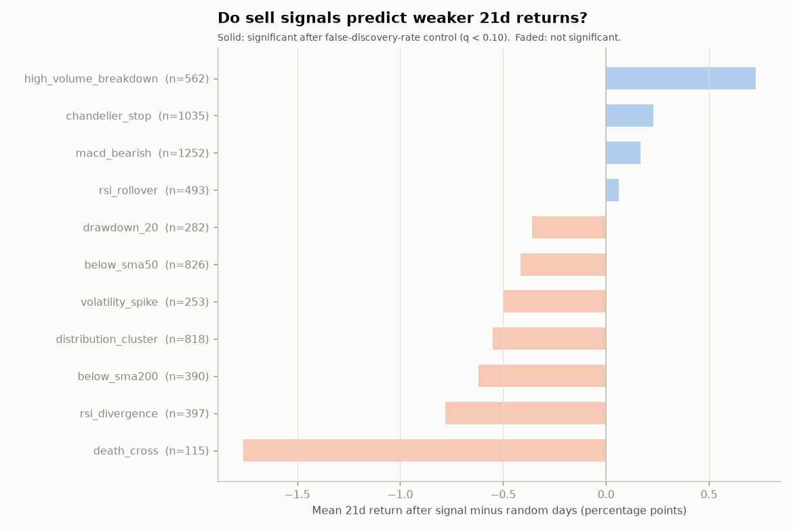
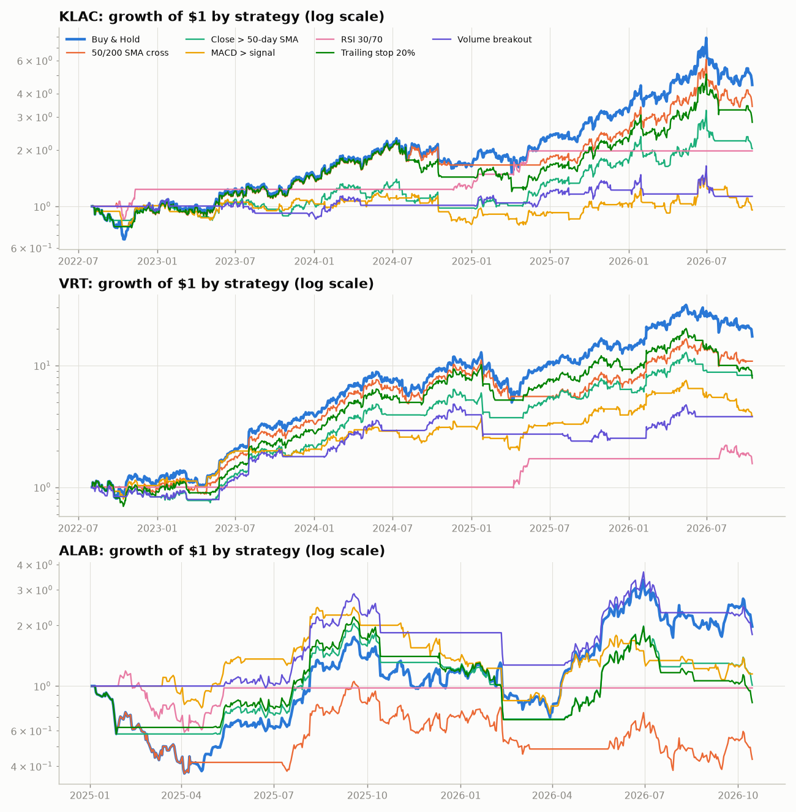
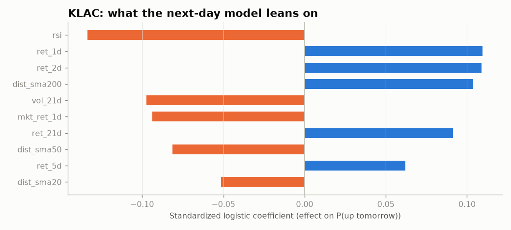
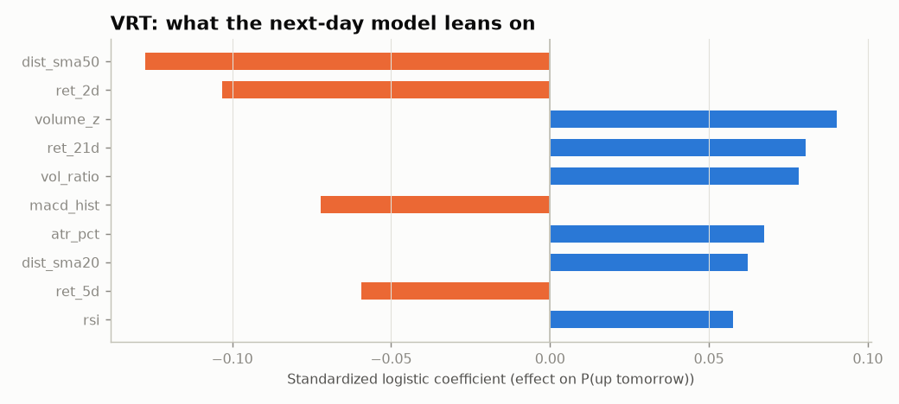
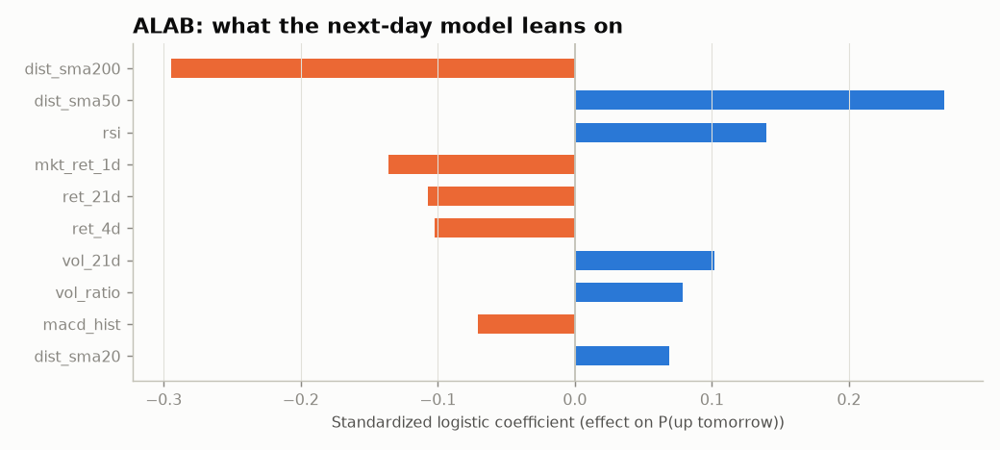
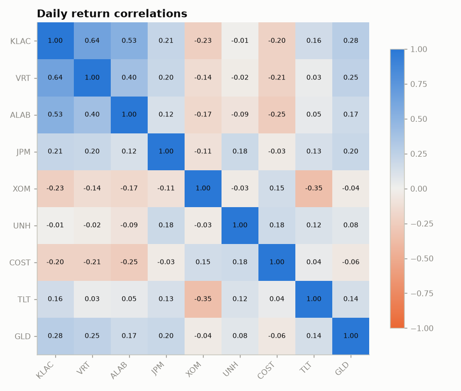
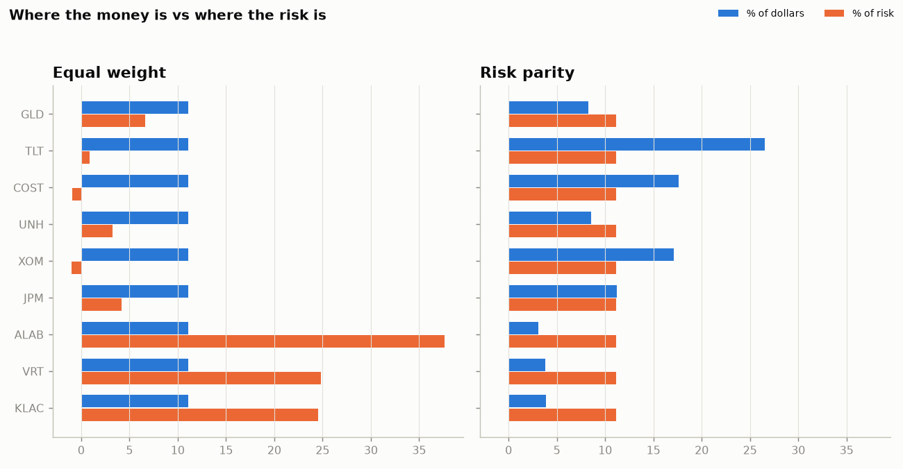
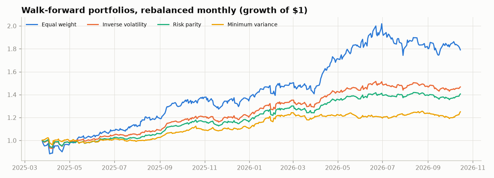

# stocklab report
Generated 2026-10-15 | data source: `yahoo` | history: 5 years

> Educational research code, not investment advice. Past results do not predict future returns.

**Holdings at a glance**

| ticker | status | score | P&L | close |
|---|---|---|---|---|
| KLAC | EXIT | 8/15 | -18.8% | 168.98 |
| VRT | EXIT | 10/15 | -21.0% | 207.02 |
| ALAB | EXIT | 6/15 | -15.1% | 282.58 |

## 1. Sell check on current holdings

```
KLAC  EXIT  (score 8/15, close 168.98 on 2026-10-15)
  Entry 208.00 -> P&L -18.8%
  RSI 33 | -43.9% from 52-week high
  Triggered:
    - [position] Price is below your 15% stop-loss at 176.80 (overrides score)
    - [trend] Close below the 50-day moving average (+1)
    - [trend] Close below the 200-day moving average (+2)
    - [momentum] MACD line below its signal line (+1)
    - [volume] 5+ distribution days in the last 25 sessions (institutional selling) (+1)
    - [risk] 20%+ below the 52-week high (+1)
    - [risk] Close below the chandelier stop (22-day high minus 3x ATR) (+2)
  Levels to watch:
    50-day SMA                 187.31  (price is below, -9.8%)
    Chandelier stop            184.51  (price is below, -8.4%)
    200-day SMA                180.50  (price is below, -6.4%)
    Your 15% stop-loss         176.80  (price is below, -4.4%)
```

```
VRT  EXIT  (score 10/15, close 207.02 on 2026-10-15)
  Entry 262.00 -> P&L -21.0%
  RSI 28 | -44.9% from 52-week high
  Triggered:
    - [position] Price is below your 15% stop-loss at 222.70 (overrides score)
    - [trend] Close below the 50-day moving average (+1)
    - [trend] Close below the 200-day moving average (+2)
    - [trend] 50-day average below the 200-day average (+2)
    - [momentum] MACD line below its signal line (+1)
    - [volume] 5+ distribution days in the last 25 sessions (institutional selling) (+1)
    - [risk] 20%+ below the 52-week high (+1)
    - [risk] Close below the chandelier stop (22-day high minus 3x ATR) (+2)
  Levels to watch:
    200-day SMA                267.95  (price is below, -22.7%)
    50-day SMA                 256.65  (price is below, -19.3%)
    Chandelier stop            222.94  (price is below, -7.1%)
    Your 15% stop-loss         222.70  (price is below, -7.0%)
```

```
ALAB  EXIT  (score 6/15, close 282.58 on 2026-10-15)
  Entry 333.00 -> P&L -15.1%
  RSI 37 | -41.5% from 52-week high
  Triggered:
    - [position] Price is below your 15% stop-loss at 283.05 (overrides score)
    - [trend] Close below the 50-day moving average (+1)
    - [momentum] MACD line below its signal line (+1)
    - [volume] 5+ distribution days in the last 25 sessions (institutional selling) (+1)
    - [risk] 20%+ below the 52-week high (+1)
    - [risk] Close below the chandelier stop (22-day high minus 3x ATR) (+2)
  Levels to watch:
    Chandelier stop            328.93  (price is below, -14.1%)
    50-day SMA                 315.86  (price is below, -10.5%)
    Your 15% stop-loss         283.05  (price is below, -0.2%)
    200-day SMA                249.14  (price is above, +13.4%)
```

## 2. Which sell signals actually work? (event study)

Panel: 36 stocks, 5 years. Null hypothesis: returns after a signal look like returns on random days from the same stocks.

| rule | horizon | events | mean_after_signal | mean_random_days | difference | p_value | q_value | drop10_after_signal | drop10_base_rate | verdict |
|---|---|---|---|---|---|---|---|---|---|---|
| below_sma50 | 5d | 837 | +0.47% | +0.64% | -0.18% | 0.175 | 0.424 | 37% | 34% | weak (not significant) |
| below_sma50 | 21d | 826 | +2.40% | +2.82% | -0.42% | 0.161 | 0.424 | 37% | 34% | weak (not significant) |
| below_sma50 | 63d | 789 | +8.70% | +9.50% | -0.80% | 0.167 | 0.424 | 37% | 34% | weak (not significant) |
| below_sma200 | 5d | 397 | +0.29% | +0.54% | -0.25% | 0.175 | 0.424 | 37% | 34% | weak (not significant) |
| below_sma200 | 21d | 390 | +1.74% | +2.35% | -0.62% | 0.142 | 0.424 | 37% | 34% | weak (not significant) |
| below_sma200 | 63d | 368 | +8.00% | +7.97% | +0.03% | 0.529 | 0.851 | 37% | 34% | no edge |
| death_cross | 5d | 119 | +0.14% | +0.56% | -0.42% | 0.193 | 0.424 | 47% | 34% | weak (not significant) |
| death_cross | 21d | 115 | +0.68% | +2.44% | -1.76% | 0.051 | 0.424 | 47% | 34% | weak (not significant) |
| death_cross | 63d | 112 | +7.66% | +8.56% | -0.89% | 0.338 | 0.594 | 47% | 34% | weak (not significant) |
| rsi_divergence | 5d | 398 | +0.32% | +0.76% | -0.44% | 0.060 | 0.424 | 36% | 34% | weak (not significant) |
| rsi_divergence | 21d | 397 | +2.56% | +3.34% | -0.78% | 0.099 | 0.424 | 36% | 34% | weak (not significant) |
| rsi_divergence | 63d | 388 | +9.40% | +11.37% | -1.97% | 0.051 | 0.424 | 36% | 34% | weak (not significant) |
| rsi_rollover | 5d | 500 | +1.70% | +0.75% | +0.95% | 1.000 | 1.000 | 33% | 34% | no edge |
| rsi_rollover | 21d | 493 | +3.37% | +3.31% | +0.06% | 0.542 | 0.851 | 33% | 34% | no edge |
| rsi_rollover | 63d | 484 | +8.45% | +11.33% | -2.88% | 0.002 | 0.066 | 33% | 34% | useful |
| macd_bearish | 5d | 1262 | +0.71% | +0.68% | +0.03% | 0.574 | 0.861 | 34% | 34% | no edge |
| macd_bearish | 21d | 1252 | +3.15% | +2.98% | +0.17% | 0.682 | 0.925 | 34% | 34% | no edge |
| macd_bearish | 63d | 1199 | +10.53% | +10.12% | +0.41% | 0.726 | 0.925 | 34% | 34% | no edge |
| distribution_cluster | 5d | 832 | +0.91% | +0.69% | +0.22% | 0.860 | 1.000 | 35% | 34% | no edge |
| distribution_cluster | 21d | 818 | +2.47% | +3.02% | -0.55% | 0.094 | 0.424 | 35% | 34% | weak (not significant) |
| distribution_cluster | 63d | 793 | +9.48% | +10.32% | -0.84% | 0.161 | 0.424 | 35% | 34% | weak (not significant) |
| high_volume_breakdown | 5d | 566 | +0.81% | +0.62% | +0.20% | 0.803 | 0.981 | 31% | 34% | no edge |
| high_volume_breakdown | 21d | 562 | +3.43% | +2.71% | +0.73% | 0.917 | 1.000 | 31% | 34% | no edge |
| high_volume_breakdown | 63d | 542 | +11.62% | +9.19% | +2.43% | 0.989 | 1.000 | 31% | 34% | no edge |
| drawdown_20 | 5d | 290 | +1.04% | +0.80% | +0.24% | 0.729 | 0.925 | 46% | 34% | no edge |
| drawdown_20 | 21d | 282 | +3.14% | +3.50% | -0.36% | 0.336 | 0.594 | 46% | 34% | weak (not significant) |
| drawdown_20 | 63d | 265 | +14.72% | +12.00% | +2.72% | 0.937 | 1.000 | 46% | 34% | no edge |
| volatility_spike | 5d | 253 | +0.40% | +0.73% | -0.33% | 0.181 | 0.424 | 42% | 34% | weak (not significant) |
| volatility_spike | 21d | 253 | +2.62% | +3.12% | -0.50% | 0.270 | 0.557 | 42% | 34% | weak (not significant) |
| volatility_spike | 63d | 242 | +8.68% | +10.49% | -1.82% | 0.116 | 0.424 | 42% | 34% | weak (not significant) |
| chandelier_stop | 5d | 1046 | +0.61% | +0.68% | -0.07% | 0.342 | 0.594 | 34% | 34% | weak (not significant) |
| chandelier_stop | 21d | 1035 | +3.20% | +2.97% | +0.23% | 0.715 | 0.925 | 34% | 34% | no edge |
| chandelier_stop | 63d | 986 | +11.32% | +10.00% | +1.32% | 0.962 | 1.000 | 34% | 34% | no edge |

**1 of 33 rule-by-horizon tests** show significantly weaker returns after the signal (q < 0.10).



## 3. Strategy backtests

### KLAC (2022-08-02 to 2026-10-15)

| strategy | Total return | CAGR | Max drawdown | Volatility | Sharpe | Round trips | Time in market | Sharpe vs B&H | 95% CI | p-value |
|---|---|---|---|---|---|---|---|---|---|---|
| Buy & Hold | +344.2% | +42.7% | -44.5% | +46.3% | 1.00 | 0 | 100% |  |  |  |
| 50/200 SMA cross | +241.0% | +34.0% | -44.5% | +41.2% | 0.92 | 2 | 78% | -0.08 | [-0.54, +0.37] | 0.69 |
| Close > 50-day SMA | +103.1% | +18.4% | -37.5% | +37.4% | 0.64 | 41 | 67% | -0.36 | [-0.86, +0.14] | 0.15 |
| MACD > signal | -4.4% | -1.1% | -39.9% | +33.5% | 0.14 | 43 | 49% | -0.86 | [-1.51, -0.35] | 0.00 |
| RSI 30/70 | +97.4% | +17.6% | -20.0% | +15.9% | 1.10 | 3 | 9% | +0.10 | [-0.82, +1.00] | 0.83 |
| Trailing stop 20% | +180.7% | +27.9% | -46.5% | +42.4% | 0.79 | 7 | 86% | -0.21 | [-0.53, +0.10] | 0.21 |
| Volume breakout | +13.0% | +3.0% | -31.2% | +27.6% | 0.24 | 9 | 35% | -0.76 | [-1.51, -0.03] | 0.05 |

### VRT (2022-08-02 to 2026-10-15)

| strategy | Total return | CAGR | Max drawdown | Volatility | Sharpe | Round trips | Time in market | Sharpe vs B&H | 95% CI | p-value |
|---|---|---|---|---|---|---|---|---|---|---|
| Buy & Hold | +1635.3% | +97.6% | -61.3% | +62.6% | 1.40 | 0 | 100% |  |  |  |
| 50/200 SMA cross | +985.4% | +76.7% | -52.9% | +56.8% | 1.29 | 2 | 86% | -0.12 | [-0.56, +0.23] | 0.58 |
| Close > 50-day SMA | +730.4% | +65.7% | -42.2% | +48.9% | 1.28 | 27 | 69% | -0.12 | [-0.76, +0.44] | 0.68 |
| MACD > signal | +283.6% | +37.8% | -49.2% | +44.5% | 0.95 | 42 | 52% | -0.46 | [-0.99, +0.15] | 0.12 |
| RSI 30/70 | +56.0% | +11.2% | -29.5% | +18.5% | 0.66 | 1 | 8% | -0.74 | [-2.07, +0.46] | 0.24 |
| Trailing stop 20% | +689.1% | +63.7% | -60.8% | +54.8% | 1.17 | 8 | 84% | -0.23 | [-0.69, +0.22] | 0.32 |
| Volume breakout | +279.8% | +37.5% | -51.3% | +43.4% | 0.95 | 10 | 49% | -0.45 | [-1.22, +0.24] | 0.21 |

### ALAB (2025-01-03 to 2026-10-15)

| strategy | Total return | CAGR | Max drawdown | Volatility | Sharpe | Round trips | Time in market | Sharpe vs B&H | 95% CI | p-value |
|---|---|---|---|---|---|---|---|---|---|---|
| Buy & Hold | +97.2% | +46.6% | -63.2% | +95.8% | 0.88 | 0 | 100% |  |  |  |
| 50/200 SMA cross | -56.7% | -37.6% | -63.8% | +85.8% | -0.12 | 2 | 74% | -1.00 | [-1.96, -0.24] | 0.03 |
| Close > 50-day SMA | +1.0% | +0.6% | -66.4% | +71.6% | 0.37 | 9 | 54% | -0.51 | [-1.57, +0.46] | 0.32 |
| MACD > signal | +14.8% | +8.1% | -70.4% | +66.6% | 0.45 | 21 | 52% | -0.43 | [-1.53, +0.77] | 0.45 |
| RSI 30/70 | -2.2% | -1.2% | -50.3% | +36.4% | 0.15 | 1 | 16% | -0.73 | [-2.33, +1.22] | 0.38 |
| Trailing stop 20% | -17.2% | -10.1% | -69.1% | +73.5% | 0.23 | 9 | 58% | -0.65 | [-1.71, +0.28] | 0.20 |
| Volume breakout | +80.1% | +39.3% | -55.7% | +64.7% | 0.83 | 3 | 43% | -0.05 | [-1.24, +1.02] | 0.94 |



## 4. Next-day forecasts

### KLAC

Walk-forward test on 551 unseen days (2024-08-05 to 2026-10-14).

| model | accuracy | always-majority accuracy | p (beats majority) | AUC | Brier | strategy Sharpe | buy & hold Sharpe |
|---|---|---|---|---|---|---|---|
| Majority class (baseline) | 0.561 | 0.561 | 0.518 | 0.48 | 0.248 | 1.043 | 1.043 |
| Logistic regression | 0.548 | 0.561 | 0.74 | 0.513 | 0.251 | 0.505 | 1.043 |
| Gradient boosting | 0.525 | 0.561 | 0.961 | 0.52 | 0.256 | 1.133 | 1.043 |

| model | RMSE (bps) | R2 out-of-sample vs zero | direction hit rate | DM p (beats zero) |
|---|---|---|---|---|
| Zero / random walk (baseline) | 332.1 | 0.0 |  |  |
| Ridge regression | 335.1 | -0.0183 | 0.515 | 0.881 |
| Gradient boosting | 332.4 | -0.0023 | 0.515 | 0.541 |

Forecast for the next session:

```
  P(up) | Logistic regression      54.2%
  P(up) | Gradient boosting        54.9%
  P(up) | historical base rate     53.8%
  expected return (ridge)          +0.42%
  80% range low                    -3.12%
  80% range high                   +4.09%
  daily volatility                 +2.80%
```

Best out-of-sample AUC **0.520**: no reliable edge: treat the forecast as close to a coin flip.



### VRT

Walk-forward test on 551 unseen days (2024-08-05 to 2026-10-14).

| model | accuracy | always-majority accuracy | p (beats majority) | AUC | Brier | strategy Sharpe | buy & hold Sharpe |
|---|---|---|---|---|---|---|---|
| Majority class (baseline) | 0.543 | 0.543 | 0.518 | 0.481 | 0.248 | 1.113 | 1.113 |
| Logistic regression | 0.506 | 0.543 | 0.96 | 0.473 | 0.254 | 0.623 | 1.113 |
| Gradient boosting | 0.523 | 0.543 | 0.837 | 0.519 | 0.257 | 1.27 | 1.113 |

| model | RMSE (bps) | R2 out-of-sample vs zero | direction hit rate | DM p (beats zero) |
|---|---|---|---|---|
| Zero / random walk (baseline) | 423.9 | 0.0 |  |  |
| Ridge regression | 429.1 | -0.0248 | 0.53 | 0.973 |
| Gradient boosting | 430.9 | -0.0334 | 0.475 | 0.959 |

Forecast for the next session:

```
  P(up) | Logistic regression      58.6%
  P(up) | Gradient boosting        58.1%
  P(up) | historical base rate     54.3%
  expected return (ridge)          +0.41%
  80% range low                    -3.13%
  80% range high                   +4.07%
  daily volatility                 +2.80%
```

Best out-of-sample AUC **0.519**: no reliable edge: treat the forecast as close to a coin flip.



### ALAB

Walk-forward test on 194 unseen days (2026-01-07 to 2026-10-14).

| model | accuracy | always-majority accuracy | p (beats majority) | AUC | Brier | strategy Sharpe | buy & hold Sharpe |
|---|---|---|---|---|---|---|---|
| Majority class (baseline) | 0.526 | 0.526 | 0.529 | 0.454 | 0.25 | 1.189 | 1.189 |
| Logistic regression | 0.495 | 0.526 | 0.825 | 0.484 | 0.259 | 0.644 | 1.189 |
| Gradient boosting | 0.469 | 0.526 | 0.951 | 0.438 | 0.288 | 0.49 | 1.189 |

| model | RMSE (bps) | R2 out-of-sample vs zero | direction hit rate | DM p (beats zero) |
|---|---|---|---|---|
| Zero / random walk (baseline) | 633.1 | 0.0 |  |  |
| Ridge regression | 654.0 | -0.0673 | 0.469 | 0.966 |
| Gradient boosting | 672.6 | -0.1286 | 0.438 | 0.996 |

Forecast for the next session:

```
  P(up) | Logistic regression      51.6%
  P(up) | Gradient boosting        72.5%
  P(up) | historical base rate     52.0%
  expected return (ridge)          +1.01%
  80% range low                    -5.71%
  80% range high                   +8.20%
  daily volatility                 +5.37%
```

Best out-of-sample AUC **0.484**: no reliable edge: treat the forecast as close to a coin flip.



## 5. Stock screen and entry plans

| ticker | rank | score | passes_filters | close | momentum_12_1 | momentum_6m | volatility | off_52w_high | forward_pe | pullback_entry | breakout_trigger | stop | stop_% | shares | position_$ | max_loss_$ | filter_notes |
|---|---|---|---|---|---|---|---|---|---|---|---|---|---|---|---|---|---|
| LLY | 1 | +0.73 | True | 1260.86 | +40.9% | +39.9% | +30.8% | -1.5% | 26.6 | 1179.02 | 1263.38 | 1107.49 | -6.1% | 8 | 9432.0 | 572.0 |  |
| XOM | 2 | +0.71 | True | 175.76 | +49.7% | +17.2% | +23.7% | -0.7% | 15.1 | 165.4 | 177.36 | 158.51 | -4.2% | 60 | 9924.0 | 413.0 |  |
| KO | 3 | +0.59 | True | 93.79 | +33.6% | +26.3% | +18.0% | +0.0% | 26.6 | 88.05 | 93.97 | 85.26 | -3.2% | 113 | 9950.0 | 316.0 |  |
| AAPL | 4 | +0.56 | True | 345.11 | +34.7% | +31.3% | +25.8% | +0.0% | 36.0 | 337.21 | 345.8 | 324.11 | -3.9% | 29 | 9779.0 | 380.0 |  |
| ALAB | 5 | +0.55 | True | 283.61 | +66.6% | +66.0% | +92.6% | -41.3% | 44.4 | 259.34 | 390.58 | 210.8 | -18.7% | 20 | 5187.0 | 971.0 |  |
| JNJ | 6 | +0.46 | True | 260.10 | +43.2% | +12.1% | +23.6% | -6.6% | 22.2 | 253.85 | 272.49 | 241.34 | -4.9% | 39 | 9900.0 | 488.0 |  |
| NVDA | 7 | +0.34 | True | 215.57 | +19.1% | +8.9% | +36.6% | -9.9% | 13.6 | 209.56 | 239.72 | 197.54 | -5.7% | 47 | 9849.0 | 565.0 |  |
| V | 8 | +0.32 | True | 397.11 | +7.3% | +26.5% | +18.4% | +0.0% | 26.4 | 372.87 | 397.9 | 359.3 | -3.6% | 26 | 9695.0 | 353.0 |  |
| JPM | 9 | +0.26 | True | 333.62 | +17.1% | +8.7% | +17.1% | -8.2% | 13.1 | 327.28 | 350.99 | 314.61 | -3.9% | 30 | 9819.0 | 380.0 |  |
| GOOGL | 10 | +0.17 | True | 351.47 | +40.1% | +4.7% | +32.0% | -12.6% | 23.1 | 346.97 | 355.68 | 329.58 | -5.0% | 28 | 9715.0 | 487.0 |  |
| MSFT | 11 | +0.12 | True | 533.22 | -3.7% | +27.4% | +37.3% | -1.9% | 22.5 | 518.15 | 544.54 | 495.53 | -4.4% | 19 | 9845.0 | 430.0 |  |
| UNH | 12 | +0.11 | True | 408.75 | +7.0% | +30.7% | +24.2% | -5.7% | 17.7 | 386.13 | 409.57 | 363.35 | -5.9% | 25 | 9653.0 | 569.0 |  |
| PG | 13 | -0.23 | True | 159.10 | +1.5% | +12.8% | +16.5% | -3.4% | 21.5 | 148.87 | 159.41 | 143.73 | -3.5% | 67 | 9974.0 | 344.0 |  |
| AMZN | 14 | -0.30 | True | 252.43 | +13.7% | +1.1% | +39.9% | -11.1% | 24.1 | 246.67 | 262.95 | 235.14 | -4.7% | 40 | 9867.0 | 461.0 |  |
| LIN | 15 | -0.45 | True | 496.63 | +2.0% | +0.1% | +18.9% | -8.8% | 25.4 | 478.03 | 497.62 | 462.57 | -3.2% | 20 | 9561.0 | 309.0 |  |

## 6. Portfolio construction

Assets: KLAC, VRT, ALAB, JPM, XOM, UNH, COST, TLT, GLD. Covariance: Ledoit-Wolf shrinkage on the last 252 trading days.

Weights and share of risk (%):

| asset | weight: Equal weight | weight: Inverse volatility | weight: Risk parity | weight: Minimum variance | risk share: Equal weight | risk share: Inverse volatility | risk share: Risk parity | risk share: Minimum variance |
|---|---|---|---|---|---|---|---|---|
| KLAC | 11.1 | 5.4 | 3.8 | 1.0 | 24.6 | 17.4 | 11.1 | 1.2 |
| VRT | 11.1 | 5.0 | 3.8 | 1.4 | 24.8 | 15.9 | 11.1 | 1.7 |
| ALAB | 11.1 | 3.4 | 3.1 | 1.6 | 37.7 | 13.2 | 11.1 | 1.9 |
| JPM | 11.1 | 13.8 | 11.2 | 15.1 | 4.2 | 13.5 | 11.1 | 18.1 |
| XOM | 11.1 | 12.0 | 17.1 | 18.6 | -1.0 | 1.8 | 11.1 | 22.3 |
| UNH | 11.1 | 9.2 | 8.5 | 4.1 | 3.2 | 10.0 | 11.1 | 4.9 |
| COST | 11.1 | 15.1 | 17.6 | 21.4 | -0.9 | 4.8 | 11.1 | 25.6 |
| TLT | 11.1 | 25.2 | 26.5 | 30.0 | 0.9 | 9.1 | 11.1 | 16.1 |
| GLD | 11.1 | 10.8 | 8.3 | 6.8 | 6.6 | 14.4 | 11.1 | 8.2 |

| method | expected volatility | diversification ratio | effective number of bets | largest risk share | largest risk holder |
|---|---|---|---|---|---|
| Equal weight | 21.5% | 1.91 | 3.69 | 37.7% | ALAB |
| Inverse volatility | 11.8% | 2.47 | 7.54 | 17.4% | KLAC |
| Risk parity | 10.4% | 2.66 | 9.00 | 11.1% | TLT |
| Minimum variance | 9.2% | 2.56 | 5.44 | 25.6% | COST |

Out-of-sample comparison, monthly rebalance (2025-03-25 to 2026-10-15; limited by the asset with the shortest history):

| method | CAGR | Volatility | Sharpe | Max drawdown |
|---|---|---|---|---|
| Equal weight | +45.3% | +22.3% | 1.79 | -13.7% |
| Inverse volatility | +27.9% | +13.5% | 1.89 | -7.2% |
| Risk parity | +24.4% | +12.1% | 1.87 | -6.7% |
| Minimum variance | +15.4% | +10.1% | 1.47 | -6.0% |






