# stocklab report
Generated 2026-11-11 | data source: `yahoo` | history: 5 years | watchlist: ALAB, AMD, NVDA, MRVL, GOOG, FSLR, SKHY, ETN, TSLA, SPCX, AMZN, IBM, GEV, CEG, VST, DELL, TSM, BE

> Educational research code, not investment advice. Past results do not predict future returns.

## 1. Decision board

Data as of the 2026-11-10 close. `*` = provisional (under 200 trading days of history).

| ticker | action | close | 1 day | 1 month | buy rank | sell warnings | pullback entry | breakout | stop | why |
|---|---|---|---|---|---|---|---|---|---|---|
| AMZN | BUY | 270.87 | +1.5% | +4.4% | 4/9 | 1/15 | 255.26 | 271.41 | 236.33 | buy rank 4/9; +11% vs 200-day average; distribution days |
| AMD | WATCH | 515.21 | +1.3% | -13.3% | 1/9 | 5/15 | 476.10 | 579.60 | 397.87 | +23% vs 200-day average; below 50-day, MACD bearish, distribution days, 20%+ off high, volatility spike |
| IBM | WATCH | 244.53 | +0.0% | +8.5% | 5/9 | 4/15 | 235.58 | 257.02 | 221.79 | +0% vs 200-day average; death cross, MACD bearish, 20%+ off high |
| DELL | REDUCE | 346.31 | +5.4% | -40.8% | 1/9 | 7/15 |  |  |  | +3% vs 200-day average; below 50-day, MACD bearish, distribution days, 20%+ off high, volatility spike, below chandelier stop |
| TSM | REDUCE | 396.48 | +2.0% | -10.8% | 3/9 | 8/15 |  |  |  | -1% vs 200-day average; below 50-day, below 200-day, MACD bearish, distribution days, volatility spike, below chandelier stop |
| ALAB | REDUCE | 216.87 | +13.7% | -36.6% | 7/9 | 8/15 |  |  |  | -15% vs 200-day average; below 50-day, below 200-day, MACD bearish, distribution days, 20%+ off high, below chandelier stop |
| SPCX | REDUCE* | 142.07 | +5.8% | -12.6% | 9/9 | 4/10 |  |  |  | -5% vs 50-day average; below 50-day, MACD bearish, distribution days, 20%+ off high (provisional: 104 days of history) |
| CEG | REDUCE | 276.09 | +10.5% | -7.4% | 13/9 | 6/15 |  |  |  | -1% vs 200-day average; below 200-day, death cross, distribution days, 20%+ off high |
| TSLA | REDUCE | 379.78 | +0.5% | +0.5% | 8/9 | 7/15 |  |  |  | -1% vs 200-day average; below 200-day, death cross, MACD bearish, distribution days, 20%+ off high |
| BE | REDUCE | 193.88 | +11.9% | -30.9% | 15/9 | 8/15 |  |  |  | -13% vs 200-day average; below 50-day, below 200-day, MACD bearish, distribution days, 20%+ off high, below chandelier stop |
| MRVL | SELL | 154.39 | -0.1% | -41.9% | 2/9 | 9/15 |  |  |  | -17% vs 200-day average; below 50-day, below 200-day, MACD bearish, distribution days, 20%+ off high, volatility spike, below chandelier stop |
| GEV | SELL | 829.34 | +7.1% | -17.4% | 11/9 | 11/15 |  |  |  | -13% vs 200-day average; below 50-day, below 200-day, death cross, MACD bearish, distribution days, 20%+ off high, volatility spike, below chandelier stop |
| ETN | SELL | 354.22 | -1.1% | -16.7% | 6/9 | 9/15 |  |  |  | -10% vs 200-day average; below 50-day, below 200-day, MACD bearish, distribution days, 20%+ off high, volatility spike, below chandelier stop |
| GOOG | SELL | 286.01 | +0.7% | -17.8% | 12/9 | 11/15 |  |  |  | -15% vs 200-day average; below 50-day, below 200-day, death cross, MACD bearish, distribution days, 20%+ off high, volatility spike, below chandelier stop |
| NVDA | SELL | 168.89 | -5.5% | -25.4% | 7/9 | 10/15 |  |  |  | -17% vs 200-day average; below 50-day, below 200-day, MACD bearish, distribution days, high-volume breakdown, 20%+ off high, below chandelier stop |
| SKHY | SELL* | 134.38 | +5.5% | -20.5% | 16/9 | 6/10 |  |  |  | -19% vs 50-day average; below 50-day, MACD bearish, distribution days, 20%+ off high, below chandelier stop (provisional: 86 days of history) |
| VST | SELL | 133.92 | +7.3% | -17.1% | 17/9 | 11/15 |  |  |  | -12% vs 200-day average; below 50-day, below 200-day, death cross, MACD bearish, distribution days, 20%+ off high, volatility spike, below chandelier stop |
| FSLR | SELL | 180.98 | -5.5% | +0.7% | 9/9 | 9/15 |  |  |  | -15% vs 200-day average; below 50-day, below 200-day, death cross, distribution days, 20%+ off high, below chandelier stop |

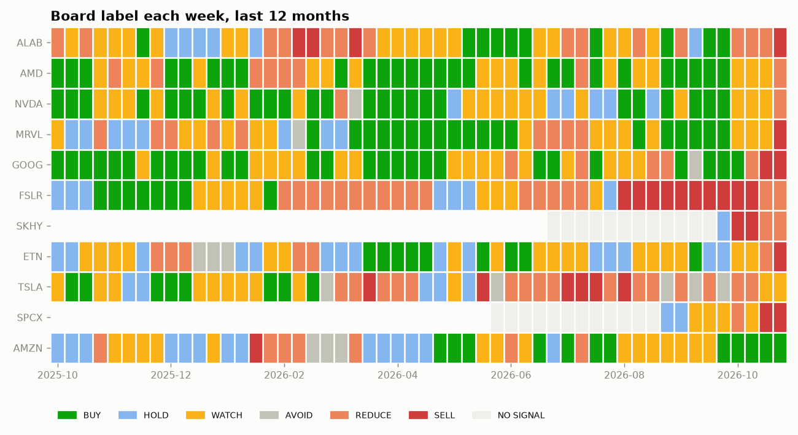

**Trading the labels** (2022-02-07 to 2026-11-10): buy on BUY, exit on SELL, REDUCE or AVOID, reviewed weekly with next-day execution and 5 bp costs.

| strategy | CAGR | Volatility | Sharpe | Max drawdown | Time invested | Avg holdings |
|---|---|---|---|---|---|---|
| Board strategy | +41.6% | 33.6% | 1.20 | -38.4% | 99% | 6.7 |
| Equal-weight watchlist | +44.2% | 34.2% | 1.24 | -36.8% | 100% | 15.0 |
| SPY (buy & hold) | +12.8% | 17.3% | 0.78 | -22.1% |  |  |

Sharpe difference vs equal weight: -0.04, 95% block-bootstrap CI [-0.52, +0.44].

Forward 21-day return after each label, relative to the watchlist average on the same date (sampled every 21 days, t-test across dates):

| label | observations | dates | mean 21d excess return | hit rate | p_value |
|---|---|---|---|---|---|
| BUY | 267 | 55 | +0.6% | 53% | 0.42 |
| HOLD | 119 | 44 | -0.7% | 45% | 0.57 |
| WATCH | 156 | 47 | +0.3% | 53% | 0.81 |
| AVOID | 46 | 23 | -1.7% | 43% | 0.48 |
| REDUCE | 157 | 52 | +0.5% | 46% | 0.67 |
| SELL | 91 | 33 | -1.6% | 39% | 0.35 |

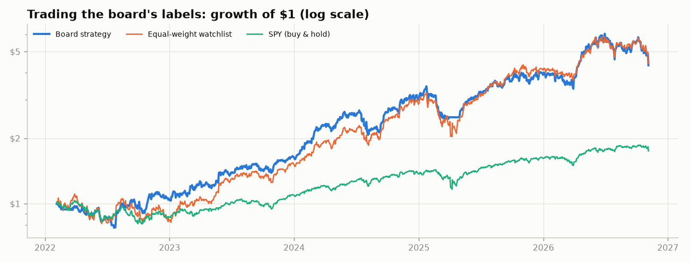

## 2. Sell check, stock by stock

```
ALAB  REDUCE  (score 8/15, close 216.87 on 2026-11-09)
  RSI 37 | -55.1% from 52-week high
  Triggered:
    - [trend] Close below the 50-day moving average (+1)
    - [trend] Close below the 200-day moving average (+2)
    - [momentum] MACD line below its signal line (+1)
    - [volume] 5+ distribution days in the last 25 sessions (institutional selling) (+1)
    - [risk] 20%+ below the 52-week high (+1)
    - [risk] Close below the chandelier stop (22-day high minus 3x ATR) (+2)
  Levels to watch:
    50-day SMA                 299.01  (price is below, -27.5%)
    Chandelier stop            274.51  (price is below, -21.0%)
    200-day SMA                256.29  (price is below, -15.4%)
```

```
AMD  WATCH  (score 5/15, close 515.21 on 2026-11-10)
  RSI 49 | -20.7% from 52-week high
  Triggered:
    - [trend] Close below the 50-day moving average (+1)
    - [momentum] MACD line below its signal line (+1)
    - [volume] 5+ distribution days in the last 25 sessions (institutional selling) (+1)
    - [risk] 20%+ below the 52-week high (+1)
    - [risk] 21-day volatility 1.5x+ its 1-year median (+1)
  Levels to watch:
    50-day SMA                 548.56  (price is below, -6.1%)
    Chandelier stop            488.86  (price is above, +5.4%)
    200-day SMA                418.54  (price is above, +23.1%)
```

```
NVDA  EXIT  (score 10/15, close 168.89 on 2026-11-10)
  RSI 24 | -29.4% from 52-week high
  Triggered:
    - [trend] Close below the 50-day moving average (+1)
    - [trend] Close below the 200-day moving average (+2)
    - [momentum] MACD line below its signal line (+1)
    - [volume] 5+ distribution days in the last 25 sessions (institutional selling) (+1)
    - [volume] Down day closing below the 50-day average on 1.5x+ average volume (+2)
    - [risk] 20%+ below the 52-week high (+1)
    - [risk] Close below the chandelier stop (22-day high minus 3x ATR) (+2)
  Levels to watch:
    50-day SMA                 217.97  (price is below, -22.5%)
    200-day SMA                204.26  (price is below, -17.3%)
    Chandelier stop            202.76  (price is below, -16.7%)
```

```
MRVL  EXIT  (score 9/15, close 154.39 on 2026-11-10)
  RSI 32 | -51.2% from 52-week high
  Triggered:
    - [trend] Close below the 50-day moving average (+1)
    - [trend] Close below the 200-day moving average (+2)
    - [momentum] MACD line below its signal line (+1)
    - [volume] 5+ distribution days in the last 25 sessions (institutional selling) (+1)
    - [risk] 20%+ below the 52-week high (+1)
    - [risk] 21-day volatility 1.5x+ its 1-year median (+1)
    - [risk] Close below the chandelier stop (22-day high minus 3x ATR) (+2)
  Levels to watch:
    50-day SMA                 231.89  (price is below, -33.4%)
    Chandelier stop            225.79  (price is below, -31.6%)
    200-day SMA                185.72  (price is below, -16.9%)
```

```
GOOG  EXIT  (score 11/15, close 286.01 on 2026-11-09)
  RSI 32 | -28.2% from 52-week high
  Triggered:
    - [trend] Close below the 50-day moving average (+1)
    - [trend] Close below the 200-day moving average (+2)
    - [trend] 50-day average below the 200-day average (+2)
    - [momentum] MACD line below its signal line (+1)
    - [volume] 5+ distribution days in the last 25 sessions (institutional selling) (+1)
    - [risk] 20%+ below the 52-week high (+1)
    - [risk] 21-day volatility 1.5x+ its 1-year median (+1)
    - [risk] Close below the chandelier stop (22-day high minus 3x ATR) (+2)
  Levels to watch:
    200-day SMA                337.02  (price is below, -15.1%)
    50-day SMA                 328.63  (price is below, -13.0%)
    Chandelier stop            323.39  (price is below, -11.6%)
```

```
FSLR  EXIT  (score 9/15, close 180.98 on 2026-11-10)
  RSI 48 | -43.1% from 52-week high
  Triggered:
    - [trend] Close below the 50-day moving average (+1)
    - [trend] Close below the 200-day moving average (+2)
    - [trend] 50-day average below the 200-day average (+2)
    - [volume] 5+ distribution days in the last 25 sessions (institutional selling) (+1)
    - [risk] 20%+ below the 52-week high (+1)
    - [risk] Close below the chandelier stop (22-day high minus 3x ATR) (+2)
  Levels to watch:
    200-day SMA                214.09  (price is below, -15.5%)
    50-day SMA                 186.32  (price is below, -2.9%)
    Chandelier stop            182.23  (price is below, -0.7%)
```

```
SKHY  EXIT  (score 6/10, close 134.38 on 2026-11-09)
  RSI 41 | -32.3% from high since listing
  Only 86 trading days of history; not scored yet: below_sma200, death_cross, volatility_spike
  Triggered:
    - [trend] Close below the 50-day moving average (+1)
    - [momentum] MACD line below its signal line (+1)
    - [volume] 5+ distribution days in the last 25 sessions (institutional selling) (+1)
    - [risk] 20%+ below the high since listing (+1)
    - [risk] Close below the chandelier stop (22-day high minus 3x ATR) (+2)
  Levels to watch:
    50-day SMA                 166.26  (price is below, -19.2%)
    Chandelier stop            143.01  (price is below, -6.0%)
```

```
ETN  EXIT  (score 9/15, close 354.22 on 2026-11-10)
  RSI 42 | -22.8% from 52-week high
  Triggered:
    - [trend] Close below the 50-day moving average (+1)
    - [trend] Close below the 200-day moving average (+2)
    - [momentum] MACD line below its signal line (+1)
    - [volume] 5+ distribution days in the last 25 sessions (institutional selling) (+1)
    - [risk] 20%+ below the 52-week high (+1)
    - [risk] 21-day volatility 1.5x+ its 1-year median (+1)
    - [risk] Close below the chandelier stop (22-day high minus 3x ATR) (+2)
  Levels to watch:
    50-day SMA                 402.24  (price is below, -11.9%)
    200-day SMA                395.27  (price is below, -10.4%)
    Chandelier stop            374.31  (price is below, -5.4%)
```

```
TSLA  REDUCE  (score 7/15, close 379.78 on 2026-11-10)
  RSI 51 | -22.5% from 52-week high
  Triggered:
    - [trend] Close below the 200-day moving average (+2)
    - [trend] 50-day average below the 200-day average (+2)
    - [momentum] MACD line below its signal line (+1)
    - [volume] 5+ distribution days in the last 25 sessions (institutional selling) (+1)
    - [risk] 20%+ below the 52-week high (+1)
  Levels to watch:
    200-day SMA                383.23  (price is below, -0.9%)
    50-day SMA                 372.96  (price is above, +1.8%)
    Chandelier stop            364.18  (price is above, +4.3%)
```

```
SPCX  REDUCE  (score 4/10, close 142.07 on 2026-11-09)
  RSI 48 | -32.8% from high since listing
  Only 104 trading days of history; not scored yet: below_sma200, death_cross, volatility_spike
  Triggered:
    - [trend] Close below the 50-day moving average (+1)
    - [momentum] MACD line below its signal line (+1)
    - [volume] 5+ distribution days in the last 25 sessions (institutional selling) (+1)
    - [risk] 20%+ below the high since listing (+1)
  Levels to watch:
    50-day SMA                 149.19  (price is below, -4.8%)
    Chandelier stop            142.01  (price is above, +0.0%)
```

```
AMZN  HOLD  (score 1/15, close 270.87 on 2026-11-10)
  RSI 62 | -4.6% from 52-week high
  Triggered:
    - [volume] 5+ distribution days in the last 25 sessions (institutional selling) (+1)
  Levels to watch:
    50-day SMA                 254.18  (price is above, +6.6%)
    Chandelier stop            246.94  (price is above, +9.7%)
    200-day SMA                244.24  (price is above, +10.9%)
```

```
IBM  WATCH  (score 4/15, close 244.53 on 2026-11-10)
  RSI 53 | -24.7% from 52-week high
  Triggered:
    - [trend] 50-day average below the 200-day average (+2)
    - [momentum] MACD line below its signal line (+1)
    - [risk] 20%+ below the 52-week high (+1)
  Levels to watch:
    200-day SMA                243.86  (price is above, +0.3%)
    Chandelier stop            237.40  (price is above, +3.0%)
    50-day SMA                 235.58  (price is above, +3.8%)
```

```
GEV  EXIT  (score 11/15, close 829.34 on 2026-11-09)
  RSI 43 | -29.4% from 52-week high
  Triggered:
    - [trend] Close below the 50-day moving average (+1)
    - [trend] Close below the 200-day moving average (+2)
    - [trend] 50-day average below the 200-day average (+2)
    - [momentum] MACD line below its signal line (+1)
    - [volume] 5+ distribution days in the last 25 sessions (institutional selling) (+1)
    - [risk] 20%+ below the 52-week high (+1)
    - [risk] 21-day volatility 1.5x+ its 1-year median (+1)
    - [risk] Close below the chandelier stop (22-day high minus 3x ATR) (+2)
  Levels to watch:
    200-day SMA                948.75  (price is below, -12.6%)
    50-day SMA                 921.42  (price is below, -10.0%)
    Chandelier stop            839.74  (price is below, -1.2%)
```

```
CEG  REDUCE  (score 6/15, close 276.09 on 2026-11-09)
  RSI 56 | -26.8% from 52-week high
  Triggered:
    - [trend] Close below the 200-day moving average (+2)
    - [trend] 50-day average below the 200-day average (+2)
    - [volume] 5+ distribution days in the last 25 sessions (institutional selling) (+1)
    - [risk] 20%+ below the 52-week high (+1)
  Levels to watch:
    200-day SMA                278.09  (price is below, -0.7%)
    50-day SMA                 270.01  (price is above, +2.3%)
    Chandelier stop            259.17  (price is above, +6.5%)
```

```
VST  EXIT  (score 11/15, close 133.92 on 2026-11-09)
  RSI 46 | -29.5% from 52-week high
  Triggered:
    - [trend] Close below the 50-day moving average (+1)
    - [trend] Close below the 200-day moving average (+2)
    - [trend] 50-day average below the 200-day average (+2)
    - [momentum] MACD line below its signal line (+1)
    - [volume] 5+ distribution days in the last 25 sessions (institutional selling) (+1)
    - [risk] 20%+ below the 52-week high (+1)
    - [risk] 21-day volatility 1.5x+ its 1-year median (+1)
    - [risk] Close below the chandelier stop (22-day high minus 3x ATR) (+2)
  Levels to watch:
    200-day SMA                152.15  (price is below, -12.0%)
    50-day SMA                 143.77  (price is below, -6.9%)
    Chandelier stop            138.25  (price is below, -3.1%)
```

```
DELL  REDUCE  (score 7/15, close 346.31 on 2026-11-09)
  RSI 33 | -41.1% from 52-week high
  Triggered:
    - [trend] Close below the 50-day moving average (+1)
    - [momentum] MACD line below its signal line (+1)
    - [volume] 5+ distribution days in the last 25 sessions (institutional selling) (+1)
    - [risk] 20%+ below the 52-week high (+1)
    - [risk] 21-day volatility 1.5x+ its 1-year median (+1)
    - [risk] Close below the chandelier stop (22-day high minus 3x ATR) (+2)
  Levels to watch:
    50-day SMA                 502.30  (price is below, -31.1%)
    Chandelier stop            493.60  (price is below, -29.8%)
    200-day SMA                337.81  (price is above, +2.5%)
```

```
TSM  REDUCE  (score 8/15, close 396.48 on 2026-11-10)
  RSI 44 | -18.4% from 52-week high
  Triggered:
    - [trend] Close below the 50-day moving average (+1)
    - [trend] Close below the 200-day moving average (+2)
    - [momentum] MACD line below its signal line (+1)
    - [volume] 5+ distribution days in the last 25 sessions (institutional selling) (+1)
    - [risk] 21-day volatility 1.5x+ its 1-year median (+1)
    - [risk] Close below the chandelier stop (22-day high minus 3x ATR) (+2)
  Levels to watch:
    50-day SMA                 430.46  (price is below, -7.9%)
    Chandelier stop            404.27  (price is below, -1.9%)
    200-day SMA                400.64  (price is below, -1.0%)
```

```
BE  REDUCE  (score 8/15, close 193.88 on 2026-11-09)
  RSI 43 | -43.9% from 52-week high
  Triggered:
    - [trend] Close below the 50-day moving average (+1)
    - [trend] Close below the 200-day moving average (+2)
    - [momentum] MACD line below its signal line (+1)
    - [volume] 5+ distribution days in the last 25 sessions (institutional selling) (+1)
    - [risk] 20%+ below the 52-week high (+1)
    - [risk] Close below the chandelier stop (22-day high minus 3x ATR) (+2)
  Levels to watch:
    50-day SMA                 245.73  (price is below, -21.1%)
    200-day SMA                222.66  (price is below, -12.9%)
    Chandelier stop            214.82  (price is below, -9.7%)
```

## 3. Which sell signals actually work? (event study)

Panel: 46 stocks, 5 years. Null hypothesis: returns after a signal look like returns on random days from the same stocks.

| rule | horizon | events | mean_after_signal | mean_random_days | difference | p_value | q_value | drop10_after_signal | drop10_base_rate | verdict |
|---|---|---|---|---|---|---|---|---|---|---|
| below_sma50 | 5d | 1071 | +0.20% | +0.68% | -0.48% | 0.006 | 0.132 | 40% | 36% | weak (not significant) |
| below_sma50 | 21d | 1044 | +2.33% | +3.06% | -0.73% | 0.035 | 0.195 | 40% | 36% | weak (not significant) |
| below_sma50 | 63d | 995 | +8.60% | +10.21% | -1.61% | 0.019 | 0.132 | 40% | 36% | weak (not significant) |
| below_sma200 | 5d | 514 | +0.08% | +0.62% | -0.54% | 0.018 | 0.132 | 39% | 36% | weak (not significant) |
| below_sma200 | 21d | 496 | +1.42% | +2.75% | -1.33% | 0.008 | 0.132 | 39% | 36% | weak (not significant) |
| below_sma200 | 63d | 472 | +9.06% | +9.12% | -0.06% | 0.495 | 0.816 | 39% | 36% | weak (not significant) |
| death_cross | 5d | 155 | -0.34% | +0.63% | -0.97% | 0.020 | 0.132 | 44% | 36% | weak (not significant) |
| death_cross | 21d | 148 | +1.11% | +2.86% | -1.75% | 0.043 | 0.205 | 44% | 36% | weak (not significant) |
| death_cross | 63d | 142 | +13.41% | +9.75% | +3.65% | 0.946 | 1.000 | 44% | 36% | no edge |
| rsi_divergence | 5d | 499 | +0.44% | +0.77% | -0.33% | 0.108 | 0.363 | 37% | 36% | weak (not significant) |
| rsi_divergence | 21d | 494 | +3.26% | +3.51% | -0.25% | 0.329 | 0.697 | 37% | 36% | weak (not significant) |
| rsi_divergence | 63d | 486 | +10.97% | +11.79% | -0.82% | 0.224 | 0.568 | 37% | 36% | weak (not significant) |
| rsi_rollover | 5d | 644 | +1.84% | +0.74% | +1.09% | 1.000 | 1.000 | 33% | 36% | no edge |
| rsi_rollover | 21d | 633 | +3.71% | +3.44% | +0.27% | 0.699 | 0.943 | 33% | 36% | no edge |
| rsi_rollover | 63d | 620 | +10.41% | +11.69% | -1.27% | 0.110 | 0.363 | 33% | 36% | weak (not significant) |
| macd_bearish | 5d | 1621 | +0.72% | +0.71% | +0.01% | 0.530 | 0.832 | 36% | 36% | no edge |
| macd_bearish | 21d | 1598 | +3.28% | +3.23% | +0.05% | 0.563 | 0.845 | 36% | 36% | no edge |
| macd_bearish | 63d | 1519 | +11.45% | +10.81% | +0.64% | 0.836 | 1.000 | 36% | 36% | no edge |
| distribution_cluster | 5d | 1079 | +0.70% | +0.71% | -0.01% | 0.475 | 0.816 | 36% | 36% | weak (not significant) |
| distribution_cluster | 21d | 1056 | +2.92% | +3.26% | -0.34% | 0.202 | 0.555 | 36% | 36% | weak (not significant) |
| distribution_cluster | 63d | 1021 | +10.08% | +10.96% | -0.88% | 0.143 | 0.430 | 36% | 36% | weak (not significant) |
| high_volume_breakdown | 5d | 761 | +0.76% | +0.67% | +0.09% | 0.663 | 0.943 | 35% | 36% | no edge |
| high_volume_breakdown | 21d | 725 | +3.82% | +3.03% | +0.79% | 0.947 | 1.000 | 35% | 36% | no edge |
| high_volume_breakdown | 63d | 705 | +12.66% | +10.20% | +2.45% | 0.994 | 1.000 | 35% | 36% | no edge |
| drawdown_20 | 5d | 405 | +1.24% | +0.84% | +0.41% | 0.874 | 1.000 | 51% | 36% | no edge |
| drawdown_20 | 21d | 394 | +2.64% | +3.77% | -1.13% | 0.076 | 0.313 | 51% | 36% | weak (not significant) |
| drawdown_20 | 63d | 373 | +13.76% | +12.84% | +0.92% | 0.724 | 0.943 | 51% | 36% | no edge |
| volatility_spike | 5d | 334 | +0.51% | +0.74% | -0.23% | 0.264 | 0.622 | 47% | 36% | weak (not significant) |
| volatility_spike | 21d | 329 | +3.15% | +3.41% | -0.26% | 0.359 | 0.697 | 47% | 36% | weak (not significant) |
| volatility_spike | 63d | 327 | +11.03% | +11.46% | -0.43% | 0.397 | 0.728 | 47% | 36% | weak (not significant) |
| chandelier_stop | 5d | 1357 | +0.64% | +0.71% | -0.07% | 0.341 | 0.697 | 37% | 36% | weak (not significant) |
| chandelier_stop | 21d | 1332 | +3.50% | +3.24% | +0.26% | 0.743 | 0.943 | 37% | 36% | no edge |
| chandelier_stop | 63d | 1273 | +12.02% | +10.87% | +1.15% | 0.931 | 1.000 | 37% | 36% | no edge |

**0 of 33 rule-by-horizon tests** show significantly weaker returns after the signal (q < 0.10).

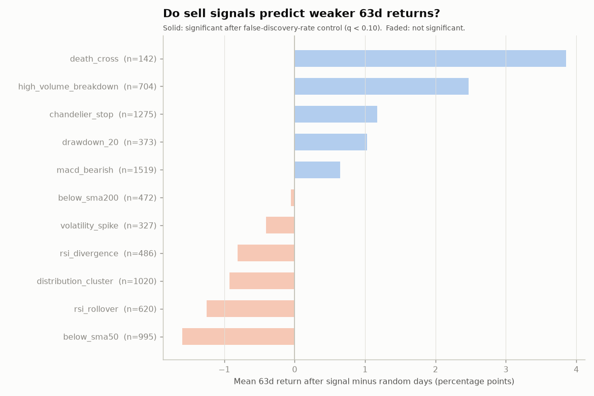

## 4. Strategy backtests

Not included: SKHY (only 86 trading days of history, needs 452); SPCX (only 104 trading days of history, needs 452).

### ALAB (2025-01-03 to 2026-11-09)

| strategy | Total return | CAGR | Max drawdown | Volatility | Sharpe | Round trips | Time in market | Sharpe vs B&H | 95% CI | p-value |
|---|---|---|---|---|---|---|---|---|---|---|
| Buy & Hold | +50.9% | +25.0% | -63.2% | +97.3% | 0.72 | 0 | 100% |  |  |  |
| 50/200 SMA cross | -66.9% | -45.1% | -74.0% | +87.8% | -0.24 | 2 | 75% | -0.96 | [-1.87, -0.25] | 0.02 |
| Close > 50-day SMA | +7.6% | +4.1% | -66.4% | +70.1% | 0.41 | 10 | 52% | -0.31 | [-1.39, +0.74] | 0.55 |
| MACD > signal | +14.8% | +7.8% | -70.4% | +65.3% | 0.44 | 21 | 50% | -0.28 | [-1.49, +0.91] | 0.64 |
| RSI 30/70 | +11.2% | +5.9% | -50.3% | +37.1% | 0.34 | 1 | 16% | -0.38 | [-2.10, +1.47] | 0.67 |
| Trailing stop 20% | -11.8% | -6.6% | -69.1% | +72.1% | 0.27 | 10 | 56% | -0.45 | [-1.49, +0.53] | 0.39 |
| Volume breakout | +91.8% | +42.4% | -55.7% | +63.3% | 0.87 | 4 | 41% | +0.15 | [-0.99, +1.24] | 0.78 |

### AMD (2022-08-29 to 2026-11-10)

| strategy | Total return | CAGR | Max drawdown | Volatility | Sharpe | Round trips | Time in market | Sharpe vs B&H | 95% CI | p-value |
|---|---|---|---|---|---|---|---|---|---|---|
| Buy & Hold | +492.3% | +52.9% | -63.0% | +58.2% | 1.02 | 0 | 100% |  |  |  |
| 50/200 SMA cross | +383.0% | +45.7% | -39.1% | +48.6% | 1.01 | 1 | 65% | -0.00 | [-0.60, +0.55] | 1.00 |
| Close > 50-day SMA | +187.5% | +28.7% | -41.8% | +43.7% | 0.79 | 36 | 53% | -0.23 | [-0.77, +0.32] | 0.45 |
| MACD > signal | +343.0% | +42.7% | -42.4% | +41.4% | 1.06 | 39 | 50% | +0.04 | [-0.49, +0.62] | 0.88 |
| RSI 30/70 | +49.4% | +10.1% | -54.7% | +31.9% | 0.46 | 3 | 33% | -0.56 | [-1.64, +0.40] | 0.27 |
| Trailing stop 20% | +172.5% | +27.1% | -58.9% | +49.6% | 0.73 | 11 | 71% | -0.29 | [-0.75, +0.19] | 0.24 |
| Volume breakout | +177.7% | +27.6% | -36.9% | +37.1% | 0.84 | 10 | 38% | -0.18 | [-0.88, +0.45] | 0.62 |

### NVDA (2022-08-29 to 2026-11-10)

| strategy | Total return | CAGR | Max drawdown | Volatility | Sharpe | Round trips | Time in market | Sharpe vs B&H | 95% CI | p-value |
|---|---|---|---|---|---|---|---|---|---|---|
| Buy & Hold | +995.6% | +77.1% | -36.9% | +49.1% | 1.41 | 0 | 100% |  |  |  |
| 50/200 SMA cross | +552.3% | +56.5% | -29.4% | +43.1% | 1.25 | 1 | 84% | -0.16 | [-0.65, +0.29] | 0.49 |
| Close > 50-day SMA | +346.8% | +43.0% | -39.1% | +39.0% | 1.11 | 38 | 69% | -0.30 | [-0.86, +0.31] | 0.33 |
| MACD > signal | +152.9% | +24.8% | -46.7% | +34.4% | 0.81 | 40 | 51% | -0.59 | [-1.34, +0.16] | 0.13 |
| RSI 30/70 | +48.9% | +10.0% | -22.6% | +18.5% | 0.60 | 2 | 7% | -0.81 | [-1.95, +0.09] | 0.10 |
| Trailing stop 20% | +601.9% | +59.3% | -36.6% | +44.7% | 1.26 | 8 | 89% | -0.15 | [-0.50, +0.17] | 0.37 |
| Volume breakout | +211.5% | +31.2% | -19.8% | +26.3% | 1.16 | 7 | 31% | -0.25 | [-1.13, +0.51] | 0.60 |

### MRVL (2022-08-29 to 2026-11-10)

| strategy | Total return | CAGR | Max drawdown | Volatility | Sharpe | Round trips | Time in market | Sharpe vs B&H | 95% CI | p-value |
|---|---|---|---|---|---|---|---|---|---|---|
| Buy & Hold | +226.3% | +32.6% | -60.8% | +67.1% | 0.75 | 0 | 100% |  |  |  |
| 50/200 SMA cross | +50.3% | +10.2% | -65.2% | +57.3% | 0.45 | 2 | 68% | -0.30 | [-0.76, +0.13] | 0.20 |
| Close > 50-day SMA | +65.8% | +12.8% | -51.5% | +52.7% | 0.49 | 36 | 58% | -0.27 | [-0.87, +0.29] | 0.39 |
| MACD > signal | +101.6% | +18.2% | -62.5% | +50.2% | 0.58 | 44 | 51% | -0.18 | [-0.87, +0.55] | 0.62 |
| RSI 30/70 | +60.7% | +12.0% | -32.1% | +28.7% | 0.54 | 2 | 19% | -0.21 | [-1.11, +0.80] | 0.66 |
| Trailing stop 20% | +68.2% | +13.2% | -53.3% | +57.0% | 0.50 | 15 | 77% | -0.25 | [-0.77, +0.24] | 0.32 |
| Volume breakout | +76.0% | +14.5% | -46.2% | +42.0% | 0.53 | 11 | 36% | -0.23 | [-1.09, +0.52] | 0.60 |

### GOOG (2022-08-29 to 2026-11-09)

| strategy | Total return | CAGR | Max drawdown | Volatility | Sharpe | Round trips | Time in market | Sharpe vs B&H | 95% CI | p-value |
|---|---|---|---|---|---|---|---|---|---|---|
| Buy & Hold | +162.6% | +26.0% | -30.2% | +31.7% | 0.89 | 0 | 100% |  |  |  |
| 50/200 SMA cross | +151.5% | +24.7% | -29.4% | +25.9% | 0.98 | 2 | 76% | +0.09 | [-0.40, +0.58] | 0.69 |
| Close > 50-day SMA | +85.6% | +15.9% | -22.2% | +23.6% | 0.74 | 34 | 63% | -0.14 | [-0.81, +0.50] | 0.68 |
| MACD > signal | +36.1% | +7.7% | -18.1% | +21.5% | 0.45 | 42 | 50% | -0.44 | [-1.15, +0.24] | 0.21 |
| RSI 30/70 | +30.4% | +6.6% | -20.4% | +18.1% | 0.44 | 4 | 25% | -0.45 | [-1.32, +0.45] | 0.31 |
| Trailing stop 20% | +43.8% | +9.1% | -40.4% | +29.7% | 0.44 | 6 | 92% | -0.45 | [-0.87, -0.07] | 0.03 |
| Volume breakout | +105.6% | +18.8% | -17.4% | +19.4% | 0.98 | 8 | 46% | +0.10 | [-0.74, +0.87] | 0.80 |

### FSLR (2022-08-29 to 2026-11-10)

| strategy | Total return | CAGR | Max drawdown | Volatility | Sharpe | Round trips | Time in market | Sharpe vs B&H | 95% CI | p-value |
|---|---|---|---|---|---|---|---|---|---|---|
| Buy & Hold | +47.9% | +9.8% | -60.0% | +55.1% | 0.44 | 0 | 100% |  |  |  |
| 50/200 SMA cross | +15.0% | +3.4% | -51.1% | +41.8% | 0.28 | 4 | 59% | -0.16 | [-0.77, +0.39] | 0.58 |
| Close > 50-day SMA | +38.1% | +8.0% | -46.8% | +40.4% | 0.39 | 28 | 50% | -0.05 | [-0.59, +0.47] | 0.83 |
| MACD > signal | -57.2% | -18.3% | -74.1% | +40.7% | -0.30 | 48 | 49% | -0.74 | [-1.38, -0.08] | 0.03 |
| RSI 30/70 | +30.1% | +6.5% | -42.8% | +30.4% | 0.35 | 2 | 27% | -0.09 | [-1.10, +0.73] | 0.85 |
| Trailing stop 20% | +23.5% | +5.2% | -52.3% | +45.3% | 0.33 | 11 | 69% | -0.11 | [-0.59, +0.37] | 0.67 |
| Volume breakout | -22.8% | -6.0% | -53.8% | +32.3% | -0.03 | 13 | 38% | -0.47 | [-1.31, +0.36] | 0.27 |

### ETN (2022-08-29 to 2026-11-10)

| strategy | Total return | CAGR | Max drawdown | Volatility | Sharpe | Round trips | Time in market | Sharpe vs B&H | 95% CI | p-value |
|---|---|---|---|---|---|---|---|---|---|---|
| Buy & Hold | +169.9% | +26.8% | -34.5% | +33.9% | 0.87 | 0 | 100% |  |  |  |
| 50/200 SMA cross | +68.0% | +13.2% | -35.7% | +30.4% | 0.56 | 2 | 83% | -0.31 | [-0.74, +0.06] | 0.13 |
| Close > 50-day SMA | +33.7% | +7.2% | -37.5% | +24.5% | 0.41 | 46 | 65% | -0.46 | [-1.08, +0.19] | 0.14 |
| MACD > signal | +37.3% | +7.9% | -25.8% | +22.4% | 0.45 | 48 | 50% | -0.42 | [-1.07, +0.22] | 0.20 |
| RSI 30/70 | +15.7% | +3.6% | -18.6% | +11.5% | 0.36 | 1 | 5% | -0.51 | [-1.44, +0.71] | 0.30 |
| Trailing stop 20% | +182.0% | +28.1% | -23.6% | +30.9% | 0.96 | 2 | 95% | +0.09 | [-0.11, +0.31] | 0.41 |
| Volume breakout | +21.6% | +4.8% | -29.3% | +18.1% | 0.35 | 10 | 38% | -0.52 | [-1.33, +0.34] | 0.23 |

### TSLA (2022-08-29 to 2026-11-10)

| strategy | Total return | CAGR | Max drawdown | Volatility | Sharpe | Round trips | Time in market | Sharpe vs B&H | 95% CI | p-value |
|---|---|---|---|---|---|---|---|---|---|---|
| Buy & Hold | +36.7% | +7.8% | -65.0% | +58.3% | 0.42 | 0 | 100% |  |  |  |
| 50/200 SMA cross | -26.4% | -7.1% | -56.8% | +40.1% | 0.01 | 4 | 47% | -0.40 | [-1.28, +0.37] | 0.32 |
| Close > 50-day SMA | +54.8% | +11.0% | -41.1% | +38.5% | 0.46 | 43 | 52% | +0.05 | [-0.70, +0.83] | 0.92 |
| MACD > signal | +396.5% | +46.6% | -39.8% | +40.8% | 1.14 | 42 | 51% | +0.72 | [+0.10, +1.41] | 0.04 |
| RSI 30/70 | +47.5% | +9.7% | -52.7% | +40.2% | 0.43 | 4 | 42% | +0.01 | [-0.72, +0.73] | 0.97 |
| Trailing stop 20% | +39.4% | +8.3% | -47.9% | +45.0% | 0.40 | 11 | 71% | -0.02 | [-0.63, +0.62] | 0.95 |
| Volume breakout | +40.5% | +8.5% | -35.4% | +25.7% | 0.44 | 9 | 18% | +0.03 | [-0.94, +0.98] | 0.97 |

### AMZN (2022-08-29 to 2026-11-10)

| strategy | Total return | CAGR | Max drawdown | Volatility | Sharpe | Round trips | Time in market | Sharpe vs B&H | 95% CI | p-value |
|---|---|---|---|---|---|---|---|---|---|---|
| Buy & Hold | +110.3% | +19.4% | -40.0% | +34.1% | 0.69 | 0 | 100% |  |  |  |
| 50/200 SMA cross | +39.3% | +8.2% | -41.4% | +27.8% | 0.42 | 2 | 73% | -0.27 | [-0.89, +0.35] | 0.38 |
| Close > 50-day SMA | +35.0% | +7.4% | -41.0% | +23.3% | 0.42 | 35 | 63% | -0.27 | [-0.94, +0.49] | 0.49 |
| MACD > signal | +1.1% | +0.3% | -28.7% | +22.7% | 0.12 | 50 | 50% | -0.57 | [-1.30, +0.14] | 0.12 |
| RSI 30/70 | +94.0% | +17.1% | -22.0% | +21.6% | 0.84 | 4 | 33% | +0.15 | [-0.56, +0.86] | 0.70 |
| Trailing stop 20% | +115.8% | +20.2% | -24.2% | +29.8% | 0.76 | 3 | 87% | +0.07 | [-0.35, +0.53] | 0.74 |
| Volume breakout | +8.3% | +1.9% | -35.7% | +18.7% | 0.20 | 11 | 45% | -0.49 | [-1.41, +0.47] | 0.30 |

### IBM (2022-08-29 to 2026-11-10)

| strategy | Total return | CAGR | Max drawdown | Volatility | Sharpe | Round trips | Time in market | Sharpe vs B&H | 95% CI | p-value |
|---|---|---|---|---|---|---|---|---|---|---|
| Buy & Hold | +118.8% | +20.6% | -37.5% | +31.5% | 0.76 | 0 | 100% |  |  |  |
| 50/200 SMA cross | +62.4% | +12.3% | -28.7% | +22.8% | 0.62 | 3 | 73% | -0.13 | [-0.78, +0.55] | 0.68 |
| Close > 50-day SMA | +53.7% | +10.8% | -42.6% | +25.1% | 0.54 | 27 | 59% | -0.22 | [-0.70, +0.37] | 0.42 |
| MACD > signal | +112.3% | +19.7% | -43.1% | +23.9% | 0.88 | 30 | 50% | +0.12 | [-0.48, +0.89] | 0.70 |
| RSI 30/70 | +175.4% | +27.4% | -16.5% | +17.4% | 1.48 | 8 | 35% | +0.72 | [-0.27, +1.64] | 0.14 |
| Trailing stop 20% | +66.1% | +12.9% | -45.9% | +30.3% | 0.56 | 3 | 92% | -0.20 | [-0.44, +0.02] | 0.08 |
| Volume breakout | +65.6% | +12.8% | -25.6% | +17.0% | 0.79 | 10 | 40% | +0.04 | [-0.89, +0.99] | 0.93 |

### GEV (2025-01-13 to 2026-11-09)

| strategy | Total return | CAGR | Max drawdown | Volatility | Sharpe | Round trips | Time in market | Sharpe vs B&H | 95% CI | p-value |
|---|---|---|---|---|---|---|---|---|---|---|
| Buy & Hold | +117.7% | +53.3% | -38.3% | +56.2% | 1.04 | 0 | 100% |  |  |  |
| 50/200 SMA cross | +133.0% | +59.1% | -38.3% | +54.9% | 1.12 | 1 | 98% | +0.08 | [-0.07, +0.27] | 0.24 |
| Close > 50-day SMA | +79.1% | +37.7% | -32.7% | +43.9% | 0.95 | 15 | 64% | -0.09 | [-0.72, +0.45] | 0.75 |
| MACD > signal | +60.6% | +29.7% | -31.0% | +42.1% | 0.83 | 17 | 48% | -0.21 | [-1.04, +0.58] | 0.60 |
| RSI 30/70 | +29.1% | +15.1% | -34.4% | +34.8% | 0.58 | 1 | 31% | -0.47 | [-1.69, +0.67] | 0.43 |
| Trailing stop 20% | +44.2% | +22.3% | -45.9% | +50.2% | 0.65 | 5 | 88% | -0.39 | [-0.94, +0.06] | 0.12 |
| Volume breakout | +24.5% | +12.8% | -24.6% | +33.6% | 0.53 | 3 | 36% | -0.51 | [-1.71, +0.56] | 0.39 |

### CEG (2022-11-02 to 2026-11-09)

| strategy | Total return | CAGR | Max drawdown | Volatility | Sharpe | Round trips | Time in market | Sharpe vs B&H | 95% CI | p-value |
|---|---|---|---|---|---|---|---|---|---|---|
| Buy & Hold | +201.4% | +31.8% | -50.7% | +49.3% | 0.80 | 0 | 100% |  |  |  |
| 50/200 SMA cross | +96.8% | +18.4% | -50.7% | +43.5% | 0.60 | 3 | 72% | -0.20 | [-0.64, +0.20] | 0.35 |
| Close > 50-day SMA | +139.1% | +24.4% | -40.9% | +37.3% | 0.77 | 47 | 57% | -0.04 | [-0.61, +0.48] | 0.90 |
| MACD > signal | +25.6% | +5.9% | -41.5% | +36.9% | 0.34 | 41 | 49% | -0.47 | [-1.13, +0.18] | 0.15 |
| RSI 30/70 | +104.2% | +19.5% | -28.6% | +32.2% | 0.71 | 3 | 37% | -0.09 | [-0.86, +0.72] | 0.83 |
| Trailing stop 20% | +90.0% | +17.4% | -52.8% | +43.8% | 0.58 | 9 | 84% | -0.22 | [-0.65, +0.23] | 0.32 |
| Volume breakout | +86.0% | +16.8% | -30.0% | +30.7% | 0.66 | 9 | 39% | -0.15 | [-0.86, +0.56] | 0.67 |

### VST (2022-08-29 to 2026-11-09)

| strategy | Total return | CAGR | Max drawdown | Volatility | Sharpe | Round trips | Time in market | Sharpe vs B&H | 95% CI | p-value |
|---|---|---|---|---|---|---|---|---|---|---|
| Buy & Hold | +489.6% | +52.8% | -48.8% | +52.1% | 1.08 | 0 | 100% |  |  |  |
| 50/200 SMA cross | +437.2% | +49.5% | -48.8% | +44.1% | 1.14 | 3 | 68% | +0.06 | [-0.26, +0.44] | 0.78 |
| Close > 50-day SMA | +54.3% | +10.9% | -67.2% | +38.1% | 0.47 | 45 | 64% | -0.61 | [-1.24, +0.01] | 0.06 |
| MACD > signal | +66.6% | +13.0% | -49.0% | +37.2% | 0.52 | 47 | 51% | -0.56 | [-1.18, +0.10] | 0.09 |
| RSI 30/70 | +201.5% | +30.2% | -27.3% | +26.8% | 1.12 | 3 | 20% | +0.04 | [-0.82, +0.84] | 0.93 |
| Trailing stop 20% | +224.3% | +32.5% | -56.3% | +44.7% | 0.86 | 9 | 88% | -0.22 | [-0.65, +0.22] | 0.32 |
| Volume breakout | +278.5% | +37.5% | -31.2% | +31.4% | 1.18 | 9 | 43% | +0.10 | [-0.67, +0.95] | 0.80 |

### DELL (2022-08-29 to 2026-11-09)

| strategy | Total return | CAGR | Max drawdown | Volatility | Sharpe | Round trips | Time in market | Sharpe vs B&H | 95% CI | p-value |
|---|---|---|---|---|---|---|---|---|---|---|
| Buy & Hold | +847.3% | +71.2% | -59.6% | +57.8% | 1.21 | 0 | 100% |  |  |  |
| 50/200 SMA cross | +424.8% | +48.6% | -50.8% | +50.4% | 1.03 | 3 | 68% | -0.18 | [-0.67, +0.25] | 0.44 |
| Close > 50-day SMA | +1326.9% | +88.8% | -27.5% | +49.3% | 1.52 | 21 | 67% | +0.31 | [-0.18, +0.83] | 0.20 |
| MACD > signal | +141.4% | +23.5% | -57.7% | +43.1% | 0.69 | 45 | 52% | -0.52 | [-1.19, +0.19] | 0.14 |
| RSI 30/70 | +158.7% | +25.5% | -23.7% | +25.9% | 1.00 | 4 | 28% | -0.21 | [-1.22, +0.78] | 0.68 |
| Trailing stop 20% | +923.5% | +74.4% | -55.9% | +51.6% | 1.33 | 7 | 82% | +0.11 | [-0.26, +0.49] | 0.58 |
| Volume breakout | +378.1% | +45.4% | -37.8% | +43.2% | 1.07 | 11 | 45% | -0.14 | [-0.83, +0.51] | 0.66 |

### TSM (2022-08-29 to 2026-11-10)

| strategy | Total return | CAGR | Max drawdown | Volatility | Sharpe | Round trips | Time in market | Sharpe vs B&H | 95% CI | p-value |
|---|---|---|---|---|---|---|---|---|---|---|
| Buy & Hold | +411.2% | +47.7% | -36.8% | +39.3% | 1.19 | 0 | 100% |  |  |  |
| 50/200 SMA cross | +172.2% | +27.0% | -36.8% | +35.9% | 0.85 | 2 | 81% | -0.34 | [-0.86, +0.17] | 0.20 |
| Close > 50-day SMA | +190.3% | +29.0% | -28.8% | +31.6% | 0.96 | 37 | 68% | -0.22 | [-0.77, +0.37] | 0.44 |
| MACD > signal | +142.0% | +23.5% | -32.1% | +28.4% | 0.89 | 44 | 49% | -0.30 | [-0.91, +0.27] | 0.33 |
| RSI 30/70 | +45.2% | +9.3% | -23.0% | +16.7% | 0.62 | 3 | 12% | -0.57 | [-1.56, +0.42] | 0.26 |
| Trailing stop 20% | +215.2% | +31.6% | -30.6% | +36.7% | 0.93 | 6 | 91% | -0.26 | [-0.62, +0.10] | 0.16 |
| Volume breakout | +77.0% | +14.6% | -26.8% | +26.4% | 0.65 | 11 | 46% | -0.54 | [-1.31, +0.22] | 0.16 |

### BE (2022-08-29 to 2026-11-09)

| strategy | Total return | CAGR | Max drawdown | Volatility | Sharpe | Round trips | Time in market | Sharpe vs B&H | 95% CI | p-value |
|---|---|---|---|---|---|---|---|---|---|---|
| Buy & Hold | +662.9% | +62.6% | -67.8% | +89.8% | 0.97 | 0 | 100% |  |  |  |
| 50/200 SMA cross | +253.5% | +35.2% | -71.9% | +74.6% | 0.77 | 4 | 63% | -0.20 | [-0.81, +0.33] | 0.50 |
| Close > 50-day SMA | +359.9% | +44.0% | -53.1% | +69.8% | 0.85 | 31 | 52% | -0.12 | [-0.69, +0.37] | 0.67 |
| MACD > signal | +217.3% | +31.8% | -60.0% | +65.8% | 0.73 | 41 | 50% | -0.24 | [-0.98, +0.43] | 0.47 |
| RSI 30/70 | +147.7% | +24.2% | -61.8% | +47.1% | 0.69 | 4 | 48% | -0.28 | [-1.15, +0.63] | 0.55 |
| Trailing stop 20% | +153.5% | +24.9% | -66.7% | +73.9% | 0.65 | 19 | 61% | -0.32 | [-0.86, +0.14] | 0.22 |
| Volume breakout | +275.5% | +37.2% | -58.1% | +61.0% | 0.80 | 11 | 30% | -0.17 | [-0.97, +0.57] | 0.66 |

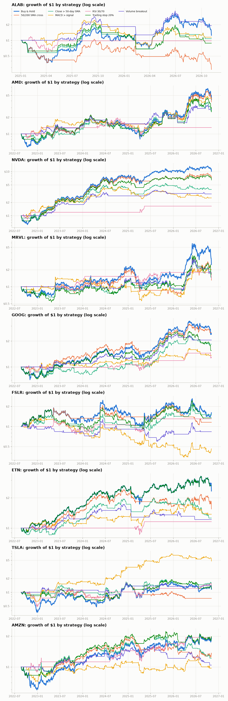

## 5. Next-day forecasts

Not included: SKHY (only 86 trading days of history, needs 452); SPCX (only 104 trading days of history, needs 452).

### ALAB

Walk-forward test on 211 unseen days (2026-01-07 to 2026-11-06).

| model | accuracy | always-majority accuracy | p (beats majority) | AUC | Brier | strategy Sharpe | buy & hold Sharpe |
|---|---|---|---|---|---|---|---|
| Majority class (baseline) | 0.526 | 0.526 | 0.528 | 0.454 | 0.25 | 0.826 | 0.827 |
| Logistic regression | 0.493 | 0.526 | 0.849 | 0.491 | 0.258 | 0.262 | 0.827 |
| Gradient boosting | 0.474 | 0.526 | 0.943 | 0.453 | 0.284 | 0.338 | 0.827 |

| model | RMSE (bps) | R2 out-of-sample vs zero | direction hit rate | DM p (beats zero) |
|---|---|---|---|---|
| Zero / random walk (baseline) | 653.5 | 0.0 |  |  |
| Ridge regression | 671.1 | -0.0545 | 0.474 | 0.953 |
| Gradient boosting | 688.0 | -0.1085 | 0.45 | 0.994 |

Forecast for the next session:

```
  P(up) | Logistic regression      47.7%
  P(up) | Gradient boosting        60.4%
  P(up) | historical base rate     52.1%
  expected return (ridge)          +1.00%
  80% range low                    -8.79%
  80% range high                   +11.84%
  daily volatility                 +7.95%
```

Best out-of-sample AUC **0.491**; smallest p-value against a naive baseline 0.849, before correcting for the four models tested here and the other stocks (the corrected count is in the summary).

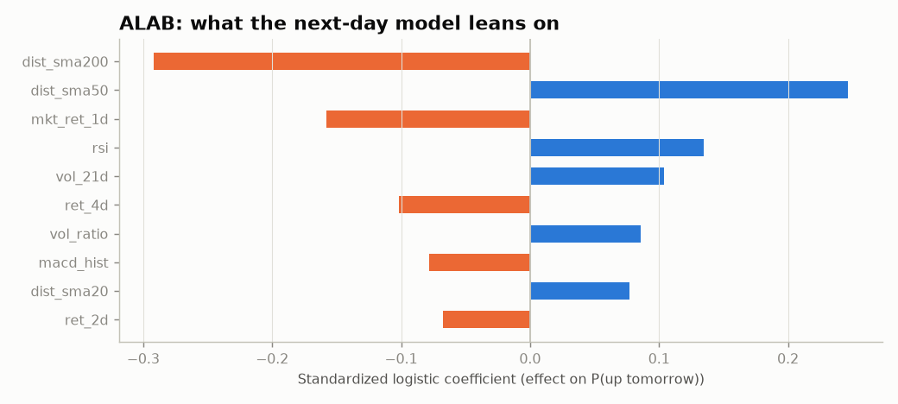

### AMD

Walk-forward test on 550 unseen days (2024-08-30 to 2026-11-09).

| model | accuracy | always-majority accuracy | p (beats majority) | AUC | Brier | strategy Sharpe | buy & hold Sharpe |
|---|---|---|---|---|---|---|---|
| Majority class (baseline) | 0.502 | 0.531 | 0.921 | 0.491 | 0.25 | 1.101 | 1.198 |
| Logistic regression | 0.5 | 0.531 | 0.932 | 0.492 | 0.255 | 0.717 | 1.198 |
| Gradient boosting | 0.475 | 0.531 | 0.996 | 0.493 | 0.266 | 0.555 | 1.198 |

| model | RMSE (bps) | R2 out-of-sample vs zero | direction hit rate | DM p (beats zero) |
|---|---|---|---|---|
| Zero / random walk (baseline) | 404.2 | 0.0 |  |  |
| Ridge regression | 406.4 | -0.0107 | 0.502 | 0.735 |
| Gradient boosting | 409.9 | -0.0284 | 0.513 | 0.936 |

Forecast for the next session:

```
  P(up) | Logistic regression      66.6%
  P(up) | Gradient boosting        69.0%
  P(up) | historical base rate     51.4%
  expected return (ridge)          +1.04%
  80% range low                    -7.88%
  80% range high                   +10.83%
  daily volatility                 +7.21%
```

Best out-of-sample AUC **0.493**; smallest p-value against a naive baseline 0.735, before correcting for the four models tested here and the other stocks (the corrected count is in the summary).

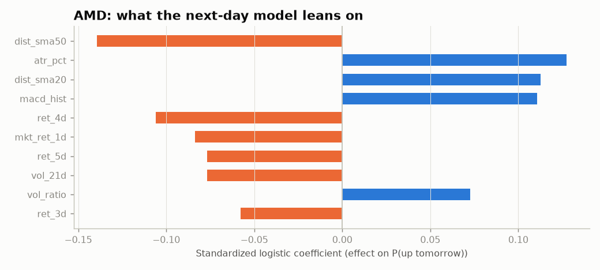

### NVDA

Walk-forward test on 550 unseen days (2024-08-30 to 2026-11-09).

| model | accuracy | always-majority accuracy | p (beats majority) | AUC | Brier | strategy Sharpe | buy & hold Sharpe |
|---|---|---|---|---|---|---|---|
| Majority class (baseline) | 0.522 | 0.522 | 0.517 | 0.505 | 0.25 | 0.582 | 0.582 |
| Logistic regression | 0.511 | 0.522 | 0.711 | 0.522 | 0.253 | 0.486 | 0.582 |
| Gradient boosting | 0.498 | 0.522 | 0.875 | 0.49 | 0.267 | 0.453 | 0.582 |

| model | RMSE (bps) | R2 out-of-sample vs zero | direction hit rate | DM p (beats zero) |
|---|---|---|---|---|
| Zero / random walk (baseline) | 282.4 | 0.0 |  |  |
| Ridge regression | 283.6 | -0.0085 | 0.507 | 0.626 |
| Gradient boosting | 291.7 | -0.0665 | 0.525 | 0.976 |

Forecast for the next session:

```
  P(up) | Logistic regression      54.4%
  P(up) | Gradient boosting        60.1%
  P(up) | historical base rate     53.6%
  expected return (ridge)          -0.07%
  80% range low                    -4.06%
  80% range high                   +4.08%
  daily volatility                 +3.17%
```

Best out-of-sample AUC **0.522**; smallest p-value against a naive baseline 0.626, before correcting for the four models tested here and the other stocks (the corrected count is in the summary).

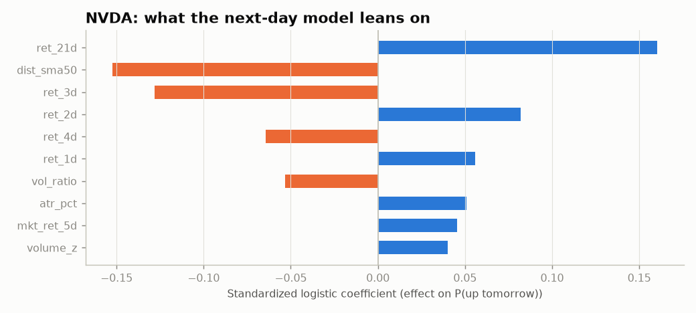

### MRVL

Walk-forward test on 550 unseen days (2024-08-30 to 2026-11-09).

| model | accuracy | always-majority accuracy | p (beats majority) | AUC | Brier | strategy Sharpe | buy & hold Sharpe |
|---|---|---|---|---|---|---|---|
| Majority class (baseline) | 0.535 | 0.535 | 0.517 | 0.472 | 0.249 | 0.806 | 0.807 |
| Logistic regression | 0.538 | 0.535 | 0.449 | 0.546 | 0.253 | 0.838 | 0.807 |
| Gradient boosting | 0.535 | 0.535 | 0.517 | 0.55 | 0.26 | 0.689 | 0.807 |

| model | RMSE (bps) | R2 out-of-sample vs zero | direction hit rate | DM p (beats zero) |
|---|---|---|---|---|
| Zero / random walk (baseline) | 480.4 | 0.0 |  |  |
| Ridge regression | 484.6 | -0.0176 | 0.524 | 0.812 |
| Gradient boosting | 491.2 | -0.0455 | 0.496 | 0.969 |

Forecast for the next session:

```
  P(up) | Logistic regression      63.2%
  P(up) | Gradient boosting        65.3%
  P(up) | historical base rate     52.5%
  expected return (ridge)          -0.30%
  80% range low                    -9.37%
  80% range high                   +9.69%
  daily volatility                 +7.45%
```

Best out-of-sample AUC **0.550**; smallest p-value against a naive baseline 0.449, before correcting for the four models tested here and the other stocks (the corrected count is in the summary).

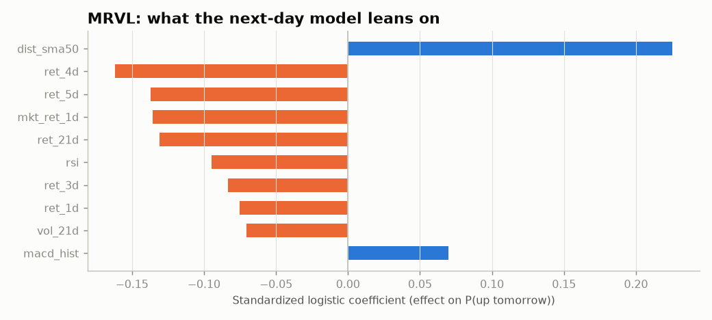

### GOOG

Walk-forward test on 549 unseen days (2024-08-30 to 2026-11-06).

| model | accuracy | always-majority accuracy | p (beats majority) | AUC | Brier | strategy Sharpe | buy & hold Sharpe |
|---|---|---|---|---|---|---|---|
| Majority class (baseline) | 0.523 | 0.523 | 0.517 | 0.48 | 0.25 | 0.959 | 0.96 |
| Logistic regression | 0.548 | 0.523 | 0.124 | 0.532 | 0.253 | 0.403 | 0.96 |
| Gradient boosting | 0.503 | 0.523 | 0.837 | 0.515 | 0.265 | 0.011 | 0.96 |

| model | RMSE (bps) | R2 out-of-sample vs zero | direction hit rate | DM p (beats zero) |
|---|---|---|---|---|
| Zero / random walk (baseline) | 201.7 | 0.0 |  |  |
| Ridge regression | 204.1 | -0.0235 | 0.53 | 0.96 |
| Gradient boosting | 209.4 | -0.0777 | 0.508 | 0.999 |

Forecast for the next session:

```
  P(up) | Logistic regression      49.8%
  P(up) | Gradient boosting        45.9%
  P(up) | historical base rate     53.0%
  expected return (ridge)          -0.00%
  80% range low                    -3.97%
  80% range high                   +4.13%
  daily volatility                 +3.16%
```

Best out-of-sample AUC **0.532**; smallest p-value against a naive baseline 0.124, before correcting for the four models tested here and the other stocks (the corrected count is in the summary).

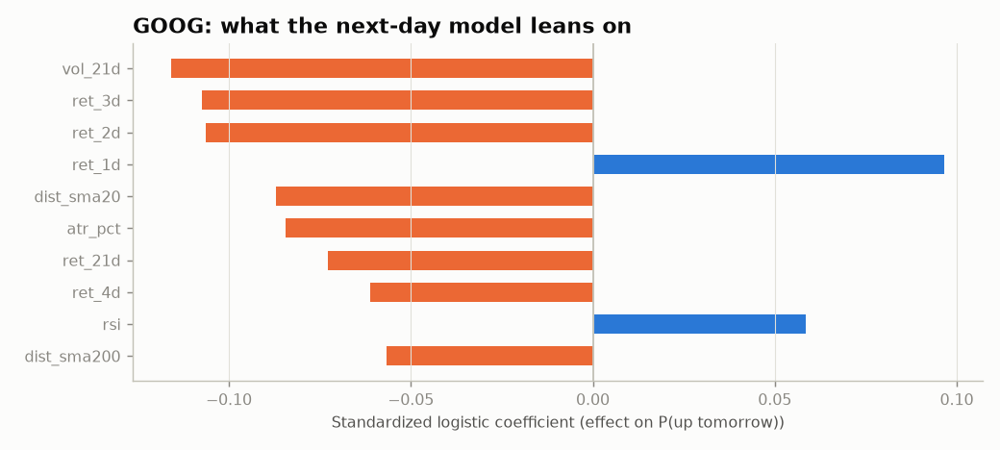

### FSLR

Walk-forward test on 550 unseen days (2024-08-30 to 2026-11-09).

| model | accuracy | always-majority accuracy | p (beats majority) | AUC | Brier | strategy Sharpe | buy & hold Sharpe |
|---|---|---|---|---|---|---|---|
| Majority class (baseline) | 0.515 | 0.515 | 0.517 | 0.454 | 0.25 |  | 0.109 |
| Logistic regression | 0.516 | 0.515 | 0.483 | 0.53 | 0.251 | -0.119 | 0.109 |
| Gradient boosting | 0.531 | 0.515 | 0.234 | 0.53 | 0.26 | 0.471 | 0.109 |

| model | RMSE (bps) | R2 out-of-sample vs zero | direction hit rate | DM p (beats zero) |
|---|---|---|---|---|
| Zero / random walk (baseline) | 364.6 | 0.0 |  |  |
| Ridge regression | 365.2 | -0.0033 | 0.515 | 0.607 |
| Gradient boosting | 375.7 | -0.062 | 0.516 | 0.998 |

Forecast for the next session:

```
  P(up) | Logistic regression      56.6%
  P(up) | Gradient boosting        64.6%
  P(up) | historical base rate     49.2%
  expected return (ridge)          -0.28%
  80% range low                    -4.09%
  80% range high                   +3.68%
  daily volatility                 +3.04%
```

Best out-of-sample AUC **0.530**; smallest p-value against a naive baseline 0.234, before correcting for the four models tested here and the other stocks (the corrected count is in the summary).

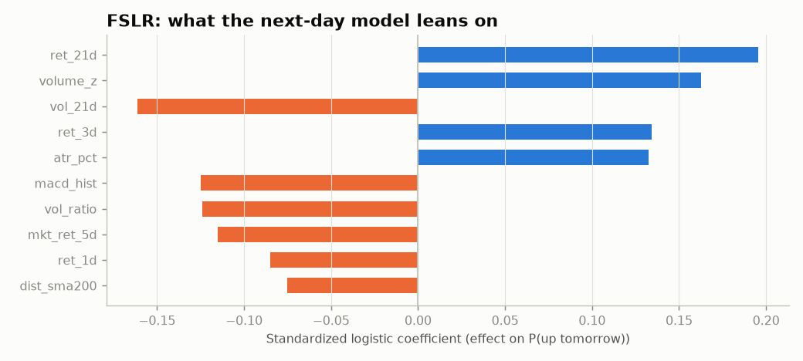

### ETN

Walk-forward test on 550 unseen days (2024-08-30 to 2026-11-09).

| model | accuracy | always-majority accuracy | p (beats majority) | AUC | Brier | strategy Sharpe | buy & hold Sharpe |
|---|---|---|---|---|---|---|---|
| Majority class (baseline) | 0.524 | 0.524 | 0.517 | 0.472 | 0.25 | 0.396 | 0.397 |
| Logistic regression | 0.516 | 0.524 | 0.65 | 0.511 | 0.255 | 0.549 | 0.397 |
| Gradient boosting | 0.536 | 0.524 | 0.29 | 0.543 | 0.255 | 0.394 | 0.397 |

| model | RMSE (bps) | R2 out-of-sample vs zero | direction hit rate | DM p (beats zero) |
|---|---|---|---|---|
| Zero / random walk (baseline) | 248.0 | 0.0 |  |  |
| Ridge regression | 249.6 | -0.0129 | 0.533 | 0.754 |
| Gradient boosting | 254.0 | -0.0493 | 0.509 | 0.965 |

Forecast for the next session:

```
  P(up) | Logistic regression      66.8%
  P(up) | Gradient boosting        61.5%
  P(up) | historical base rate     54.0%
  expected return (ridge)          +0.94%
  80% range low                    -4.62%
  80% range high                   +6.83%
  daily volatility                 +4.42%
```

Best out-of-sample AUC **0.543**; smallest p-value against a naive baseline 0.290, before correcting for the four models tested here and the other stocks (the corrected count is in the summary).

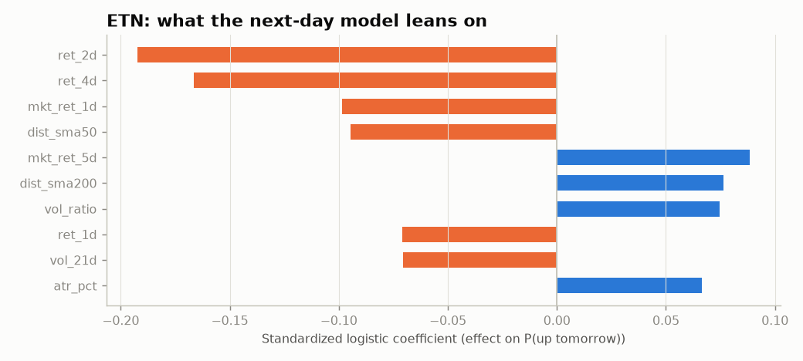

### TSLA

Walk-forward test on 550 unseen days (2024-08-30 to 2026-11-09).

| model | accuracy | always-majority accuracy | p (beats majority) | AUC | Brier | strategy Sharpe | buy & hold Sharpe |
|---|---|---|---|---|---|---|---|
| Majority class (baseline) | 0.504 | 0.504 | 0.517 | 0.453 | 0.25 | 0.736 | 0.736 |
| Logistic regression | 0.527 | 0.504 | 0.143 | 0.516 | 0.253 | 0.759 | 0.736 |
| Gradient boosting | 0.516 | 0.504 | 0.29 | 0.526 | 0.263 | 0.531 | 0.736 |

| model | RMSE (bps) | R2 out-of-sample vs zero | direction hit rate | DM p (beats zero) |
|---|---|---|---|---|
| Zero / random walk (baseline) | 370.1 | 0.0 |  |  |
| Ridge regression | 374.7 | -0.0247 | 0.498 | 0.95 |
| Gradient boosting | 377.0 | -0.0377 | 0.509 | 0.91 |

Forecast for the next session:

```
  P(up) | Logistic regression      44.4%
  P(up) | Gradient boosting        43.3%
  P(up) | historical base rate     50.8%
  expected return (ridge)          -0.56%
  80% range low                    -5.24%
  80% range high                   +4.35%
  daily volatility                 +3.76%
```

Best out-of-sample AUC **0.526**; smallest p-value against a naive baseline 0.143, before correcting for the four models tested here and the other stocks (the corrected count is in the summary).

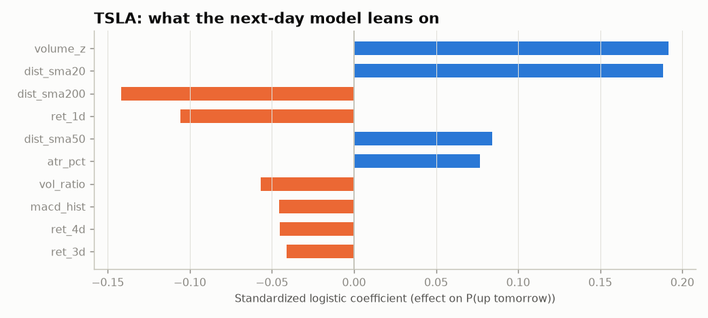

### AMZN

Walk-forward test on 550 unseen days (2024-08-30 to 2026-11-09).

| model | accuracy | always-majority accuracy | p (beats majority) | AUC | Brier | strategy Sharpe | buy & hold Sharpe |
|---|---|---|---|---|---|---|---|
| Majority class (baseline) | 0.516 | 0.516 | 0.517 | 0.459 | 0.25 | 0.729 | 0.73 |
| Logistic regression | 0.544 | 0.516 | 0.108 | 0.563 | 0.248 | 0.904 | 0.73 |
| Gradient boosting | 0.509 | 0.516 | 0.65 | 0.517 | 0.263 | 0.126 | 0.73 |

| model | RMSE (bps) | R2 out-of-sample vs zero | direction hit rate | DM p (beats zero) |
|---|---|---|---|---|
| Zero / random walk (baseline) | 212.1 | 0.0 |  |  |
| Ridge regression | 213.6 | -0.0143 | 0.549 | 0.834 |
| Gradient boosting | 222.1 | -0.0965 | 0.524 | 1.0 |

Forecast for the next session:

```
  P(up) | Logistic regression      59.3%
  P(up) | Gradient boosting        54.4%
  P(up) | historical base rate     51.3%
  expected return (ridge)          +0.49%
  80% range low                    -2.81%
  80% range high                   +3.91%
  daily volatility                 +2.61%
```

Best out-of-sample AUC **0.563**; smallest p-value against a naive baseline 0.108, before correcting for the four models tested here and the other stocks (the corrected count is in the summary).

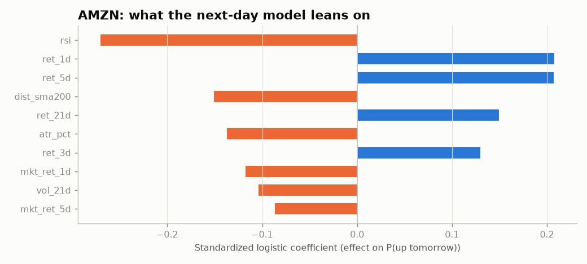

### IBM

Walk-forward test on 550 unseen days (2024-08-30 to 2026-11-09).

| model | accuracy | always-majority accuracy | p (beats majority) | AUC | Brier | strategy Sharpe | buy & hold Sharpe |
|---|---|---|---|---|---|---|---|
| Majority class (baseline) | 0.547 | 0.547 | 0.518 | 0.46 | 0.248 | 0.496 | 0.496 |
| Logistic regression | 0.54 | 0.547 | 0.65 | 0.47 | 0.255 | 0.384 | 0.496 |
| Gradient boosting | 0.518 | 0.547 | 0.921 | 0.502 | 0.263 | 0.758 | 0.496 |

| model | RMSE (bps) | R2 out-of-sample vs zero | direction hit rate | DM p (beats zero) |
|---|---|---|---|---|
| Zero / random walk (baseline) | 253.4 | 0.0 |  |  |
| Ridge regression | 256.3 | -0.0231 | 0.533 | 0.932 |
| Gradient boosting | 257.4 | -0.0322 | 0.513 | 0.972 |

Forecast for the next session:

```
  P(up) | Logistic regression      52.2%
  P(up) | Gradient boosting        39.2%
  P(up) | historical base rate     55.1%
  expected return (ridge)          -0.13%
  80% range low                    -2.28%
  80% range high                   +2.06%
  daily volatility                 +1.70%
```

Best out-of-sample AUC **0.502**; smallest p-value against a naive baseline 0.650, before correcting for the four models tested here and the other stocks (the corrected count is in the summary).

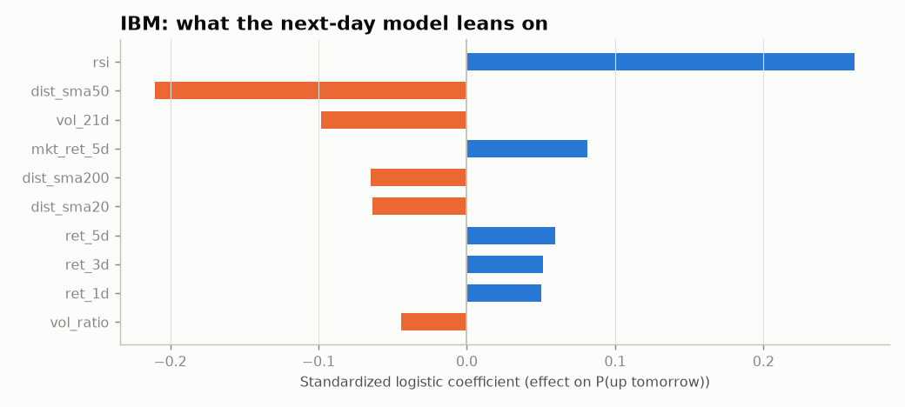

### GEV

Walk-forward test on 206 unseen days (2026-01-14 to 2026-11-06).

| model | accuracy | always-majority accuracy | p (beats majority) | AUC | Brier | strategy Sharpe | buy & hold Sharpe |
|---|---|---|---|---|---|---|---|
| Majority class (baseline) | 0.534 | 0.534 | 0.528 | 0.469 | 0.249 | 0.846 | 0.847 |
| Logistic regression | 0.505 | 0.534 | 0.818 | 0.5 | 0.257 | 0.56 | 0.847 |
| Gradient boosting | 0.534 | 0.534 | 0.528 | 0.537 | 0.266 | 1.235 | 0.847 |

| model | RMSE (bps) | R2 out-of-sample vs zero | direction hit rate | DM p (beats zero) |
|---|---|---|---|---|
| Zero / random walk (baseline) | 338.6 | 0.0 |  |  |
| Ridge regression | 343.9 | -0.0314 | 0.553 | 0.762 |
| Gradient boosting | 348.8 | -0.0613 | 0.539 | 0.86 |

Forecast for the next session:

```
  P(up) | Logistic regression      55.2%
  P(up) | Gradient boosting        83.2%
  P(up) | historical base rate     54.4%
  expected return (ridge)          +1.08%
  80% range low                    -5.08%
  80% range high                   +7.65%
  daily volatility                 +4.91%
```

Best out-of-sample AUC **0.537**; smallest p-value against a naive baseline 0.528, before correcting for the four models tested here and the other stocks (the corrected count is in the summary).

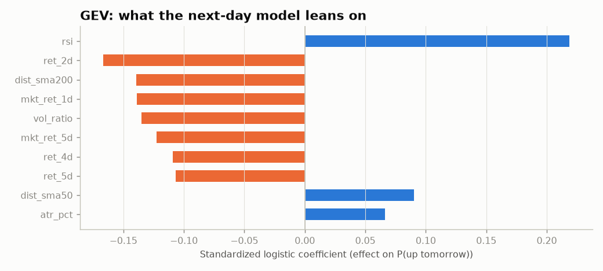

### CEG

Walk-forward test on 504 unseen days (2024-11-04 to 2026-11-06).

| model | accuracy | always-majority accuracy | p (beats majority) | AUC | Brier | strategy Sharpe | buy & hold Sharpe |
|---|---|---|---|---|---|---|---|
| Majority class (baseline) | 0.506 | 0.506 | 0.518 | 0.482 | 0.251 | 0.468 | 0.468 |
| Logistic regression | 0.48 | 0.506 | 0.885 | 0.491 | 0.26 | 0.088 | 0.468 |
| Gradient boosting | 0.488 | 0.506 | 0.801 | 0.473 | 0.274 | -0.052 | 0.468 |

| model | RMSE (bps) | R2 out-of-sample vs zero | direction hit rate | DM p (beats zero) |
|---|---|---|---|---|
| Zero / random walk (baseline) | 352.4 | 0.0 |  |  |
| Ridge regression | 361.0 | -0.0498 | 0.482 | 0.99 |
| Gradient boosting | 364.4 | -0.0691 | 0.506 | 0.997 |

Forecast for the next session:

```
  P(up) | Logistic regression      40.6%
  P(up) | Gradient boosting        35.2%
  P(up) | historical base rate     52.1%
  expected return (ridge)          +0.14%
  80% range low                    -4.70%
  80% range high                   +5.22%
  daily volatility                 +3.86%
```

Best out-of-sample AUC **0.491**; smallest p-value against a naive baseline 0.801, before correcting for the four models tested here and the other stocks (the corrected count is in the summary).

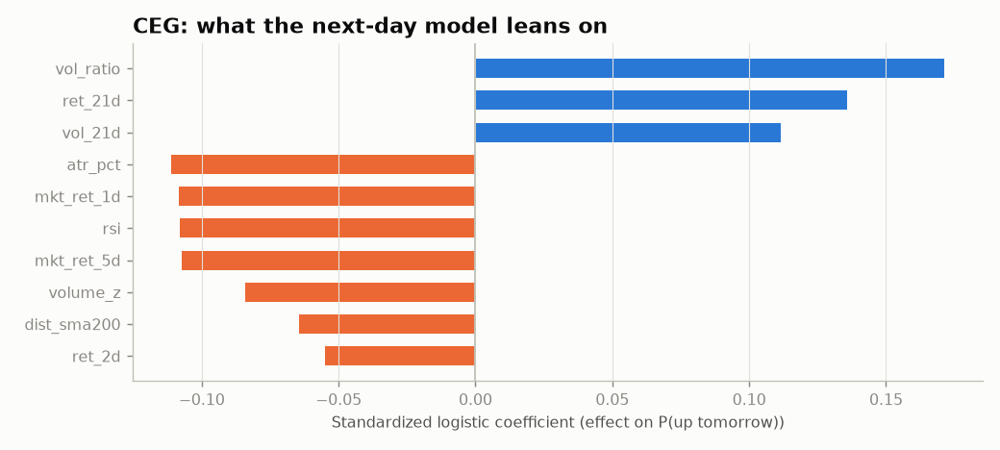

### VST

Walk-forward test on 549 unseen days (2024-08-30 to 2026-11-06).

| model | accuracy | always-majority accuracy | p (beats majority) | AUC | Brier | strategy Sharpe | buy & hold Sharpe |
|---|---|---|---|---|---|---|---|
| Majority class (baseline) | 0.517 | 0.517 | 0.517 | 0.475 | 0.25 | 0.66 | 0.66 |
| Logistic regression | 0.485 | 0.517 | 0.943 | 0.48 | 0.26 | 1.099 | 0.66 |
| Gradient boosting | 0.541 | 0.517 | 0.143 | 0.54 | 0.263 | 1.218 | 0.66 |

| model | RMSE (bps) | R2 out-of-sample vs zero | direction hit rate | DM p (beats zero) |
|---|---|---|---|---|
| Zero / random walk (baseline) | 396.2 | 0.0 |  |  |
| Ridge regression | 398.9 | -0.0136 | 0.497 | 0.741 |
| Gradient boosting | 404.3 | -0.0412 | 0.514 | 0.942 |

Forecast for the next session:

```
  P(up) | Logistic regression      41.5%
  P(up) | Gradient boosting        38.8%
  P(up) | historical base rate     52.8%
  expected return (ridge)          +0.92%
  80% range low                    -6.07%
  80% range high                   +8.42%
  daily volatility                 +5.60%
```

Best out-of-sample AUC **0.540**; smallest p-value against a naive baseline 0.143, before correcting for the four models tested here and the other stocks (the corrected count is in the summary).

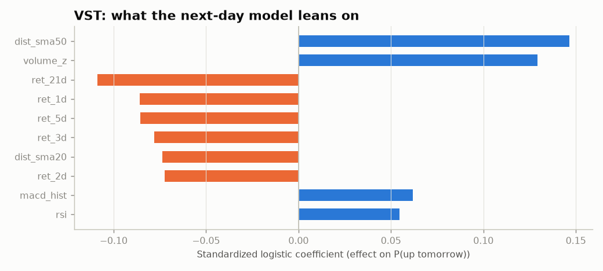

### DELL

Walk-forward test on 549 unseen days (2024-08-30 to 2026-11-06).

| model | accuracy | always-majority accuracy | p (beats majority) | AUC | Brier | strategy Sharpe | buy & hold Sharpe |
|---|---|---|---|---|---|---|---|
| Majority class (baseline) | 0.521 | 0.521 | 0.517 | 0.479 | 0.25 | 1.112 | 1.112 |
| Logistic regression | 0.512 | 0.521 | 0.681 | 0.508 | 0.255 | -0.048 | 1.112 |
| Gradient boosting | 0.517 | 0.521 | 0.585 | 0.494 | 0.269 | 0.93 | 1.112 |

| model | RMSE (bps) | R2 out-of-sample vs zero | direction hit rate | DM p (beats zero) |
|---|---|---|---|---|
| Zero / random walk (baseline) | 405.5 | 0.0 |  |  |
| Ridge regression | 410.9 | -0.0271 | 0.494 | 0.978 |
| Gradient boosting | 420.1 | -0.0731 | 0.512 | 0.999 |

Forecast for the next session:

```
  P(up) | Logistic regression      61.6%
  P(up) | Gradient boosting        54.1%
  P(up) | historical base rate     51.7%
  expected return (ridge)          +0.42%
  80% range low                    -7.54%
  80% range high                   +9.06%
  daily volatility                 +6.44%
```

Best out-of-sample AUC **0.508**; smallest p-value against a naive baseline 0.585, before correcting for the four models tested here and the other stocks (the corrected count is in the summary).

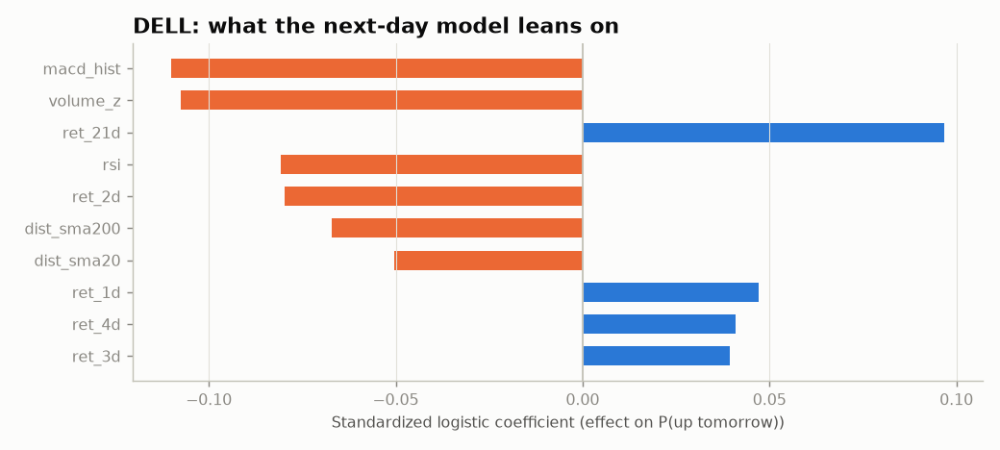

### TSM

Walk-forward test on 550 unseen days (2024-08-30 to 2026-11-09).

| model | accuracy | always-majority accuracy | p (beats majority) | AUC | Brier | strategy Sharpe | buy & hold Sharpe |
|---|---|---|---|---|---|---|---|
| Majority class (baseline) | 0.515 | 0.535 | 0.837 | 0.474 | 0.25 | 1.204 | 1.155 |
| Logistic regression | 0.533 | 0.535 | 0.551 | 0.528 | 0.25 | 0.937 | 1.155 |
| Gradient boosting | 0.522 | 0.535 | 0.739 | 0.509 | 0.261 | 1.078 | 1.155 |

| model | RMSE (bps) | R2 out-of-sample vs zero | direction hit rate | DM p (beats zero) |
|---|---|---|---|---|
| Zero / random walk (baseline) | 265.0 | 0.0 |  |  |
| Ridge regression | 263.4 | 0.0117 | 0.527 | 0.25 |
| Gradient boosting | 270.7 | -0.0436 | 0.52 | 0.983 |

Forecast for the next session:

```
  P(up) | Logistic regression      67.6%
  P(up) | Gradient boosting        55.7%
  P(up) | historical base rate     51.6%
  expected return (ridge)          +0.35%
  80% range low                    -4.44%
  80% range high                   +5.38%
  daily volatility                 +3.82%
```

Best out-of-sample AUC **0.528**; smallest p-value against a naive baseline 0.250, before correcting for the four models tested here and the other stocks (the corrected count is in the summary).

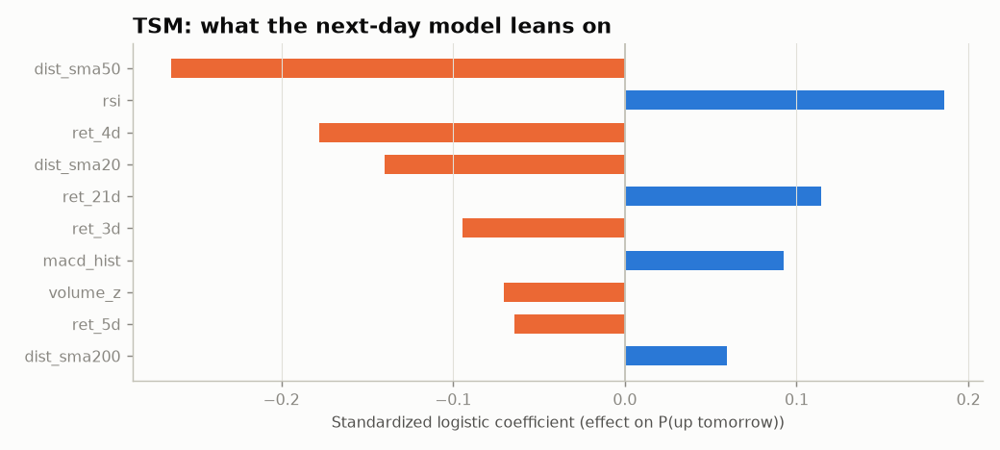

### BE

Walk-forward test on 549 unseen days (2024-08-30 to 2026-11-06).

| model | accuracy | always-majority accuracy | p (beats majority) | AUC | Brier | strategy Sharpe | buy & hold Sharpe |
|---|---|---|---|---|---|---|---|
| Majority class (baseline) | 0.485 | 0.515 | 0.932 | 0.479 | 0.251 |  | 1.707 |
| Logistic regression | 0.483 | 0.515 | 0.943 | 0.46 | 0.267 | 0.833 | 1.707 |
| Gradient boosting | 0.485 | 0.515 | 0.932 | 0.471 | 0.27 | 0.447 | 1.707 |

| model | RMSE (bps) | R2 out-of-sample vs zero | direction hit rate | DM p (beats zero) |
|---|---|---|---|---|
| Zero / random walk (baseline) | 653.2 | 0.0 |  |  |
| Ridge regression | 671.1 | -0.0557 | 0.466 | 0.997 |
| Gradient boosting | 667.9 | -0.0455 | 0.492 | 0.991 |

Forecast for the next session:

```
  P(up) | Logistic regression      52.9%
  P(up) | Gradient boosting        46.4%
  P(up) | historical base rate     49.7%
  expected return (ridge)          +0.68%
  80% range low                    -8.71%
  80% range high                   +11.04%
  daily volatility                 +7.64%
```

Best out-of-sample AUC **0.471**; smallest p-value against a naive baseline 0.932, before correcting for the four models tested here and the other stocks (the corrected count is in the summary).

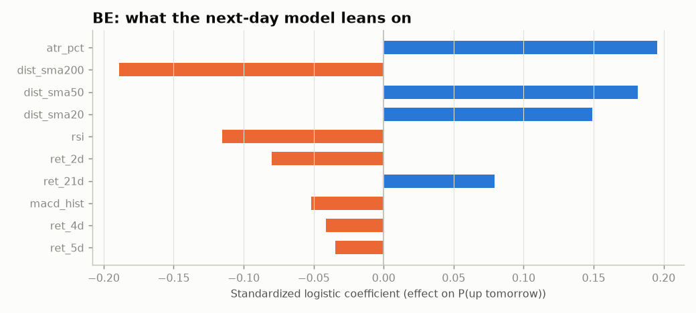

## 6. Stock screen and entry plans

| ticker | rank | score | passes_filters | close | momentum_12_1 | momentum_6m | volatility | off_52w_high | forward_pe | pullback_entry | breakout_trigger | stop | stop_% | shares | position_$ | max_loss_$ | filter_notes |
|---|---|---|---|---|---|---|---|---|---|---|---|---|---|---|---|---|---|
| DELL | 1 | +1.06 | True | 346.31 | +296.4% | +40.6% | +85.3% | -41.1% | 11.0 | 312.77 | 572.82 | 245.68 | -21.5% | 14 | 4379.0 | 939.0 |  |
| AMD | 2 | +0.90 | True | 515.21 | +154.4% | +14.9% | +77.7% | -20.7% | 29.1 | 476.1 | 579.6 | 397.87 | -16.4% | 12 | 5713.0 | 939.0 |  |
| V | 3 | +0.52 | True | 423.00 | +16.8% | +30.1% | +21.6% | -2.9% | 24.7 | 411.13 | 436.63 | 393.18 | -4.4% | 24 | 9867.0 | 431.0 |  |
| MSFT | 4 | +0.52 | True | 533.16 | +9.8% | +31.3% | +27.2% | -4.1% | 22.0 | 531.09 | 556.91 | 499.44 | -6.0% | 18 | 9560.0 | 570.0 |  |
| LLY | 5 | +0.51 | True | 1432.29 | +28.7% | +45.2% | +31.6% | +0.0% | 28.3 | 1326.71 | 1435.15 | 1230.79 | -7.2% | 7 | 9287.0 | 671.0 |  |
| JNJ | 6 | +0.46 | True | 280.78 | +44.5% | +26.5% | +25.0% | -0.5% | 24.2 | 267.2 | 282.67 | 252.97 | -5.3% | 37 | 9886.0 | 527.0 |  |
| KO | 7 | +0.44 | True | 96.91 | +30.7% | +22.6% | +17.4% | +0.0% | 27.5 | 93.93 | 97.1 | 90.43 | -3.7% | 106 | 9957.0 | 371.0 |  |
| XOM | 8 | +0.44 | True | 164.47 | +51.1% | +10.6% | +26.3% | -12.2% | 13.2 | 159.84 | 187.62 | 150.57 | -5.8% | 62 | 9910.0 | 575.0 |  |
| AAPL | 9 | +0.39 | True | 348.51 | +27.5% | +18.3% | +22.1% | -0.6% | 33.0 | 344.23 | 351.39 | 326.73 | -5.1% | 29 | 9983.0 | 508.0 |  |
| JPM | 10 | +0.26 | True | 342.07 | +8.4% | +13.3% | +20.3% | -5.9% | 13.4 | 340.41 | 352.81 | 324.82 | -4.6% | 29 | 9872.0 | 452.0 |  |
| PG | 11 | +0.14 | True | 168.66 | +6.6% | +18.9% | +20.5% | +0.0% | 22.8 | 161.4 | 169.0 | 154.77 | -4.1% | 61 | 9846.0 | 405.0 |  |
| UNH | 12 | +0.11 | True | 405.12 | +19.9% | +3.4% | +23.9% | -6.6% | 17.4 | 390.67 | 425.83 | 367.36 | -6.0% | 25 | 9767.0 | 583.0 |  |
| LIN | 13 | +0.01 | True | 521.78 | +17.5% | +4.2% | +15.5% | -4.2% | 26.7 | 509.29 | 525.79 | 490.46 | -3.7% | 19 | 9677.0 | 358.0 |  |
| AMT | 14 | -0.02 | True | 190.37 | +6.8% | +8.6% | +29.5% | -2.3% | 27.2 | 186.15 | 195.25 | 175.38 | -5.8% | 53 | 9866.0 | 571.0 |  |
| AMZN | 15 | -0.07 | True | 270.87 | +6.2% | +1.9% | +31.2% | -4.6% | 24.8 | 255.26 | 271.41 | 236.33 | -7.4% | 39 | 9955.0 | 739.0 |  |

## 7. Portfolio construction

Not included: SKHY (only 86 trading days of history, needs 252); SPCX (only 104 trading days of history, needs 252).

Assets: ALAB, AMD, NVDA, MRVL, GOOG, FSLR, ETN, TSLA, AMZN, IBM, GEV, CEG, VST, DELL, TSM, BE, JPM, XOM, UNH, COST, TLT, GLD. Covariance: Ledoit-Wolf shrinkage on the last 252 trading days.

Weights and share of risk (%):

| asset | weight: Equal weight | weight: Inverse volatility | weight: Risk parity | weight: Minimum variance | risk share: Equal weight | risk share: Inverse volatility | risk share: Risk parity | risk share: Minimum variance |
|---|---|---|---|---|---|---|---|---|
| ALAB | 4.5 | 1.8 | 1.2 | 0.0 | 12.4 | 6.6 | 4.6 | 0.0 |
| AMD | 4.5 | 2.5 | 1.4 | 0.0 | 9.5 | 7.4 | 4.6 | 0.0 |
| NVDA | 4.5 | 4.6 | 3.4 | 5.1 | 3.9 | 6.0 | 4.8 | 5.6 |
| MRVL | 4.5 | 2.1 | 1.3 | 0.0 | 10.3 | 6.7 | 4.6 | 0.0 |
| GOOG | 4.5 | 5.2 | 4.6 | 4.5 | 1.9 | 4.0 | 4.8 | 4.9 |
| FSLR | 4.5 | 3.4 | 2.8 | 0.6 | 4.1 | 4.7 | 4.7 | 0.6 |
| ETN | 4.5 | 4.1 | 2.5 | 1.7 | 5.5 | 7.2 | 4.7 | 1.9 |
| TSLA | 4.5 | 3.9 | 2.5 | 0.0 | 4.6 | 6.1 | 4.7 | 0.0 |
| AMZN | 4.5 | 5.1 | 4.0 | 3.5 | 2.2 | 4.4 | 4.7 | 3.8 |
| IBM | 4.5 | 3.7 | 5.4 | 2.4 | 0.9 | 1.5 | 4.8 | 2.6 |
| GEV | 4.5 | 3.2 | 2.3 | 0.9 | 6.2 | 6.3 | 4.7 | 0.9 |
| CEG | 4.5 | 3.6 | 2.7 | 1.3 | 4.5 | 5.4 | 4.7 | 1.5 |
| VST | 4.5 | 3.3 | 2.4 | 0.1 | 5.4 | 6.0 | 4.7 | 0.2 |
| DELL | 4.5 | 2.3 | 1.8 | 0.0 | 7.5 | 5.3 | 4.7 | 0.0 |
| TSM | 4.5 | 4.2 | 2.3 | 0.0 | 5.5 | 7.6 | 4.7 | 0.0 |
| BE | 4.5 | 1.6 | 1.0 | 0.0 | 13.6 | 6.7 | 4.6 | 0.0 |
| JPM | 4.5 | 7.2 | 6.6 | 7.5 | 1.2 | 3.7 | 4.9 | 8.3 |
| XOM | 4.5 | 6.3 | 0.0 | 18.0 | -0.8 | -1.7 | -0.0 | 19.8 |
| UNH | 4.5 | 5.0 | 6.8 | 3.3 | 0.5 | 1.5 | 4.8 | 3.6 |
| COST | 4.5 | 8.0 | 22.8 | 17.7 | -0.9 | -1.6 | 5.1 | 19.5 |
| TLT | 4.5 | 12.9 | 16.8 | 30.0 | 0.3 | 2.1 | 5.4 | 23.0 |
| GLD | 4.5 | 5.9 | 5.3 | 3.6 | 1.8 | 4.2 | 4.8 | 3.9 |

| method | expected volatility | diversification ratio | effective number of bets | largest risk share | largest risk holder |
|---|---|---|---|---|---|
| Equal weight | 27.5% | 1.82 | 12.39 | 13.6% | BE |
| Inverse volatility | 18.2% | 2.16 | 16.50 | 7.6% | TSM |
| Risk parity | 13.9% | 2.48 | 20.97 | 5.4% | TLT |
| Minimum variance | 8.6% | 2.96 | 6.77 | 23.0% | TLT |

Concentration warnings:

- AMD and TSM have correlation 0.70: they tend to fall together
- ETN and GEV have correlation 0.72: they tend to fall together
- CEG and VST have correlation 0.80: they tend to fall together

Out-of-sample comparison, monthly rebalance (2025-04-01 to 2026-11-09):

| method | CAGR | Volatility | Sharpe | Max drawdown |
|---|---|---|---|---|
| Equal weight | +63.4% | +28.7% | 1.86 | -18.0% |
| Inverse volatility | +44.4% | +20.7% | 1.88 | -11.2% |
| Risk parity | +33.6% | +16.0% | 1.89 | -9.3% |
| Minimum variance | +14.7% | +10.0% | 1.42 | -6.8% |

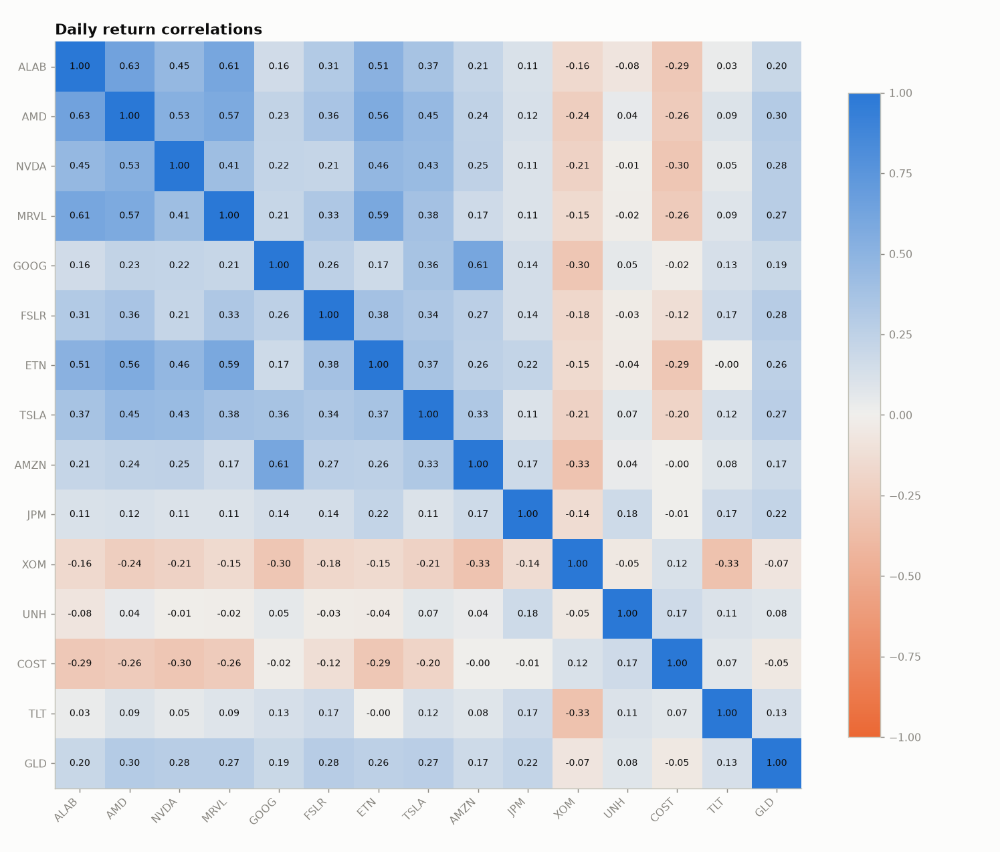

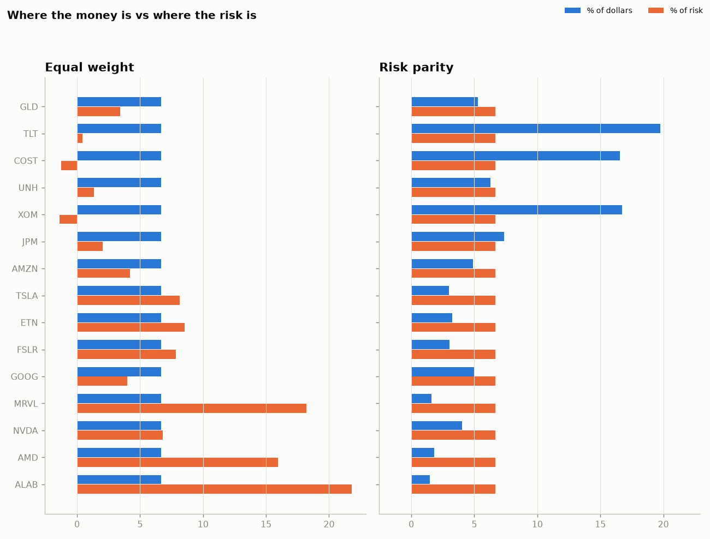

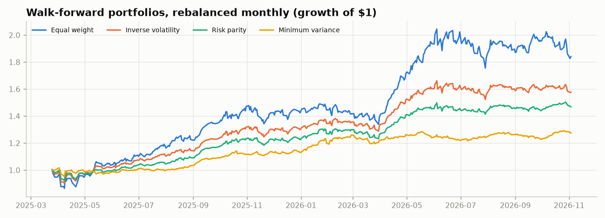

## 8. Opening gaps: do pre-market moves carry into the day?

Across 18,997 stock-days (18 watchlist stocks, 2021-11-12 to 2026-11-10), each 1% of opening gap went with a -0.02% move from the open to the close (95% block-bootstrap CI [-0.08%, +0.03%]): no reliable relationship, so the size of a gap has not told you which way the session goes.

| opening gap | days | avg gap | avg open-to-close | closed above open |
|---|---|---|---|---|
| gap down 3%+ | 768 | -5.2% | +0.30% | 50% |
| down 1-3% | 2901 | -1.7% | +0.09% | 52% |
| within 1% | 11040 | +0.0% | +0.02% | 50% |
| up 1-3% | 3366 | +1.7% | +0.09% | 52% |
| gap up 3%+ | 922 | +5.4% | -0.13% | 47% |

## 9. Deciding before the open vs at the previous close

From 2022-02-08 to 2026-11-09 (239 weekly decisions, both traded at the open), labels set with the pre-market price returned +41.3% a year (worst drawdown -37.0%) against +36.8% (-40.5%) for labels set at the previous close; the two agreed on 89% of stock-weeks. Sharpe ratio difference +0.10 (95% block-bootstrap CI [-0.15, +0.34]): deciding before the open has been **not distinguishable from deciding on the previous close**.

| strategy | CAGR | Volatility | Sharpe | Max drawdown |
|---|---|---|---|---|
| Board on the previous close | +36.8% | 34.5% | 1.08 | -40.5% |
| Board on the pre-market price | +41.3% | 34.1% | 1.19 | -37.0% |
| Equal-weight watchlist | +44.1% | 35.3% | 1.21 | -40.7% |

The pre-market version uses the official opening price as a stand-in for the last pre-market trade (free pre-market history is only days long), which slightly flatters it.
