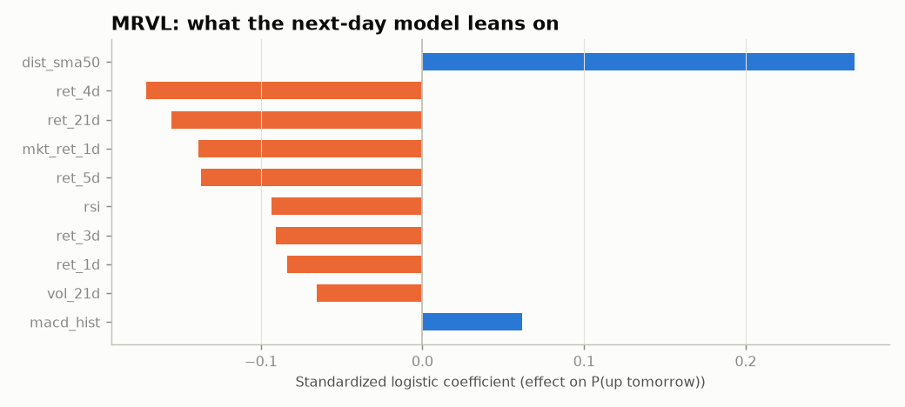
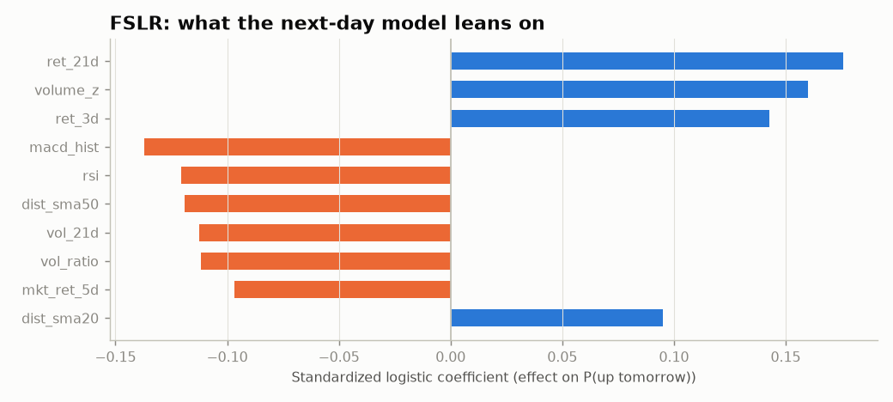
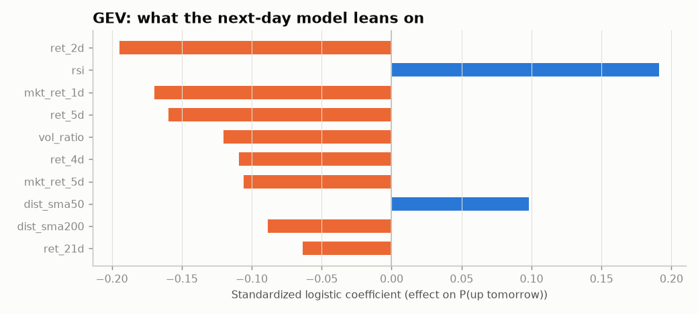

# stocklab report
Generated 2026-11-18 | data source: `yahoo` | history: 5 years | watchlist: ALAB, AMD, NVDA, MRVL, GOOG, FSLR, SKHY, ETN, TSLA, SPCX, AMZN, IBM, GEV, CEG, VST, DELL, TSM, BE

> Educational research code, not investment advice. Past results do not predict future returns.

## 1. Decision board

Data as of the 2026-11-17 close. `*` = provisional (under 200 trading days of history).

| ticker | action | close | 1 day | 1 month | buy rank | sell warnings | pullback entry | breakout | stop | why |
|---|---|---|---|---|---|---|---|---|---|---|
| AMZN | BUY | 257.89 | +0.1% | -1.7% | 4/18 | 1/15 | 256.86 | 271.41 | 239.03 | buy rank 4/18; +5% vs 200-day average; distribution days |
| AMD | WATCH | 503.41 | -0.2% | -6.4% | 2/18 | 4/15 | 462.82 | 586.47 | 381.64 | +18% vs 200-day average; below 50-day, distribution days, 20%+ off high, volatility spike |
| SPCX | REDUCE* | 141.70 | +3.2% | -4.2% | 6/18 | 5/10 |  |  |  | -5% vs 50-day average; below 50-day, distribution days, 20%+ off high, below chandelier stop (provisional: 110 days of history) |
| TSLA | REDUCE | 380.11 | +0.1% | +3.3% | 9/18 | 7/15 |  |  |  | -1% vs 200-day average; below 200-day, death cross, MACD bearish, distribution days, 20%+ off high |
| ALAB | REDUCE | 211.60 | +4.6% | -26.2% | 10/18 | 7/15 |  |  |  | -18% vs 200-day average; below 50-day, below 200-day, distribution days, 20%+ off high, below chandelier stop |
| CEG | REDUCE | 268.07 | -3.5% | +2.0% | 13/18 | 7/15 |  |  |  | -3% vs 200-day average; below 50-day, below 200-day, death cross, distribution days, 20%+ off high |
| BE | REDUCE | 173.46 | -2.2% | -23.3% | 15/18 | 8/15 |  |  |  | -22% vs 200-day average; below 50-day, below 200-day, MACD bearish, distribution days, 20%+ off high, below chandelier stop |
| DELL | SELL | 322.79 | +0.7% | -29.0% | 1/18 | 9/15 |  |  |  | -6% vs 200-day average; below 50-day, below 200-day, MACD bearish, distribution days, 20%+ off high, volatility spike, below chandelier stop |
| MRVL | SELL | 148.74 | +2.3% | -37.3% | 3/18 | 9/15 |  |  |  | -21% vs 200-day average; below 50-day, below 200-day, MACD bearish, distribution days, 20%+ off high, volatility spike, below chandelier stop |
| TSM | SELL | 359.69 | -3.7% | -14.4% | 5/18 | 11/15 |  |  |  | -11% vs 200-day average; below 50-day, below 200-day, MACD bearish, distribution days, high-volume breakdown, 20%+ off high, volatility spike, below chandelier stop |
| IBM | SELL | 231.09 | -4.7% | -1.6% | 7/18 | 9/15 |  |  |  | -5% vs 200-day average; below 50-day, below 200-day, death cross, MACD bearish, 20%+ off high, below chandelier stop |
| ETN | SELL | 337.11 | +0.1% | -13.6% | 8/18 | 9/15 |  |  |  | -15% vs 200-day average; below 50-day, below 200-day, MACD bearish, distribution days, 20%+ off high, volatility spike, below chandelier stop |
| GEV | SELL | 779.91 | +2.1% | -14.1% | 11/18 | 9/15 |  |  |  | -18% vs 200-day average; below 50-day, below 200-day, death cross, MACD bearish, distribution days, 20%+ off high, volatility spike |
| GOOG | SELL | 277.60 | -1.3% | -18.4% | 12/18 | 10/15 |  |  |  | -17% vs 200-day average; below 50-day, below 200-day, death cross, distribution days, 20%+ off high, volatility spike, below chandelier stop |
| NVDA | SELL | 155.46 | -0.4% | -28.4% | 14/18 | 10/15 |  |  |  | -24% vs 200-day average; below 50-day, below 200-day, MACD bearish, distribution days, high-volume breakdown, 20%+ off high, below chandelier stop |
| VST | SELL | 127.15 | -2.3% | -15.1% | 16/18 | 11/15 |  |  |  | -16% vs 200-day average; below 50-day, below 200-day, death cross, MACD bearish, distribution days, 20%+ off high, volatility spike, below chandelier stop |
| SKHY | SELL* | 122.61 | +0.4% | -14.2% | 17/18 | 6/10 |  |  |  | -24% vs 50-day average; below 50-day, MACD bearish, distribution days, 20%+ off high, below chandelier stop (provisional: 92 days of history) |
| FSLR | SELL | 152.97 | -5.8% | -11.0% | 18/18 | 10/15 |  |  |  | -28% vs 200-day average; below 50-day, below 200-day, death cross, MACD bearish, distribution days, 20%+ off high, below chandelier stop |


**Trading the labels** (2022-02-14 to 2026-11-17): buy on BUY, exit on SELL, REDUCE or AVOID, reviewed weekly with next-day execution and 5 bp costs.

| strategy | CAGR | Volatility | Sharpe | Max drawdown | Time invested | Avg holdings |
|---|---|---|---|---|---|---|
| Board strategy | +39.9% | 33.8% | 1.16 | -38.7% | 99% | 6.7 |
| Equal-weight watchlist | +42.0% | 34.2% | 1.20 | -36.8% | 100% | 15.0 |
| SPY (buy & hold) | +12.5% | 17.3% | 0.77 | -22.1% |  |  |

Sharpe difference vs equal weight: -0.03, 95% block-bootstrap CI [-0.52, +0.45].

Forward 21-day return after each label, relative to the watchlist average on the same date (sampled every 21 days, t-test across dates):

| label | observations | dates | mean 21d excess return | hit rate | p_value |
|---|---|---|---|---|---|
| BUY | 239 | 52 | -0.4% | 48% | 0.71 |
| HOLD | 115 | 40 | +0.2% | 50% | 0.90 |
| WATCH | 184 | 54 | +1.7% | 52% | 0.21 |
| AVOID | 51 | 24 | +1.9% | 50% | 0.29 |
| REDUCE | 164 | 52 | -1.8% | 37% | 0.17 |
| SELL | 85 | 36 | -2.4% | 50% | 0.19 |


## 2. Sell check, stock by stock

```
ALAB  REDUCE  (score 7/15, close 211.60 on 2026-11-17)
  RSI 39 | -56.2% from 52-week high
  Triggered:
    - [trend] Close below the 50-day moving average (+1)
    - [trend] Close below the 200-day moving average (+2)
    - [volume] 5+ distribution days in the last 25 sessions (institutional selling) (+1)
    - [risk] 20%+ below the 52-week high (+1)
    - [risk] Close below the chandelier stop (22-day high minus 3x ATR) (+2)
  Levels to watch:
    50-day SMA                 290.56  (price is below, -27.2%)
    200-day SMA                258.02  (price is below, -18.0%)
    Chandelier stop            229.76  (price is below, -7.9%)
```

```
AMD  WATCH  (score 4/15, close 503.41 on 2026-11-17)
  RSI 47 | -22.5% from 52-week high
  Triggered:
    - [trend] Close below the 50-day moving average (+1)
    - [volume] 5+ distribution days in the last 25 sessions (institutional selling) (+1)
    - [risk] 20%+ below the 52-week high (+1)
    - [risk] 21-day volatility 1.5x+ its 1-year median (+1)
  Levels to watch:
    50-day SMA                 555.04  (price is below, -9.3%)
    Chandelier stop            472.23  (price is above, +6.6%)
    200-day SMA                425.74  (price is above, +18.2%)
```

```
NVDA  EXIT  (score 10/15, close 155.46 on 2026-11-17)
  RSI 23 | -35.0% from 52-week high
  Triggered:
    - [trend] Close below the 50-day moving average (+1)
    - [trend] Close below the 200-day moving average (+2)
    - [momentum] MACD line below its signal line (+1)
    - [volume] 5+ distribution days in the last 25 sessions (institutional selling) (+1)
    - [volume] Down day closing below the 50-day average on 1.5x+ average volume (+2)
    - [risk] 20%+ below the 52-week high (+1)
    - [risk] Close below the chandelier stop (22-day high minus 3x ATR) (+2)
  Levels to watch:
    50-day SMA                 211.75  (price is below, -26.6%)
    200-day SMA                203.60  (price is below, -23.6%)
    Chandelier stop            193.06  (price is below, -19.5%)
```

```
MRVL  EXIT  (score 9/15, close 148.74 on 2026-11-17)
  RSI 34 | -53.0% from 52-week high
  Triggered:
    - [trend] Close below the 50-day moving average (+1)
    - [trend] Close below the 200-day moving average (+2)
    - [momentum] MACD line below its signal line (+1)
    - [volume] 5+ distribution days in the last 25 sessions (institutional selling) (+1)
    - [risk] 20%+ below the 52-week high (+1)
    - [risk] 21-day volatility 1.5x+ its 1-year median (+1)
    - [risk] Close below the chandelier stop (22-day high minus 3x ATR) (+2)
  Levels to watch:
    50-day SMA                 226.08  (price is below, -34.2%)
    Chandelier stop            204.56  (price is below, -27.3%)
    200-day SMA                187.62  (price is below, -20.7%)
```

```
GOOG  EXIT  (score 10/15, close 277.60 on 2026-11-17)
  RSI 32 | -30.3% from 52-week high
  Triggered:
    - [trend] Close below the 50-day moving average (+1)
    - [trend] Close below the 200-day moving average (+2)
    - [trend] 50-day average below the 200-day average (+2)
    - [volume] 5+ distribution days in the last 25 sessions (institutional selling) (+1)
    - [risk] 20%+ below the 52-week high (+1)
    - [risk] 21-day volatility 1.5x+ its 1-year median (+1)
    - [risk] Close below the chandelier stop (22-day high minus 3x ATR) (+2)
  Levels to watch:
    200-day SMA                335.51  (price is below, -17.3%)
    50-day SMA                 322.87  (price is below, -14.0%)
    Chandelier stop            312.73  (price is below, -11.2%)
```

```
FSLR  EXIT  (score 10/15, close 152.97 on 2026-11-17)
  RSI 31 | -51.9% from 52-week high
  Triggered:
    - [trend] Close below the 50-day moving average (+1)
    - [trend] Close below the 200-day moving average (+2)
    - [trend] 50-day average below the 200-day average (+2)
    - [momentum] MACD line below its signal line (+1)
    - [volume] 5+ distribution days in the last 25 sessions (institutional selling) (+1)
    - [risk] 20%+ below the 52-week high (+1)
    - [risk] Close below the chandelier stop (22-day high minus 3x ATR) (+2)
  Levels to watch:
    200-day SMA                212.45  (price is below, -28.0%)
    Chandelier stop            184.51  (price is below, -17.1%)
    50-day SMA                 182.52  (price is below, -16.2%)
```

```
SKHY  EXIT  (score 6/10, close 122.61 on 2026-11-17)
  RSI 38 | -38.3% from high since listing
  Only 92 trading days of history; not scored yet: below_sma200, death_cross, volatility_spike
  Triggered:
    - [trend] Close below the 50-day moving average (+1)
    - [momentum] MACD line below its signal line (+1)
    - [volume] 5+ distribution days in the last 25 sessions (institutional selling) (+1)
    - [risk] 20%+ below the high since listing (+1)
    - [risk] Close below the chandelier stop (22-day high minus 3x ATR) (+2)
  Levels to watch:
    50-day SMA                 161.65  (price is below, -24.2%)
    Chandelier stop            136.36  (price is below, -10.1%)
```

```
ETN  EXIT  (score 9/15, close 337.11 on 2026-11-17)
  RSI 38 | -26.5% from 52-week high
  Triggered:
    - [trend] Close below the 50-day moving average (+1)
    - [trend] Close below the 200-day moving average (+2)
    - [momentum] MACD line below its signal line (+1)
    - [volume] 5+ distribution days in the last 25 sessions (institutional selling) (+1)
    - [risk] 20%+ below the 52-week high (+1)
    - [risk] 21-day volatility 1.5x+ its 1-year median (+1)
    - [risk] Close below the chandelier stop (22-day high minus 3x ATR) (+2)
  Levels to watch:
    50-day SMA                 397.06  (price is below, -15.1%)
    200-day SMA                395.33  (price is below, -14.7%)
    Chandelier stop            344.64  (price is below, -2.2%)
```

```
TSLA  REDUCE  (score 7/15, close 380.11 on 2026-11-17)
  RSI 50 | -22.4% from 52-week high
  Triggered:
    - [trend] Close below the 200-day moving average (+2)
    - [trend] 50-day average below the 200-day average (+2)
    - [momentum] MACD line below its signal line (+1)
    - [volume] 5+ distribution days in the last 25 sessions (institutional selling) (+1)
    - [risk] 20%+ below the 52-week high (+1)
  Levels to watch:
    200-day SMA                382.27  (price is below, -0.6%)
    50-day SMA                 375.49  (price is above, +1.2%)
    Chandelier stop            366.24  (price is above, +3.8%)
```

```
SPCX  REDUCE  (score 5/10, close 141.70 on 2026-11-17)
  RSI 49 | -33.0% from high since listing
  Only 110 trading days of history; not scored yet: below_sma200, death_cross, volatility_spike
  Triggered:
    - [trend] Close below the 50-day moving average (+1)
    - [volume] 5+ distribution days in the last 25 sessions (institutional selling) (+1)
    - [risk] 20%+ below the high since listing (+1)
    - [risk] Close below the chandelier stop (22-day high minus 3x ATR) (+2)
  Levels to watch:
    50-day SMA                 148.46  (price is below, -4.6%)
    Chandelier stop            143.27  (price is below, -1.1%)
```

```
AMZN  HOLD  (score 1/15, close 257.89 on 2026-11-17)
  RSI 50 | -9.2% from 52-week high
  Triggered:
    - [volume] 5+ distribution days in the last 25 sessions (institutional selling) (+1)
  Levels to watch:
    50-day SMA                 254.81  (price is above, +1.2%)
    Chandelier stop            248.60  (price is above, +3.7%)
    200-day SMA                244.76  (price is above, +5.4%)
```

```
IBM  EXIT  (score 9/15, close 231.09 on 2026-11-17)
  RSI 39 | -28.8% from 52-week high
  Triggered:
    - [trend] Close below the 50-day moving average (+1)
    - [trend] Close below the 200-day moving average (+2)
    - [trend] 50-day average below the 200-day average (+2)
    - [momentum] MACD line below its signal line (+1)
    - [risk] 20%+ below the 52-week high (+1)
    - [risk] Close below the chandelier stop (22-day high minus 3x ATR) (+2)
  Levels to watch:
    200-day SMA                242.54  (price is below, -4.7%)
    Chandelier stop            237.74  (price is below, -2.8%)
    50-day SMA                 236.72  (price is below, -2.4%)
```

```
GEV  EXIT  (score 9/15, close 779.91 on 2026-11-17)
  RSI 40 | -33.6% from 52-week high
  Triggered:
    - [trend] Close below the 50-day moving average (+1)
    - [trend] Close below the 200-day moving average (+2)
    - [trend] 50-day average below the 200-day average (+2)
    - [momentum] MACD line below its signal line (+1)
    - [volume] 5+ distribution days in the last 25 sessions (institutional selling) (+1)
    - [risk] 20%+ below the 52-week high (+1)
    - [risk] 21-day volatility 1.5x+ its 1-year median (+1)
  Levels to watch:
    200-day SMA                951.29  (price is below, -18.0%)
    50-day SMA                 905.41  (price is below, -13.9%)
    Chandelier stop            772.13  (price is above, +1.0%)
```

```
CEG  REDUCE  (score 7/15, close 268.07 on 2026-11-17)
  RSI 50 | -28.8% from 52-week high
  Triggered:
    - [trend] Close below the 50-day moving average (+1)
    - [trend] Close below the 200-day moving average (+2)
    - [trend] 50-day average below the 200-day average (+2)
    - [volume] 5+ distribution days in the last 25 sessions (institutional selling) (+1)
    - [risk] 20%+ below the 52-week high (+1)
  Levels to watch:
    200-day SMA                277.46  (price is below, -3.4%)
    50-day SMA                 268.07  (price is below, -0.0%)
    Chandelier stop            245.57  (price is above, +9.2%)
```

```
VST  EXIT  (score 11/15, close 127.15 on 2026-11-17)
  RSI 42 | -29.1% from 52-week high
  Triggered:
    - [trend] Close below the 50-day moving average (+1)
    - [trend] Close below the 200-day moving average (+2)
    - [trend] 50-day average below the 200-day average (+2)
    - [momentum] MACD line below its signal line (+1)
    - [volume] 5+ distribution days in the last 25 sessions (institutional selling) (+1)
    - [risk] 20%+ below the 52-week high (+1)
    - [risk] 21-day volatility 1.5x+ its 1-year median (+1)
    - [risk] Close below the chandelier stop (22-day high minus 3x ATR) (+2)
  Levels to watch:
    200-day SMA                151.30  (price is below, -16.0%)
    50-day SMA                 142.31  (price is below, -10.7%)
    Chandelier stop            135.80  (price is below, -6.4%)
```

```
DELL  EXIT  (score 9/15, close 322.79 on 2026-11-17)
  RSI 34 | -45.1% from 52-week high
  Triggered:
    - [trend] Close below the 50-day moving average (+1)
    - [trend] Close below the 200-day moving average (+2)
    - [momentum] MACD line below its signal line (+1)
    - [volume] 5+ distribution days in the last 25 sessions (institutional selling) (+1)
    - [risk] 20%+ below the 52-week high (+1)
    - [risk] 21-day volatility 1.5x+ its 1-year median (+1)
    - [risk] Close below the chandelier stop (22-day high minus 3x ATR) (+2)
  Levels to watch:
    50-day SMA                 484.77  (price is below, -33.4%)
    Chandelier stop            404.46  (price is below, -20.2%)
    200-day SMA                344.67  (price is below, -6.3%)
```

```
TSM  EXIT  (score 11/15, close 359.69 on 2026-11-17)
  RSI 36 | -26.0% from 52-week high
  Triggered:
    - [trend] Close below the 50-day moving average (+1)
    - [trend] Close below the 200-day moving average (+2)
    - [momentum] MACD line below its signal line (+1)
    - [volume] 5+ distribution days in the last 25 sessions (institutional selling) (+1)
    - [volume] Down day closing below the 50-day average on 1.5x+ average volume (+2)
    - [risk] 20%+ below the 52-week high (+1)
    - [risk] 21-day volatility 1.5x+ its 1-year median (+1)
    - [risk] Close below the chandelier stop (22-day high minus 3x ATR) (+2)
  Levels to watch:
    50-day SMA                 427.30  (price is below, -15.8%)
    200-day SMA                402.00  (price is below, -10.5%)
    Chandelier stop            387.13  (price is below, -7.1%)
```

```
BE  REDUCE  (score 8/15, close 173.46 on 2026-11-17)
  RSI 39 | -49.8% from 52-week high
  Triggered:
    - [trend] Close below the 50-day moving average (+1)
    - [trend] Close below the 200-day moving average (+2)
    - [momentum] MACD line below its signal line (+1)
    - [volume] 5+ distribution days in the last 25 sessions (institutional selling) (+1)
    - [risk] 20%+ below the 52-week high (+1)
    - [risk] Close below the chandelier stop (22-day high minus 3x ATR) (+2)
  Levels to watch:
    50-day SMA                 240.46  (price is below, -27.9%)
    200-day SMA                223.75  (price is below, -22.5%)
    Chandelier stop            177.75  (price is below, -2.4%)
```

## 3. Which sell signals actually work? (event study)

Panel: 46 stocks, 5 years. Null hypothesis: returns after a signal look like returns on random days from the same stocks.

| rule | horizon | events | mean_after_signal | mean_random_days | difference | p_value | q_value | drop10_after_signal | drop10_base_rate | verdict |
|---|---|---|---|---|---|---|---|---|---|---|
| below_sma50 | 5d | 1076 | +0.32% | +0.68% | -0.36% | 0.030 | 0.247 | 40% | 36% | weak (not significant) |
| below_sma50 | 21d | 1059 | +2.29% | +3.08% | -0.78% | 0.024 | 0.247 | 40% | 36% | weak (not significant) |
| below_sma50 | 63d | 1001 | +8.61% | +10.17% | -1.56% | 0.019 | 0.247 | 40% | 36% | weak (not significant) |
| below_sma200 | 5d | 522 | +0.59% | +0.62% | -0.03% | 0.455 | 1.000 | 38% | 36% | weak (not significant) |
| below_sma200 | 21d | 503 | +1.66% | +2.77% | -1.11% | 0.025 | 0.247 | 38% | 36% | weak (not significant) |
| below_sma200 | 63d | 476 | +9.44% | +9.08% | +0.36% | 0.630 | 1.000 | 38% | 36% | no edge |
| death_cross | 5d | 156 | +0.71% | +0.64% | +0.06% | 0.559 | 1.000 | 41% | 36% | no edge |
| death_cross | 21d | 148 | +2.74% | +2.90% | -0.16% | 0.454 | 1.000 | 41% | 36% | weak (not significant) |
| death_cross | 63d | 142 | +14.69% | +9.68% | +5.01% | 0.985 | 1.000 | 41% | 36% | no edge |
| rsi_divergence | 5d | 503 | +0.42% | +0.79% | -0.36% | 0.084 | 0.557 | 37% | 36% | weak (not significant) |
| rsi_divergence | 21d | 495 | +3.26% | +3.50% | -0.24% | 0.354 | 1.000 | 37% | 36% | weak (not significant) |
| rsi_divergence | 63d | 487 | +10.96% | +11.69% | -0.73% | 0.268 | 0.886 | 37% | 36% | weak (not significant) |
| rsi_rollover | 5d | 645 | +1.83% | +0.75% | +1.08% | 1.000 | 1.000 | 33% | 36% | no edge |
| rsi_rollover | 21d | 634 | +3.70% | +3.42% | +0.28% | 0.697 | 1.000 | 33% | 36% | no edge |
| rsi_rollover | 63d | 621 | +10.41% | +11.55% | -1.14% | 0.135 | 0.641 | 33% | 36% | weak (not significant) |
| macd_bearish | 5d | 1622 | +0.89% | +0.71% | +0.18% | 0.877 | 1.000 | 35% | 36% | no edge |
| macd_bearish | 21d | 1606 | +3.40% | +3.24% | +0.16% | 0.707 | 1.000 | 35% | 36% | no edge |
| macd_bearish | 63d | 1527 | +11.40% | +10.75% | +0.64% | 0.844 | 1.000 | 35% | 36% | no edge |
| distribution_cluster | 5d | 1079 | +0.81% | +0.72% | +0.09% | 0.684 | 1.000 | 36% | 36% | no edge |
| distribution_cluster | 21d | 1064 | +2.94% | +3.25% | -0.31% | 0.231 | 0.886 | 36% | 36% | weak (not significant) |
| distribution_cluster | 63d | 1022 | +10.36% | +10.90% | -0.54% | 0.256 | 0.886 | 36% | 36% | weak (not significant) |
| high_volume_breakdown | 5d | 766 | +0.82% | +0.67% | +0.15% | 0.748 | 1.000 | 34% | 36% | no edge |
| high_volume_breakdown | 21d | 733 | +3.63% | +3.04% | +0.60% | 0.884 | 1.000 | 34% | 36% | no edge |
| high_volume_breakdown | 63d | 701 | +12.60% | +10.12% | +2.48% | 0.994 | 1.000 | 34% | 36% | no edge |
| drawdown_20 | 5d | 407 | +1.60% | +0.82% | +0.77% | 0.987 | 1.000 | 51% | 36% | no edge |
| drawdown_20 | 21d | 397 | +2.88% | +3.75% | -0.86% | 0.136 | 0.641 | 51% | 36% | weak (not significant) |
| drawdown_20 | 63d | 375 | +13.91% | +12.79% | +1.12% | 0.760 | 1.000 | 51% | 36% | no edge |
| volatility_spike | 5d | 349 | +0.95% | +0.75% | +0.20% | 0.726 | 1.000 | 47% | 36% | no edge |
| volatility_spike | 21d | 330 | +3.20% | +3.39% | -0.19% | 0.409 | 1.000 | 47% | 36% | weak (not significant) |
| volatility_spike | 63d | 329 | +10.80% | +11.34% | -0.53% | 0.371 | 1.000 | 47% | 36% | weak (not significant) |
| chandelier_stop | 5d | 1362 | +0.77% | +0.72% | +0.05% | 0.621 | 1.000 | 37% | 36% | no edge |
| chandelier_stop | 21d | 1343 | +3.51% | +3.25% | +0.27% | 0.757 | 1.000 | 37% | 36% | no edge |
| chandelier_stop | 63d | 1278 | +12.07% | +10.80% | +1.27% | 0.956 | 1.000 | 37% | 36% | no edge |

**0 of 33 rule-by-horizon tests** show significantly weaker returns after the signal (q < 0.10).


## 4. Strategy backtests

Not included: SKHY (only 92 trading days of history, needs 452); SPCX (only 110 trading days of history, needs 452).

### ALAB (2025-01-03 to 2026-11-17)

| strategy | Total return | CAGR | Max drawdown | Volatility | Sharpe | Round trips | Time in market | Sharpe vs B&H | 95% CI | p-value |
|---|---|---|---|---|---|---|---|---|---|---|
| Buy & Hold | +47.2% | +23.0% | -63.2% | +97.1% | 0.70 | 0 | 100% |  |  |  |
| 50/200 SMA cross | -67.7% | -45.4% | -74.0% | +87.7% | -0.25 | 2 | 76% | -0.95 | [-1.88, -0.24] | 0.02 |
| Close > 50-day SMA | +7.6% | +4.0% | -66.4% | +69.7% | 0.41 | 10 | 51% | -0.29 | [-1.34, +0.63] | 0.58 |
| MACD > signal | +20.0% | +10.3% | -70.4% | +65.0% | 0.47 | 21 | 50% | -0.23 | [-1.36, +0.97] | 0.70 |
| RSI 30/70 | +8.5% | +4.5% | -50.3% | +38.0% | 0.30 | 1 | 17% | -0.40 | [-2.21, +1.37] | 0.64 |
| Trailing stop 20% | -11.8% | -6.5% | -69.1% | +71.6% | 0.27 | 10 | 55% | -0.43 | [-1.48, +0.50] | 0.41 |
| Volume breakout | +91.8% | +41.8% | -55.7% | +62.9% | 0.87 | 4 | 41% | +0.17 | [-0.98, +1.29] | 0.77 |

### AMD (2022-09-06 to 2026-11-17)

| strategy | Total return | CAGR | Max drawdown | Volatility | Sharpe | Round trips | Time in market | Sharpe vs B&H | 95% CI | p-value |
|---|---|---|---|---|---|---|---|---|---|---|
| Buy & Hold | +532.0% | +55.3% | -63.0% | +58.6% | 1.04 | 0 | 100% |  |  |  |
| 50/200 SMA cross | +371.9% | +44.9% | -39.1% | +49.1% | 1.00 | 1 | 66% | -0.04 | [-0.60, +0.47] | 0.87 |
| Close > 50-day SMA | +147.4% | +24.2% | -49.9% | +44.0% | 0.71 | 37 | 54% | -0.33 | [-0.94, +0.23] | 0.29 |
| MACD > signal | +280.8% | +37.6% | -42.4% | +41.7% | 0.97 | 39 | 50% | -0.07 | [-0.60, +0.46] | 0.78 |
| RSI 30/70 | +46.0% | +9.5% | -54.7% | +32.6% | 0.44 | 3 | 33% | -0.60 | [-1.62, +0.32] | 0.22 |
| Trailing stop 20% | +149.5% | +24.4% | -58.9% | +49.8% | 0.69 | 11 | 71% | -0.36 | [-0.89, +0.13] | 0.18 |
| Volume breakout | +161.9% | +25.9% | -36.9% | +37.2% | 0.80 | 11 | 38% | -0.24 | [-0.92, +0.37] | 0.49 |

### NVDA (2022-09-06 to 2026-11-17)

| strategy | Total return | CAGR | Max drawdown | Volatility | Sharpe | Round trips | Time in market | Sharpe vs B&H | 95% CI | p-value |
|---|---|---|---|---|---|---|---|---|---|---|
| Buy & Hold | +1037.1% | +78.7% | -36.9% | +49.0% | 1.43 | 0 | 100% |  |  |  |
| 50/200 SMA cross | +500.4% | +53.4% | -35.0% | +43.3% | 1.20 | 1 | 84% | -0.22 | [-0.70, +0.19] | 0.31 |
| Close > 50-day SMA | +346.8% | +43.0% | -39.1% | +39.0% | 1.11 | 38 | 69% | -0.32 | [-0.89, +0.30] | 0.29 |
| MACD > signal | +152.9% | +24.8% | -46.7% | +34.4% | 0.81 | 40 | 51% | -0.61 | [-1.36, +0.09] | 0.10 |
| RSI 30/70 | +36.3% | +7.7% | -22.6% | +18.8% | 0.48 | 2 | 8% | -0.94 | [-2.16, -0.05] | 0.07 |
| Trailing stop 20% | +627.2% | +60.6% | -36.6% | +44.9% | 1.28 | 8 | 90% | -0.15 | [-0.53, +0.19] | 0.41 |
| Volume breakout | +211.5% | +31.2% | -19.8% | +26.3% | 1.16 | 7 | 31% | -0.27 | [-1.07, +0.52] | 0.55 |

### MRVL (2022-09-06 to 2026-11-17)

| strategy | Total return | CAGR | Max drawdown | Volatility | Sharpe | Round trips | Time in market | Sharpe vs B&H | 95% CI | p-value |
|---|---|---|---|---|---|---|---|---|---|---|
| Buy & Hold | +222.7% | +32.3% | -60.8% | +67.4% | 0.75 | 0 | 100% |  |  |  |
| 50/200 SMA cross | +44.8% | +9.2% | -65.2% | +57.7% | 0.44 | 2 | 68% | -0.31 | [-0.76, +0.11] | 0.18 |
| Close > 50-day SMA | +65.8% | +12.8% | -51.5% | +52.7% | 0.49 | 36 | 58% | -0.26 | [-0.88, +0.28] | 0.38 |
| MACD > signal | +101.6% | +18.2% | -62.5% | +50.2% | 0.58 | 44 | 51% | -0.17 | [-0.86, +0.51] | 0.65 |
| RSI 30/70 | +54.9% | +11.0% | -32.1% | +29.4% | 0.50 | 2 | 20% | -0.24 | [-1.18, +0.78] | 0.62 |
| Trailing stop 20% | +72.6% | +13.9% | -53.3% | +57.0% | 0.51 | 15 | 76% | -0.24 | [-0.76, +0.23] | 0.32 |
| Volume breakout | +76.0% | +14.5% | -46.2% | +42.0% | 0.53 | 11 | 36% | -0.22 | [-1.10, +0.55] | 0.60 |

### GOOG (2022-09-06 to 2026-11-17)

| strategy | Total return | CAGR | Max drawdown | Volatility | Sharpe | Round trips | Time in market | Sharpe vs B&H | 95% CI | p-value |
|---|---|---|---|---|---|---|---|---|---|---|
| Buy & Hold | +153.5% | +24.9% | -30.3% | +31.7% | 0.86 | 0 | 100% |  |  |  |
| 50/200 SMA cross | +151.5% | +24.6% | -29.4% | +25.9% | 0.98 | 2 | 76% | +0.12 | [-0.37, +0.62] | 0.63 |
| Close > 50-day SMA | +85.6% | +15.9% | -22.2% | +23.6% | 0.74 | 34 | 63% | -0.12 | [-0.83, +0.60] | 0.75 |
| MACD > signal | +29.1% | +6.3% | -21.6% | +21.6% | 0.39 | 42 | 50% | -0.47 | [-1.14, +0.21] | 0.20 |
| RSI 30/70 | +26.6% | +5.8% | -20.4% | +18.3% | 0.40 | 4 | 26% | -0.46 | [-1.31, +0.42] | 0.28 |
| Trailing stop 20% | +43.0% | +8.9% | -40.4% | +29.7% | 0.44 | 6 | 92% | -0.42 | [-0.88, -0.03] | 0.05 |
| Volume breakout | +105.6% | +18.8% | -17.4% | +19.4% | 0.98 | 8 | 46% | +0.12 | [-0.66, +0.88] | 0.75 |

### FSLR (2022-09-06 to 2026-11-17)

| strategy | Total return | CAGR | Max drawdown | Volatility | Sharpe | Round trips | Time in market | Sharpe vs B&H | 95% CI | p-value |
|---|---|---|---|---|---|---|---|---|---|---|
| Buy & Hold | +13.4% | +3.1% | -60.0% | +55.2% | 0.33 | 0 | 100% |  |  |  |
| 50/200 SMA cross | +4.3% | +1.0% | -51.1% | +41.6% | 0.23 | 4 | 59% | -0.10 | [-0.74, +0.47] | 0.74 |
| Close > 50-day SMA | +23.3% | +5.1% | -46.8% | +40.3% | 0.32 | 29 | 50% | -0.00 | [-0.59, +0.55] | 0.99 |
| MACD > signal | -61.6% | -20.4% | -74.1% | +40.8% | -0.36 | 49 | 50% | -0.68 | [-1.40, +0.01] | 0.05 |
| RSI 30/70 | +30.1% | +6.5% | -42.8% | +30.4% | 0.35 | 2 | 27% | +0.03 | [-0.99, +0.83] | 0.95 |
| Trailing stop 20% | -5.3% | -1.3% | -57.3% | +45.3% | 0.19 | 11 | 69% | -0.13 | [-0.62, +0.36] | 0.59 |
| Volume breakout | -28.7% | -7.8% | -53.8% | +32.2% | -0.09 | 14 | 37% | -0.42 | [-1.27, +0.38] | 0.34 |

### ETN (2022-09-06 to 2026-11-17)

| strategy | Total return | CAGR | Max drawdown | Volatility | Sharpe | Round trips | Time in market | Sharpe vs B&H | 95% CI | p-value |
|---|---|---|---|---|---|---|---|---|---|---|
| Buy & Hold | +153.2% | +24.8% | -34.5% | +34.0% | 0.82 | 0 | 100% |  |  |  |
| 50/200 SMA cross | +59.9% | +11.9% | -35.7% | +30.5% | 0.52 | 2 | 83% | -0.30 | [-0.70, +0.05] | 0.12 |
| Close > 50-day SMA | +33.3% | +7.1% | -37.5% | +24.5% | 0.40 | 44 | 65% | -0.42 | [-1.05, +0.24] | 0.19 |
| MACD > signal | +37.3% | +7.9% | -25.8% | +22.4% | 0.45 | 48 | 50% | -0.37 | [-1.11, +0.34] | 0.30 |
| RSI 30/70 | +15.7% | +3.6% | -18.6% | +11.5% | 0.36 | 1 | 5% | -0.46 | [-1.44, +0.71] | 0.35 |
| Trailing stop 20% | +178.0% | +27.7% | -23.6% | +30.8% | 0.95 | 2 | 94% | +0.12 | [-0.09, +0.37] | 0.29 |
| Volume breakout | +21.6% | +4.8% | -29.3% | +18.1% | 0.35 | 10 | 38% | -0.47 | [-1.25, +0.38] | 0.26 |

### TSLA (2022-09-06 to 2026-11-17)

| strategy | Total return | CAGR | Max drawdown | Volatility | Sharpe | Round trips | Time in market | Sharpe vs B&H | 95% CI | p-value |
|---|---|---|---|---|---|---|---|---|---|---|
| Buy & Hold | +33.9% | +7.2% | -65.0% | +58.3% | 0.41 | 0 | 100% |  |  |  |
| 50/200 SMA cross | -26.4% | -7.1% | -56.8% | +40.1% | 0.01 | 4 | 47% | -0.39 | [-1.27, +0.41] | 0.35 |
| Close > 50-day SMA | +56.9% | +11.4% | -41.1% | +38.5% | 0.47 | 42 | 53% | +0.06 | [-0.67, +0.84] | 0.88 |
| MACD > signal | +396.5% | +46.6% | -39.8% | +40.8% | 1.14 | 42 | 51% | +0.73 | [+0.07, +1.41] | 0.03 |
| RSI 30/70 | +47.6% | +9.7% | -52.7% | +40.3% | 0.43 | 4 | 43% | +0.02 | [-0.73, +0.76] | 0.95 |
| Trailing stop 20% | +36.5% | +7.7% | -47.9% | +45.0% | 0.39 | 11 | 71% | -0.02 | [-0.68, +0.62] | 0.95 |
| Volume breakout | +40.5% | +8.5% | -35.4% | +25.7% | 0.44 | 9 | 18% | +0.03 | [-0.92, +0.99] | 0.95 |

### AMZN (2022-09-06 to 2026-11-17)

| strategy | Total return | CAGR | Max drawdown | Volatility | Sharpe | Round trips | Time in market | Sharpe vs B&H | 95% CI | p-value |
|---|---|---|---|---|---|---|---|---|---|---|
| Buy & Hold | +99.1% | +17.9% | -40.0% | +34.1% | 0.65 | 0 | 100% |  |  |  |
| 50/200 SMA cross | +32.6% | +7.0% | -41.4% | +27.9% | 0.38 | 2 | 74% | -0.27 | [-0.87, +0.36] | 0.39 |
| Close > 50-day SMA | +27.9% | +6.1% | -41.4% | +23.3% | 0.37 | 34 | 63% | -0.28 | [-0.96, +0.41] | 0.44 |
| MACD > signal | -3.8% | -0.9% | -28.7% | +22.8% | 0.07 | 50 | 50% | -0.58 | [-1.28, +0.11] | 0.12 |
| RSI 30/70 | +94.0% | +17.1% | -22.0% | +21.6% | 0.84 | 4 | 33% | +0.19 | [-0.51, +0.94] | 0.60 |
| Trailing stop 20% | +104.3% | +18.6% | -24.2% | +29.8% | 0.72 | 3 | 87% | +0.07 | [-0.37, +0.50] | 0.77 |
| Volume breakout | +3.1% | +0.7% | -36.1% | +18.8% | 0.13 | 11 | 46% | -0.52 | [-1.45, +0.39] | 0.27 |

### IBM (2022-09-06 to 2026-11-17)

| strategy | Total return | CAGR | Max drawdown | Volatility | Sharpe | Round trips | Time in market | Sharpe vs B&H | 95% CI | p-value |
|---|---|---|---|---|---|---|---|---|---|---|
| Buy & Hold | +109.8% | +19.4% | -37.5% | +31.6% | 0.72 | 0 | 100% |  |  |  |
| 50/200 SMA cross | +64.8% | +12.7% | -28.7% | +22.8% | 0.64 | 3 | 72% | -0.08 | [-0.80, +0.56] | 0.81 |
| Close > 50-day SMA | +45.3% | +9.3% | -42.6% | +25.3% | 0.48 | 27 | 60% | -0.24 | [-0.74, +0.31] | 0.35 |
| MACD > signal | +112.3% | +19.7% | -43.1% | +23.9% | 0.88 | 30 | 50% | +0.15 | [-0.43, +0.89] | 0.65 |
| RSI 30/70 | +175.4% | +27.4% | -16.5% | +17.4% | 1.48 | 8 | 35% | +0.76 | [-0.25, +1.61] | 0.11 |
| Trailing stop 20% | +59.3% | +11.8% | -45.9% | +30.4% | 0.52 | 3 | 92% | -0.20 | [-0.45, +0.00] | 0.08 |
| Volume breakout | +56.5% | +11.3% | -29.4% | +17.2% | 0.71 | 10 | 40% | -0.02 | [-0.89, +0.85] | 0.97 |

### GEV (2025-01-13 to 2026-11-17)

| strategy | Total return | CAGR | Max drawdown | Volatility | Sharpe | Round trips | Time in market | Sharpe vs B&H | 95% CI | p-value |
|---|---|---|---|---|---|---|---|---|---|---|
| Buy & Hold | +104.8% | +47.5% | -38.3% | +56.1% | 0.98 | 0 | 100% |  |  |  |
| 50/200 SMA cross | +133.0% | +58.1% | -38.3% | +54.6% | 1.12 | 1 | 97% | +0.14 | [-0.02, +0.43] | 0.18 |
| Close > 50-day SMA | +79.1% | +37.1% | -32.7% | +43.6% | 0.94 | 15 | 63% | -0.03 | [-0.64, +0.57] | 0.91 |
| MACD > signal | +60.6% | +29.3% | -31.0% | +41.8% | 0.83 | 17 | 48% | -0.15 | [-0.93, +0.65] | 0.70 |
| RSI 30/70 | +21.4% | +11.1% | -35.0% | +35.0% | 0.48 | 1 | 32% | -0.50 | [-1.68, +0.63] | 0.42 |
| Trailing stop 20% | +44.2% | +21.9% | -45.9% | +49.9% | 0.65 | 5 | 86% | -0.33 | [-0.87, +0.17] | 0.23 |
| Volume breakout | +24.5% | +12.6% | -24.6% | +33.3% | 0.53 | 3 | 35% | -0.45 | [-1.55, +0.72] | 0.47 |

### CEG (2022-11-02 to 2026-11-17)

| strategy | Total return | CAGR | Max drawdown | Volatility | Sharpe | Round trips | Time in market | Sharpe vs B&H | 95% CI | p-value |
|---|---|---|---|---|---|---|---|---|---|---|
| Buy & Hold | +193.1% | +30.6% | -50.7% | +49.3% | 0.79 | 0 | 100% |  |  |  |
| 50/200 SMA cross | +96.8% | +18.3% | -50.7% | +43.4% | 0.60 | 3 | 72% | -0.18 | [-0.65, +0.23] | 0.40 |
| Close > 50-day SMA | +132.9% | +23.4% | -42.4% | +37.3% | 0.75 | 48 | 57% | -0.04 | [-0.59, +0.54] | 0.90 |
| MACD > signal | +25.9% | +5.9% | -41.5% | +36.9% | 0.34 | 41 | 49% | -0.45 | [-1.10, +0.19] | 0.16 |
| RSI 30/70 | +98.6% | +18.6% | -28.6% | +32.3% | 0.69 | 3 | 37% | -0.10 | [-0.92, +0.65] | 0.80 |
| Trailing stop 20% | +90.5% | +17.4% | -52.8% | +43.8% | 0.58 | 9 | 84% | -0.20 | [-0.64, +0.23] | 0.36 |
| Volume breakout | +86.0% | +16.7% | -30.0% | +30.6% | 0.66 | 9 | 39% | -0.13 | [-0.86, +0.62] | 0.75 |

### VST (2022-09-06 to 2026-11-17)

| strategy | Total return | CAGR | Max drawdown | Volatility | Sharpe | Round trips | Time in market | Sharpe vs B&H | 95% CI | p-value |
|---|---|---|---|---|---|---|---|---|---|---|
| Buy & Hold | +449.4% | +50.2% | -48.8% | +52.1% | 1.05 | 0 | 100% |  |  |  |
| 50/200 SMA cross | +427.2% | +48.7% | -48.8% | +44.0% | 1.13 | 3 | 68% | +0.08 | [-0.26, +0.48] | 0.65 |
| Close > 50-day SMA | +51.4% | +10.4% | -67.2% | +38.0% | 0.46 | 45 | 63% | -0.59 | [-1.20, +0.04] | 0.06 |
| MACD > signal | +66.6% | +13.0% | -49.0% | +37.2% | 0.52 | 47 | 51% | -0.53 | [-1.18, +0.14] | 0.12 |
| RSI 30/70 | +186.3% | +28.6% | -27.3% | +26.8% | 1.07 | 3 | 21% | +0.02 | [-0.85, +0.80] | 0.96 |
| Trailing stop 20% | +218.2% | +31.8% | -56.3% | +44.6% | 0.85 | 9 | 88% | -0.20 | [-0.64, +0.25] | 0.38 |
| Volume breakout | +278.5% | +37.4% | -31.2% | +31.4% | 1.18 | 9 | 43% | +0.13 | [-0.65, +1.00] | 0.76 |

### DELL (2022-09-06 to 2026-11-17)

| strategy | Total return | CAGR | Max drawdown | Volatility | Sharpe | Round trips | Time in market | Sharpe vs B&H | 95% CI | p-value |
|---|---|---|---|---|---|---|---|---|---|---|
| Buy & Hold | +822.8% | +70.0% | -59.6% | +58.2% | 1.19 | 0 | 100% |  |  |  |
| 50/200 SMA cross | +389.2% | +46.1% | -50.8% | +51.0% | 0.99 | 3 | 69% | -0.21 | [-0.69, +0.21] | 0.36 |
| Close > 50-day SMA | +1326.9% | +88.7% | -27.5% | +49.3% | 1.52 | 21 | 67% | +0.33 | [-0.16, +0.85] | 0.22 |
| MACD > signal | +141.4% | +23.4% | -57.7% | +43.1% | 0.69 | 45 | 52% | -0.50 | [-1.15, +0.20] | 0.13 |
| RSI 30/70 | +139.0% | +23.1% | -23.7% | +27.0% | 0.90 | 4 | 28% | -0.29 | [-1.25, +0.62] | 0.57 |
| Trailing stop 20% | +969.6% | +76.1% | -55.9% | +51.5% | 1.35 | 7 | 82% | +0.15 | [-0.27, +0.58] | 0.48 |
| Volume breakout | +378.1% | +45.3% | -37.8% | +43.2% | 1.07 | 11 | 45% | -0.13 | [-0.82, +0.55] | 0.71 |

### TSM (2022-09-06 to 2026-11-17)

| strategy | Total return | CAGR | Max drawdown | Volatility | Sharpe | Round trips | Time in market | Sharpe vs B&H | 95% CI | p-value |
|---|---|---|---|---|---|---|---|---|---|---|
| Buy & Hold | +380.3% | +45.5% | -36.8% | +39.5% | 1.15 | 0 | 100% |  |  |  |
| 50/200 SMA cross | +146.9% | +24.1% | -36.8% | +36.1% | 0.78 | 2 | 82% | -0.37 | [-0.88, +0.11] | 0.15 |
| Close > 50-day SMA | +190.3% | +29.0% | -28.8% | +31.6% | 0.96 | 37 | 68% | -0.18 | [-0.71, +0.38] | 0.53 |
| MACD > signal | +118.2% | +20.5% | -32.1% | +28.6% | 0.79 | 44 | 49% | -0.35 | [-0.99, +0.24] | 0.26 |
| RSI 30/70 | +31.7% | +6.8% | -23.0% | +17.2% | 0.47 | 3 | 13% | -0.68 | [-1.68, +0.24] | 0.17 |
| Trailing stop 20% | +226.4% | +32.7% | -30.6% | +36.7% | 0.95 | 6 | 90% | -0.19 | [-0.56, +0.15] | 0.28 |
| Volume breakout | +77.0% | +14.6% | -26.8% | +26.4% | 0.65 | 11 | 46% | -0.50 | [-1.32, +0.23] | 0.19 |

### BE (2022-09-06 to 2026-11-17)

| strategy | Total return | CAGR | Max drawdown | Volatility | Sharpe | Round trips | Time in market | Sharpe vs B&H | 95% CI | p-value |
|---|---|---|---|---|---|---|---|---|---|---|
| Buy & Hold | +581.8% | +58.2% | -67.8% | +90.1% | 0.94 | 0 | 100% |  |  |  |
| 50/200 SMA cross | +215.9% | +31.6% | -71.9% | +75.0% | 0.74 | 4 | 63% | -0.21 | [-0.79, +0.35] | 0.51 |
| Close > 50-day SMA | +359.4% | +43.9% | -53.1% | +69.6% | 0.85 | 31 | 51% | -0.09 | [-0.66, +0.43] | 0.74 |
| MACD > signal | +186.5% | +28.6% | -60.0% | +65.9% | 0.69 | 41 | 50% | -0.25 | [-1.00, +0.41] | 0.46 |
| RSI 30/70 | +147.7% | +24.2% | -61.8% | +47.0% | 0.69 | 4 | 47% | -0.25 | [-1.09, +0.66] | 0.60 |
| Trailing stop 20% | +153.2% | +24.8% | -66.7% | +73.8% | 0.65 | 19 | 60% | -0.29 | [-0.81, +0.20] | 0.24 |
| Volume breakout | +275.5% | +37.2% | -58.1% | +61.0% | 0.80 | 11 | 30% | -0.14 | [-0.97, +0.60] | 0.72 |


## 5. Next-day forecasts

Not included: SKHY (only 92 trading days of history, needs 452); SPCX (only 110 trading days of history, needs 452).

### ALAB

Walk-forward test on 217 unseen days (2026-01-07 to 2026-11-16).

| model | accuracy | always-majority accuracy | p (beats majority) | AUC | Brier | strategy Sharpe | buy & hold Sharpe |
|---|---|---|---|---|---|---|---|
| Majority class (baseline) | 0.521 | 0.521 | 0.527 | 0.458 | 0.25 | 0.789 | 0.789 |
| Logistic regression | 0.498 | 0.521 | 0.773 | 0.5 | 0.257 | 0.27 | 0.789 |
| Gradient boosting | 0.479 | 0.521 | 0.902 | 0.46 | 0.282 | 0.359 | 0.789 |

| model | RMSE (bps) | R2 out-of-sample vs zero | direction hit rate | DM p (beats zero) |
|---|---|---|---|---|
| Zero / random walk (baseline) | 650.0 | 0.0 |  |  |
| Ridge regression | 666.1 | -0.0503 | 0.475 | 0.942 |
| Gradient boosting | 683.1 | -0.1045 | 0.456 | 0.993 |

Forecast for the next session:

```
  P(up) | Logistic regression      59.0%
  P(up) | Gradient boosting        34.2%
  P(up) | historical base rate     51.8%
  expected return (ridge)          +1.88%
  80% range low                    -8.31%
  80% range high                   +13.20%
  daily volatility                 +8.22%
```

Best out-of-sample AUC **0.500**; smallest p-value against a naive baseline 0.773, before correcting for the four models tested here and the other stocks (the corrected count is in the summary).


### AMD

Walk-forward test on 550 unseen days (2024-09-09 to 2026-11-16).

| model | accuracy | always-majority accuracy | p (beats majority) | AUC | Brier | strategy Sharpe | buy & hold Sharpe |
|---|---|---|---|---|---|---|---|
| Majority class (baseline) | 0.515 | 0.531 | 0.792 | 0.482 | 0.25 | 1.232 | 1.23 |
| Logistic regression | 0.507 | 0.531 | 0.876 | 0.49 | 0.256 | 0.774 | 1.23 |
| Gradient boosting | 0.487 | 0.531 | 0.982 | 0.498 | 0.265 | 0.61 | 1.23 |

| model | RMSE (bps) | R2 out-of-sample vs zero | direction hit rate | DM p (beats zero) |
|---|---|---|---|---|
| Zero / random walk (baseline) | 406.5 | 0.0 |  |  |
| Ridge regression | 407.4 | -0.0044 | 0.509 | 0.593 |
| Gradient boosting | 412.0 | -0.0269 | 0.513 | 0.911 |

Forecast for the next session:

```
  P(up) | Logistic regression      57.1%
  P(up) | Gradient boosting        56.0%
  P(up) | historical base rate     51.6%
  expected return (ridge)          +0.79%
  80% range low                    -8.61%
  80% range high                   +11.15%
  daily volatility                 +7.64%
```

Best out-of-sample AUC **0.498**; smallest p-value against a naive baseline 0.593, before correcting for the four models tested here and the other stocks (the corrected count is in the summary).


### NVDA

Walk-forward test on 550 unseen days (2024-09-09 to 2026-11-16).

| model | accuracy | always-majority accuracy | p (beats majority) | AUC | Brier | strategy Sharpe | buy & hold Sharpe |
|---|---|---|---|---|---|---|---|
| Majority class (baseline) | 0.52 | 0.52 | 0.517 | 0.513 | 0.25 | 0.615 | 0.616 |
| Logistic regression | 0.509 | 0.52 | 0.711 | 0.53 | 0.254 | 0.568 | 0.616 |
| Gradient boosting | 0.487 | 0.52 | 0.943 | 0.483 | 0.268 | 0.19 | 0.616 |

| model | RMSE (bps) | R2 out-of-sample vs zero | direction hit rate | DM p (beats zero) |
|---|---|---|---|---|
| Zero / random walk (baseline) | 279.7 | 0.0 |  |  |
| Ridge regression | 280.6 | -0.0064 | 0.524 | 0.589 |
| Gradient boosting | 288.1 | -0.0608 | 0.505 | 0.964 |

Forecast for the next session:

```
  P(up) | Logistic regression      61.7%
  P(up) | Gradient boosting        73.0%
  P(up) | historical base rate     53.7%
  expected return (ridge)          +0.74%
  80% range low                    -3.46%
  80% range high                   +5.12%
  daily volatility                 +3.32%
```

Best out-of-sample AUC **0.530**; smallest p-value against a naive baseline 0.589, before correcting for the four models tested here and the other stocks (the corrected count is in the summary).


### MRVL

Walk-forward test on 550 unseen days (2024-09-09 to 2026-11-16).

| model | accuracy | always-majority accuracy | p (beats majority) | AUC | Brier | strategy Sharpe | buy & hold Sharpe |
|---|---|---|---|---|---|---|---|
| Majority class (baseline) | 0.535 | 0.535 | 0.517 | 0.469 | 0.249 | 0.844 | 0.844 |
| Logistic regression | 0.538 | 0.535 | 0.449 | 0.553 | 0.251 | 0.79 | 0.844 |
| Gradient boosting | 0.502 | 0.535 | 0.943 | 0.555 | 0.257 | 0.305 | 0.844 |

| model | RMSE (bps) | R2 out-of-sample vs zero | direction hit rate | DM p (beats zero) |
|---|---|---|---|---|
| Zero / random walk (baseline) | 481.3 | 0.0 |  |  |
| Ridge regression | 484.3 | -0.0124 | 0.538 | 0.751 |
| Gradient boosting | 489.9 | -0.0358 | 0.525 | 0.946 |

Forecast for the next session:

```
  P(up) | Logistic regression      47.4%
  P(up) | Gradient boosting        63.0%
  P(up) | historical base rate     52.7%
  expected return (ridge)          +0.69%
  80% range low                    -8.76%
  80% range high                   +11.12%
  daily volatility                 +7.69%
```

Best out-of-sample AUC **0.555**; smallest p-value against a naive baseline 0.449, before correcting for the four models tested here and the other stocks (the corrected count is in the summary).



### GOOG

Walk-forward test on 550 unseen days (2024-09-09 to 2026-11-16).

| model | accuracy | always-majority accuracy | p (beats majority) | AUC | Brier | strategy Sharpe | buy & hold Sharpe |
|---|---|---|---|---|---|---|---|
| Majority class (baseline) | 0.524 | 0.524 | 0.517 | 0.485 | 0.25 | 1.058 | 1.059 |
| Logistic regression | 0.536 | 0.524 | 0.29 | 0.533 | 0.252 | 0.365 | 1.059 |
| Gradient boosting | 0.527 | 0.524 | 0.449 | 0.529 | 0.261 | 0.742 | 1.059 |

| model | RMSE (bps) | R2 out-of-sample vs zero | direction hit rate | DM p (beats zero) |
|---|---|---|---|---|
| Zero / random walk (baseline) | 201.0 | 0.0 |  |  |
| Ridge regression | 202.8 | -0.0178 | 0.535 | 0.917 |
| Gradient boosting | 207.1 | -0.0615 | 0.52 | 0.996 |

Forecast for the next session:

```
  P(up) | Logistic regression      52.8%
  P(up) | Gradient boosting        58.3%
  P(up) | historical base rate     53.0%
  expected return (ridge)          +0.32%
  80% range low                    -3.80%
  80% range high                   +4.61%
  daily volatility                 +3.27%
```

Best out-of-sample AUC **0.533**; smallest p-value against a naive baseline 0.290, before correcting for the four models tested here and the other stocks (the corrected count is in the summary).


### FSLR

Walk-forward test on 550 unseen days (2024-09-09 to 2026-11-16).

| model | accuracy | always-majority accuracy | p (beats majority) | AUC | Brier | strategy Sharpe | buy & hold Sharpe |
|---|---|---|---|---|---|---|---|
| Majority class (baseline) | 0.516 | 0.516 | 0.517 | 0.471 | 0.25 |  | 0.057 |
| Logistic regression | 0.518 | 0.516 | 0.483 | 0.529 | 0.251 | -0.106 | 0.057 |
| Gradient boosting | 0.504 | 0.516 | 0.739 | 0.525 | 0.261 | -0.161 | 0.057 |

| model | RMSE (bps) | R2 out-of-sample vs zero | direction hit rate | DM p (beats zero) |
|---|---|---|---|---|
| Zero / random walk (baseline) | 365.2 | 0.0 |  |  |
| Ridge regression | 366.1 | -0.0053 | 0.498 | 0.669 |
| Gradient boosting | 375.8 | -0.0594 | 0.509 | 0.998 |

Forecast for the next session:

```
  P(up) | Logistic regression      65.2%
  P(up) | Gradient boosting        73.0%
  P(up) | historical base rate     48.9%
  expected return (ridge)          +0.70%
  80% range low                    -3.43%
  80% range high                   +5.01%
  daily volatility                 +3.27%
```

Best out-of-sample AUC **0.529**; smallest p-value against a naive baseline 0.483, before correcting for the four models tested here and the other stocks (the corrected count is in the summary).



### ETN

Walk-forward test on 550 unseen days (2024-09-09 to 2026-11-16).

| model | accuracy | always-majority accuracy | p (beats majority) | AUC | Brier | strategy Sharpe | buy & hold Sharpe |
|---|---|---|---|---|---|---|---|
| Majority class (baseline) | 0.525 | 0.525 | 0.517 | 0.47 | 0.25 | 0.407 | 0.408 |
| Logistic regression | 0.509 | 0.525 | 0.791 | 0.514 | 0.254 | 0.435 | 0.408 |
| Gradient boosting | 0.531 | 0.525 | 0.416 | 0.519 | 0.261 | 0.174 | 0.408 |

| model | RMSE (bps) | R2 out-of-sample vs zero | direction hit rate | DM p (beats zero) |
|---|---|---|---|---|
| Zero / random walk (baseline) | 247.6 | 0.0 |  |  |
| Ridge regression | 248.7 | -0.0087 | 0.529 | 0.689 |
| Gradient boosting | 255.0 | -0.0606 | 0.511 | 0.985 |

Forecast for the next session:

```
  P(up) | Logistic regression      60.8%
  P(up) | Gradient boosting        65.0%
  P(up) | historical base rate     54.0%
  expected return (ridge)          +0.74%
  80% range low                    -4.82%
  80% range high                   +6.62%
  daily volatility                 +4.43%
```

Best out-of-sample AUC **0.519**; smallest p-value against a naive baseline 0.416, before correcting for the four models tested here and the other stocks (the corrected count is in the summary).


### TSLA

Walk-forward test on 550 unseen days (2024-09-09 to 2026-11-16).

| model | accuracy | always-majority accuracy | p (beats majority) | AUC | Brier | strategy Sharpe | buy & hold Sharpe |
|---|---|---|---|---|---|---|---|
| Majority class (baseline) | 0.504 | 0.504 | 0.517 | 0.461 | 0.25 | 0.73 | 0.73 |
| Logistic regression | 0.527 | 0.504 | 0.143 | 0.512 | 0.253 | 0.86 | 0.73 |
| Gradient boosting | 0.515 | 0.504 | 0.32 | 0.532 | 0.261 | 0.498 | 0.73 |

| model | RMSE (bps) | R2 out-of-sample vs zero | direction hit rate | DM p (beats zero) |
|---|---|---|---|---|
| Zero / random walk (baseline) | 367.5 | 0.0 |  |  |
| Ridge regression | 372.2 | -0.0256 | 0.498 | 0.953 |
| Gradient boosting | 377.1 | -0.0528 | 0.518 | 0.986 |

Forecast for the next session:

```
  P(up) | Logistic regression      43.3%
  P(up) | Gradient boosting        60.2%
  P(up) | historical base rate     50.9%
  expected return (ridge)          -0.02%
  80% range low                    -4.69%
  80% range high                   +4.88%
  daily volatility                 +3.73%
```

Best out-of-sample AUC **0.532**; smallest p-value against a naive baseline 0.143, before correcting for the four models tested here and the other stocks (the corrected count is in the summary).


### AMZN

Walk-forward test on 550 unseen days (2024-09-09 to 2026-11-16).

| model | accuracy | always-majority accuracy | p (beats majority) | AUC | Brier | strategy Sharpe | buy & hold Sharpe |
|---|---|---|---|---|---|---|---|
| Majority class (baseline) | 0.516 | 0.516 | 0.517 | 0.449 | 0.25 | 0.688 | 0.689 |
| Logistic regression | 0.538 | 0.516 | 0.163 | 0.553 | 0.249 | 0.956 | 0.689 |
| Gradient boosting | 0.502 | 0.516 | 0.766 | 0.518 | 0.262 | 0.132 | 0.689 |

| model | RMSE (bps) | R2 out-of-sample vs zero | direction hit rate | DM p (beats zero) |
|---|---|---|---|---|
| Zero / random walk (baseline) | 211.5 | 0.0 |  |  |
| Ridge regression | 213.0 | -0.0144 | 0.545 | 0.838 |
| Gradient boosting | 220.1 | -0.083 | 0.531 | 1.0 |

Forecast for the next session:

```
  P(up) | Logistic regression      48.0%
  P(up) | Gradient boosting        56.4%
  P(up) | historical base rate     51.4%
  expected return (ridge)          +0.12%
  80% range low                    -2.99%
  80% range high                   +3.33%
  daily volatility                 +2.46%
```

Best out-of-sample AUC **0.553**; smallest p-value against a naive baseline 0.163, before correcting for the four models tested here and the other stocks (the corrected count is in the summary).


### IBM

Walk-forward test on 550 unseen days (2024-09-09 to 2026-11-16).

| model | accuracy | always-majority accuracy | p (beats majority) | AUC | Brier | strategy Sharpe | buy & hold Sharpe |
|---|---|---|---|---|---|---|---|
| Majority class (baseline) | 0.547 | 0.547 | 0.518 | 0.452 | 0.248 | 0.421 | 0.422 |
| Logistic regression | 0.527 | 0.547 | 0.838 | 0.467 | 0.254 | 0.687 | 0.422 |
| Gradient boosting | 0.525 | 0.547 | 0.858 | 0.513 | 0.262 | 0.678 | 0.422 |

| model | RMSE (bps) | R2 out-of-sample vs zero | direction hit rate | DM p (beats zero) |
|---|---|---|---|---|
| Zero / random walk (baseline) | 254.3 | 0.0 |  |  |
| Ridge regression | 257.0 | -0.021 | 0.524 | 0.925 |
| Gradient boosting | 257.1 | -0.0219 | 0.515 | 0.869 |

Forecast for the next session:

```
  P(up) | Logistic regression      49.7%
  P(up) | Gradient boosting        60.6%
  P(up) | historical base rate     55.2%
  expected return (ridge)          -0.17%
  80% range low                    -2.65%
  80% range high                   +2.38%
  daily volatility                 +1.96%
```

Best out-of-sample AUC **0.513**; smallest p-value against a naive baseline 0.838, before correcting for the four models tested here and the other stocks (the corrected count is in the summary).


### GEV

Walk-forward test on 212 unseen days (2026-01-14 to 2026-11-16).

| model | accuracy | always-majority accuracy | p (beats majority) | AUC | Brier | strategy Sharpe | buy & hold Sharpe |
|---|---|---|---|---|---|---|---|
| Majority class (baseline) | 0.533 | 0.533 | 0.528 | 0.469 | 0.249 | 0.694 | 0.695 |
| Logistic regression | 0.505 | 0.533 | 0.815 | 0.513 | 0.256 | 0.403 | 0.695 |
| Gradient boosting | 0.533 | 0.533 | 0.528 | 0.532 | 0.267 | 1.043 | 0.695 |

| model | RMSE (bps) | R2 out-of-sample vs zero | direction hit rate | DM p (beats zero) |
|---|---|---|---|---|
| Zero / random walk (baseline) | 337.5 | 0.0 |  |  |
| Ridge regression | 343.9 | -0.0382 | 0.552 | 0.808 |
| Gradient boosting | 350.7 | -0.0801 | 0.528 | 0.921 |

Forecast for the next session:

```
  P(up) | Logistic regression      72.3%
  P(up) | Gradient boosting        89.4%
  P(up) | historical base rate     54.3%
  expected return (ridge)          +1.47%
  80% range low                    -4.80%
  80% range high                   +8.15%
  daily volatility                 +4.97%
```

Best out-of-sample AUC **0.532**; smallest p-value against a naive baseline 0.528, before correcting for the four models tested here and the other stocks (the corrected count is in the summary).



### CEG

Walk-forward test on 509 unseen days (2024-11-05 to 2026-11-16).

| model | accuracy | always-majority accuracy | p (beats majority) | AUC | Brier | strategy Sharpe | buy & hold Sharpe |
|---|---|---|---|---|---|---|---|
| Majority class (baseline) | 0.503 | 0.503 | 0.518 | 0.492 | 0.251 | 0.411 | 0.411 |
| Logistic regression | 0.472 | 0.503 | 0.928 | 0.501 | 0.259 | 0.017 | 0.411 |
| Gradient boosting | 0.475 | 0.503 | 0.901 | 0.466 | 0.275 | -0.092 | 0.411 |

| model | RMSE (bps) | R2 out-of-sample vs zero | direction hit rate | DM p (beats zero) |
|---|---|---|---|---|
| Zero / random walk (baseline) | 351.4 | 0.0 |  |  |
| Ridge regression | 359.1 | -0.0447 | 0.475 | 0.982 |
| Gradient boosting | 362.1 | -0.0622 | 0.509 | 0.989 |

Forecast for the next session:

```
  P(up) | Logistic regression      61.2%
  P(up) | Gradient boosting        42.2%
  P(up) | historical base rate     52.0%
  expected return (ridge)          +0.55%
  80% range low                    -4.24%
  80% range high                   +5.57%
  daily volatility                 +3.81%
```

Best out-of-sample AUC **0.501**; smallest p-value against a naive baseline 0.901, before correcting for the four models tested here and the other stocks (the corrected count is in the summary).


### VST

Walk-forward test on 550 unseen days (2024-09-09 to 2026-11-16).

| model | accuracy | always-majority accuracy | p (beats majority) | AUC | Brier | strategy Sharpe | buy & hold Sharpe |
|---|---|---|---|---|---|---|---|
| Majority class (baseline) | 0.516 | 0.516 | 0.517 | 0.487 | 0.25 | 0.718 | 0.719 |
| Logistic regression | 0.495 | 0.516 | 0.857 | 0.482 | 0.26 | 1.255 | 0.719 |
| Gradient boosting | 0.518 | 0.516 | 0.483 | 0.531 | 0.266 | 1.404 | 0.719 |

| model | RMSE (bps) | R2 out-of-sample vs zero | direction hit rate | DM p (beats zero) |
|---|---|---|---|---|
| Zero / random walk (baseline) | 392.7 | 0.0 |  |  |
| Ridge regression | 395.4 | -0.0142 | 0.509 | 0.758 |
| Gradient boosting | 403.6 | -0.0568 | 0.493 | 0.991 |

Forecast for the next session:

```
  P(up) | Logistic regression      54.0%
  P(up) | Gradient boosting        57.8%
  P(up) | historical base rate     52.8%
  expected return (ridge)          +0.70%
  80% range low                    -6.05%
  80% range high                   +7.94%
  daily volatility                 +5.41%
```

Best out-of-sample AUC **0.531**; smallest p-value against a naive baseline 0.483, before correcting for the four models tested here and the other stocks (the corrected count is in the summary).


### DELL

Walk-forward test on 550 unseen days (2024-09-09 to 2026-11-16).

| model | accuracy | always-majority accuracy | p (beats majority) | AUC | Brier | strategy Sharpe | buy & hold Sharpe |
|---|---|---|---|---|---|---|---|
| Majority class (baseline) | 0.522 | 0.522 | 0.517 | 0.465 | 0.25 | 1.118 | 1.118 |
| Logistic regression | 0.515 | 0.522 | 0.65 | 0.507 | 0.255 | 0.269 | 1.118 |
| Gradient boosting | 0.496 | 0.522 | 0.892 | 0.506 | 0.266 | 0.026 | 1.118 |

| model | RMSE (bps) | R2 out-of-sample vs zero | direction hit rate | DM p (beats zero) |
|---|---|---|---|---|
| Zero / random walk (baseline) | 409.2 | 0.0 |  |  |
| Ridge regression | 414.7 | -0.027 | 0.484 | 0.968 |
| Gradient boosting | 422.1 | -0.064 | 0.493 | 0.997 |

Forecast for the next session:

```
  P(up) | Logistic regression      61.2%
  P(up) | Gradient boosting        74.6%
  P(up) | historical base rate     51.8%
  expected return (ridge)          +0.67%
  80% range low                    -7.76%
  80% range high                   +9.87%
  daily volatility                 +6.82%
```

Best out-of-sample AUC **0.507**; smallest p-value against a naive baseline 0.650, before correcting for the four models tested here and the other stocks (the corrected count is in the summary).


### TSM

Walk-forward test on 550 unseen days (2024-09-09 to 2026-11-16).

| model | accuracy | always-majority accuracy | p (beats majority) | AUC | Brier | strategy Sharpe | buy & hold Sharpe |
|---|---|---|---|---|---|---|---|
| Majority class (baseline) | 0.522 | 0.531 | 0.681 | 0.469 | 0.25 | 0.965 | 1.107 |
| Logistic regression | 0.527 | 0.531 | 0.585 | 0.531 | 0.25 | 0.883 | 1.107 |
| Gradient boosting | 0.527 | 0.531 | 0.585 | 0.516 | 0.259 | 1.28 | 1.107 |

| model | RMSE (bps) | R2 out-of-sample vs zero | direction hit rate | DM p (beats zero) |
|---|---|---|---|---|
| Zero / random walk (baseline) | 265.0 | 0.0 |  |  |
| Ridge regression | 263.6 | 0.0102 | 0.522 | 0.284 |
| Gradient boosting | 269.5 | -0.0347 | 0.525 | 0.957 |

Forecast for the next session:

```
  P(up) | Logistic regression      57.8%
  P(up) | Gradient boosting        72.2%
  P(up) | historical base rate     51.6%
  expected return (ridge)          +1.14%
  80% range low                    -4.08%
  80% range high                   +6.65%
  daily volatility                 +4.14%
```

Best out-of-sample AUC **0.531**; smallest p-value against a naive baseline 0.284, before correcting for the four models tested here and the other stocks (the corrected count is in the summary).


### BE

Walk-forward test on 550 unseen days (2024-09-09 to 2026-11-16).

| model | accuracy | always-majority accuracy | p (beats majority) | AUC | Brier | strategy Sharpe | buy & hold Sharpe |
|---|---|---|---|---|---|---|---|
| Majority class (baseline) | 0.485 | 0.515 | 0.92 | 0.477 | 0.251 |  | 1.742 |
| Logistic regression | 0.484 | 0.515 | 0.932 | 0.466 | 0.265 | 1.006 | 1.742 |
| Gradient boosting | 0.5 | 0.515 | 0.766 | 0.479 | 0.268 | 0.949 | 1.742 |

| model | RMSE (bps) | R2 out-of-sample vs zero | direction hit rate | DM p (beats zero) |
|---|---|---|---|---|
| Zero / random walk (baseline) | 654.0 | 0.0 |  |  |
| Ridge regression | 671.6 | -0.0546 | 0.471 | 0.998 |
| Gradient boosting | 669.7 | -0.0484 | 0.475 | 0.995 |

Forecast for the next session:

```
  P(up) | Logistic regression      53.3%
  P(up) | Gradient boosting        62.3%
  P(up) | historical base rate     49.5%
  expected return (ridge)          +1.74%
  80% range low                    -8.20%
  80% range high                   +12.77%
  daily volatility                 +8.03%
```

Best out-of-sample AUC **0.479**; smallest p-value against a naive baseline 0.766, before correcting for the four models tested here and the other stocks (the corrected count is in the summary).


## 6. Stock screen and entry plans

| ticker | rank | score | passes_filters | close | momentum_12_1 | momentum_6m | volatility | off_52w_high | forward_pe | pullback_entry | breakout_trigger | stop | stop_% | shares | position_$ | max_loss_$ | filter_notes |
|---|---|---|---|---|---|---|---|---|---|---|---|---|---|---|---|---|---|
| AMD | 1 | +0.85 | True | 503.41 | +118.0% | +21.6% | +80.9% | -22.5% | 28.5 | 462.82 | 586.47 | 381.64 | -17.5% | 12 | 5554.0 | 974.0 |  |
| V | 2 | +0.61 | True | 416.77 | +22.8% | +26.8% | +21.9% | -4.4% | 24.3 | 391.72 | 436.63 | 374.09 | -4.5% | 25 | 9793.0 | 441.0 |  |
| KO | 3 | +0.54 | True | 98.79 | +34.8% | +22.1% | +16.9% | -0.7% | 28.0 | 95.33 | 99.68 | 91.99 | -3.5% | 104 | 9914.0 | 347.0 |  |
| LLY | 4 | +0.53 | True | 1415.55 | +21.6% | +39.0% | +29.5% | -1.9% | 27.9 | 1371.0 | 1446.39 | 1283.99 | -6.3% | 7 | 9597.0 | 609.0 |  |
| XOM | 5 | +0.51 | True | 167.21 | +52.4% | +4.2% | +26.1% | -10.1% | 13.3 | 163.03 | 186.45 | 154.68 | -5.1% | 61 | 9945.0 | 509.0 |  |
| MSFT | 6 | +0.45 | True | 506.24 | +5.4% | +21.8% | +27.3% | -8.9% | 20.9 | 490.85 | 556.91 | 460.06 | -6.3% | 20 | 9817.0 | 616.0 |  |
| AAPL | 7 | +0.45 | True | 351.91 | +26.2% | +17.9% | +22.0% | -1.2% | 33.3 | 347.05 | 356.98 | 331.31 | -4.5% | 28 | 9717.0 | 441.0 |  |
| JNJ | 8 | +0.42 | True | 278.70 | +32.5% | +22.5% | +24.4% | -2.5% | 24.0 | 273.95 | 286.32 | 260.44 | -4.9% | 36 | 9862.0 | 487.0 |  |
| JPM | 9 | +0.30 | True | 329.96 | +12.0% | +12.6% | +21.2% | -9.2% | 12.9 | 322.5 | 352.81 | 307.59 | -4.6% | 31 | 9998.0 | 462.0 |  |
| PG | 10 | +0.25 | True | 171.72 | +9.2% | +23.2% | +20.8% | -0.8% | 23.2 | 164.68 | 173.37 | 158.27 | -3.9% | 60 | 9881.0 | 384.0 |  |
| UNH | 11 | +0.19 | True | 389.68 | +29.8% | +1.3% | +26.0% | -10.1% | 16.7 | 378.06 | 425.83 | 354.81 | -6.1% | 26 | 9829.0 | 604.0 |  |
| LIN | 12 | +0.07 | True | 515.11 | +20.5% | +2.4% | +15.5% | -5.5% | 26.4 | 492.05 | 527.6 | 474.02 | -3.7% | 20 | 9841.0 | 361.0 |  |
| AMZN | 13 | -0.03 | True | 257.89 | +11.8% | -0.6% | +31.6% | -9.2% | 23.6 | 256.86 | 271.41 | 239.03 | -6.9% | 38 | 9761.0 | 677.0 |  |
| AMT | 14 | -0.06 | True | 183.18 | +3.8% | +2.1% | +30.0% | -6.0% | 26.2 | 178.62 | 195.25 | 168.62 | -5.6% | 55 | 9824.0 | 550.0 |  |
| COST | 15 | -0.09 | True | 1110.08 | +8.3% | +1.8% | +20.4% | -0.3% | 44.3 | 1043.27 | 1115.97 | 1005.7 | -3.6% | 9 | 9389.0 | 338.0 |  |

## 7. Portfolio construction

Not included: SKHY (only 92 trading days of history, needs 252); SPCX (only 110 trading days of history, needs 252).

Assets: ALAB, AMD, NVDA, MRVL, GOOG, FSLR, ETN, TSLA, AMZN, IBM, GEV, CEG, VST, DELL, TSM, BE, JPM, XOM, UNH, COST, TLT, GLD. Covariance: Ledoit-Wolf shrinkage on the last 252 trading days.

Weights and share of risk (%):

| asset | weight: Equal weight | weight: Inverse volatility | weight: Risk parity | weight: Minimum variance | risk share: Equal weight | risk share: Inverse volatility | risk share: Risk parity | risk share: Minimum variance |
|---|---|---|---|---|---|---|---|---|
| ALAB | 4.5 | 1.8 | 1.2 | 0.0 | 12.4 | 6.6 | 4.6 | 0.0 |
| AMD | 4.5 | 2.5 | 1.4 | 0.0 | 9.5 | 7.3 | 4.6 | 0.0 |
| NVDA | 4.5 | 4.5 | 3.4 | 4.6 | 3.9 | 6.0 | 4.8 | 5.1 |
| MRVL | 4.5 | 2.1 | 1.3 | 0.0 | 10.4 | 6.8 | 4.6 | 0.0 |
| GOOG | 4.5 | 5.3 | 4.5 | 4.3 | 1.9 | 4.0 | 4.8 | 4.8 |
| FSLR | 4.5 | 3.4 | 2.8 | 0.2 | 4.1 | 4.7 | 4.7 | 0.2 |
| ETN | 4.5 | 4.1 | 2.6 | 1.8 | 5.4 | 7.2 | 4.7 | 2.0 |
| TSLA | 4.5 | 3.9 | 2.6 | 0.0 | 4.5 | 6.0 | 4.7 | 0.0 |
| AMZN | 4.5 | 5.1 | 4.1 | 4.1 | 2.2 | 4.3 | 4.7 | 4.6 |
| IBM | 4.5 | 3.7 | 5.3 | 2.3 | 0.9 | 1.5 | 4.8 | 2.5 |
| GEV | 4.5 | 3.2 | 2.3 | 0.8 | 6.2 | 6.4 | 4.7 | 0.8 |
| CEG | 4.5 | 3.6 | 2.7 | 1.5 | 4.4 | 5.4 | 4.7 | 1.7 |
| VST | 4.5 | 3.4 | 2.4 | 0.0 | 5.4 | 6.0 | 4.7 | 0.0 |
| DELL | 4.5 | 2.2 | 1.7 | 0.0 | 7.8 | 5.4 | 4.6 | 0.0 |
| TSM | 4.5 | 4.2 | 2.3 | 0.0 | 5.6 | 7.7 | 4.7 | 0.0 |
| BE | 4.5 | 1.6 | 1.0 | 0.0 | 13.4 | 6.7 | 4.6 | 0.0 |
| JPM | 4.5 | 7.3 | 6.8 | 7.7 | 1.2 | 3.6 | 4.9 | 8.5 |
| XOM | 4.5 | 6.3 | 0.0 | 18.1 | -0.8 | -1.5 | -0.0 | 20.1 |
| UNH | 4.5 | 5.0 | 6.9 | 3.6 | 0.4 | 1.4 | 4.8 | 4.0 |
| COST | 4.5 | 8.0 | 22.2 | 17.0 | -0.9 | -1.5 | 5.1 | 18.8 |
| TLT | 4.5 | 12.9 | 17.0 | 30.0 | 0.3 | 2.0 | 5.4 | 22.6 |
| GLD | 4.5 | 5.9 | 5.4 | 3.9 | 1.8 | 4.1 | 4.8 | 4.3 |

| method | expected volatility | diversification ratio | effective number of bets | largest risk share | largest risk holder |
|---|---|---|---|---|---|
| Equal weight | 27.7% | 1.81 | 12.40 | 13.4% | BE |
| Inverse volatility | 18.2% | 2.16 | 16.58 | 7.7% | TSM |
| Risk parity | 14.0% | 2.47 | 20.97 | 5.4% | TLT |
| Minimum variance | 8.7% | 2.93 | 6.87 | 22.6% | TLT |

Concentration warnings:

- AMD and TSM have correlation 0.70: they tend to fall together
- ETN and GEV have correlation 0.72: they tend to fall together
- CEG and VST have correlation 0.80: they tend to fall together

Out-of-sample comparison, monthly rebalance (2025-04-01 to 2026-11-17):

| method | CAGR | Volatility | Sharpe | Max drawdown |
|---|---|---|---|---|
| Equal weight | +57.5% | +28.8% | 1.72 | -18.0% |
| Inverse volatility | +40.2% | +20.7% | 1.73 | -11.2% |
| Risk parity | +30.9% | +16.1% | 1.76 | -9.3% |
| Minimum variance | +13.4% | +10.1% | 1.30 | -6.8% |


## 8. Opening gaps: do pre-market moves carry into the day?

Across 19,031 stock-days (18 watchlist stocks, 2021-11-19 to 2026-11-17), each 1% of opening gap went with a -0.03% move from the open to the close (95% block-bootstrap CI [-0.08%, +0.03%]): no reliable relationship, so the size of a gap has not told you which way the session goes.

| opening gap | days | avg gap | avg open-to-close | closed above open |
|---|---|---|---|---|
| gap down 3%+ | 785 | -5.2% | +0.33% | 50% |
| down 1-3% | 2921 | -1.7% | +0.09% | 52% |
| within 1% | 11015 | +0.0% | +0.01% | 50% |
| up 1-3% | 3380 | +1.7% | +0.08% | 52% |
| gap up 3%+ | 930 | +5.4% | -0.12% | 47% |

## 9. Deciding before the open vs at the previous close

From 2022-02-15 to 2026-11-16 (239 weekly decisions, both traded at the open), labels set with the pre-market price returned +38.7% a year (worst drawdown -37.0%) against +36.6% (-40.5%) for labels set at the previous close; the two agreed on 89% of stock-weeks. Sharpe ratio difference +0.06 (95% block-bootstrap CI [-0.22, +0.29]): deciding before the open has been **not distinguishable from deciding on the previous close**.

| strategy | CAGR | Volatility | Sharpe | Max drawdown |
|---|---|---|---|---|
| Board on the previous close | +36.6% | 34.7% | 1.07 | -40.5% |
| Board on the pre-market price | +38.7% | 34.3% | 1.13 | -37.0% |
| Equal-weight watchlist | +43.2% | 35.4% | 1.19 | -40.7% |

The pre-market version uses the official opening price as a stand-in for the last pre-market trade (free pre-market history is only days long), which slightly flatters it.
