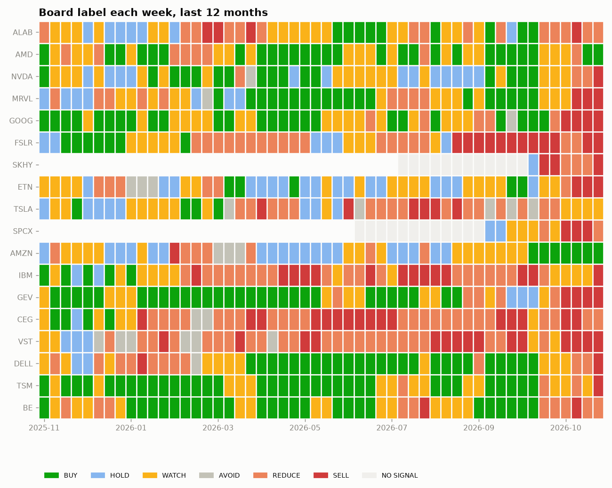
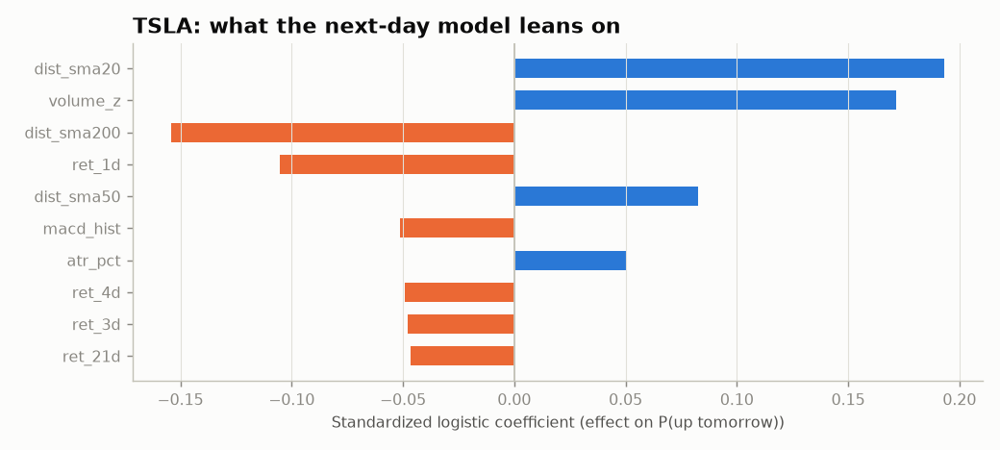
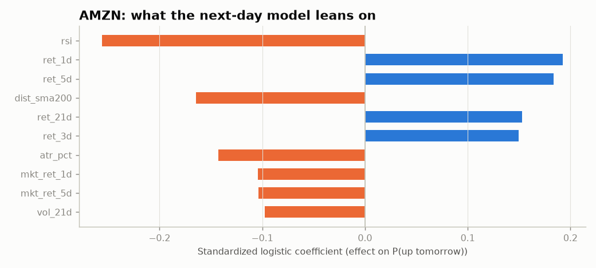
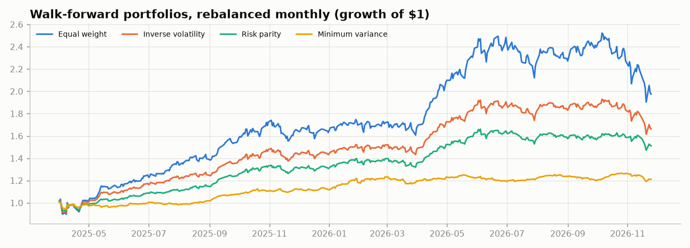

# stocklab report
Generated 2026-11-25 | data source: `yahoo` | history: 5 years | watchlist: ALAB, AMD, NVDA, MRVL, GOOG, FSLR, SKHY, ETN, TSLA, SPCX, AMZN, IBM, GEV, CEG, VST, DELL, TSM, BE

> Educational research code, not investment advice. Past results do not predict future returns.

## 1. Decision board

Data as of the 2026-11-24 close. `*` = provisional (under 200 trading days of history).

| ticker | action | close | 1 day | 1 month | buy rank | sell warnings | pullback entry | breakout | stop | why |
|---|---|---|---|---|---|---|---|---|---|---|
| AMZN | WATCH | 252.29 | -1.2% | +1.3% | 3/18 | 4/15 | 242.30 | 271.41 | 222.31 | +3% vs 200-day average; below 50-day, MACD bearish, distribution days, volatility spike |
| AMD | REDUCE | 413.27 | -8.9% | -22.2% | 2/18 | 8/15 |  |  |  | -4% vs 200-day average; below 50-day, below 200-day, MACD bearish, 20%+ off high, volatility spike, below chandelier stop |
| IBM | REDUCE | 235.62 | +1.1% | -6.4% | 6/18 | 8/15 |  |  |  | -2% vs 200-day average; below 200-day, death cross, MACD bearish, 20%+ off high, below chandelier stop |
| SPCX | REDUCE* | 125.81 | -5.7% | -14.4% | 7/18 | 4/10 |  |  |  | -14% vs 50-day average; below 50-day, MACD bearish, distribution days, 20%+ off high (provisional: 115 days of history) |
| TSLA | REDUCE | 384.68 | -0.2% | -1.8% | 8/18 | 6/15 |  |  |  | +1% vs 200-day average; death cross, MACD bearish, distribution days, 20%+ off high, volatility spike |
| CEG | REDUCE | 244.84 | -2.7% | -2.9% | 12/18 | 8/15 |  |  |  | -12% vs 200-day average; below 50-day, below 200-day, death cross, MACD bearish, distribution days, 20%+ off high |
| BE | REDUCE | 156.41 | -7.0% | -23.3% | 15/18 | 8/15 |  |  |  | -30% vs 200-day average; below 50-day, below 200-day, MACD bearish, distribution days, 20%+ off high, below chandelier stop |
| ALAB | REDUCE | 191.30 | -13.9% | -26.3% | 16/18 | 8/15 |  |  |  | -26% vs 200-day average; below 50-day, below 200-day, distribution days, 20%+ off high, volatility spike, below chandelier stop |
| DELL | SELL | 295.28 | -11.8% | -36.8% | 1/18 | 11/15 |  |  |  | -15% vs 200-day average; below 50-day, below 200-day, MACD bearish, distribution days, high-volume breakdown, 20%+ off high, volatility spike, below chandelier stop |
| TSM | SELL | 349.20 | -4.0% | -17.7% | 4/18 | 9/15 |  |  |  | -13% vs 200-day average; below 50-day, below 200-day, MACD bearish, distribution days, 20%+ off high, volatility spike, below chandelier stop |
| MRVL | SELL | 131.57 | -9.1% | -43.7% | 5/18 | 9/15 |  |  |  | -30% vs 200-day average; below 50-day, below 200-day, MACD bearish, distribution days, 20%+ off high, volatility spike, below chandelier stop |
| ETN | SELL | 319.27 | -5.1% | -13.9% | 9/18 | 11/15 |  |  |  | -19% vs 200-day average; below 50-day, below 200-day, death cross, MACD bearish, distribution days, 20%+ off high, volatility spike, below chandelier stop |
| GOOG | SELL | 276.58 | -1.1% | -12.0% | 10/18 | 10/15 |  |  |  | -17% vs 200-day average; below 50-day, below 200-day, death cross, distribution days, 20%+ off high, volatility spike, below chandelier stop |
| GEV | SELL | 720.65 | -4.8% | -15.7% | 11/18 | 10/15 |  |  |  | -24% vs 200-day average; below 50-day, below 200-day, death cross, MACD bearish, distribution days, 20%+ off high, below chandelier stop |
| NVDA | SELL | 155.38 | -5.9% | -28.1% | 13/18 | 11/15 |  |  |  | -23% vs 200-day average; below 50-day, below 200-day, MACD bearish, distribution days, high-volume breakdown, 20%+ off high, volatility spike, below chandelier stop |
| VST | SELL | 120.72 | -2.5% | -14.8% | 14/18 | 11/15 |  |  |  | -20% vs 200-day average; below 50-day, below 200-day, death cross, MACD bearish, distribution days, 20%+ off high, volatility spike, below chandelier stop |
| SKHY | SELL* | 111.98 | -9.9% | -21.5% | 17/18 | 6/10 |  |  |  | -28% vs 50-day average; below 50-day, MACD bearish, distribution days, 20%+ off high, below chandelier stop (provisional: 97 days of history) |
| FSLR | SELL | 148.00 | +1.0% | -12.0% | 18/18 | 10/15 |  |  |  | -30% vs 200-day average; below 50-day, below 200-day, death cross, MACD bearish, distribution days, 20%+ off high, below chandelier stop |



**Trading the labels** (2022-02-22 to 2026-11-24): buy on BUY, exit on SELL, REDUCE or AVOID, reviewed weekly with next-day execution and 5 bp costs.

| strategy | CAGR | Volatility | Sharpe | Max drawdown | Time invested | Avg holdings |
|---|---|---|---|---|---|---|
| Board strategy | +37.6% | 34.3% | 1.10 | -45.0% | 99% | 6.7 |
| Equal-weight watchlist | +43.1% | 34.9% | 1.20 | -36.8% | 100% | 15.1 |
| SPY (buy & hold) | +13.4% | 17.5% | 0.81 | -22.1% |  |  |

Sharpe difference vs equal weight: -0.10, 95% block-bootstrap CI [-0.65, +0.38].

Forward 21-day return after each label, relative to the watchlist average on the same date (sampled every 21 days, t-test across dates):

| label | observations | dates | mean 21d excess return | hit rate | p_value |
|---|---|---|---|---|---|
| BUY | 235 | 51 | +0.0% | 51% | 0.97 |
| HOLD | 114 | 43 | -0.4% | 49% | 0.77 |
| WATCH | 177 | 55 | +1.8% | 51% | 0.19 |
| AVOID | 53 | 23 | -1.0% | 35% | 0.66 |
| REDUCE | 175 | 51 | -2.1% | 33% | 0.11 |
| SELL | 85 | 35 | +3.6% | 57% | 0.21 |


## 2. Sell check, stock by stock

```
ALAB  REDUCE  (score 8/15, close 191.30 on 2026-11-24)
  RSI 40 | -60.4% from 52-week high
  Triggered:
    - [trend] Close below the 50-day moving average (+1)
    - [trend] Close below the 200-day moving average (+2)
    - [volume] 5+ distribution days in the last 25 sessions (institutional selling) (+1)
    - [risk] 20%+ below the 52-week high (+1)
    - [risk] 21-day volatility 1.5x+ its 1-year median (+1)
    - [risk] Close below the chandelier stop (22-day high minus 3x ATR) (+2)
  Levels to watch:
    50-day SMA                 283.28  (price is below, -32.5%)
    200-day SMA                259.11  (price is below, -26.2%)
    Chandelier stop            222.33  (price is below, -14.0%)
```

```
AMD  REDUCE  (score 8/15, close 413.27 on 2026-11-24)
  RSI 39 | -36.4% from 52-week high
  Triggered:
    - [trend] Close below the 50-day moving average (+1)
    - [trend] Close below the 200-day moving average (+2)
    - [momentum] MACD line below its signal line (+1)
    - [risk] 20%+ below the 52-week high (+1)
    - [risk] 21-day volatility 1.5x+ its 1-year median (+1)
    - [risk] Close below the chandelier stop (22-day high minus 3x ATR) (+2)
  Levels to watch:
    50-day SMA                 550.48  (price is below, -24.9%)
    Chandelier stop            453.61  (price is below, -8.9%)
    200-day SMA                432.00  (price is below, -4.3%)
```

```
NVDA  EXIT  (score 11/15, close 155.38 on 2026-11-24)
  RSI 39 | -35.1% from 52-week high
  Triggered:
    - [trend] Close below the 50-day moving average (+1)
    - [trend] Close below the 200-day moving average (+2)
    - [momentum] MACD line below its signal line (+1)
    - [volume] 5+ distribution days in the last 25 sessions (institutional selling) (+1)
    - [volume] Down day closing below the 50-day average on 1.5x+ average volume (+2)
    - [risk] 20%+ below the 52-week high (+1)
    - [risk] 21-day volatility 1.5x+ its 1-year median (+1)
    - [risk] Close below the chandelier stop (22-day high minus 3x ATR) (+2)
  Levels to watch:
    50-day SMA                 204.95  (price is below, -24.2%)
    200-day SMA                202.81  (price is below, -23.4%)
    Chandelier stop            180.03  (price is below, -13.7%)
```

```
MRVL  EXIT  (score 9/15, close 131.57 on 2026-11-24)
  RSI 35 | -58.4% from 52-week high
  Triggered:
    - [trend] Close below the 50-day moving average (+1)
    - [trend] Close below the 200-day moving average (+2)
    - [momentum] MACD line below its signal line (+1)
    - [volume] 5+ distribution days in the last 25 sessions (institutional selling) (+1)
    - [risk] 20%+ below the 52-week high (+1)
    - [risk] 21-day volatility 1.5x+ its 1-year median (+1)
    - [risk] Close below the chandelier stop (22-day high minus 3x ATR) (+2)
  Levels to watch:
    50-day SMA                 216.97  (price is below, -39.4%)
    Chandelier stop            203.05  (price is below, -35.2%)
    200-day SMA                189.10  (price is below, -30.4%)
```

```
GOOG  EXIT  (score 10/15, close 276.58 on 2026-11-24)
  RSI 39 | -30.6% from 52-week high
  Triggered:
    - [trend] Close below the 50-day moving average (+1)
    - [trend] Close below the 200-day moving average (+2)
    - [trend] 50-day average below the 200-day average (+2)
    - [volume] 5+ distribution days in the last 25 sessions (institutional selling) (+1)
    - [risk] 20%+ below the 52-week high (+1)
    - [risk] 21-day volatility 1.5x+ its 1-year median (+1)
    - [risk] Close below the chandelier stop (22-day high minus 3x ATR) (+2)
  Levels to watch:
    200-day SMA                334.12  (price is below, -17.2%)
    50-day SMA                 316.65  (price is below, -12.7%)
    Chandelier stop            289.72  (price is below, -4.5%)
```

```
FSLR  EXIT  (score 10/15, close 148.00 on 2026-11-24)
  RSI 35 | -53.5% from 52-week high
  Triggered:
    - [trend] Close below the 50-day moving average (+1)
    - [trend] Close below the 200-day moving average (+2)
    - [trend] 50-day average below the 200-day average (+2)
    - [momentum] MACD line below its signal line (+1)
    - [volume] 5+ distribution days in the last 25 sessions (institutional selling) (+1)
    - [risk] 20%+ below the 52-week high (+1)
    - [risk] Close below the chandelier stop (22-day high minus 3x ATR) (+2)
  Levels to watch:
    200-day SMA                210.37  (price is below, -29.6%)
    Chandelier stop            184.27  (price is below, -19.7%)
    50-day SMA                 176.64  (price is below, -16.2%)
```

```
SKHY  EXIT  (score 6/10, close 111.98 on 2026-11-24)
  RSI 39 | -43.6% from high since listing
  Only 97 trading days of history; not scored yet: below_sma200, death_cross, volatility_spike
  Triggered:
    - [trend] Close below the 50-day moving average (+1)
    - [momentum] MACD line below its signal line (+1)
    - [volume] 5+ distribution days in the last 25 sessions (institutional selling) (+1)
    - [risk] 20%+ below the high since listing (+1)
    - [risk] Close below the chandelier stop (22-day high minus 3x ATR) (+2)
  Levels to watch:
    50-day SMA                 154.73  (price is below, -27.6%)
    Chandelier stop            131.59  (price is below, -14.9%)
```

```
ETN  EXIT  (score 11/15, close 319.27 on 2026-11-24)
  RSI 38 | -30.4% from 52-week high
  Triggered:
    - [trend] Close below the 50-day moving average (+1)
    - [trend] Close below the 200-day moving average (+2)
    - [trend] 50-day average below the 200-day average (+2)
    - [momentum] MACD line below its signal line (+1)
    - [volume] 5+ distribution days in the last 25 sessions (institutional selling) (+1)
    - [risk] 20%+ below the 52-week high (+1)
    - [risk] 21-day volatility 1.5x+ its 1-year median (+1)
    - [risk] Close below the chandelier stop (22-day high minus 3x ATR) (+2)
  Levels to watch:
    200-day SMA                394.45  (price is below, -19.1%)
    50-day SMA                 389.19  (price is below, -18.0%)
    Chandelier stop            341.55  (price is below, -6.5%)
```

```
TSLA  REDUCE  (score 6/15, close 384.68 on 2026-11-24)
  RSI 52 | -21.5% from 52-week high
  Triggered:
    - [trend] 50-day average below the 200-day average (+2)
    - [momentum] MACD line below its signal line (+1)
    - [volume] 5+ distribution days in the last 25 sessions (institutional selling) (+1)
    - [risk] 20%+ below the 52-week high (+1)
    - [risk] 21-day volatility 1.5x+ its 1-year median (+1)
  Levels to watch:
    200-day SMA                381.37  (price is above, +0.9%)
    50-day SMA                 376.73  (price is above, +2.1%)
    Chandelier stop            357.21  (price is above, +7.7%)
```

```
SPCX  REDUCE  (score 4/10, close 125.81 on 2026-11-24)
  RSI 39 | -40.5% from high since listing
  Only 115 trading days of history; not scored yet: below_sma200, death_cross, volatility_spike
  Triggered:
    - [trend] Close below the 50-day moving average (+1)
    - [momentum] MACD line below its signal line (+1)
    - [volume] 5+ distribution days in the last 25 sessions (institutional selling) (+1)
    - [risk] 20%+ below the high since listing (+1)
  Levels to watch:
    50-day SMA                 147.06  (price is below, -14.5%)
    Chandelier stop            125.56  (price is above, +0.2%)
```

```
AMZN  WATCH  (score 4/15, close 252.29 on 2026-11-24)
  RSI 47 | -11.2% from 52-week high
  Triggered:
    - [trend] Close below the 50-day moving average (+1)
    - [momentum] MACD line below its signal line (+1)
    - [volume] 5+ distribution days in the last 25 sessions (institutional selling) (+1)
    - [risk] 21-day volatility 1.5x+ its 1-year median (+1)
  Levels to watch:
    50-day SMA                 255.15  (price is below, -1.1%)
    200-day SMA                245.59  (price is above, +2.7%)
    Chandelier stop            245.36  (price is above, +2.8%)
```

```
IBM  REDUCE  (score 8/15, close 235.62 on 2026-11-24)
  RSI 47 | -27.4% from 52-week high
  Triggered:
    - [trend] Close below the 200-day moving average (+2)
    - [trend] 50-day average below the 200-day average (+2)
    - [momentum] MACD line below its signal line (+1)
    - [risk] 20%+ below the 52-week high (+1)
    - [risk] Close below the chandelier stop (22-day high minus 3x ATR) (+2)
  Levels to watch:
    200-day SMA                241.12  (price is below, -2.3%)
    Chandelier stop            236.79  (price is below, -0.5%)
    50-day SMA                 235.50  (price is above, +0.1%)
```

```
GEV  EXIT  (score 10/15, close 720.65 on 2026-11-24)
  RSI 38 | -38.6% from 52-week high
  Triggered:
    - [trend] Close below the 50-day moving average (+1)
    - [trend] Close below the 200-day moving average (+2)
    - [trend] 50-day average below the 200-day average (+2)
    - [momentum] MACD line below its signal line (+1)
    - [volume] 5+ distribution days in the last 25 sessions (institutional selling) (+1)
    - [risk] 20%+ below the 52-week high (+1)
    - [risk] Close below the chandelier stop (22-day high minus 3x ATR) (+2)
  Levels to watch:
    200-day SMA                950.62  (price is below, -24.2%)
    50-day SMA                 887.77  (price is below, -18.8%)
    Chandelier stop            763.12  (price is below, -5.6%)
```

```
CEG  REDUCE  (score 8/15, close 244.84 on 2026-11-24)
  RSI 42 | -34.9% from 52-week high
  Triggered:
    - [trend] Close below the 50-day moving average (+1)
    - [trend] Close below the 200-day moving average (+2)
    - [trend] 50-day average below the 200-day average (+2)
    - [momentum] MACD line below its signal line (+1)
    - [volume] 5+ distribution days in the last 25 sessions (institutional selling) (+1)
    - [risk] 20%+ below the 52-week high (+1)
  Levels to watch:
    200-day SMA                277.24  (price is below, -11.7%)
    50-day SMA                 265.31  (price is below, -7.7%)
    Chandelier stop            244.19  (price is above, +0.3%)
```

```
VST  EXIT  (score 11/15, close 120.72 on 2026-11-24)
  RSI 41 | -32.7% from 52-week high
  Triggered:
    - [trend] Close below the 50-day moving average (+1)
    - [trend] Close below the 200-day moving average (+2)
    - [trend] 50-day average below the 200-day average (+2)
    - [momentum] MACD line below its signal line (+1)
    - [volume] 5+ distribution days in the last 25 sessions (institutional selling) (+1)
    - [risk] 20%+ below the 52-week high (+1)
    - [risk] 21-day volatility 1.5x+ its 1-year median (+1)
    - [risk] Close below the chandelier stop (22-day high minus 3x ATR) (+2)
  Levels to watch:
    200-day SMA                150.66  (price is below, -19.9%)
    50-day SMA                 139.95  (price is below, -13.7%)
    Chandelier stop            125.34  (price is below, -3.7%)
```

```
DELL  EXIT  (score 11/15, close 295.28 on 2026-11-24)
  RSI 37 | -49.7% from 52-week high
  Triggered:
    - [trend] Close below the 50-day moving average (+1)
    - [trend] Close below the 200-day moving average (+2)
    - [momentum] MACD line below its signal line (+1)
    - [volume] 5+ distribution days in the last 25 sessions (institutional selling) (+1)
    - [volume] Down day closing below the 50-day average on 1.5x+ average volume (+2)
    - [risk] 20%+ below the 52-week high (+1)
    - [risk] 21-day volatility 1.5x+ its 1-year median (+1)
    - [risk] Close below the chandelier stop (22-day high minus 3x ATR) (+2)
  Levels to watch:
    50-day SMA                 461.78  (price is below, -36.1%)
    Chandelier stop            392.07  (price is below, -24.7%)
    200-day SMA                349.37  (price is below, -15.5%)
```

```
TSM  EXIT  (score 9/15, close 349.20 on 2026-11-24)
  RSI 40 | -28.1% from 52-week high
  Triggered:
    - [trend] Close below the 50-day moving average (+1)
    - [trend] Close below the 200-day moving average (+2)
    - [momentum] MACD line below its signal line (+1)
    - [volume] 5+ distribution days in the last 25 sessions (institutional selling) (+1)
    - [risk] 20%+ below the 52-week high (+1)
    - [risk] 21-day volatility 1.5x+ its 1-year median (+1)
    - [risk] Close below the chandelier stop (22-day high minus 3x ATR) (+2)
  Levels to watch:
    50-day SMA                 419.77  (price is below, -16.8%)
    200-day SMA                402.32  (price is below, -13.2%)
    Chandelier stop            372.90  (price is below, -6.4%)
```

```
BE  REDUCE  (score 8/15, close 156.41 on 2026-11-24)
  RSI 39 | -54.8% from 52-week high
  Triggered:
    - [trend] Close below the 50-day moving average (+1)
    - [trend] Close below the 200-day moving average (+2)
    - [momentum] MACD line below its signal line (+1)
    - [volume] 5+ distribution days in the last 25 sessions (institutional selling) (+1)
    - [risk] 20%+ below the 52-week high (+1)
    - [risk] Close below the chandelier stop (22-day high minus 3x ATR) (+2)
  Levels to watch:
    50-day SMA                 230.19  (price is below, -32.1%)
    200-day SMA                224.02  (price is below, -30.2%)
    Chandelier stop            166.54  (price is below, -6.1%)
```

## 3. Which sell signals actually work? (event study)

Panel: 46 stocks, 5 years. Null hypothesis: returns after a signal look like returns on random days from the same stocks.

| rule | horizon | events | mean_after_signal | mean_random_days | difference | p_value | q_value | drop10_after_signal | drop10_base_rate | verdict |
|---|---|---|---|---|---|---|---|---|---|---|
| below_sma50 | 5d | 1081 | +0.22% | +0.66% | -0.44% | 0.007 | 0.082 | 40% | 36% | useful |
| below_sma50 | 21d | 1061 | +2.03% | +3.08% | -1.05% | 0.003 | 0.049 | 40% | 36% | useful |
| below_sma50 | 63d | 1005 | +8.54% | +10.09% | -1.55% | 0.023 | 0.129 | 40% | 36% | weak (not significant) |
| below_sma200 | 5d | 523 | +0.43% | +0.59% | -0.17% | 0.264 | 0.842 | 38% | 36% | weak (not significant) |
| below_sma200 | 21d | 507 | +0.87% | +2.77% | -1.91% | 0.001 | 0.033 | 38% | 36% | useful |
| below_sma200 | 63d | 476 | +9.54% | +9.03% | +0.51% | 0.679 | 0.961 | 38% | 36% | no edge |
| death_cross | 5d | 155 | +0.18% | +0.64% | -0.45% | 0.177 | 0.649 | 42% | 36% | weak (not significant) |
| death_cross | 21d | 151 | +0.60% | +2.91% | -2.30% | 0.012 | 0.082 | 42% | 36% | useful |
| death_cross | 63d | 142 | +14.42% | +9.60% | +4.82% | 0.980 | 1.000 | 42% | 36% | no edge |
| rsi_divergence | 5d | 503 | +0.43% | +0.75% | -0.31% | 0.132 | 0.610 | 37% | 36% | weak (not significant) |
| rsi_divergence | 21d | 495 | +3.22% | +3.49% | -0.27% | 0.335 | 0.851 | 37% | 36% | weak (not significant) |
| rsi_divergence | 63d | 486 | +10.97% | +11.57% | -0.59% | 0.306 | 0.842 | 37% | 36% | weak (not significant) |
| rsi_rollover | 5d | 646 | +1.83% | +0.72% | +1.11% | 1.000 | 1.000 | 33% | 36% | no edge |
| rsi_rollover | 21d | 638 | +3.68% | +3.37% | +0.31% | 0.725 | 0.961 | 33% | 36% | no edge |
| rsi_rollover | 63d | 623 | +10.39% | +11.47% | -1.08% | 0.148 | 0.610 | 33% | 36% | weak (not significant) |
| macd_bearish | 5d | 1632 | +0.77% | +0.69% | +0.08% | 0.704 | 0.961 | 36% | 36% | no edge |
| macd_bearish | 21d | 1605 | +3.21% | +3.22% | -0.01% | 0.493 | 0.953 | 36% | 36% | weak (not significant) |
| macd_bearish | 63d | 1540 | +11.12% | +10.71% | +0.41% | 0.741 | 0.961 | 36% | 36% | no edge |
| distribution_cluster | 5d | 1080 | +0.99% | +0.69% | +0.30% | 0.936 | 1.000 | 35% | 36% | no edge |
| distribution_cluster | 21d | 1066 | +3.14% | +3.24% | -0.10% | 0.406 | 0.875 | 35% | 36% | weak (not significant) |
| distribution_cluster | 63d | 1023 | +10.32% | +10.79% | -0.47% | 0.283 | 0.842 | 35% | 36% | weak (not significant) |
| high_volume_breakdown | 5d | 763 | +0.81% | +0.65% | +0.15% | 0.757 | 0.961 | 34% | 36% | no edge |
| high_volume_breakdown | 21d | 732 | +3.61% | +3.02% | +0.59% | 0.881 | 1.000 | 34% | 36% | no edge |
| high_volume_breakdown | 63d | 697 | +12.69% | +10.02% | +2.67% | 0.999 | 1.000 | 34% | 36% | no edge |
| drawdown_20 | 5d | 406 | +1.34% | +0.80% | +0.54% | 0.940 | 1.000 | 52% | 36% | no edge |
| drawdown_20 | 21d | 400 | +2.03% | +3.70% | -1.68% | 0.011 | 0.082 | 52% | 36% | useful |
| drawdown_20 | 63d | 376 | +13.67% | +12.76% | +0.91% | 0.707 | 0.961 | 52% | 36% | no edge |
| volatility_spike | 5d | 350 | +0.90% | +0.73% | +0.17% | 0.694 | 0.961 | 47% | 36% | no edge |
| volatility_spike | 21d | 330 | +3.14% | +3.33% | -0.19% | 0.424 | 0.875 | 47% | 36% | weak (not significant) |
| volatility_spike | 63d | 328 | +10.77% | +11.33% | -0.56% | 0.363 | 0.855 | 47% | 36% | weak (not significant) |
| chandelier_stop | 5d | 1366 | +0.70% | +0.69% | +0.01% | 0.520 | 0.953 | 37% | 36% | no edge |
| chandelier_stop | 21d | 1340 | +3.28% | +3.22% | +0.06% | 0.560 | 0.961 | 37% | 36% | no edge |
| chandelier_stop | 63d | 1278 | +11.88% | +10.76% | +1.12% | 0.929 | 1.000 | 37% | 36% | no edge |

**5 of 33 rule-by-horizon tests** show significantly weaker returns after the signal (q < 0.10).


## 4. Strategy backtests

Not included: SKHY (only 97 trading days of history, needs 452); SPCX (only 115 trading days of history, needs 452).

### ALAB (2025-01-03 to 2026-11-24)

| strategy | Total return | CAGR | Max drawdown | Volatility | Sharpe | Round trips | Time in market | Sharpe vs B&H | 95% CI | p-value |
|---|---|---|---|---|---|---|---|---|---|---|
| Buy & Hold | +33.1% | +16.4% | -63.2% | +99.2% | 0.65 | 0 | 100% |  |  |  |
| 50/200 SMA cross | -70.8% | -47.9% | -74.0% | +90.1% | -0.27 | 2 | 76% | -0.92 | [-1.81, -0.25] | 0.02 |
| Close > 50-day SMA | +7.6% | +4.0% | -66.4% | +69.3% | 0.41 | 10 | 51% | -0.24 | [-1.35, +0.74] | 0.61 |
| MACD > signal | +22.8% | +11.5% | -70.4% | +67.7% | 0.49 | 23 | 50% | -0.15 | [-1.29, +1.03] | 0.80 |
| RSI 30/70 | -1.9% | -1.0% | -50.3% | +44.0% | 0.19 | 1 | 18% | -0.46 | [-2.07, +1.12] | 0.57 |
| Trailing stop 20% | -11.8% | -6.5% | -69.1% | +71.2% | 0.27 | 10 | 55% | -0.38 | [-1.45, +0.61] | 0.46 |
| Volume breakout | +91.8% | +41.3% | -55.7% | +62.6% | 0.86 | 4 | 40% | +0.21 | [-0.94, +1.32] | 0.70 |

### AMD (2022-09-13 to 2026-11-24)

| strategy | Total return | CAGR | Max drawdown | Volatility | Sharpe | Round trips | Time in market | Sharpe vs B&H | 95% CI | p-value |
|---|---|---|---|---|---|---|---|---|---|---|
| Buy & Hold | +433.3% | +49.2% | -63.0% | +59.2% | 0.97 | 0 | 100% |  |  |  |
| 50/200 SMA cross | +287.4% | +38.2% | -39.1% | +50.0% | 0.90 | 1 | 66% | -0.07 | [-0.59, +0.45] | 0.77 |
| Close > 50-day SMA | +147.4% | +24.2% | -49.9% | +44.0% | 0.71 | 37 | 54% | -0.26 | [-0.87, +0.34] | 0.38 |
| MACD > signal | +242.9% | +34.2% | -42.4% | +42.6% | 0.90 | 40 | 51% | -0.07 | [-0.59, +0.43] | 0.80 |
| RSI 30/70 | +19.8% | +4.4% | -54.7% | +34.0% | 0.30 | 3 | 34% | -0.67 | [-1.68, +0.18] | 0.15 |
| Trailing stop 20% | +101.4% | +18.2% | -58.9% | +50.9% | 0.58 | 12 | 72% | -0.39 | [-0.88, +0.06] | 0.11 |
| Volume breakout | +161.9% | +25.9% | -36.9% | +37.2% | 0.80 | 11 | 38% | -0.17 | [-0.81, +0.54] | 0.62 |

### NVDA (2022-09-13 to 2026-11-24)

| strategy | Total return | CAGR | Max drawdown | Volatility | Sharpe | Round trips | Time in market | Sharpe vs B&H | 95% CI | p-value |
|---|---|---|---|---|---|---|---|---|---|---|
| Buy & Hold | +1087.2% | +80.6% | -47.5% | +51.7% | 1.40 | 0 | 100% |  |  |  |
| 50/200 SMA cross | +500.1% | +53.4% | -47.5% | +46.6% | 1.15 | 1 | 85% | -0.25 | [-0.68, +0.15] | 0.22 |
| Close > 50-day SMA | +346.8% | +43.0% | -39.1% | +39.0% | 1.11 | 38 | 69% | -0.29 | [-0.93, +0.34] | 0.36 |
| MACD > signal | +152.9% | +24.8% | -46.7% | +34.4% | 0.81 | 40 | 51% | -0.58 | [-1.36, +0.18] | 0.13 |
| RSI 30/70 | +50.5% | +10.3% | -33.1% | +24.8% | 0.51 | 2 | 7% | -0.89 | [-1.76, +0.00] | 0.05 |
| Trailing stop 20% | +792.5% | +68.7% | -36.6% | +45.1% | 1.38 | 7 | 91% | -0.01 | [-0.40, +0.35] | 0.94 |
| Volume breakout | +211.5% | +31.2% | -19.8% | +26.3% | 1.16 | 7 | 31% | -0.24 | [-1.11, +0.55] | 0.57 |

### MRVL (2022-09-13 to 2026-11-24)

| strategy | Total return | CAGR | Max drawdown | Volatility | Sharpe | Round trips | Time in market | Sharpe vs B&H | 95% CI | p-value |
|---|---|---|---|---|---|---|---|---|---|---|
| Buy & Hold | +175.7% | +27.4% | -61.3% | +68.3% | 0.69 | 0 | 100% |  |  |  |
| 50/200 SMA cross | +28.0% | +6.1% | -65.2% | +58.9% | 0.39 | 2 | 69% | -0.30 | [-0.77, +0.11] | 0.19 |
| Close > 50-day SMA | +65.8% | +12.8% | -51.5% | +52.7% | 0.49 | 36 | 58% | -0.20 | [-0.86, +0.36] | 0.49 |
| MACD > signal | +101.6% | +18.2% | -62.5% | +50.2% | 0.58 | 44 | 51% | -0.11 | [-0.87, +0.56] | 0.77 |
| RSI 30/70 | +37.0% | +7.8% | -32.1% | +31.7% | 0.40 | 2 | 20% | -0.29 | [-1.13, +0.71] | 0.52 |
| Trailing stop 20% | +66.7% | +13.0% | -53.3% | +56.9% | 0.49 | 15 | 76% | -0.20 | [-0.71, +0.30] | 0.45 |
| Volume breakout | +76.0% | +14.5% | -46.2% | +42.0% | 0.53 | 11 | 36% | -0.16 | [-1.06, +0.65] | 0.69 |

### GOOG (2022-09-13 to 2026-11-24)

| strategy | Total return | CAGR | Max drawdown | Volatility | Sharpe | Round trips | Time in market | Sharpe vs B&H | 95% CI | p-value |
|---|---|---|---|---|---|---|---|---|---|---|
| Buy & Hold | +163.6% | +26.0% | -33.8% | +31.8% | 0.89 | 0 | 100% |  |  |  |
| 50/200 SMA cross | +151.5% | +24.6% | -29.4% | +25.9% | 0.98 | 2 | 76% | +0.09 | [-0.38, +0.58] | 0.70 |
| Close > 50-day SMA | +85.6% | +15.9% | -22.2% | +23.6% | 0.74 | 34 | 63% | -0.14 | [-0.79, +0.53] | 0.67 |
| MACD > signal | +30.0% | +6.5% | -25.4% | +21.8% | 0.40 | 43 | 50% | -0.49 | [-1.17, +0.16] | 0.15 |
| RSI 30/70 | +26.1% | +5.7% | -20.4% | +18.6% | 0.39 | 4 | 26% | -0.50 | [-1.26, +0.42] | 0.24 |
| Trailing stop 20% | +55.0% | +11.0% | -40.4% | +29.6% | 0.50 | 6 | 91% | -0.39 | [-0.83, -0.02] | 0.06 |
| Volume breakout | +105.6% | +18.8% | -17.4% | +19.4% | 0.98 | 8 | 46% | +0.10 | [-0.70, +0.86] | 0.80 |

### FSLR (2022-09-13 to 2026-11-24)

| strategy | Total return | CAGR | Max drawdown | Volatility | Sharpe | Round trips | Time in market | Sharpe vs B&H | 95% CI | p-value |
|---|---|---|---|---|---|---|---|---|---|---|
| Buy & Hold | +9.0% | +2.1% | -60.0% | +55.5% | 0.31 | 0 | 100% |  |  |  |
| 50/200 SMA cross | +3.6% | +0.8% | -51.1% | +41.6% | 0.22 | 4 | 58% | -0.09 | [-0.71, +0.48] | 0.75 |
| Close > 50-day SMA | +22.4% | +4.9% | -46.8% | +40.3% | 0.32 | 29 | 49% | +0.01 | [-0.59, +0.56] | 0.97 |
| MACD > signal | -61.6% | -20.4% | -74.1% | +40.8% | -0.36 | 49 | 49% | -0.67 | [-1.34, -0.01] | 0.05 |
| RSI 30/70 | +26.6% | +5.8% | -42.8% | +30.9% | 0.33 | 2 | 28% | +0.02 | [-0.91, +0.76] | 0.96 |
| Trailing stop 20% | -7.2% | -1.8% | -57.9% | +45.3% | 0.18 | 12 | 68% | -0.13 | [-0.63, +0.36] | 0.61 |
| Volume breakout | -18.0% | -4.6% | -53.8% | +31.5% | 0.01 | 13 | 35% | -0.30 | [-1.15, +0.48] | 0.48 |

### ETN (2022-09-13 to 2026-11-24)

| strategy | Total return | CAGR | Max drawdown | Volatility | Sharpe | Round trips | Time in market | Sharpe vs B&H | 95% CI | p-value |
|---|---|---|---|---|---|---|---|---|---|---|
| Buy & Hold | +136.7% | +22.9% | -34.5% | +34.4% | 0.77 | 0 | 100% |  |  |  |
| 50/200 SMA cross | +47.6% | +9.7% | -38.7% | +30.7% | 0.46 | 3 | 84% | -0.31 | [-0.73, +0.05] | 0.10 |
| Close > 50-day SMA | +33.4% | +7.1% | -37.5% | +24.4% | 0.41 | 44 | 65% | -0.37 | [-1.02, +0.29] | 0.25 |
| MACD > signal | +36.8% | +7.8% | -25.8% | +22.4% | 0.45 | 48 | 50% | -0.32 | [-1.01, +0.44] | 0.39 |
| RSI 30/70 | +15.7% | +3.6% | -18.6% | +11.5% | 0.36 | 1 | 5% | -0.41 | [-1.41, +0.71] | 0.41 |
| Trailing stop 20% | +174.4% | +27.3% | -23.6% | +30.8% | 0.94 | 2 | 94% | +0.17 | [-0.08, +0.47] | 0.26 |
| Volume breakout | +21.6% | +4.8% | -29.3% | +18.1% | 0.35 | 10 | 38% | -0.42 | [-1.28, +0.42] | 0.34 |

### TSLA (2022-09-13 to 2026-11-24)

| strategy | Total return | CAGR | Max drawdown | Volatility | Sharpe | Round trips | Time in market | Sharpe vs B&H | 95% CI | p-value |
|---|---|---|---|---|---|---|---|---|---|---|
| Buy & Hold | +27.1% | +5.9% | -65.0% | +58.6% | 0.39 | 0 | 100% |  |  |  |
| 50/200 SMA cross | -26.4% | -7.1% | -56.8% | +40.1% | 0.01 | 4 | 47% | -0.37 | [-1.21, +0.49] | 0.38 |
| Close > 50-day SMA | +33.8% | +7.2% | -41.1% | +38.5% | 0.37 | 43 | 52% | -0.02 | [-0.76, +0.78] | 0.95 |
| MACD > signal | +379.3% | +45.4% | -39.8% | +40.8% | 1.12 | 42 | 51% | +0.73 | [+0.05, +1.41] | 0.04 |
| RSI 30/70 | +49.4% | +10.1% | -52.7% | +40.9% | 0.44 | 4 | 43% | +0.05 | [-0.72, +0.79] | 0.92 |
| Trailing stop 20% | +29.5% | +6.4% | -47.9% | +45.4% | 0.36 | 11 | 71% | -0.03 | [-0.64, +0.61] | 0.94 |
| Volume breakout | +40.5% | +8.5% | -35.4% | +25.7% | 0.44 | 9 | 18% | +0.05 | [-0.82, +1.11] | 0.91 |

### AMZN (2022-09-13 to 2026-11-24)

| strategy | Total return | CAGR | Max drawdown | Volatility | Sharpe | Round trips | Time in market | Sharpe vs B&H | 95% CI | p-value |
|---|---|---|---|---|---|---|---|---|---|---|
| Buy & Hold | +96.2% | +17.5% | -36.4% | +34.1% | 0.64 | 0 | 100% |  |  |  |
| 50/200 SMA cross | +29.7% | +6.4% | -41.4% | +28.1% | 0.36 | 2 | 74% | -0.28 | [-0.95, +0.36] | 0.35 |
| Close > 50-day SMA | +28.0% | +6.1% | -43.9% | +23.2% | 0.37 | 34 | 63% | -0.27 | [-0.94, +0.45] | 0.45 |
| MACD > signal | -4.7% | -1.2% | -28.7% | +23.1% | 0.07 | 51 | 50% | -0.58 | [-1.35, +0.10] | 0.10 |
| RSI 30/70 | +94.0% | +17.1% | -22.0% | +21.6% | 0.84 | 4 | 33% | +0.20 | [-0.51, +0.99] | 0.59 |
| Trailing stop 20% | +71.2% | +13.7% | -28.4% | +30.4% | 0.57 | 3 | 88% | -0.07 | [-0.40, +0.24] | 0.68 |
| Volume breakout | +2.1% | +0.5% | -38.8% | +19.2% | 0.12 | 12 | 46% | -0.52 | [-1.39, +0.38] | 0.26 |

### IBM (2022-09-13 to 2026-11-24)

| strategy | Total return | CAGR | Max drawdown | Volatility | Sharpe | Round trips | Time in market | Sharpe vs B&H | 95% CI | p-value |
|---|---|---|---|---|---|---|---|---|---|---|
| Buy & Hold | +113.9% | +19.9% | -37.5% | +31.6% | 0.74 | 0 | 100% |  |  |  |
| 50/200 SMA cross | +64.8% | +12.7% | -28.7% | +22.7% | 0.64 | 3 | 72% | -0.10 | [-0.89, +0.58] | 0.78 |
| Close > 50-day SMA | +43.6% | +9.0% | -43.2% | +25.3% | 0.47 | 28 | 60% | -0.26 | [-0.75, +0.30] | 0.31 |
| MACD > signal | +112.3% | +19.7% | -43.1% | +23.9% | 0.88 | 30 | 50% | +0.14 | [-0.45, +0.93] | 0.69 |
| RSI 30/70 | +175.4% | +27.4% | -16.5% | +17.4% | 1.48 | 8 | 35% | +0.74 | [-0.25, +1.59] | 0.12 |
| Trailing stop 20% | +62.4% | +12.3% | -45.9% | +30.4% | 0.54 | 3 | 92% | -0.20 | [-0.46, +0.00] | 0.09 |
| Volume breakout | +54.7% | +11.0% | -30.2% | +17.2% | 0.69 | 11 | 40% | -0.05 | [-0.96, +0.88] | 0.92 |

### GEV (2025-01-13 to 2026-11-24)

| strategy | Total return | CAGR | Max drawdown | Volatility | Sharpe | Round trips | Time in market | Sharpe vs B&H | 95% CI | p-value |
|---|---|---|---|---|---|---|---|---|---|---|
| Buy & Hold | +89.2% | +40.8% | -40.4% | +56.5% | 0.89 | 0 | 100% |  |  |  |
| 50/200 SMA cross | +133.0% | +57.4% | -38.3% | +54.3% | 1.11 | 1 | 96% | +0.22 | [+0.00, +0.60] | 0.13 |
| Close > 50-day SMA | +79.1% | +36.7% | -32.7% | +43.4% | 0.94 | 15 | 62% | +0.05 | [-0.54, +0.69] | 0.89 |
| MACD > signal | +60.6% | +28.9% | -31.0% | +41.6% | 0.82 | 17 | 47% | -0.07 | [-0.89, +0.78] | 0.87 |
| RSI 30/70 | +12.2% | +6.4% | -40.4% | +36.0% | 0.35 | 1 | 33% | -0.54 | [-1.66, +0.56] | 0.38 |
| Trailing stop 20% | +44.2% | +21.7% | -45.9% | +49.6% | 0.65 | 5 | 86% | -0.24 | [-0.78, +0.32] | 0.41 |
| Volume breakout | +24.5% | +12.5% | -24.6% | +33.2% | 0.52 | 3 | 35% | -0.37 | [-1.56, +0.87] | 0.55 |

### CEG (2022-11-02 to 2026-11-24)

| strategy | Total return | CAGR | Max drawdown | Volatility | Sharpe | Round trips | Time in market | Sharpe vs B&H | 95% CI | p-value |
|---|---|---|---|---|---|---|---|---|---|---|
| Buy & Hold | +167.7% | +27.6% | -50.7% | +49.4% | 0.74 | 0 | 100% |  |  |  |
| 50/200 SMA cross | +96.8% | +18.2% | -50.7% | +43.3% | 0.60 | 3 | 72% | -0.14 | [-0.63, +0.26] | 0.53 |
| Close > 50-day SMA | +128.2% | +22.6% | -43.6% | +37.2% | 0.73 | 49 | 57% | -0.01 | [-0.55, +0.53] | 0.98 |
| MACD > signal | +18.2% | +4.2% | -48.1% | +37.1% | 0.29 | 42 | 49% | -0.44 | [-1.07, +0.15] | 0.17 |
| RSI 30/70 | +81.4% | +15.9% | -28.6% | +32.6% | 0.61 | 3 | 38% | -0.13 | [-0.90, +0.64] | 0.75 |
| Trailing stop 20% | +74.0% | +14.7% | -56.3% | +43.9% | 0.53 | 9 | 84% | -0.21 | [-0.63, +0.21] | 0.34 |
| Volume breakout | +86.0% | +16.6% | -30.0% | +30.5% | 0.65 | 9 | 39% | -0.08 | [-0.77, +0.65] | 0.81 |

### VST (2022-09-13 to 2026-11-24)

| strategy | Total return | CAGR | Max drawdown | Volatility | Sharpe | Round trips | Time in market | Sharpe vs B&H | 95% CI | p-value |
|---|---|---|---|---|---|---|---|---|---|---|
| Buy & Hold | +406.8% | +47.4% | -48.8% | +52.4% | 1.01 | 0 | 100% |  |  |  |
| 50/200 SMA cross | +412.2% | +47.7% | -48.8% | +44.0% | 1.11 | 3 | 67% | +0.11 | [-0.24, +0.50] | 0.59 |
| Close > 50-day SMA | +47.1% | +9.7% | -67.2% | +37.9% | 0.44 | 45 | 63% | -0.57 | [-1.23, +0.11] | 0.10 |
| MACD > signal | +61.9% | +12.2% | -49.0% | +37.2% | 0.50 | 48 | 51% | -0.50 | [-1.12, +0.15] | 0.12 |
| RSI 30/70 | +171.8% | +27.0% | -27.3% | +27.4% | 1.01 | 3 | 21% | +0.00 | [-0.89, +0.79] | 1.00 |
| Trailing stop 20% | +209.2% | +30.9% | -56.3% | +44.6% | 0.83 | 9 | 87% | -0.17 | [-0.65, +0.30] | 0.47 |
| Volume breakout | +278.5% | +37.4% | -31.2% | +31.4% | 1.18 | 9 | 43% | +0.17 | [-0.64, +1.07] | 0.69 |

### DELL (2022-09-13 to 2026-11-24)

| strategy | Total return | CAGR | Max drawdown | Volatility | Sharpe | Round trips | Time in market | Sharpe vs B&H | 95% CI | p-value |
|---|---|---|---|---|---|---|---|---|---|---|
| Buy & Hold | +740.8% | +66.3% | -59.6% | +59.6% | 1.14 | 0 | 100% |  |  |  |
| 50/200 SMA cross | +347.5% | +43.0% | -52.7% | +52.6% | 0.93 | 3 | 69% | -0.21 | [-0.69, +0.22] | 0.36 |
| Close > 50-day SMA | +1326.9% | +88.7% | -27.5% | +49.3% | 1.52 | 21 | 67% | +0.38 | [-0.14, +0.93] | 0.17 |
| MACD > signal | +141.4% | +23.4% | -57.7% | +43.1% | 0.69 | 45 | 52% | -0.45 | [-1.15, +0.23] | 0.22 |
| RSI 30/70 | +139.3% | +23.2% | -25.6% | +29.7% | 0.85 | 4 | 28% | -0.30 | [-1.17, +0.58] | 0.54 |
| Trailing stop 20% | +965.4% | +76.0% | -55.9% | +51.4% | 1.35 | 7 | 81% | +0.20 | [-0.24, +0.65] | 0.35 |
| Volume breakout | +378.1% | +45.3% | -37.8% | +43.2% | 1.07 | 11 | 45% | -0.07 | [-0.81, +0.58] | 0.84 |

### TSM (2022-09-13 to 2026-11-24)

| strategy | Total return | CAGR | Max drawdown | Volatility | Sharpe | Round trips | Time in market | Sharpe vs B&H | 95% CI | p-value |
|---|---|---|---|---|---|---|---|---|---|---|
| Buy & Hold | +367.9% | +44.6% | -36.8% | +40.4% | 1.11 | 0 | 100% |  |  |  |
| 50/200 SMA cross | +139.7% | +23.2% | -36.8% | +37.2% | 0.75 | 2 | 82% | -0.37 | [-0.89, +0.09] | 0.14 |
| Close > 50-day SMA | +190.3% | +29.0% | -28.8% | +31.6% | 0.96 | 37 | 68% | -0.15 | [-0.72, +0.43] | 0.61 |
| MACD > signal | +118.0% | +20.5% | -32.1% | +28.6% | 0.79 | 45 | 49% | -0.32 | [-0.94, +0.30] | 0.32 |
| RSI 30/70 | +27.9% | +6.1% | -23.0% | +19.3% | 0.40 | 3 | 13% | -0.72 | [-1.64, +0.20] | 0.11 |
| Trailing stop 20% | +212.4% | +31.3% | -30.6% | +36.8% | 0.92 | 6 | 91% | -0.19 | [-0.58, +0.17] | 0.31 |
| Volume breakout | +77.0% | +14.6% | -26.8% | +26.4% | 0.65 | 11 | 46% | -0.47 | [-1.28, +0.29] | 0.23 |

### BE (2022-09-13 to 2026-11-24)

| strategy | Total return | CAGR | Max drawdown | Volatility | Sharpe | Round trips | Time in market | Sharpe vs B&H | 95% CI | p-value |
|---|---|---|---|---|---|---|---|---|---|---|
| Buy & Hold | +485.9% | +52.5% | -67.9% | +90.8% | 0.90 | 0 | 100% |  |  |  |
| 50/200 SMA cross | +171.5% | +26.9% | -71.9% | +75.9% | 0.69 | 4 | 63% | -0.21 | [-0.81, +0.35] | 0.46 |
| Close > 50-day SMA | +337.8% | +42.3% | -53.1% | +69.5% | 0.83 | 31 | 51% | -0.07 | [-0.62, +0.42] | 0.78 |
| MACD > signal | +182.3% | +28.1% | -60.0% | +65.9% | 0.68 | 42 | 51% | -0.22 | [-0.90, +0.43] | 0.55 |
| RSI 30/70 | +147.7% | +24.2% | -61.8% | +47.0% | 0.69 | 4 | 47% | -0.21 | [-1.10, +0.67] | 0.66 |
| Trailing stop 20% | +141.4% | +23.4% | -66.7% | +73.7% | 0.63 | 19 | 60% | -0.27 | [-0.78, +0.23] | 0.30 |
| Volume breakout | +275.5% | +37.2% | -58.1% | +61.0% | 0.80 | 11 | 30% | -0.10 | [-0.88, +0.63] | 0.81 |


## 5. Next-day forecasts

Not included: SKHY (only 97 trading days of history, needs 452); SPCX (only 115 trading days of history, needs 452).

### ALAB

Walk-forward test on 222 unseen days (2026-01-07 to 2026-11-23).

| model | accuracy | always-majority accuracy | p (beats majority) | AUC | Brier | strategy Sharpe | buy & hold Sharpe |
|---|---|---|---|---|---|---|---|
| Majority class (baseline) | 0.518 | 0.518 | 0.527 | 0.46 | 0.25 | 0.684 | 0.685 |
| Logistic regression | 0.5 | 0.518 | 0.727 | 0.507 | 0.256 | 0.358 | 0.685 |
| Gradient boosting | 0.482 | 0.518 | 0.873 | 0.468 | 0.28 | 0.44 | 0.685 |

| model | RMSE (bps) | R2 out-of-sample vs zero | direction hit rate | DM p (beats zero) |
|---|---|---|---|---|
| Zero / random walk (baseline) | 674.2 | 0.0 |  |  |
| Ridge regression | 687.4 | -0.0394 | 0.477 | 0.881 |
| Gradient boosting | 704.9 | -0.0931 | 0.455 | 0.989 |

Forecast for the next session:

```
  P(up) | Logistic regression      56.8%
  P(up) | Gradient boosting        72.5%
  P(up) | historical base rate     51.7%
  expected return (ridge)          +1.83%
  80% range low                    -10.79%
  80% range high                   +16.24%
  daily volatility                 +10.33%
```

Best out-of-sample AUC **0.507**; smallest p-value against a naive baseline 0.727, before correcting for the four models tested here and the other stocks (the corrected count is in the summary).


### AMD

Walk-forward test on 550 unseen days (2024-09-16 to 2026-11-23).

| model | accuracy | always-majority accuracy | p (beats majority) | AUC | Brier | strategy Sharpe | buy & hold Sharpe |
|---|---|---|---|---|---|---|---|
| Majority class (baseline) | 0.505 | 0.527 | 0.857 | 0.487 | 0.25 | 0.971 | 1.017 |
| Logistic regression | 0.493 | 0.527 | 0.952 | 0.49 | 0.257 | 0.434 | 1.017 |
| Gradient boosting | 0.489 | 0.527 | 0.967 | 0.496 | 0.266 | 0.701 | 1.017 |

| model | RMSE (bps) | R2 out-of-sample vs zero | direction hit rate | DM p (beats zero) |
|---|---|---|---|---|
| Zero / random walk (baseline) | 415.1 | 0.0 |  |  |
| Ridge regression | 418.7 | -0.0172 | 0.491 | 0.819 |
| Gradient boosting | 424.0 | -0.0434 | 0.507 | 0.981 |

Forecast for the next session:

```
  P(up) | Logistic regression      60.0%
  P(up) | Gradient boosting        64.5%
  P(up) | historical base rate     51.5%
  expected return (ridge)          +1.33%
  80% range low                    -9.20%
  80% range high                   +13.10%
  daily volatility                 +8.57%
```

Best out-of-sample AUC **0.496**; smallest p-value against a naive baseline 0.819, before correcting for the four models tested here and the other stocks (the corrected count is in the summary).


### NVDA

Walk-forward test on 550 unseen days (2024-09-16 to 2026-11-23).

| model | accuracy | always-majority accuracy | p (beats majority) | AUC | Brier | strategy Sharpe | buy & hold Sharpe |
|---|---|---|---|---|---|---|---|
| Majority class (baseline) | 0.516 | 0.516 | 0.517 | 0.51 | 0.251 | 0.507 | 0.508 |
| Logistic regression | 0.507 | 0.516 | 0.681 | 0.514 | 0.255 | 0.41 | 0.508 |
| Gradient boosting | 0.518 | 0.516 | 0.483 | 0.478 | 0.269 | 0.955 | 0.508 |

| model | RMSE (bps) | R2 out-of-sample vs zero | direction hit rate | DM p (beats zero) |
|---|---|---|---|---|
| Zero / random walk (baseline) | 309.4 | 0.0 |  |  |
| Ridge regression | 308.9 | 0.0031 | 0.509 | 0.46 |
| Gradient boosting | 312.6 | -0.021 | 0.531 | 0.688 |

Forecast for the next session:

```
  P(up) | Logistic regression      77.4%
  P(up) | Gradient boosting        47.4%
  P(up) | historical base rate     53.4%
  expected return (ridge)          +3.26%
  80% range low                    -6.58%
  80% range high                   +14.15%
  daily volatility                 +7.82%
```

Best out-of-sample AUC **0.514**; smallest p-value against a naive baseline 0.460, before correcting for the four models tested here and the other stocks (the corrected count is in the summary).


### MRVL

Walk-forward test on 550 unseen days (2024-09-16 to 2026-11-23).

| model | accuracy | always-majority accuracy | p (beats majority) | AUC | Brier | strategy Sharpe | buy & hold Sharpe |
|---|---|---|---|---|---|---|---|
| Majority class (baseline) | 0.531 | 0.531 | 0.517 | 0.471 | 0.249 | 0.733 | 0.734 |
| Logistic regression | 0.533 | 0.531 | 0.483 | 0.552 | 0.251 | 0.752 | 0.734 |
| Gradient boosting | 0.527 | 0.531 | 0.585 | 0.552 | 0.258 | 0.356 | 0.734 |

| model | RMSE (bps) | R2 out-of-sample vs zero | direction hit rate | DM p (beats zero) |
|---|---|---|---|---|
| Zero / random walk (baseline) | 491.1 | 0.0 |  |  |
| Ridge regression | 495.1 | -0.0166 | 0.535 | 0.819 |
| Gradient boosting | 502.9 | -0.0488 | 0.502 | 0.984 |

Forecast for the next session:

```
  P(up) | Logistic regression      59.1%
  P(up) | Gradient boosting        61.0%
  P(up) | historical base rate     52.4%
  expected return (ridge)          +0.61%
  80% range low                    -10.25%
  80% range high                   +12.79%
  daily volatility                 +8.91%
```

Best out-of-sample AUC **0.552**; smallest p-value against a naive baseline 0.483, before correcting for the four models tested here and the other stocks (the corrected count is in the summary).


### GOOG

Walk-forward test on 550 unseen days (2024-09-16 to 2026-11-23).

| model | accuracy | always-majority accuracy | p (beats majority) | AUC | Brier | strategy Sharpe | buy & hold Sharpe |
|---|---|---|---|---|---|---|---|
| Majority class (baseline) | 0.518 | 0.518 | 0.517 | 0.495 | 0.25 | 0.958 | 0.959 |
| Logistic regression | 0.536 | 0.518 | 0.209 | 0.53 | 0.253 | 0.136 | 0.959 |
| Gradient boosting | 0.518 | 0.518 | 0.517 | 0.538 | 0.261 | 0.215 | 0.959 |

| model | RMSE (bps) | R2 out-of-sample vs zero | direction hit rate | DM p (beats zero) |
|---|---|---|---|---|
| Zero / random walk (baseline) | 202.8 | 0.0 |  |  |
| Ridge regression | 204.8 | -0.0201 | 0.52 | 0.946 |
| Gradient boosting | 208.4 | -0.0556 | 0.516 | 0.992 |

Forecast for the next session:

```
  P(up) | Logistic regression      37.6%
  P(up) | Gradient boosting        34.7%
  P(up) | historical base rate     52.9%
  expected return (ridge)          -0.02%
  80% range low                    -4.53%
  80% range high                   +4.70%
  daily volatility                 +3.60%
```

Best out-of-sample AUC **0.538**; smallest p-value against a naive baseline 0.209, before correcting for the four models tested here and the other stocks (the corrected count is in the summary).


### FSLR

Walk-forward test on 550 unseen days (2024-09-16 to 2026-11-23).

| model | accuracy | always-majority accuracy | p (beats majority) | AUC | Brier | strategy Sharpe | buy & hold Sharpe |
|---|---|---|---|---|---|---|---|
| Majority class (baseline) | 0.516 | 0.516 | 0.517 | 0.476 | 0.25 |  | -0.073 |
| Logistic regression | 0.524 | 0.516 | 0.383 | 0.535 | 0.251 | 0.059 | -0.073 |
| Gradient boosting | 0.513 | 0.516 | 0.585 | 0.524 | 0.261 | 0.243 | -0.073 |

| model | RMSE (bps) | R2 out-of-sample vs zero | direction hit rate | DM p (beats zero) |
|---|---|---|---|---|
| Zero / random walk (baseline) | 363.2 | 0.0 |  |  |
| Ridge regression | 364.1 | -0.0047 | 0.493 | 0.642 |
| Gradient boosting | 373.2 | -0.0556 | 0.495 | 0.994 |

Forecast for the next session:

```
  P(up) | Logistic regression      48.8%
  P(up) | Gradient boosting        47.3%
  P(up) | historical base rate     48.9%
  expected return (ridge)          +1.11%
  80% range low                    -4.11%
  80% range high                   +6.61%
  daily volatility                 +4.13%
```

Best out-of-sample AUC **0.535**; smallest p-value against a naive baseline 0.383, before correcting for the four models tested here and the other stocks (the corrected count is in the summary).


### ETN

Walk-forward test on 550 unseen days (2024-09-16 to 2026-11-23).

| model | accuracy | always-majority accuracy | p (beats majority) | AUC | Brier | strategy Sharpe | buy & hold Sharpe |
|---|---|---|---|---|---|---|---|
| Majority class (baseline) | 0.522 | 0.522 | 0.517 | 0.471 | 0.25 | 0.278 | 0.278 |
| Logistic regression | 0.518 | 0.522 | 0.585 | 0.527 | 0.253 | 0.247 | 0.278 |
| Gradient boosting | 0.522 | 0.522 | 0.517 | 0.533 | 0.26 | 0.042 | 0.278 |

| model | RMSE (bps) | R2 out-of-sample vs zero | direction hit rate | DM p (beats zero) |
|---|---|---|---|---|
| Zero / random walk (baseline) | 251.8 | 0.0 |  |  |
| Ridge regression | 252.8 | -0.008 | 0.527 | 0.666 |
| Gradient boosting | 260.0 | -0.0666 | 0.507 | 0.99 |

Forecast for the next session:

```
  P(up) | Logistic regression      43.3%
  P(up) | Gradient boosting        64.7%
  P(up) | historical base rate     53.8%
  expected return (ridge)          -0.32%
  80% range low                    -6.26%
  80% range high                   +5.99%
  daily volatility                 +4.79%
```

Best out-of-sample AUC **0.533**; smallest p-value against a naive baseline 0.517, before correcting for the four models tested here and the other stocks (the corrected count is in the summary).


### TSLA

Walk-forward test on 550 unseen days (2024-09-16 to 2026-11-23).

| model | accuracy | always-majority accuracy | p (beats majority) | AUC | Brier | strategy Sharpe | buy & hold Sharpe |
|---|---|---|---|---|---|---|---|
| Majority class (baseline) | 0.489 | 0.5 | 0.71 | 0.466 | 0.25 | 0.4 | 0.701 |
| Logistic regression | 0.504 | 0.5 | 0.449 | 0.503 | 0.254 | 0.883 | 0.701 |
| Gradient boosting | 0.549 | 0.5 | 0.012 | 0.54 | 0.261 | 1.006 | 0.701 |

| model | RMSE (bps) | R2 out-of-sample vs zero | direction hit rate | DM p (beats zero) |
|---|---|---|---|---|
| Zero / random walk (baseline) | 371.6 | 0.0 |  |  |
| Ridge regression | 376.0 | -0.0238 | 0.493 | 0.948 |
| Gradient boosting | 378.4 | -0.037 | 0.524 | 0.953 |

Forecast for the next session:

```
  P(up) | Logistic regression      51.3%
  P(up) | Gradient boosting        39.1%
  P(up) | historical base rate     50.7%
  expected return (ridge)          +0.37%
  80% range low                    -5.34%
  80% range high                   +6.42%
  daily volatility                 +4.57%
```

Best out-of-sample AUC **0.540**; smallest p-value against a naive baseline 0.012, before correcting for the four models tested here and the other stocks (the corrected count is in the summary).



### AMZN

Walk-forward test on 550 unseen days (2024-09-16 to 2026-11-23).

| model | accuracy | always-majority accuracy | p (beats majority) | AUC | Brier | strategy Sharpe | buy & hold Sharpe |
|---|---|---|---|---|---|---|---|
| Majority class (baseline) | 0.515 | 0.515 | 0.517 | 0.459 | 0.25 | 0.585 | 0.585 |
| Logistic regression | 0.545 | 0.515 | 0.08 | 0.553 | 0.249 | 0.955 | 0.585 |
| Gradient boosting | 0.511 | 0.515 | 0.585 | 0.528 | 0.262 | -0.042 | 0.585 |

| model | RMSE (bps) | R2 out-of-sample vs zero | direction hit rate | DM p (beats zero) |
|---|---|---|---|---|
| Zero / random walk (baseline) | 213.4 | 0.0 |  |  |
| Ridge regression | 215.3 | -0.0179 | 0.535 | 0.881 |
| Gradient boosting | 223.8 | -0.1 | 0.515 | 1.0 |

Forecast for the next session:

```
  P(up) | Logistic regression      53.0%
  P(up) | Gradient boosting        45.1%
  P(up) | historical base rate     51.2%
  expected return (ridge)          +0.15%
  80% range low                    -3.40%
  80% range high                   +3.83%
  daily volatility                 +2.82%
```

Best out-of-sample AUC **0.553**; smallest p-value against a naive baseline 0.080, before correcting for the four models tested here and the other stocks (the corrected count is in the summary).



### IBM

Walk-forward test on 550 unseen days (2024-09-16 to 2026-11-23).

| model | accuracy | always-majority accuracy | p (beats majority) | AUC | Brier | strategy Sharpe | buy & hold Sharpe |
|---|---|---|---|---|---|---|---|
| Majority class (baseline) | 0.544 | 0.544 | 0.518 | 0.464 | 0.249 | 0.368 | 0.369 |
| Logistic regression | 0.544 | 0.544 | 0.518 | 0.476 | 0.254 | 0.619 | 0.369 |
| Gradient boosting | 0.505 | 0.544 | 0.967 | 0.489 | 0.268 | 0.265 | 0.369 |

| model | RMSE (bps) | R2 out-of-sample vs zero | direction hit rate | DM p (beats zero) |
|---|---|---|---|---|
| Zero / random walk (baseline) | 254.7 | 0.0 |  |  |
| Ridge regression | 256.8 | -0.0164 | 0.54 | 0.876 |
| Gradient boosting | 258.7 | -0.0316 | 0.505 | 0.933 |

Forecast for the next session:

```
  P(up) | Logistic regression      54.2%
  P(up) | Gradient boosting        52.9%
  P(up) | historical base rate     55.1%
  expected return (ridge)          +0.27%
  80% range low                    -2.19%
  80% range high                   +2.79%
  daily volatility                 +1.94%
```

Best out-of-sample AUC **0.489**; smallest p-value against a naive baseline 0.518, before correcting for the four models tested here and the other stocks (the corrected count is in the summary).


### GEV

Walk-forward test on 217 unseen days (2026-01-14 to 2026-11-23).

| model | accuracy | always-majority accuracy | p (beats majority) | AUC | Brier | strategy Sharpe | buy & hold Sharpe |
|---|---|---|---|---|---|---|---|
| Majority class (baseline) | 0.525 | 0.525 | 0.528 | 0.475 | 0.25 | 0.514 | 0.515 |
| Logistic regression | 0.498 | 0.525 | 0.812 | 0.503 | 0.259 | 0.22 | 0.515 |
| Gradient boosting | 0.525 | 0.525 | 0.528 | 0.519 | 0.273 | 0.89 | 0.515 |

| model | RMSE (bps) | R2 out-of-sample vs zero | direction hit rate | DM p (beats zero) |
|---|---|---|---|---|
| Zero / random walk (baseline) | 344.0 | 0.0 |  |  |
| Ridge regression | 350.9 | -0.0408 | 0.544 | 0.812 |
| Gradient boosting | 361.0 | -0.1014 | 0.525 | 0.958 |

Forecast for the next session:

```
  P(up) | Logistic regression      50.6%
  P(up) | Gradient boosting        49.4%
  P(up) | historical base rate     53.9%
  expected return (ridge)          +0.61%
  80% range low                    -5.47%
  80% range high                   +7.08%
  daily volatility                 +4.86%
```

Best out-of-sample AUC **0.519**; smallest p-value against a naive baseline 0.528, before correcting for the four models tested here and the other stocks (the corrected count is in the summary).


### CEG

Walk-forward test on 514 unseen days (2024-11-05 to 2026-11-23).

| model | accuracy | always-majority accuracy | p (beats majority) | AUC | Brier | strategy Sharpe | buy & hold Sharpe |
|---|---|---|---|---|---|---|---|
| Majority class (baseline) | 0.5 | 0.5 | 0.518 | 0.498 | 0.251 | 0.33 | 0.331 |
| Logistic regression | 0.471 | 0.5 | 0.914 | 0.501 | 0.26 | -0.04 | 0.331 |
| Gradient boosting | 0.477 | 0.5 | 0.865 | 0.469 | 0.275 | -0.101 | 0.331 |

| model | RMSE (bps) | R2 out-of-sample vs zero | direction hit rate | DM p (beats zero) |
|---|---|---|---|---|
| Zero / random walk (baseline) | 352.4 | 0.0 |  |  |
| Ridge regression | 360.1 | -0.0439 | 0.475 | 0.981 |
| Gradient boosting | 361.9 | -0.0548 | 0.514 | 0.979 |

Forecast for the next session:

```
  P(up) | Logistic regression      56.5%
  P(up) | Gradient boosting        70.2%
  P(up) | historical base rate     51.9%
  expected return (ridge)          +0.22%
  80% range low                    -4.87%
  80% range high                   +5.58%
  daily volatility                 +4.06%
```

Best out-of-sample AUC **0.501**; smallest p-value against a naive baseline 0.865, before correcting for the four models tested here and the other stocks (the corrected count is in the summary).


### VST

Walk-forward test on 550 unseen days (2024-09-16 to 2026-11-23).

| model | accuracy | always-majority accuracy | p (beats majority) | AUC | Brier | strategy Sharpe | buy & hold Sharpe |
|---|---|---|---|---|---|---|---|
| Majority class (baseline) | 0.509 | 0.509 | 0.517 | 0.5 | 0.251 | 0.548 | 0.548 |
| Logistic regression | 0.495 | 0.509 | 0.766 | 0.493 | 0.257 | 0.968 | 0.548 |
| Gradient boosting | 0.513 | 0.509 | 0.449 | 0.529 | 0.265 | 0.932 | 0.548 |

| model | RMSE (bps) | R2 out-of-sample vs zero | direction hit rate | DM p (beats zero) |
|---|---|---|---|---|
| Zero / random walk (baseline) | 393.4 | 0.0 |  |  |
| Ridge regression | 394.4 | -0.005 | 0.502 | 0.6 |
| Gradient boosting | 404.1 | -0.0555 | 0.507 | 0.985 |

Forecast for the next session:

```
  P(up) | Logistic regression      50.1%
  P(up) | Gradient boosting        47.3%
  P(up) | historical base rate     52.5%
  expected return (ridge)          +0.50%
  80% range low                    -6.21%
  80% range high                   +7.68%
  daily volatility                 +5.39%
```

Best out-of-sample AUC **0.529**; smallest p-value against a naive baseline 0.449, before correcting for the four models tested here and the other stocks (the corrected count is in the summary).


### DELL

Walk-forward test on 550 unseen days (2024-09-16 to 2026-11-23).

| model | accuracy | always-majority accuracy | p (beats majority) | AUC | Brier | strategy Sharpe | buy & hold Sharpe |
|---|---|---|---|---|---|---|---|
| Majority class (baseline) | 0.515 | 0.515 | 0.517 | 0.46 | 0.25 | 0.984 | 0.984 |
| Logistic regression | 0.502 | 0.515 | 0.739 | 0.497 | 0.256 | -0.125 | 0.984 |
| Gradient boosting | 0.498 | 0.515 | 0.791 | 0.502 | 0.267 | -0.001 | 0.984 |

| model | RMSE (bps) | R2 out-of-sample vs zero | direction hit rate | DM p (beats zero) |
|---|---|---|---|---|
| Zero / random walk (baseline) | 423.0 | 0.0 |  |  |
| Ridge regression | 429.8 | -0.0324 | 0.48 | 0.99 |
| Gradient boosting | 439.4 | -0.079 | 0.491 | 0.999 |

Forecast for the next session:

```
  P(up) | Logistic regression      28.9%
  P(up) | Gradient boosting        48.1%
  P(up) | historical base rate     51.5%
  expected return (ridge)          -1.31%
  80% range low                    -11.53%
  80% range high                   +10.09%
  daily volatility                 +8.53%
```

Best out-of-sample AUC **0.502**; smallest p-value against a naive baseline 0.739, before correcting for the four models tested here and the other stocks (the corrected count is in the summary).


### TSM

Walk-forward test on 550 unseen days (2024-09-16 to 2026-11-23).

| model | accuracy | always-majority accuracy | p (beats majority) | AUC | Brier | strategy Sharpe | buy & hold Sharpe |
|---|---|---|---|---|---|---|---|
| Majority class (baseline) | 0.516 | 0.529 | 0.739 | 0.463 | 0.25 | 0.754 | 1.007 |
| Logistic regression | 0.524 | 0.529 | 0.618 | 0.531 | 0.25 | 0.845 | 1.007 |
| Gradient boosting | 0.509 | 0.529 | 0.837 | 0.504 | 0.263 | 0.862 | 1.007 |

| model | RMSE (bps) | R2 out-of-sample vs zero | direction hit rate | DM p (beats zero) |
|---|---|---|---|---|
| Zero / random walk (baseline) | 274.1 | 0.0 |  |  |
| Ridge regression | 272.6 | 0.0111 | 0.533 | 0.318 |
| Gradient boosting | 279.8 | -0.042 | 0.531 | 0.931 |

Forecast for the next session:

```
  P(up) | Logistic regression      67.3%
  P(up) | Gradient boosting        60.8%
  P(up) | historical base rate     51.5%
  expected return (ridge)          +1.01%
  80% range low                    -5.87%
  80% range high                   +8.38%
  daily volatility                 +5.50%
```

Best out-of-sample AUC **0.531**; smallest p-value against a naive baseline 0.318, before correcting for the four models tested here and the other stocks (the corrected count is in the summary).


### BE

Walk-forward test on 550 unseen days (2024-09-16 to 2026-11-23).

| model | accuracy | always-majority accuracy | p (beats majority) | AUC | Brier | strategy Sharpe | buy & hold Sharpe |
|---|---|---|---|---|---|---|---|
| Majority class (baseline) | 0.487 | 0.513 | 0.892 | 0.466 | 0.251 |  | 1.689 |
| Logistic regression | 0.484 | 0.513 | 0.92 | 0.455 | 0.268 | 0.969 | 1.689 |
| Gradient boosting | 0.482 | 0.513 | 0.932 | 0.464 | 0.273 | 1.291 | 1.689 |

| model | RMSE (bps) | R2 out-of-sample vs zero | direction hit rate | DM p (beats zero) |
|---|---|---|---|---|
| Zero / random walk (baseline) | 661.5 | 0.0 |  |  |
| Ridge regression | 681.7 | -0.062 | 0.458 | 1.0 |
| Gradient boosting | 676.6 | -0.0459 | 0.487 | 0.992 |

Forecast for the next session:

```
  P(up) | Logistic regression      46.6%
  P(up) | Gradient boosting        50.0%
  P(up) | historical base rate     49.2%
  expected return (ridge)          +0.00%
  80% range low                    -10.81%
  80% range high                   +12.13%
  daily volatility                 +8.93%
```

Best out-of-sample AUC **0.464**; smallest p-value against a naive baseline 0.920, before correcting for the four models tested here and the other stocks (the corrected count is in the summary).


## 6. Stock screen and entry plans

| ticker | rank | score | passes_filters | close | momentum_12_1 | momentum_6m | volatility | off_52w_high | forward_pe | pullback_entry | breakout_trigger | stop | stop_% | shares | position_$ | max_loss_$ | filter_notes |
|---|---|---|---|---|---|---|---|---|---|---|---|---|---|---|---|---|---|
| V | 1 | +0.64 | True | 416.78 | +24.0% | +27.7% | +22.5% | -4.4% | 24.3 | 395.58 | 436.63 | 377.56 | -4.6% | 25 | 9890.0 | 451.0 |  |
| XOM | 2 | +0.59 | True | 158.23 | +60.8% | +8.4% | +27.2% | -15.0% | 12.7 | 154.22 | 186.45 | 146.2 | -5.2% | 64 | 9870.0 | 513.0 |  |
| LLY | 3 | +0.57 | True | 1407.59 | +21.3% | +30.3% | +29.2% | -2.5% | 27.7 | 1393.45 | 1446.39 | 1308.15 | -6.1% | 7 | 9754.0 | 597.0 |  |
| MSFT | 4 | +0.56 | True | 496.13 | +13.5% | +20.7% | +28.2% | -10.6% | 20.5 | 479.41 | 555.84 | 445.98 | -7.0% | 20 | 9588.0 | 669.0 |  |
| KO | 5 | +0.55 | True | 97.62 | +30.5% | +21.1% | +17.6% | -1.9% | 27.6 | 96.33 | 99.68 | 92.55 | -3.9% | 103 | 9922.0 | 389.0 |  |
| AAPL | 6 | +0.49 | True | 354.07 | +27.0% | +14.1% | +22.4% | -0.6% | 33.5 | 347.94 | 356.98 | 331.29 | -4.8% | 28 | 9742.0 | 466.0 |  |
| JNJ | 7 | +0.45 | True | 276.46 | +33.5% | +20.7% | +25.2% | -2.8% | 23.8 | 274.28 | 284.9 | 260.86 | -4.9% | 36 | 9874.0 | 483.0 |  |
| PG | 8 | +0.31 | True | 172.47 | +9.0% | +18.6% | +21.0% | -0.3% | 23.2 | 167.13 | 173.37 | 160.67 | -3.9% | 59 | 9861.0 | 381.0 |  |
| LIN | 9 | +0.18 | True | 516.83 | +24.6% | +2.4% | +16.5% | -5.1% | 26.4 | 516.64 | 527.6 | 497.65 | -3.7% | 19 | 9816.0 | 361.0 |  |
| COST | 10 | +0.13 | True | 1091.71 | +12.3% | +12.2% | +19.4% | +0.0% | 43.6 | 1039.24 | 1093.89 | 1001.15 | -3.7% | 9 | 9353.0 | 343.0 |  |
| AMT | 11 | +0.06 | True | 182.83 | +9.1% | +0.9% | +31.0% | -6.2% | 26.2 | 179.44 | 195.25 | 169.1 | -5.8% | 55 | 9869.0 | 569.0 |  |
| AMZN | 12 | +0.00 | True | 252.29 | +12.9% | -7.2% | +34.9% | -11.2% | 23.1 | 242.3 | 271.41 | 222.31 | -8.2% | 41 | 9934.0 | 819.0 |  |
| TSLA | 13 | -0.48 | True | 384.68 | +0.1% | -12.6% | +53.1% | -21.5% | 178.2 | 383.35 | 405.03 | 345.34 | -9.9% | 26 | 9967.0 | 988.0 |  |
| DELL | 14 | +0.84 | False | 295.28 | +285.3% | -3.0% | +100.4% | -49.7% | 9.6 | 256.84 | 494.78 | 179.96 | -29.9% | 13 | 3339.0 | 999.0 | below 200-day SMA |
| AMD | 15 | +0.70 | False | 413.27 | +160.7% | -16.6% | +90.0% | -36.4% | 23.4 | 366.47 | 586.47 | 272.88 | -25.5% | 10 | 3665.0 | 936.0 | below 200-day SMA |

## 7. Portfolio construction

Not included: SKHY (only 97 trading days of history, needs 252); SPCX (only 115 trading days of history, needs 252).

Assets: ALAB, AMD, NVDA, MRVL, GOOG, FSLR, ETN, TSLA, AMZN, IBM, GEV, CEG, VST, DELL, TSM, BE, JPM, XOM, UNH, COST, TLT, GLD. Covariance: Ledoit-Wolf shrinkage on the last 252 trading days.

Weights and share of risk (%):

| asset | weight: Equal weight | weight: Inverse volatility | weight: Risk parity | weight: Minimum variance | risk share: Equal weight | risk share: Inverse volatility | risk share: Risk parity | risk share: Minimum variance |
|---|---|---|---|---|---|---|---|---|
| ALAB | 4.5 | 1.8 | 1.2 | 0.0 | 12.4 | 6.6 | 4.6 | 0.0 |
| AMD | 4.5 | 2.5 | 1.5 | 0.0 | 9.0 | 7.0 | 4.6 | 0.0 |
| NVDA | 4.5 | 3.6 | 2.4 | 1.4 | 5.3 | 6.2 | 4.7 | 1.6 |
| MRVL | 4.5 | 2.1 | 1.3 | 0.0 | 10.2 | 6.7 | 4.6 | 0.0 |
| GOOG | 4.5 | 5.4 | 4.4 | 3.9 | 2.1 | 4.3 | 4.8 | 4.4 |
| FSLR | 4.5 | 3.4 | 2.7 | 0.2 | 4.0 | 4.8 | 4.7 | 0.2 |
| ETN | 4.5 | 4.2 | 2.6 | 2.6 | 5.2 | 7.0 | 4.7 | 2.9 |
| TSLA | 4.5 | 3.9 | 2.5 | 0.0 | 4.6 | 6.1 | 4.7 | 0.0 |
| AMZN | 4.5 | 5.2 | 4.3 | 5.3 | 2.1 | 4.2 | 4.8 | 5.9 |
| IBM | 4.5 | 3.8 | 5.4 | 2.6 | 0.9 | 1.6 | 4.8 | 2.9 |
| GEV | 4.5 | 3.3 | 2.3 | 1.2 | 5.9 | 6.3 | 4.7 | 1.3 |
| CEG | 4.5 | 3.7 | 2.7 | 1.1 | 4.3 | 5.4 | 4.7 | 1.2 |
| VST | 4.5 | 3.4 | 2.4 | 0.3 | 5.2 | 6.0 | 4.7 | 0.3 |
| DELL | 4.5 | 2.2 | 1.6 | 0.0 | 8.1 | 5.6 | 4.6 | 0.0 |
| TSM | 4.5 | 4.0 | 2.1 | 0.0 | 5.8 | 7.6 | 4.7 | 0.0 |
| BE | 4.5 | 1.7 | 1.0 | 0.0 | 12.7 | 6.6 | 4.6 | 0.0 |
| JPM | 4.5 | 7.4 | 6.7 | 8.0 | 1.2 | 3.7 | 4.9 | 8.9 |
| XOM | 4.5 | 6.4 | 0.0 | 18.3 | -0.7 | -1.4 | -0.0 | 20.5 |
| UNH | 4.5 | 5.0 | 7.1 | 3.2 | 0.3 | 1.2 | 4.8 | 3.6 |
| COST | 4.5 | 8.2 | 22.6 | 17.7 | -0.9 | -1.4 | 5.1 | 19.8 |
| TLT | 4.5 | 12.8 | 18.0 | 30.0 | 0.2 | 1.7 | 5.4 | 21.8 |
| GLD | 4.5 | 6.0 | 5.1 | 4.1 | 1.9 | 4.3 | 4.8 | 4.6 |

| method | expected volatility | diversification ratio | effective number of bets | largest risk share | largest risk holder |
|---|---|---|---|---|---|
| Equal weight | 29.7% | 1.75 | 12.66 | 12.7% | BE |
| Inverse volatility | 19.6% | 2.09 | 16.60 | 7.6% | TSM |
| Risk parity | 14.6% | 2.42 | 20.97 | 5.4% | TLT |
| Minimum variance | 9.1% | 2.88 | 6.77 | 21.8% | TLT |

Concentration warnings:

- AMD and TSM have correlation 0.71: they tend to fall together
- NVDA and TSM have correlation 0.70: they tend to fall together
- ETN and GEV have correlation 0.74: they tend to fall together
- CEG and VST have correlation 0.81: they tend to fall together

Out-of-sample comparison, monthly rebalance (2025-04-01 to 2026-11-24):

| method | CAGR | Volatility | Sharpe | Max drawdown |
|---|---|---|---|---|
| Equal weight | +51.7% | +29.8% | 1.55 | -24.5% |
| Inverse volatility | +36.5% | +21.4% | 1.56 | -16.3% |
| Risk parity | +28.7% | +16.4% | 1.61 | -11.4% |
| Minimum variance | +12.4% | +10.2% | 1.20 | -6.8% |




## 8. Opening gaps: do pre-market moves carry into the day?

Across 19,056 stock-days (18 watchlist stocks, 2021-11-29 to 2026-11-24), each 1% of opening gap went with a -0.03% move from the open to the close (95% block-bootstrap CI [-0.08%, +0.03%]): no reliable relationship, so the size of a gap has not told you which way the session goes.

| opening gap | days | avg gap | avg open-to-close | closed above open |
|---|---|---|---|---|
| gap down 3%+ | 796 | -5.2% | +0.22% | 49% |
| down 1-3% | 2921 | -1.7% | +0.06% | 52% |
| within 1% | 10992 | +0.0% | +0.01% | 50% |
| up 1-3% | 3393 | +1.7% | +0.07% | 51% |
| gap up 3%+ | 954 | +5.6% | -0.21% | 46% |

## 9. Deciding before the open vs at the previous close

From 2022-02-23 to 2026-11-23 (239 weekly decisions, both traded at the open), labels set with the pre-market price returned +41.3% a year (worst drawdown -37.0%) against +34.3% (-40.6%) for labels set at the previous close; the two agreed on 89% of stock-weeks. Sharpe ratio difference +0.16 (95% block-bootstrap CI [-0.04, +0.36]): deciding before the open has been **not distinguishable from deciding on the previous close**.

| strategy | CAGR | Volatility | Sharpe | Max drawdown |
|---|---|---|---|---|
| Board on the previous close | +34.3% | 35.3% | 1.01 | -40.6% |
| Board on the pre-market price | +41.3% | 34.6% | 1.17 | -37.0% |
| Equal-weight watchlist | +42.7% | 35.7% | 1.18 | -40.7% |

The pre-market version uses the official opening price as a stand-in for the last pre-market trade (free pre-market history is only days long), which slightly flatters it.
