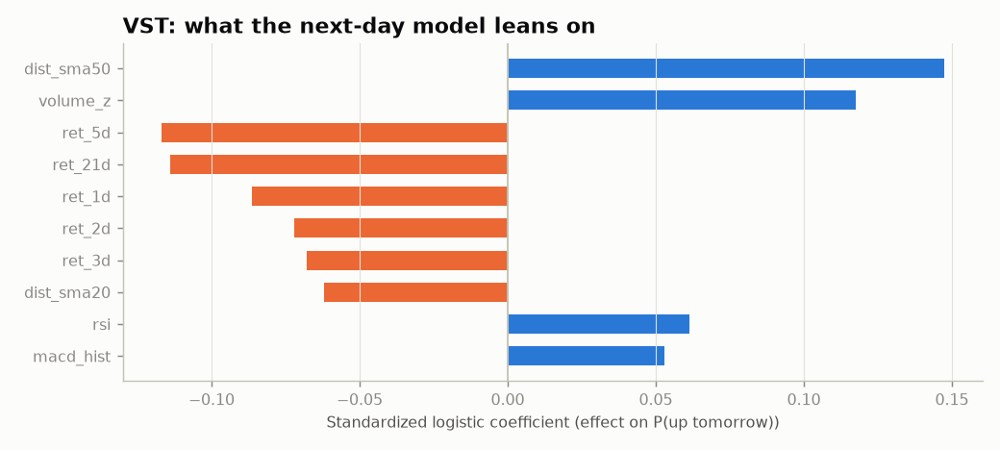

# stocklab report
Generated 2026-11-21 | data source: `yahoo` | history: 5 years | watchlist: ALAB, AMD, NVDA, MRVL, GOOG, FSLR, SKHY, ETN, TSLA, SPCX, AMZN, IBM, GEV, CEG, VST, DELL, TSM, BE

> Educational research code, not investment advice. Past results do not predict future returns.

## 1. Decision board

Data as of the 2026-11-20 close. `*` = provisional (under 200 trading days of history).

| ticker | action | close | 1 day | 1 month | buy rank | sell warnings | pullback entry | breakout | stop | why |
|---|---|---|---|---|---|---|---|---|---|---|
| AMZN | WATCH | 246.82 | -4.1% | -1.4% | 3/18 | 5/15 | 236.85 | 271.41 | 216.91 | +1% vs 200-day average; below 50-day, MACD bearish, distribution days, high-volume breakdown |
| DELL | SELL | 278.02 | -11.0% | -38.6% | 1/18 | 11/15 |  |  |  | -20% vs 200-day average; below 50-day, below 200-day, MACD bearish, distribution days, high-volume breakdown, 20%+ off high, volatility spike, below chandelier stop |
| AMD | SELL | 424.39 | -13.2% | -16.4% | 2/18 | 10/15 |  |  |  | -1% vs 200-day average; below 50-day, below 200-day, MACD bearish, high-volume breakdown, 20%+ off high, volatility spike, below chandelier stop |
| TSM | SELL | 318.71 | -9.5% | -22.7% | 4/18 | 11/15 |  |  |  | -21% vs 200-day average; below 50-day, below 200-day, MACD bearish, distribution days, high-volume breakdown, 20%+ off high, volatility spike, below chandelier stop |
| MRVL | SELL | 122.28 | -11.7% | -45.3% | 5/18 | 11/15 |  |  |  | -35% vs 200-day average; below 50-day, below 200-day, MACD bearish, distribution days, high-volume breakdown, 20%+ off high, volatility spike, below chandelier stop |
| SPCX | SELL* | 127.79 | -7.7% | -11.7% | 6/18 | 6/10 |  |  |  | -13% vs 50-day average; below 50-day, MACD bearish, distribution days, 20%+ off high, below chandelier stop (provisional: 113 days of history) |
| IBM | SELL | 224.44 | +0.3% | -10.4% | 7/18 | 9/15 |  |  |  | -7% vs 200-day average; below 50-day, below 200-day, death cross, MACD bearish, 20%+ off high, below chandelier stop |
| ETN | SELL | 311.33 | -5.8% | -15.4% | 8/18 | 13/15 |  |  |  | -21% vs 200-day average; below 50-day, below 200-day, death cross, MACD bearish, distribution days, high-volume breakdown, 20%+ off high, volatility spike, below chandelier stop |
| TSLA | SELL | 345.82 | -7.6% | -7.7% | 9/18 | 11/15 |  |  |  | -9% vs 200-day average; below 50-day, below 200-day, death cross, MACD bearish, distribution days, 20%+ off high, volatility spike, below chandelier stop |
| GOOG | SELL | 264.00 | -2.6% | -17.7% | 10/18 | 13/15 |  |  |  | -21% vs 200-day average; below 50-day, below 200-day, death cross, MACD bearish, distribution days, high-volume breakdown, 20%+ off high, volatility spike, below chandelier stop |
| GEV | SELL | 699.33 | -7.5% | -15.4% | 11/18 | 12/15 |  |  |  | -26% vs 200-day average; below 50-day, below 200-day, death cross, MACD bearish, distribution days, high-volume breakdown, 20%+ off high, below chandelier stop |
| CEG | SELL | 237.41 | -5.8% | -6.8% | 12/18 | 10/15 |  |  |  | -14% vs 200-day average; below 50-day, below 200-day, death cross, MACD bearish, distribution days, 20%+ off high, below chandelier stop |
| NVDA | SELL | 125.53 | -14.0% | -40.8% | 13/18 | 11/15 |  |  |  | -38% vs 200-day average; below 50-day, below 200-day, MACD bearish, distribution days, high-volume breakdown, 20%+ off high, volatility spike, below chandelier stop |
| VST | SELL | 115.25 | -7.2% | -18.2% | 14/18 | 11/15 |  |  |  | -24% vs 200-day average; below 50-day, below 200-day, death cross, MACD bearish, distribution days, 20%+ off high, volatility spike, below chandelier stop |
| ALAB | SELL | 180.35 | -14.8% | -30.0% | 15/18 | 10/15 |  |  |  | -30% vs 200-day average; below 50-day, below 200-day, MACD bearish, distribution days, high-volume breakdown, 20%+ off high, below chandelier stop |
| BE | SELL | 142.39 | -15.3% | -34.6% | 16/18 | 10/15 |  |  |  | -36% vs 200-day average; below 50-day, below 200-day, MACD bearish, distribution days, high-volume breakdown, 20%+ off high, below chandelier stop |
| SKHY | SELL* | 103.57 | -13.1% | -21.4% | 17/18 | 8/10 |  |  |  | -34% vs 50-day average; below 50-day, MACD bearish, distribution days, high-volume breakdown, 20%+ off high, below chandelier stop (provisional: 95 days of history) |
| FSLR | SELL | 137.59 | -9.5% | -19.7% | 18/18 | 10/15 |  |  |  | -35% vs 200-day average; below 50-day, below 200-day, death cross, MACD bearish, distribution days, 20%+ off high, below chandelier stop |


**Trading the labels** (2022-02-16 to 2026-11-20): buy on BUY, exit on SELL, REDUCE or AVOID, reviewed weekly with next-day execution and 5 bp costs.

| strategy | CAGR | Volatility | Sharpe | Max drawdown | Time invested | Avg holdings |
|---|---|---|---|---|---|---|
| Board strategy | +34.3% | 33.6% | 1.05 | -35.0% | 97% | 6.6 |
| Equal-weight watchlist | +39.2% | 34.4% | 1.13 | -36.8% | 100% | 15.1 |
| SPY (buy & hold) | +11.6% | 17.4% | 0.72 | -22.1% |  |  |

Sharpe difference vs equal weight: -0.09, 95% block-bootstrap CI [-0.60, +0.37].

Forward 21-day return after each label, relative to the watchlist average on the same date (sampled every 21 days, t-test across dates):

| label | observations | dates | mean 21d excess return | hit rate | p_value |
|---|---|---|---|---|---|
| BUY | 235 | 52 | +0.5% | 58% | 0.58 |
| HOLD | 120 | 42 | -0.2% | 52% | 0.90 |
| WATCH | 190 | 50 | +0.1% | 44% | 0.92 |
| AVOID | 43 | 23 | +0.3% | 39% | 0.91 |
| REDUCE | 168 | 52 | -1.0% | 37% | 0.44 |
| SELL | 83 | 35 | +2.1% | 51% | 0.60 |


## 2. Sell check, stock by stock

```
ALAB  EXIT  (score 10/15, close 180.35 on 2026-11-20)
  RSI 33 | -62.7% from 52-week high
  Triggered:
    - [trend] Close below the 50-day moving average (+1)
    - [trend] Close below the 200-day moving average (+2)
    - [momentum] MACD line below its signal line (+1)
    - [volume] 5+ distribution days in the last 25 sessions (institutional selling) (+1)
    - [volume] Down day closing below the 50-day average on 1.5x+ average volume (+2)
    - [risk] 20%+ below the 52-week high (+1)
    - [risk] Close below the chandelier stop (22-day high minus 3x ATR) (+2)
  Levels to watch:
    50-day SMA                 285.21  (price is below, -36.8%)
    200-day SMA                258.83  (price is below, -30.3%)
    Chandelier stop            228.36  (price is below, -21.0%)
```

```
AMD  EXIT  (score 10/15, close 424.39 on 2026-11-20)
  RSI 38 | -34.7% from 52-week high
  Triggered:
    - [trend] Close below the 50-day moving average (+1)
    - [trend] Close below the 200-day moving average (+2)
    - [momentum] MACD line below its signal line (+1)
    - [volume] Down day closing below the 50-day average on 1.5x+ average volume (+2)
    - [risk] 20%+ below the 52-week high (+1)
    - [risk] 21-day volatility 1.5x+ its 1-year median (+1)
    - [risk] Close below the chandelier stop (22-day high minus 3x ATR) (+2)
  Levels to watch:
    50-day SMA                 553.10  (price is below, -23.3%)
    Chandelier stop            457.78  (price is below, -7.3%)
    200-day SMA                429.79  (price is below, -1.3%)
```

```
NVDA  EXIT  (score 11/15, close 125.53 on 2026-11-20)
  RSI 15 | -47.5% from 52-week high
  Triggered:
    - [trend] Close below the 50-day moving average (+1)
    - [trend] Close below the 200-day moving average (+2)
    - [momentum] MACD line below its signal line (+1)
    - [volume] 5+ distribution days in the last 25 sessions (institutional selling) (+1)
    - [volume] Down day closing below the 50-day average on 1.5x+ average volume (+2)
    - [risk] 20%+ below the 52-week high (+1)
    - [risk] 21-day volatility 1.5x+ its 1-year median (+1)
    - [risk] Close below the chandelier stop (22-day high minus 3x ATR) (+2)
  Levels to watch:
    50-day SMA                 207.00  (price is below, -39.4%)
    200-day SMA                203.09  (price is below, -38.2%)
    Chandelier stop            187.87  (price is below, -33.2%)
```

```
MRVL  EXIT  (score 11/15, close 122.28 on 2026-11-20)
  RSI 28 | -61.3% from 52-week high
  Triggered:
    - [trend] Close below the 50-day moving average (+1)
    - [trend] Close below the 200-day moving average (+2)
    - [momentum] MACD line below its signal line (+1)
    - [volume] 5+ distribution days in the last 25 sessions (institutional selling) (+1)
    - [volume] Down day closing below the 50-day average on 1.5x+ average volume (+2)
    - [risk] 20%+ below the 52-week high (+1)
    - [risk] 21-day volatility 1.5x+ its 1-year median (+1)
    - [risk] Close below the chandelier stop (22-day high minus 3x ATR) (+2)
  Levels to watch:
    50-day SMA                 220.25  (price is below, -44.5%)
    Chandelier stop            205.49  (price is below, -40.5%)
    200-day SMA                188.53  (price is below, -35.1%)
```

```
GOOG  EXIT  (score 13/15, close 264.00 on 2026-11-20)
  RSI 27 | -33.8% from 52-week high
  Triggered:
    - [trend] Close below the 50-day moving average (+1)
    - [trend] Close below the 200-day moving average (+2)
    - [trend] 50-day average below the 200-day average (+2)
    - [momentum] MACD line below its signal line (+1)
    - [volume] 5+ distribution days in the last 25 sessions (institutional selling) (+1)
    - [volume] Down day closing below the 50-day average on 1.5x+ average volume (+2)
    - [risk] 20%+ below the 52-week high (+1)
    - [risk] 21-day volatility 1.5x+ its 1-year median (+1)
    - [risk] Close below the chandelier stop (22-day high minus 3x ATR) (+2)
  Levels to watch:
    200-day SMA                334.57  (price is below, -21.1%)
    50-day SMA                 319.27  (price is below, -17.3%)
    Chandelier stop            294.65  (price is below, -10.4%)
```

```
FSLR  EXIT  (score 10/15, close 137.59 on 2026-11-20)
  RSI 25 | -56.8% from 52-week high
  Triggered:
    - [trend] Close below the 50-day moving average (+1)
    - [trend] Close below the 200-day moving average (+2)
    - [trend] 50-day average below the 200-day average (+2)
    - [momentum] MACD line below its signal line (+1)
    - [volume] 5+ distribution days in the last 25 sessions (institutional selling) (+1)
    - [risk] 20%+ below the 52-week high (+1)
    - [risk] Close below the chandelier stop (22-day high minus 3x ATR) (+2)
  Levels to watch:
    200-day SMA                211.10  (price is below, -34.8%)
    Chandelier stop            184.30  (price is below, -25.3%)
    50-day SMA                 178.94  (price is below, -23.1%)
```

```
SKHY  EXIT  (score 8/10, close 103.57 on 2026-11-20)
  RSI 30 | -47.9% from high since listing
  Only 95 trading days of history; not scored yet: below_sma200, death_cross, volatility_spike
  Triggered:
    - [trend] Close below the 50-day moving average (+1)
    - [momentum] MACD line below its signal line (+1)
    - [volume] 5+ distribution days in the last 25 sessions (institutional selling) (+1)
    - [volume] Down day closing below the 50-day average on 1.5x+ average volume (+2)
    - [risk] 20%+ below the high since listing (+1)
    - [risk] Close below the chandelier stop (22-day high minus 3x ATR) (+2)
  Levels to watch:
    50-day SMA                 157.01  (price is below, -34.0%)
    Chandelier stop            135.06  (price is below, -23.3%)
```

```
ETN  EXIT  (score 13/15, close 311.33 on 2026-11-20)
  RSI 31 | -32.1% from 52-week high
  Triggered:
    - [trend] Close below the 50-day moving average (+1)
    - [trend] Close below the 200-day moving average (+2)
    - [trend] 50-day average below the 200-day average (+2)
    - [momentum] MACD line below its signal line (+1)
    - [volume] 5+ distribution days in the last 25 sessions (institutional selling) (+1)
    - [volume] Down day closing below the 50-day average on 1.5x+ average volume (+2)
    - [risk] 20%+ below the 52-week high (+1)
    - [risk] 21-day volatility 1.5x+ its 1-year median (+1)
    - [risk] Close below the chandelier stop (22-day high minus 3x ATR) (+2)
  Levels to watch:
    200-day SMA                394.88  (price is below, -21.2%)
    50-day SMA                 391.75  (price is below, -20.5%)
    Chandelier stop            344.66  (price is below, -9.7%)
```

```
TSLA  EXIT  (score 11/15, close 345.82 on 2026-11-20)
  RSI 38 | -29.4% from 52-week high
  Triggered:
    - [trend] Close below the 50-day moving average (+1)
    - [trend] Close below the 200-day moving average (+2)
    - [trend] 50-day average below the 200-day average (+2)
    - [momentum] MACD line below its signal line (+1)
    - [volume] 5+ distribution days in the last 25 sessions (institutional selling) (+1)
    - [risk] 20%+ below the 52-week high (+1)
    - [risk] 21-day volatility 1.5x+ its 1-year median (+1)
    - [risk] Close below the chandelier stop (22-day high minus 3x ATR) (+2)
  Levels to watch:
    200-day SMA                381.66  (price is below, -9.4%)
    50-day SMA                 375.64  (price is below, -7.9%)
    Chandelier stop            362.81  (price is below, -4.7%)
```

```
SPCX  EXIT  (score 6/10, close 127.79 on 2026-11-20)
  RSI 39 | -39.5% from high since listing
  Only 113 trading days of history; not scored yet: below_sma200, death_cross, volatility_spike
  Triggered:
    - [trend] Close below the 50-day moving average (+1)
    - [momentum] MACD line below its signal line (+1)
    - [volume] 5+ distribution days in the last 25 sessions (institutional selling) (+1)
    - [risk] 20%+ below the high since listing (+1)
    - [risk] Close below the chandelier stop (22-day high minus 3x ATR) (+2)
  Levels to watch:
    50-day SMA                 147.71  (price is below, -13.5%)
    Chandelier stop            130.03  (price is below, -1.7%)
```

```
AMZN  WATCH  (score 5/15, close 246.82 on 2026-11-20)
  RSI 42 | -13.1% from 52-week high
  Triggered:
    - [trend] Close below the 50-day moving average (+1)
    - [momentum] MACD line below its signal line (+1)
    - [volume] 5+ distribution days in the last 25 sessions (institutional selling) (+1)
    - [volume] Down day closing below the 50-day average on 1.5x+ average volume (+2)
  Levels to watch:
    50-day SMA                 255.03  (price is below, -3.2%)
    Chandelier stop            245.43  (price is above, +0.6%)
    200-day SMA                245.15  (price is above, +0.7%)
```

```
IBM  EXIT  (score 9/15, close 224.44 on 2026-11-20)
  RSI 34 | -30.9% from 52-week high
  Triggered:
    - [trend] Close below the 50-day moving average (+1)
    - [trend] Close below the 200-day moving average (+2)
    - [trend] 50-day average below the 200-day average (+2)
    - [momentum] MACD line below its signal line (+1)
    - [risk] 20%+ below the 52-week high (+1)
    - [risk] Close below the chandelier stop (22-day high minus 3x ATR) (+2)
  Levels to watch:
    200-day SMA                241.67  (price is below, -7.1%)
    Chandelier stop            236.92  (price is below, -5.3%)
    50-day SMA                 236.01  (price is below, -4.9%)
```

```
GEV  EXIT  (score 12/15, close 699.33 on 2026-11-20)
  RSI 32 | -40.4% from 52-week high
  Triggered:
    - [trend] Close below the 50-day moving average (+1)
    - [trend] Close below the 200-day moving average (+2)
    - [trend] 50-day average below the 200-day average (+2)
    - [momentum] MACD line below its signal line (+1)
    - [volume] 5+ distribution days in the last 25 sessions (institutional selling) (+1)
    - [volume] Down day closing below the 50-day average on 1.5x+ average volume (+2)
    - [risk] 20%+ below the 52-week high (+1)
    - [risk] Close below the chandelier stop (22-day high minus 3x ATR) (+2)
  Levels to watch:
    200-day SMA                951.13  (price is below, -26.5%)
    50-day SMA                 893.36  (price is below, -21.7%)
    Chandelier stop            766.75  (price is below, -8.8%)
```

```
CEG  EXIT  (score 10/15, close 237.41 on 2026-11-20)
  RSI 38 | -36.9% from 52-week high
  Triggered:
    - [trend] Close below the 50-day moving average (+1)
    - [trend] Close below the 200-day moving average (+2)
    - [trend] 50-day average below the 200-day average (+2)
    - [momentum] MACD line below its signal line (+1)
    - [volume] 5+ distribution days in the last 25 sessions (institutional selling) (+1)
    - [risk] 20%+ below the 52-week high (+1)
    - [risk] Close below the chandelier stop (22-day high minus 3x ATR) (+2)
  Levels to watch:
    200-day SMA                277.41  (price is below, -14.4%)
    50-day SMA                 265.85  (price is below, -10.7%)
    Chandelier stop            244.63  (price is below, -3.0%)
```

```
VST  EXIT  (score 11/15, close 115.25 on 2026-11-20)
  RSI 34 | -35.8% from 52-week high
  Triggered:
    - [trend] Close below the 50-day moving average (+1)
    - [trend] Close below the 200-day moving average (+2)
    - [trend] 50-day average below the 200-day average (+2)
    - [momentum] MACD line below its signal line (+1)
    - [volume] 5+ distribution days in the last 25 sessions (institutional selling) (+1)
    - [risk] 20%+ below the 52-week high (+1)
    - [risk] 21-day volatility 1.5x+ its 1-year median (+1)
    - [risk] Close below the chandelier stop (22-day high minus 3x ATR) (+2)
  Levels to watch:
    200-day SMA                150.95  (price is below, -23.6%)
    50-day SMA                 140.69  (price is below, -18.1%)
    Chandelier stop            131.84  (price is below, -12.6%)
```

```
DELL  EXIT  (score 11/15, close 278.02 on 2026-11-20)
  RSI 28 | -52.7% from 52-week high
  Triggered:
    - [trend] Close below the 50-day moving average (+1)
    - [trend] Close below the 200-day moving average (+2)
    - [momentum] MACD line below its signal line (+1)
    - [volume] 5+ distribution days in the last 25 sessions (institutional selling) (+1)
    - [volume] Down day closing below the 50-day average on 1.5x+ average volume (+2)
    - [risk] 20%+ below the 52-week high (+1)
    - [risk] 21-day volatility 1.5x+ its 1-year median (+1)
    - [risk] Close below the chandelier stop (22-day high minus 3x ATR) (+2)
  Levels to watch:
    50-day SMA                 470.70  (price is below, -40.9%)
    Chandelier stop            408.00  (price is below, -31.9%)
    200-day SMA                347.42  (price is below, -20.0%)
```

```
TSM  EXIT  (score 11/15, close 318.71 on 2026-11-20)
  RSI 28 | -34.4% from 52-week high
  Triggered:
    - [trend] Close below the 50-day moving average (+1)
    - [trend] Close below the 200-day moving average (+2)
    - [momentum] MACD line below its signal line (+1)
    - [volume] 5+ distribution days in the last 25 sessions (institutional selling) (+1)
    - [volume] Down day closing below the 50-day average on 1.5x+ average volume (+2)
    - [risk] 20%+ below the 52-week high (+1)
    - [risk] 21-day volatility 1.5x+ its 1-year median (+1)
    - [risk] Close below the chandelier stop (22-day high minus 3x ATR) (+2)
  Levels to watch:
    50-day SMA                 422.11  (price is below, -24.5%)
    200-day SMA                402.25  (price is below, -20.8%)
    Chandelier stop            383.71  (price is below, -16.9%)
```

```
BE  EXIT  (score 10/15, close 142.39 on 2026-11-20)
  RSI 32 | -58.8% from 52-week high
  Triggered:
    - [trend] Close below the 50-day moving average (+1)
    - [trend] Close below the 200-day moving average (+2)
    - [momentum] MACD line below its signal line (+1)
    - [volume] 5+ distribution days in the last 25 sessions (institutional selling) (+1)
    - [volume] Down day closing below the 50-day average on 1.5x+ average volume (+2)
    - [risk] 20%+ below the 52-week high (+1)
    - [risk] Close below the chandelier stop (22-day high minus 3x ATR) (+2)
  Levels to watch:
    50-day SMA                 234.02  (price is below, -39.2%)
    200-day SMA                223.89  (price is below, -36.4%)
    Chandelier stop            168.29  (price is below, -15.4%)
```

## 3. Which sell signals actually work? (event study)

Panel: 46 stocks, 5 years. Null hypothesis: returns after a signal look like returns on random days from the same stocks.

| rule | horizon | events | mean_after_signal | mean_random_days | difference | p_value | q_value | drop10_after_signal | drop10_base_rate | verdict |
|---|---|---|---|---|---|---|---|---|---|---|
| below_sma50 | 5d | 1077 | +0.20% | +0.66% | -0.47% | 0.006 | 0.071 | 40% | 36% | useful |
| below_sma50 | 21d | 1060 | +2.05% | +3.07% | -1.01% | 0.004 | 0.071 | 40% | 36% | useful |
| below_sma50 | 63d | 1005 | +8.41% | +10.11% | -1.69% | 0.018 | 0.153 | 40% | 36% | weak (not significant) |
| below_sma200 | 5d | 521 | +0.39% | +0.59% | -0.19% | 0.229 | 0.755 | 39% | 36% | weak (not significant) |
| below_sma200 | 21d | 507 | +0.95% | +2.75% | -1.80% | 0.001 | 0.033 | 39% | 36% | useful |
| below_sma200 | 63d | 475 | +9.24% | +8.98% | +0.25% | 0.586 | 1.000 | 39% | 36% | no edge |
| death_cross | 5d | 156 | +0.01% | +0.63% | -0.62% | 0.096 | 0.455 | 44% | 36% | weak (not significant) |
| death_cross | 21d | 149 | +0.95% | +2.87% | -1.92% | 0.037 | 0.206 | 44% | 36% | weak (not significant) |
| death_cross | 63d | 143 | +13.50% | +9.64% | +3.86% | 0.956 | 1.000 | 44% | 36% | no edge |
| rsi_divergence | 5d | 503 | +0.43% | +0.75% | -0.32% | 0.117 | 0.476 | 37% | 36% | weak (not significant) |
| rsi_divergence | 21d | 494 | +3.26% | +3.45% | -0.20% | 0.370 | 0.877 | 37% | 36% | weak (not significant) |
| rsi_divergence | 63d | 486 | +10.97% | +11.61% | -0.63% | 0.298 | 0.877 | 37% | 36% | weak (not significant) |
| rsi_rollover | 5d | 645 | +1.83% | +0.72% | +1.11% | 1.000 | 1.000 | 33% | 36% | no edge |
| rsi_rollover | 21d | 635 | +3.70% | +3.38% | +0.32% | 0.732 | 1.000 | 33% | 36% | no edge |
| rsi_rollover | 63d | 621 | +10.41% | +11.54% | -1.13% | 0.130 | 0.476 | 33% | 36% | weak (not significant) |
| macd_bearish | 5d | 1621 | +0.80% | +0.68% | +0.12% | 0.781 | 1.000 | 36% | 36% | no edge |
| macd_bearish | 21d | 1604 | +3.23% | +3.20% | +0.02% | 0.526 | 0.964 | 36% | 36% | no edge |
| macd_bearish | 63d | 1538 | +11.02% | +10.72% | +0.30% | 0.673 | 1.000 | 36% | 36% | no edge |
| distribution_cluster | 5d | 1080 | +0.90% | +0.69% | +0.21% | 0.866 | 1.000 | 35% | 36% | no edge |
| distribution_cluster | 21d | 1068 | +3.15% | +3.23% | -0.08% | 0.425 | 0.877 | 35% | 36% | weak (not significant) |
| distribution_cluster | 63d | 1023 | +10.46% | +10.81% | -0.35% | 0.334 | 0.877 | 35% | 36% | weak (not significant) |
| high_volume_breakdown | 5d | 766 | +0.82% | +0.65% | +0.17% | 0.790 | 1.000 | 34% | 36% | no edge |
| high_volume_breakdown | 21d | 737 | +3.51% | +3.03% | +0.49% | 0.829 | 1.000 | 34% | 36% | no edge |
| high_volume_breakdown | 63d | 702 | +12.61% | +10.06% | +2.55% | 0.995 | 1.000 | 34% | 36% | no edge |
| drawdown_20 | 5d | 405 | +1.33% | +0.80% | +0.53% | 0.921 | 1.000 | 52% | 36% | no edge |
| drawdown_20 | 21d | 397 | +2.22% | +3.71% | -1.48% | 0.029 | 0.195 | 52% | 36% | weak (not significant) |
| drawdown_20 | 63d | 375 | +13.48% | +12.66% | +0.82% | 0.694 | 1.000 | 52% | 36% | no edge |
| volatility_spike | 5d | 350 | +0.93% | +0.73% | +0.21% | 0.724 | 1.000 | 47% | 36% | no edge |
| volatility_spike | 21d | 331 | +3.16% | +3.35% | -0.19% | 0.416 | 0.877 | 47% | 36% | weak (not significant) |
| volatility_spike | 63d | 329 | +10.78% | +11.34% | -0.56% | 0.372 | 0.877 | 47% | 36% | weak (not significant) |
| chandelier_stop | 5d | 1356 | +0.69% | +0.69% | +0.01% | 0.519 | 0.964 | 37% | 36% | no edge |
| chandelier_stop | 21d | 1340 | +3.31% | +3.20% | +0.11% | 0.625 | 1.000 | 37% | 36% | no edge |
| chandelier_stop | 63d | 1278 | +11.77% | +10.79% | +0.98% | 0.901 | 1.000 | 37% | 36% | no edge |

**3 of 33 rule-by-horizon tests** show significantly weaker returns after the signal (q < 0.10).


## 4. Strategy backtests

Not included: SKHY (only 95 trading days of history, needs 452); SPCX (only 113 trading days of history, needs 452).

### ALAB (2025-01-03 to 2026-11-20)

| strategy | Total return | CAGR | Max drawdown | Volatility | Sharpe | Round trips | Time in market | Sharpe vs B&H | 95% CI | p-value |
|---|---|---|---|---|---|---|---|---|---|---|
| Buy & Hold | +25.5% | +12.9% | -63.2% | +97.4% | 0.61 | 0 | 100% |  |  |  |
| 50/200 SMA cross | -72.4% | -49.7% | -74.0% | +88.1% | -0.33 | 2 | 76% | -0.95 | [-1.84, -0.21] | 0.02 |
| Close > 50-day SMA | +7.6% | +4.0% | -66.4% | +69.4% | 0.41 | 10 | 51% | -0.21 | [-1.34, +0.83] | 0.72 |
| MACD > signal | -0.2% | -0.1% | -70.4% | +65.7% | 0.32 | 22 | 50% | -0.29 | [-1.40, +0.81] | 0.61 |
| RSI 30/70 | -7.5% | -4.1% | -50.3% | +39.5% | 0.09 | 1 | 18% | -0.52 | [-2.23, +1.15] | 0.53 |
| Trailing stop 20% | -11.8% | -6.5% | -69.1% | +71.4% | 0.27 | 10 | 55% | -0.35 | [-1.42, +0.62] | 0.52 |
| Volume breakout | +91.8% | +41.5% | -55.7% | +62.7% | 0.86 | 4 | 41% | +0.25 | [-0.95, +1.41] | 0.65 |

### AMD (2022-09-08 to 2026-11-20)

| strategy | Total return | CAGR | Max drawdown | Volatility | Sharpe | Round trips | Time in market | Sharpe vs B&H | 95% CI | p-value |
|---|---|---|---|---|---|---|---|---|---|---|
| Buy & Hold | +396.4% | +46.6% | -63.0% | +59.1% | 0.94 | 0 | 100% |  |  |  |
| 50/200 SMA cross | +297.9% | +39.0% | -39.1% | +49.7% | 0.91 | 1 | 66% | -0.03 | [-0.56, +0.51] | 0.92 |
| Close > 50-day SMA | +147.4% | +24.1% | -49.9% | +44.0% | 0.71 | 37 | 54% | -0.23 | [-0.82, +0.39] | 0.46 |
| MACD > signal | +221.0% | +32.1% | -42.4% | +42.5% | 0.87 | 39 | 51% | -0.07 | [-0.61, +0.45] | 0.78 |
| RSI 30/70 | +23.1% | +5.1% | -54.7% | +33.6% | 0.31 | 3 | 34% | -0.63 | [-1.66, +0.27] | 0.20 |
| Trailing stop 20% | +96.0% | +17.4% | -58.9% | +50.4% | 0.57 | 11 | 71% | -0.37 | [-0.90, +0.12] | 0.16 |
| Volume breakout | +161.9% | +25.8% | -36.9% | +37.2% | 0.80 | 11 | 38% | -0.14 | [-0.84, +0.55] | 0.72 |

### NVDA (2022-09-08 to 2026-11-20)

| strategy | Total return | CAGR | Max drawdown | Volatility | Sharpe | Round trips | Time in market | Sharpe vs B&H | 95% CI | p-value |
|---|---|---|---|---|---|---|---|---|---|---|
| Buy & Hold | +775.2% | +67.8% | -47.5% | +49.5% | 1.29 | 0 | 100% |  |  |  |
| 50/200 SMA cross | +384.8% | +45.7% | -47.5% | +43.8% | 1.08 | 1 | 84% | -0.21 | [-0.66, +0.20] | 0.32 |
| Close > 50-day SMA | +346.8% | +42.9% | -39.1% | +39.0% | 1.11 | 38 | 69% | -0.18 | [-0.87, +0.58] | 0.62 |
| MACD > signal | +152.9% | +24.8% | -46.7% | +34.4% | 0.81 | 40 | 51% | -0.48 | [-1.33, +0.39] | 0.28 |
| RSI 30/70 | +21.6% | +4.8% | -33.1% | +19.2% | 0.34 | 2 | 7% | -0.95 | [-2.14, -0.00] | 0.07 |
| Trailing stop 20% | +593.2% | +58.7% | -36.6% | +44.9% | 1.25 | 8 | 90% | -0.04 | [-0.49, +0.45] | 0.87 |
| Volume breakout | +211.5% | +31.1% | -19.8% | +26.3% | 1.16 | 7 | 31% | -0.13 | [-1.05, +0.79] | 0.79 |

### MRVL (2022-09-08 to 2026-11-20)

| strategy | Total return | CAGR | Max drawdown | Volatility | Sharpe | Round trips | Time in market | Sharpe vs B&H | 95% CI | p-value |
|---|---|---|---|---|---|---|---|---|---|---|
| Buy & Hold | +149.4% | +24.4% | -61.3% | +67.6% | 0.66 | 0 | 100% |  |  |  |
| 50/200 SMA cross | +19.0% | +4.2% | -65.2% | +58.0% | 0.36 | 2 | 68% | -0.30 | [-0.77, +0.15] | 0.20 |
| Close > 50-day SMA | +65.8% | +12.8% | -51.5% | +52.7% | 0.49 | 36 | 57% | -0.17 | [-0.82, +0.40] | 0.58 |
| MACD > signal | +101.6% | +18.2% | -62.5% | +50.2% | 0.58 | 44 | 51% | -0.08 | [-0.80, +0.65] | 0.84 |
| RSI 30/70 | +27.3% | +5.9% | -32.1% | +30.1% | 0.34 | 2 | 20% | -0.31 | [-1.24, +0.68] | 0.51 |
| Trailing stop 20% | +62.3% | +12.2% | -53.3% | +56.9% | 0.48 | 15 | 76% | -0.17 | [-0.71, +0.27] | 0.50 |
| Volume breakout | +76.0% | +14.4% | -46.2% | +42.0% | 0.53 | 11 | 36% | -0.13 | [-1.02, +0.70] | 0.74 |

### GOOG (2022-09-08 to 2026-11-20)

| strategy | Total return | CAGR | Max drawdown | Volatility | Sharpe | Round trips | Time in market | Sharpe vs B&H | 95% CI | p-value |
|---|---|---|---|---|---|---|---|---|---|---|
| Buy & Hold | +138.3% | +23.0% | -33.8% | +31.8% | 0.81 | 0 | 100% |  |  |  |
| 50/200 SMA cross | +151.5% | +24.6% | -29.4% | +25.9% | 0.98 | 2 | 76% | +0.17 | [-0.35, +0.71] | 0.53 |
| Close > 50-day SMA | +85.6% | +15.9% | -22.2% | +23.6% | 0.74 | 34 | 63% | -0.07 | [-0.78, +0.64] | 0.86 |
| MACD > signal | +22.8% | +5.0% | -25.4% | +21.6% | 0.33 | 42 | 50% | -0.48 | [-1.15, +0.18] | 0.17 |
| RSI 30/70 | +20.4% | +4.5% | -20.4% | +18.4% | 0.33 | 4 | 26% | -0.48 | [-1.30, +0.43] | 0.27 |
| Trailing stop 20% | +41.4% | +8.6% | -40.4% | +29.6% | 0.43 | 6 | 91% | -0.38 | [-0.83, +0.03] | 0.08 |
| Volume breakout | +105.6% | +18.8% | -17.4% | +19.4% | 0.98 | 8 | 46% | +0.17 | [-0.68, +0.98] | 0.68 |

### FSLR (2022-09-08 to 2026-11-20)

| strategy | Total return | CAGR | Max drawdown | Volatility | Sharpe | Round trips | Time in market | Sharpe vs B&H | 95% CI | p-value |
|---|---|---|---|---|---|---|---|---|---|---|
| Buy & Hold | +1.3% | +0.3% | -60.0% | +55.3% | 0.28 | 0 | 100% |  |  |  |
| 50/200 SMA cross | +3.5% | +0.8% | -51.1% | +41.6% | 0.22 | 4 | 58% | -0.05 | [-0.69, +0.56] | 0.85 |
| Close > 50-day SMA | +22.3% | +4.9% | -46.8% | +40.2% | 0.32 | 29 | 49% | +0.04 | [-0.56, +0.60] | 0.88 |
| MACD > signal | -61.6% | -20.4% | -74.1% | +40.8% | -0.36 | 49 | 50% | -0.64 | [-1.31, +0.04] | 0.07 |
| RSI 30/70 | +17.7% | +4.0% | -42.8% | +30.7% | 0.27 | 2 | 27% | -0.00 | [-0.98, +0.79] | 0.99 |
| Trailing stop 20% | -7.2% | -1.8% | -57.9% | +45.3% | 0.18 | 12 | 69% | -0.09 | [-0.61, +0.38] | 0.69 |
| Volume breakout | -28.7% | -7.8% | -53.8% | +32.2% | -0.09 | 14 | 37% | -0.37 | [-1.23, +0.41] | 0.41 |

### ETN (2022-09-08 to 2026-11-20)

| strategy | Total return | CAGR | Max drawdown | Volatility | Sharpe | Round trips | Time in market | Sharpe vs B&H | 95% CI | p-value |
|---|---|---|---|---|---|---|---|---|---|---|
| Buy & Hold | +126.7% | +21.6% | -34.5% | +34.1% | 0.74 | 0 | 100% |  |  |  |
| 50/200 SMA cross | +47.7% | +9.7% | -38.6% | +30.6% | 0.46 | 2 | 84% | -0.29 | [-0.70, +0.08] | 0.13 |
| Close > 50-day SMA | +31.0% | +6.7% | -37.5% | +24.5% | 0.39 | 44 | 65% | -0.36 | [-0.98, +0.34] | 0.27 |
| MACD > signal | +37.2% | +7.8% | -25.8% | +22.3% | 0.45 | 49 | 50% | -0.29 | [-1.06, +0.45] | 0.42 |
| RSI 30/70 | +15.7% | +3.5% | -18.6% | +11.5% | 0.36 | 1 | 5% | -0.39 | [-1.35, +0.75] | 0.46 |
| Trailing stop 20% | +169.5% | +26.7% | -23.6% | +30.8% | 0.92 | 2 | 94% | +0.18 | [-0.07, +0.49] | 0.23 |
| Volume breakout | +21.6% | +4.8% | -29.3% | +18.1% | 0.35 | 10 | 38% | -0.40 | [-1.22, +0.49] | 0.36 |

### TSLA (2022-09-08 to 2026-11-20)

| strategy | Total return | CAGR | Max drawdown | Volatility | Sharpe | Round trips | Time in market | Sharpe vs B&H | 95% CI | p-value |
|---|---|---|---|---|---|---|---|---|---|---|
| Buy & Hold | +15.3% | +3.5% | -65.0% | +58.3% | 0.35 | 0 | 100% |  |  |  |
| 50/200 SMA cross | -26.4% | -7.1% | -56.8% | +40.1% | 0.01 | 4 | 47% | -0.33 | [-1.22, +0.52] | 0.45 |
| Close > 50-day SMA | +35.1% | +7.5% | -41.1% | +38.6% | 0.38 | 42 | 53% | +0.03 | [-0.71, +0.77] | 0.93 |
| MACD > signal | +396.5% | +46.6% | -39.8% | +40.8% | 1.14 | 42 | 51% | +0.79 | [+0.15, +1.47] | 0.02 |
| RSI 30/70 | +34.3% | +7.3% | -52.7% | +40.5% | 0.37 | 4 | 43% | +0.03 | [-0.75, +0.78] | 0.94 |
| Trailing stop 20% | +17.6% | +3.9% | -47.9% | +45.1% | 0.31 | 11 | 71% | -0.04 | [-0.63, +0.56] | 0.91 |
| Volume breakout | +40.5% | +8.4% | -35.4% | +25.7% | 0.44 | 9 | 18% | +0.09 | [-0.82, +1.07] | 0.85 |

### AMZN (2022-09-08 to 2026-11-20)

| strategy | Total return | CAGR | Max drawdown | Volatility | Sharpe | Round trips | Time in market | Sharpe vs B&H | 95% CI | p-value |
|---|---|---|---|---|---|---|---|---|---|---|
| Buy & Hold | +85.1% | +15.8% | -40.0% | +34.2% | 0.60 | 0 | 100% |  |  |  |
| 50/200 SMA cross | +26.9% | +5.8% | -41.4% | +28.1% | 0.34 | 2 | 74% | -0.26 | [-0.90, +0.37] | 0.39 |
| Close > 50-day SMA | +19.2% | +4.3% | -43.9% | +23.5% | 0.30 | 34 | 63% | -0.30 | [-0.97, +0.36] | 0.39 |
| MACD > signal | -7.9% | -1.9% | -28.7% | +23.0% | 0.03 | 50 | 50% | -0.57 | [-1.27, +0.15] | 0.12 |
| RSI 30/70 | +94.0% | +17.1% | -22.0% | +21.6% | 0.84 | 4 | 33% | +0.24 | [-0.48, +1.00] | 0.52 |
| Trailing stop 20% | +90.0% | +16.5% | -24.2% | +30.0% | 0.66 | 3 | 87% | +0.06 | [-0.36, +0.51] | 0.79 |
| Volume breakout | -1.3% | -0.3% | -38.8% | +19.1% | 0.08 | 11 | 46% | -0.52 | [-1.46, +0.38] | 0.26 |

### IBM (2022-09-08 to 2026-11-20)

| strategy | Total return | CAGR | Max drawdown | Volatility | Sharpe | Round trips | Time in market | Sharpe vs B&H | 95% CI | p-value |
|---|---|---|---|---|---|---|---|---|---|---|
| Buy & Hold | +101.4% | +18.2% | -37.5% | +31.6% | 0.69 | 0 | 100% |  |  |  |
| 50/200 SMA cross | +62.9% | +12.3% | -28.7% | +22.8% | 0.63 | 3 | 72% | -0.07 | [-0.79, +0.62] | 0.86 |
| Close > 50-day SMA | +43.6% | +9.0% | -43.2% | +25.3% | 0.47 | 28 | 60% | -0.22 | [-0.70, +0.35] | 0.40 |
| MACD > signal | +112.3% | +19.7% | -43.1% | +23.9% | 0.88 | 30 | 50% | +0.19 | [-0.40, +1.02] | 0.57 |
| RSI 30/70 | +175.4% | +27.3% | -16.5% | +17.4% | 1.48 | 8 | 35% | +0.79 | [-0.27, +1.66] | 0.10 |
| Trailing stop 20% | +52.9% | +10.7% | -45.9% | +30.4% | 0.49 | 3 | 92% | -0.20 | [-0.45, +0.02] | 0.09 |
| Volume breakout | +54.7% | +11.0% | -30.2% | +17.2% | 0.69 | 11 | 40% | -0.00 | [-0.88, +0.94] | 1.00 |

### GEV (2025-01-13 to 2026-11-20)

| strategy | Total return | CAGR | Max drawdown | Volatility | Sharpe | Round trips | Time in market | Sharpe vs B&H | 95% CI | p-value |
|---|---|---|---|---|---|---|---|---|---|---|
| Buy & Hold | +83.6% | +38.7% | -40.4% | +56.2% | 0.87 | 0 | 100% |  |  |  |
| 50/200 SMA cross | +133.0% | +57.7% | -38.3% | +54.4% | 1.11 | 1 | 96% | +0.25 | [+0.00, +0.70] | 0.11 |
| Close > 50-day SMA | +79.1% | +36.9% | -32.7% | +43.5% | 0.94 | 15 | 62% | +0.08 | [-0.58, +0.80] | 0.81 |
| MACD > signal | +60.6% | +29.1% | -31.0% | +41.7% | 0.82 | 17 | 47% | -0.04 | [-0.84, +0.79] | 0.92 |
| RSI 30/70 | +8.9% | +4.7% | -40.4% | +35.4% | 0.31 | 1 | 32% | -0.56 | [-1.72, +0.57] | 0.36 |
| Trailing stop 20% | +44.2% | +21.8% | -45.9% | +49.7% | 0.65 | 5 | 86% | -0.22 | [-0.80, +0.43] | 0.47 |
| Volume breakout | +24.5% | +12.5% | -24.6% | +33.2% | 0.53 | 3 | 35% | -0.34 | [-1.55, +0.88] | 0.58 |

### CEG (2022-11-02 to 2026-11-20)

| strategy | Total return | CAGR | Max drawdown | Volatility | Sharpe | Round trips | Time in market | Sharpe vs B&H | 95% CI | p-value |
|---|---|---|---|---|---|---|---|---|---|---|
| Buy & Hold | +159.5% | +26.7% | -50.7% | +49.4% | 0.72 | 0 | 100% |  |  |  |
| 50/200 SMA cross | +96.8% | +18.3% | -50.7% | +43.4% | 0.60 | 3 | 72% | -0.12 | [-0.62, +0.29] | 0.60 |
| Close > 50-day SMA | +128.2% | +22.7% | -43.6% | +37.2% | 0.73 | 49 | 57% | +0.01 | [-0.56, +0.56] | 0.98 |
| MACD > signal | +11.5% | +2.7% | -48.1% | +37.0% | 0.25 | 41 | 49% | -0.47 | [-1.12, +0.15] | 0.14 |
| RSI 30/70 | +75.9% | +15.0% | -28.6% | +32.5% | 0.59 | 3 | 38% | -0.13 | [-0.95, +0.64] | 0.75 |
| Trailing stop 20% | +68.7% | +13.8% | -56.3% | +43.9% | 0.51 | 9 | 84% | -0.21 | [-0.67, +0.19] | 0.34 |
| Volume breakout | +86.0% | +16.6% | -30.0% | +30.5% | 0.65 | 9 | 39% | -0.07 | [-0.80, +0.70] | 0.84 |

### VST (2022-09-08 to 2026-11-20)

| strategy | Total return | CAGR | Max drawdown | Volatility | Sharpe | Round trips | Time in market | Sharpe vs B&H | 95% CI | p-value |
|---|---|---|---|---|---|---|---|---|---|---|
| Buy & Hold | +385.9% | +45.8% | -48.8% | +52.2% | 0.99 | 0 | 100% |  |  |  |
| 50/200 SMA cross | +414.5% | +47.8% | -48.8% | +44.0% | 1.11 | 3 | 68% | +0.13 | [-0.25, +0.53] | 0.53 |
| Close > 50-day SMA | +47.8% | +9.8% | -67.2% | +38.0% | 0.44 | 45 | 63% | -0.55 | [-1.21, +0.12] | 0.10 |
| MACD > signal | +64.4% | +12.6% | -49.0% | +37.2% | 0.51 | 48 | 51% | -0.48 | [-1.12, +0.20] | 0.17 |
| RSI 30/70 | +159.5% | +25.6% | -27.3% | +27.1% | 0.97 | 3 | 21% | -0.01 | [-0.93, +0.77] | 0.98 |
| Trailing stop 20% | +210.5% | +31.0% | -56.3% | +44.6% | 0.83 | 9 | 87% | -0.15 | [-0.62, +0.33] | 0.52 |
| Volume breakout | +278.5% | +37.4% | -31.2% | +31.4% | 1.18 | 9 | 43% | +0.19 | [-0.65, +1.08] | 0.63 |

### DELL (2022-09-08 to 2026-11-20)

| strategy | Total return | CAGR | Max drawdown | Volatility | Sharpe | Round trips | Time in market | Sharpe vs B&H | 95% CI | p-value |
|---|---|---|---|---|---|---|---|---|---|---|
| Buy & Hold | +658.6% | +62.2% | -59.6% | +58.5% | 1.11 | 0 | 100% |  |  |  |
| 50/200 SMA cross | +321.3% | +40.9% | -52.7% | +51.3% | 0.92 | 3 | 69% | -0.19 | [-0.68, +0.22] | 0.40 |
| Close > 50-day SMA | +1326.9% | +88.6% | -27.5% | +49.3% | 1.52 | 21 | 67% | +0.41 | [-0.12, +0.97] | 0.16 |
| MACD > signal | +141.4% | +23.4% | -57.7% | +43.1% | 0.69 | 45 | 52% | -0.42 | [-1.12, +0.32] | 0.27 |
| RSI 30/70 | +125.3% | +21.4% | -25.6% | +27.3% | 0.84 | 4 | 27% | -0.27 | [-1.18, +0.61] | 0.58 |
| Trailing stop 20% | +921.0% | +74.1% | -55.9% | +51.5% | 1.32 | 7 | 81% | +0.21 | [-0.22, +0.70] | 0.36 |
| Volume breakout | +378.1% | +45.3% | -37.8% | +43.2% | 1.07 | 11 | 45% | -0.04 | [-0.74, +0.69] | 0.90 |

### TSM (2022-09-08 to 2026-11-20)

| strategy | Total return | CAGR | Max drawdown | Volatility | Sharpe | Round trips | Time in market | Sharpe vs B&H | 95% CI | p-value |
|---|---|---|---|---|---|---|---|---|---|---|
| Buy & Hold | +317.3% | +40.6% | -36.8% | +39.8% | 1.06 | 0 | 100% |  |  |  |
| 50/200 SMA cross | +118.8% | +20.5% | -36.8% | +36.5% | 0.69 | 2 | 82% | -0.36 | [-0.86, +0.13] | 0.16 |
| Close > 50-day SMA | +190.3% | +29.0% | -28.8% | +31.5% | 0.96 | 37 | 68% | -0.09 | [-0.71, +0.58] | 0.78 |
| MACD > signal | +118.0% | +20.4% | -32.1% | +28.6% | 0.79 | 45 | 49% | -0.26 | [-0.91, +0.37] | 0.45 |
| RSI 30/70 | +16.7% | +3.8% | -23.0% | +17.9% | 0.29 | 3 | 13% | -0.76 | [-1.76, +0.12] | 0.13 |
| Trailing stop 20% | +220.1% | +32.0% | -30.6% | +36.7% | 0.94 | 6 | 90% | -0.12 | [-0.51, +0.27] | 0.57 |
| Volume breakout | +77.0% | +14.6% | -26.8% | +26.4% | 0.65 | 11 | 46% | -0.41 | [-1.22, +0.42] | 0.32 |

### BE (2022-09-08 to 2026-11-20)

| strategy | Total return | CAGR | Max drawdown | Volatility | Sharpe | Round trips | Time in market | Sharpe vs B&H | 95% CI | p-value |
|---|---|---|---|---|---|---|---|---|---|---|
| Buy & Hold | +444.4% | +49.8% | -67.8% | +90.4% | 0.88 | 0 | 100% |  |  |  |
| 50/200 SMA cross | +152.3% | +24.7% | -71.9% | +75.3% | 0.67 | 4 | 63% | -0.22 | [-0.80, +0.35] | 0.48 |
| Close > 50-day SMA | +346.9% | +42.9% | -53.1% | +69.6% | 0.84 | 31 | 51% | -0.04 | [-0.62, +0.43] | 0.86 |
| MACD > signal | +182.3% | +28.1% | -60.0% | +65.9% | 0.68 | 42 | 50% | -0.20 | [-0.95, +0.44] | 0.57 |
| RSI 30/70 | +147.7% | +24.2% | -61.8% | +47.0% | 0.69 | 4 | 47% | -0.19 | [-1.04, +0.71] | 0.67 |
| Trailing stop 20% | +146.3% | +24.0% | -66.7% | +73.7% | 0.64 | 19 | 60% | -0.24 | [-0.78, +0.25] | 0.35 |
| Volume breakout | +275.5% | +37.1% | -58.1% | +60.9% | 0.80 | 11 | 30% | -0.08 | [-0.92, +0.64] | 0.84 |


## 5. Next-day forecasts

Not included: SKHY (only 95 trading days of history, needs 452); SPCX (only 113 trading days of history, needs 452).

### ALAB

Walk-forward test on 220 unseen days (2026-01-07 to 2026-11-19).

| model | accuracy | always-majority accuracy | p (beats majority) | AUC | Brier | strategy Sharpe | buy & hold Sharpe |
|---|---|---|---|---|---|---|---|
| Majority class (baseline) | 0.518 | 0.518 | 0.527 | 0.46 | 0.25 | 0.611 | 0.612 |
| Logistic regression | 0.495 | 0.518 | 0.771 | 0.499 | 0.257 | 0.068 | 0.612 |
| Gradient boosting | 0.477 | 0.518 | 0.9 | 0.461 | 0.281 | 0.154 | 0.612 |

| model | RMSE (bps) | R2 out-of-sample vs zero | direction hit rate | DM p (beats zero) |
|---|---|---|---|---|
| Zero / random walk (baseline) | 654.9 | 0.0 |  |  |
| Ridge regression | 674.0 | -0.0592 | 0.473 | 0.965 |
| Gradient boosting | 690.6 | -0.1122 | 0.45 | 0.996 |

Forecast for the next session:

```
  P(up) | Logistic regression      68.7%
  P(up) | Gradient boosting        75.2%
  P(up) | historical base rate     51.7%
  expected return (ridge)          +2.98%
  80% range low                    -7.70%
  80% range high                   +14.89%
  daily volatility                 +8.54%
```

Best out-of-sample AUC **0.499**; smallest p-value against a naive baseline 0.771, before correcting for the four models tested here and the other stocks (the corrected count is in the summary).


### AMD

Walk-forward test on 551 unseen days (2024-09-11 to 2026-11-19).

| model | accuracy | always-majority accuracy | p (beats majority) | AUC | Brier | strategy Sharpe | buy & hold Sharpe |
|---|---|---|---|---|---|---|---|
| Majority class (baseline) | 0.503 | 0.528 | 0.892 | 0.487 | 0.25 | 0.854 | 1.047 |
| Logistic regression | 0.488 | 0.528 | 0.972 | 0.489 | 0.257 | 0.564 | 1.047 |
| Gradient boosting | 0.497 | 0.528 | 0.932 | 0.504 | 0.265 | 1.051 | 1.047 |

| model | RMSE (bps) | R2 out-of-sample vs zero | direction hit rate | DM p (beats zero) |
|---|---|---|---|---|
| Zero / random walk (baseline) | 411.9 | 0.0 |  |  |
| Ridge regression | 415.4 | -0.0172 | 0.505 | 0.811 |
| Gradient boosting | 421.9 | -0.0491 | 0.501 | 0.984 |

Forecast for the next session:

```
  P(up) | Logistic regression      67.2%
  P(up) | Gradient boosting        65.2%
  P(up) | historical base rate     51.5%
  expected return (ridge)          +2.33%
  80% range low                    -7.95%
  80% range high                   +13.75%
  daily volatility                 +8.26%
```

Best out-of-sample AUC **0.504**; smallest p-value against a naive baseline 0.811, before correcting for the four models tested here and the other stocks (the corrected count is in the summary).


### NVDA

Walk-forward test on 551 unseen days (2024-09-11 to 2026-11-19).

| model | accuracy | always-majority accuracy | p (beats majority) | AUC | Brier | strategy Sharpe | buy & hold Sharpe |
|---|---|---|---|---|---|---|---|
| Majority class (baseline) | 0.515 | 0.515 | 0.517 | 0.514 | 0.251 | 0.301 | 0.302 |
| Logistic regression | 0.508 | 0.515 | 0.649 | 0.522 | 0.255 | 0.256 | 0.302 |
| Gradient boosting | 0.503 | 0.515 | 0.739 | 0.473 | 0.273 | 0.429 | 0.302 |

| model | RMSE (bps) | R2 out-of-sample vs zero | direction hit rate | DM p (beats zero) |
|---|---|---|---|---|
| Zero / random walk (baseline) | 285.4 | 0.0 |  |  |
| Ridge regression | 288.1 | -0.0195 | 0.515 | 0.748 |
| Gradient boosting | 298.5 | -0.0939 | 0.505 | 0.992 |

Forecast for the next session:

```
  P(up) | Logistic regression      49.8%
  P(up) | Gradient boosting        63.4%
  P(up) | historical base rate     53.5%
  expected return (ridge)          +1.04%
  80% range low                    -4.33%
  80% range high                   +6.71%
  daily volatility                 +4.26%
```

Best out-of-sample AUC **0.522**; smallest p-value against a naive baseline 0.649, before correcting for the four models tested here and the other stocks (the corrected count is in the summary).


### MRVL

Walk-forward test on 551 unseen days (2024-09-11 to 2026-11-19).

| model | accuracy | always-majority accuracy | p (beats majority) | AUC | Brier | strategy Sharpe | buy & hold Sharpe |
|---|---|---|---|---|---|---|---|
| Majority class (baseline) | 0.53 | 0.53 | 0.517 | 0.465 | 0.249 | 0.677 | 0.678 |
| Logistic regression | 0.537 | 0.53 | 0.383 | 0.553 | 0.251 | 0.769 | 0.678 |
| Gradient boosting | 0.541 | 0.53 | 0.32 | 0.564 | 0.255 | 0.549 | 0.678 |

| model | RMSE (bps) | R2 out-of-sample vs zero | direction hit rate | DM p (beats zero) |
|---|---|---|---|---|
| Zero / random walk (baseline) | 483.7 | 0.0 |  |  |
| Ridge regression | 489.5 | -0.024 | 0.534 | 0.908 |
| Gradient boosting | 495.6 | -0.0498 | 0.506 | 0.978 |

Forecast for the next session:

```
  P(up) | Logistic regression      66.1%
  P(up) | Gradient boosting        72.2%
  P(up) | historical base rate     52.4%
  expected return (ridge)          +1.04%
  80% range low                    -8.54%
  80% range high                   +11.63%
  daily volatility                 +7.77%
```

Best out-of-sample AUC **0.564**; smallest p-value against a naive baseline 0.320, before correcting for the four models tested here and the other stocks (the corrected count is in the summary).


### GOOG

Walk-forward test on 551 unseen days (2024-09-11 to 2026-11-19).

| model | accuracy | always-majority accuracy | p (beats majority) | AUC | Brier | strategy Sharpe | buy & hold Sharpe |
|---|---|---|---|---|---|---|---|
| Majority class (baseline) | 0.521 | 0.521 | 0.517 | 0.487 | 0.25 | 0.958 | 0.958 |
| Logistic regression | 0.534 | 0.521 | 0.29 | 0.53 | 0.253 | 0.229 | 0.958 |
| Gradient boosting | 0.51 | 0.521 | 0.71 | 0.534 | 0.262 | 0.342 | 0.958 |

| model | RMSE (bps) | R2 out-of-sample vs zero | direction hit rate | DM p (beats zero) |
|---|---|---|---|---|
| Zero / random walk (baseline) | 201.5 | 0.0 |  |  |
| Ridge regression | 203.6 | -0.0218 | 0.523 | 0.954 |
| Gradient boosting | 208.4 | -0.0703 | 0.53 | 0.998 |

Forecast for the next session:

```
  P(up) | Logistic regression      40.8%
  P(up) | Gradient boosting        39.2%
  P(up) | historical base rate     53.0%
  expected return (ridge)          +0.45%
  80% range low                    -3.71%
  80% range high                   +4.78%
  daily volatility                 +3.30%
```

Best out-of-sample AUC **0.534**; smallest p-value against a naive baseline 0.290, before correcting for the four models tested here and the other stocks (the corrected count is in the summary).


### FSLR

Walk-forward test on 551 unseen days (2024-09-11 to 2026-11-19).

| model | accuracy | always-majority accuracy | p (beats majority) | AUC | Brier | strategy Sharpe | buy & hold Sharpe |
|---|---|---|---|---|---|---|---|
| Majority class (baseline) | 0.519 | 0.519 | 0.517 | 0.466 | 0.25 |  | -0.154 |
| Logistic regression | 0.512 | 0.519 | 0.65 | 0.525 | 0.252 | -0.317 | -0.154 |
| Gradient boosting | 0.497 | 0.519 | 0.857 | 0.511 | 0.265 | -0.119 | -0.154 |

| model | RMSE (bps) | R2 out-of-sample vs zero | direction hit rate | DM p (beats zero) |
|---|---|---|---|---|
| Zero / random walk (baseline) | 362.3 | 0.0 |  |  |
| Ridge regression | 365.2 | -0.0161 | 0.494 | 0.884 |
| Gradient boosting | 372.0 | -0.0543 | 0.515 | 0.993 |

Forecast for the next session:

```
  P(up) | Logistic regression      71.5%
  P(up) | Gradient boosting        67.6%
  P(up) | historical base rate     48.7%
  expected return (ridge)          +1.51%
  80% range low                    -3.33%
  80% range high                   +6.60%
  daily volatility                 +3.82%
```

Best out-of-sample AUC **0.525**; smallest p-value against a naive baseline 0.650, before correcting for the four models tested here and the other stocks (the corrected count is in the summary).


### ETN

Walk-forward test on 551 unseen days (2024-09-11 to 2026-11-19).

| model | accuracy | always-majority accuracy | p (beats majority) | AUC | Brier | strategy Sharpe | buy & hold Sharpe |
|---|---|---|---|---|---|---|---|
| Majority class (baseline) | 0.525 | 0.525 | 0.517 | 0.482 | 0.25 | 0.283 | 0.284 |
| Logistic regression | 0.517 | 0.525 | 0.65 | 0.517 | 0.254 | 0.443 | 0.284 |
| Gradient boosting | 0.532 | 0.525 | 0.383 | 0.529 | 0.26 | 0.125 | 0.284 |

| model | RMSE (bps) | R2 out-of-sample vs zero | direction hit rate | DM p (beats zero) |
|---|---|---|---|---|
| Zero / random walk (baseline) | 248.6 | 0.0 |  |  |
| Ridge regression | 250.5 | -0.0153 | 0.535 | 0.801 |
| Gradient boosting | 258.2 | -0.0791 | 0.492 | 0.996 |

Forecast for the next session:

```
  P(up) | Logistic regression      62.5%
  P(up) | Gradient boosting        68.2%
  P(up) | historical base rate     53.8%
  expected return (ridge)          +0.92%
  80% range low                    -4.51%
  80% range high                   +6.67%
  daily volatility                 +4.32%
```

Best out-of-sample AUC **0.529**; smallest p-value against a naive baseline 0.383, before correcting for the four models tested here and the other stocks (the corrected count is in the summary).


### TSLA

Walk-forward test on 551 unseen days (2024-09-11 to 2026-11-19).

| model | accuracy | always-majority accuracy | p (beats majority) | AUC | Brier | strategy Sharpe | buy & hold Sharpe |
|---|---|---|---|---|---|---|---|
| Majority class (baseline) | 0.488 | 0.501 | 0.739 | 0.472 | 0.25 | 0.359 | 0.614 |
| Logistic regression | 0.515 | 0.501 | 0.261 | 0.512 | 0.253 | 1.048 | 0.614 |
| Gradient boosting | 0.525 | 0.501 | 0.143 | 0.531 | 0.262 | 0.468 | 0.614 |

| model | RMSE (bps) | R2 out-of-sample vs zero | direction hit rate | DM p (beats zero) |
|---|---|---|---|---|
| Zero / random walk (baseline) | 368.4 | 0.0 |  |  |
| Ridge regression | 372.9 | -0.0246 | 0.497 | 0.951 |
| Gradient boosting | 376.2 | -0.0425 | 0.539 | 0.964 |

Forecast for the next session:

```
  P(up) | Logistic regression      53.9%
  P(up) | Gradient boosting        57.0%
  P(up) | historical base rate     50.7%
  expected return (ridge)          +0.71%
  80% range low                    -4.34%
  80% range high                   +6.03%
  daily volatility                 +4.02%
```

Best out-of-sample AUC **0.531**; smallest p-value against a naive baseline 0.143, before correcting for the four models tested here and the other stocks (the corrected count is in the summary).


### AMZN

Walk-forward test on 551 unseen days (2024-09-11 to 2026-11-19).

| model | accuracy | always-majority accuracy | p (beats majority) | AUC | Brier | strategy Sharpe | buy & hold Sharpe |
|---|---|---|---|---|---|---|---|
| Majority class (baseline) | 0.514 | 0.514 | 0.517 | 0.454 | 0.25 | 0.558 | 0.559 |
| Logistic regression | 0.541 | 0.514 | 0.108 | 0.553 | 0.25 | 0.88 | 0.559 |
| Gradient boosting | 0.521 | 0.514 | 0.383 | 0.525 | 0.262 | 0.24 | 0.559 |

| model | RMSE (bps) | R2 out-of-sample vs zero | direction hit rate | DM p (beats zero) |
|---|---|---|---|---|
| Zero / random walk (baseline) | 212.7 | 0.0 |  |  |
| Ridge regression | 215.0 | -0.021 | 0.534 | 0.923 |
| Gradient boosting | 222.5 | -0.0943 | 0.534 | 1.0 |

Forecast for the next session:

```
  P(up) | Logistic regression      59.2%
  P(up) | Gradient boosting        53.1%
  P(up) | historical base rate     51.3%
  expected return (ridge)          +0.92%
  80% range low                    -2.52%
  80% range high                   +4.48%
  daily volatility                 +2.71%
```

Best out-of-sample AUC **0.553**; smallest p-value against a naive baseline 0.108, before correcting for the four models tested here and the other stocks (the corrected count is in the summary).


### IBM

Walk-forward test on 551 unseen days (2024-09-11 to 2026-11-19).

| model | accuracy | always-majority accuracy | p (beats majority) | AUC | Brier | strategy Sharpe | buy & hold Sharpe |
|---|---|---|---|---|---|---|---|
| Majority class (baseline) | 0.544 | 0.544 | 0.518 | 0.476 | 0.248 | 0.351 | 0.352 |
| Logistic regression | 0.534 | 0.544 | 0.711 | 0.477 | 0.253 | 0.677 | 0.352 |
| Gradient boosting | 0.497 | 0.544 | 0.988 | 0.501 | 0.266 | 0.384 | 0.352 |

| model | RMSE (bps) | R2 out-of-sample vs zero | direction hit rate | DM p (beats zero) |
|---|---|---|---|---|
| Zero / random walk (baseline) | 254.1 | 0.0 |  |  |
| Ridge regression | 256.4 | -0.0181 | 0.53 | 0.891 |
| Gradient boosting | 257.3 | -0.0257 | 0.51 | 0.913 |

Forecast for the next session:

```
  P(up) | Logistic regression      44.0%
  P(up) | Gradient boosting        55.2%
  P(up) | historical base rate     55.1%
  expected return (ridge)          +0.03%
  80% range low                    -2.10%
  80% range high                   +2.21%
  daily volatility                 +1.68%
```

Best out-of-sample AUC **0.501**; smallest p-value against a naive baseline 0.711, before correcting for the four models tested here and the other stocks (the corrected count is in the summary).


### GEV

Walk-forward test on 215 unseen days (2026-01-14 to 2026-11-19).

| model | accuracy | always-majority accuracy | p (beats majority) | AUC | Brier | strategy Sharpe | buy & hold Sharpe |
|---|---|---|---|---|---|---|---|
| Majority class (baseline) | 0.526 | 0.526 | 0.528 | 0.475 | 0.25 | 0.45 | 0.451 |
| Logistic regression | 0.498 | 0.526 | 0.813 | 0.498 | 0.26 | 0.145 | 0.451 |
| Gradient boosting | 0.526 | 0.526 | 0.528 | 0.518 | 0.273 | 0.746 | 0.451 |

| model | RMSE (bps) | R2 out-of-sample vs zero | direction hit rate | DM p (beats zero) |
|---|---|---|---|---|
| Zero / random walk (baseline) | 339.7 | 0.0 |  |  |
| Ridge regression | 349.3 | -0.057 | 0.544 | 0.896 |
| Gradient boosting | 357.7 | -0.1084 | 0.521 | 0.963 |

Forecast for the next session:

```
  P(up) | Logistic regression      78.1%
  P(up) | Gradient boosting        72.9%
  P(up) | historical base rate     54.0%
  expected return (ridge)          +2.27%
  80% range low                    -3.51%
  80% range high                   +8.41%
  daily volatility                 +4.54%
```

Best out-of-sample AUC **0.518**; smallest p-value against a naive baseline 0.528, before correcting for the four models tested here and the other stocks (the corrected count is in the summary).


### CEG

Walk-forward test on 512 unseen days (2024-11-05 to 2026-11-19).

| model | accuracy | always-majority accuracy | p (beats majority) | AUC | Brier | strategy Sharpe | buy & hold Sharpe |
|---|---|---|---|---|---|---|---|
| Majority class (baseline) | 0.5 | 0.5 | 0.518 | 0.498 | 0.251 | 0.303 | 0.304 |
| Logistic regression | 0.469 | 0.5 | 0.928 | 0.498 | 0.26 | -0.098 | 0.304 |
| Gradient boosting | 0.477 | 0.5 | 0.865 | 0.469 | 0.274 | -0.257 | 0.304 |

| model | RMSE (bps) | R2 out-of-sample vs zero | direction hit rate | DM p (beats zero) |
|---|---|---|---|---|
| Zero / random walk (baseline) | 351.9 | 0.0 |  |  |
| Ridge regression | 360.1 | -0.0469 | 0.473 | 0.987 |
| Gradient boosting | 362.2 | -0.059 | 0.512 | 0.986 |

Forecast for the next session:

```
  P(up) | Logistic regression      68.6%
  P(up) | Gradient boosting        61.3%
  P(up) | historical base rate     51.9%
  expected return (ridge)          +1.31%
  80% range low                    -3.49%
  80% range high                   +6.35%
  daily volatility                 +3.79%
```

Best out-of-sample AUC **0.498**; smallest p-value against a naive baseline 0.865, before correcting for the four models tested here and the other stocks (the corrected count is in the summary).


### VST

Walk-forward test on 551 unseen days (2024-09-11 to 2026-11-19).

| model | accuracy | always-majority accuracy | p (beats majority) | AUC | Brier | strategy Sharpe | buy & hold Sharpe |
|---|---|---|---|---|---|---|---|
| Majority class (baseline) | 0.512 | 0.512 | 0.517 | 0.497 | 0.251 | 0.595 | 0.595 |
| Logistic regression | 0.481 | 0.512 | 0.932 | 0.482 | 0.26 | 0.855 | 0.595 |
| Gradient boosting | 0.528 | 0.512 | 0.234 | 0.542 | 0.263 | 1.475 | 0.595 |

| model | RMSE (bps) | R2 out-of-sample vs zero | direction hit rate | DM p (beats zero) |
|---|---|---|---|---|
| Zero / random walk (baseline) | 393.0 | 0.0 |  |  |
| Ridge regression | 395.5 | -0.013 | 0.508 | 0.739 |
| Gradient boosting | 402.5 | -0.0491 | 0.494 | 0.985 |

Forecast for the next session:

```
  P(up) | Logistic regression      62.7%
  P(up) | Gradient boosting        54.0%
  P(up) | historical base rate     52.5%
  expected return (ridge)          +1.47%
  80% range low                    -4.93%
  80% range high                   +8.30%
  daily volatility                 +5.08%
```

Best out-of-sample AUC **0.542**; smallest p-value against a naive baseline 0.234, before correcting for the four models tested here and the other stocks (the corrected count is in the summary).



### DELL

Walk-forward test on 551 unseen days (2024-09-11 to 2026-11-19).

| model | accuracy | always-majority accuracy | p (beats majority) | AUC | Brier | strategy Sharpe | buy & hold Sharpe |
|---|---|---|---|---|---|---|---|
| Majority class (baseline) | 0.517 | 0.517 | 0.517 | 0.459 | 0.25 | 0.992 | 0.992 |
| Logistic regression | 0.503 | 0.517 | 0.766 | 0.503 | 0.255 | -0.243 | 0.992 |
| Gradient boosting | 0.512 | 0.517 | 0.617 | 0.503 | 0.268 | 0.539 | 0.992 |

| model | RMSE (bps) | R2 out-of-sample vs zero | direction hit rate | DM p (beats zero) |
|---|---|---|---|---|
| Zero / random walk (baseline) | 412.0 | 0.0 |  |  |
| Ridge regression | 418.9 | -0.034 | 0.492 | 0.989 |
| Gradient boosting | 427.7 | -0.078 | 0.51 | 0.998 |

Forecast for the next session:

```
  P(up) | Logistic regression      43.2%
  P(up) | Gradient boosting        39.5%
  P(up) | historical base rate     51.5%
  expected return (ridge)          -0.38%
  80% range low                    -8.77%
  80% range high                   +8.78%
  daily volatility                 +6.86%
```

Best out-of-sample AUC **0.503**; smallest p-value against a naive baseline 0.617, before correcting for the four models tested here and the other stocks (the corrected count is in the summary).


### TSM

Walk-forward test on 551 unseen days (2024-09-11 to 2026-11-19).

| model | accuracy | always-majority accuracy | p (beats majority) | AUC | Brier | strategy Sharpe | buy & hold Sharpe |
|---|---|---|---|---|---|---|---|
| Majority class (baseline) | 0.521 | 0.53 | 0.681 | 0.471 | 0.25 | 0.826 | 0.92 |
| Logistic regression | 0.532 | 0.53 | 0.483 | 0.527 | 0.251 | 0.789 | 0.92 |
| Gradient boosting | 0.512 | 0.53 | 0.815 | 0.509 | 0.261 | 0.867 | 0.92 |

| model | RMSE (bps) | R2 out-of-sample vs zero | direction hit rate | DM p (beats zero) |
|---|---|---|---|---|
| Zero / random walk (baseline) | 267.7 | 0.0 |  |  |
| Ridge regression | 268.2 | -0.0041 | 0.525 | 0.58 |
| Gradient boosting | 274.1 | -0.0482 | 0.525 | 0.981 |

Forecast for the next session:

```
  P(up) | Logistic regression      68.9%
  P(up) | Gradient boosting        61.1%
  P(up) | historical base rate     51.6%
  expected return (ridge)          +1.79%
  80% range low                    -3.92%
  80% range high                   +7.84%
  daily volatility                 +4.51%
```

Best out-of-sample AUC **0.527**; smallest p-value against a naive baseline 0.483, before correcting for the four models tested here and the other stocks (the corrected count is in the summary).


### BE

Walk-forward test on 551 unseen days (2024-09-11 to 2026-11-19).

| model | accuracy | always-majority accuracy | p (beats majority) | AUC | Brier | strategy Sharpe | buy & hold Sharpe |
|---|---|---|---|---|---|---|---|
| Majority class (baseline) | 0.49 | 0.51 | 0.836 | 0.482 | 0.251 |  | 1.616 |
| Logistic regression | 0.472 | 0.51 | 0.967 | 0.466 | 0.265 | 0.599 | 1.616 |
| Gradient boosting | 0.515 | 0.51 | 0.416 | 0.497 | 0.265 | 1.602 | 1.616 |

| model | RMSE (bps) | R2 out-of-sample vs zero | direction hit rate | DM p (beats zero) |
|---|---|---|---|---|
| Zero / random walk (baseline) | 656.8 | 0.0 |  |  |
| Ridge regression | 674.9 | -0.0561 | 0.472 | 0.999 |
| Gradient boosting | 672.1 | -0.047 | 0.481 | 0.994 |

Forecast for the next session:

```
  P(up) | Logistic regression      53.2%
  P(up) | Gradient boosting        47.7%
  P(up) | historical base rate     49.3%
  expected return (ridge)          +0.48%
  80% range low                    -9.68%
  80% range high                   +11.79%
  daily volatility                 +8.32%
```

Best out-of-sample AUC **0.497**; smallest p-value against a naive baseline 0.416, before correcting for the four models tested here and the other stocks (the corrected count is in the summary).


## 6. Stock screen and entry plans

| ticker | rank | score | passes_filters | close | momentum_12_1 | momentum_6m | volatility | off_52w_high | forward_pe | pullback_entry | breakout_trigger | stop | stop_% | shares | position_$ | max_loss_$ | filter_notes |
|---|---|---|---|---|---|---|---|---|---|---|---|---|---|---|---|---|---|
| V | 1 | +0.69 | True | 401.87 | +28.6% | +22.6% | +22.0% | -7.8% | 23.4 | 394.05 | 436.63 | 376.18 | -4.5% | 25 | 9851.0 | 447.0 |  |
| KO | 2 | +0.65 | True | 96.99 | +37.6% | +20.5% | +17.5% | -2.5% | 27.4 | 95.85 | 99.68 | 92.28 | -3.7% | 104 | 9968.0 | 372.0 |  |
| XOM | 3 | +0.60 | True | 159.99 | +54.9% | +4.6% | +27.4% | -14.0% | 12.8 | 155.8 | 186.45 | 147.41 | -5.4% | 64 | 9971.0 | 537.0 |  |
| LLY | 4 | +0.59 | True | 1347.11 | +25.1% | +26.8% | +29.7% | -6.7% | 26.5 | 1265.59 | 1446.39 | 1180.8 | -6.7% | 7 | 8859.0 | 593.0 |  |
| AAPL | 5 | +0.52 | True | 342.56 | +30.0% | +11.1% | +22.1% | -3.8% | 32.4 | 341.59 | 356.98 | 325.23 | -4.8% | 29 | 9906.0 | 474.0 |  |
| MSFT | 6 | +0.51 | True | 484.52 | +7.9% | +16.2% | +28.1% | -12.7% | 20.0 | 468.14 | 555.84 | 435.37 | -7.0% | 21 | 9831.0 | 688.0 |  |
| JNJ | 7 | +0.48 | True | 270.47 | +35.1% | +16.7% | +24.7% | -5.3% | 23.3 | 267.43 | 286.32 | 254.02 | -5.0% | 37 | 9895.0 | 496.0 |  |
| PG | 8 | +0.36 | True | 169.37 | +15.2% | +18.9% | +20.9% | -2.1% | 22.8 | 165.99 | 173.37 | 159.59 | -3.9% | 60 | 9959.0 | 384.0 |  |
| LIN | 9 | +0.18 | True | 502.83 | +25.2% | -2.2% | +15.6% | -7.7% | 25.7 | 494.67 | 527.6 | 476.17 | -3.7% | 20 | 9893.0 | 370.0 |  |
| COST | 10 | +0.12 | True | 1102.15 | +14.8% | +7.5% | +19.2% | -1.0% | 44.0 | 1057.14 | 1115.97 | 1018.93 | -3.6% | 9 | 9514.0 | 344.0 |  |
| AMT | 11 | +0.06 | True | 184.21 | +4.7% | +2.2% | +30.4% | -5.5% | 26.4 | 179.21 | 195.25 | 169.08 | -5.7% | 55 | 9857.0 | 557.0 |  |
| AMZN | 12 | +0.01 | True | 246.82 | +12.4% | -7.3% | +34.1% | -13.1% | 22.6 | 236.85 | 271.41 | 216.91 | -8.4% | 42 | 9948.0 | 837.0 |  |
| DELL | 13 | +0.82 | False | 278.02 | +283.4% | -5.5% | +90.2% | -52.7% | 9.1 | 244.89 | 502.96 | 178.63 | -27.1% | 15 | 3673.0 | 994.0 | below 200-day SMA; down >50% from high |
| AMD | 14 | +0.70 | False | 424.39 | +127.2% | -9.2% | +87.6% | -34.7% | 24.1 | 378.98 | 586.47 | 288.17 | -24.0% | 11 | 4169.0 | 999.0 | below 200-day SMA |
| MRVL | 15 | +0.46 | False | 122.28 | +175.3% | -37.7% | +90.6% | -61.3% | 16.6 | 106.22 | 252.15 | 74.11 | -30.2% | 31 | 3293.0 | 996.0 | below 200-day SMA; down >50% from high |

## 7. Portfolio construction

Not included: SKHY (only 95 trading days of history, needs 252); SPCX (only 113 trading days of history, needs 252).

Assets: ALAB, AMD, NVDA, MRVL, GOOG, FSLR, ETN, TSLA, AMZN, IBM, GEV, CEG, VST, DELL, TSM, BE, JPM, XOM, UNH, COST, TLT, GLD. Covariance: Ledoit-Wolf shrinkage on the last 252 trading days.

Weights and share of risk (%):

| asset | weight: Equal weight | weight: Inverse volatility | weight: Risk parity | weight: Minimum variance | risk share: Equal weight | risk share: Inverse volatility | risk share: Risk parity | risk share: Minimum variance |
|---|---|---|---|---|---|---|---|---|
| ALAB | 4.5 | 1.8 | 1.2 | 0.0 | 12.2 | 6.5 | 4.6 | 0.0 |
| AMD | 4.5 | 2.4 | 1.4 | 0.0 | 9.6 | 7.3 | 4.6 | 0.0 |
| NVDA | 4.5 | 4.3 | 3.1 | 4.0 | 4.2 | 6.1 | 4.8 | 4.5 |
| MRVL | 4.5 | 2.1 | 1.3 | 0.0 | 10.3 | 6.7 | 4.6 | 0.0 |
| GOOG | 4.5 | 5.3 | 4.4 | 3.9 | 2.0 | 4.1 | 4.8 | 4.4 |
| FSLR | 4.5 | 3.4 | 2.7 | 0.1 | 4.2 | 4.8 | 4.7 | 0.1 |
| ETN | 4.5 | 4.1 | 2.6 | 2.3 | 5.3 | 7.1 | 4.7 | 2.6 |
| TSLA | 4.5 | 3.9 | 2.6 | 0.0 | 4.5 | 6.0 | 4.7 | 0.0 |
| AMZN | 4.5 | 5.1 | 4.1 | 4.8 | 2.2 | 4.3 | 4.8 | 5.4 |
| IBM | 4.5 | 3.7 | 5.4 | 2.5 | 0.9 | 1.4 | 4.8 | 2.8 |
| GEV | 4.5 | 3.3 | 2.3 | 0.8 | 6.1 | 6.4 | 4.7 | 0.9 |
| CEG | 4.5 | 3.6 | 2.7 | 1.0 | 4.5 | 5.4 | 4.7 | 1.1 |
| VST | 4.5 | 3.4 | 2.4 | 0.3 | 5.4 | 6.0 | 4.7 | 0.3 |
| DELL | 4.5 | 2.2 | 1.7 | 0.0 | 7.7 | 5.4 | 4.6 | 0.0 |
| TSM | 4.5 | 4.1 | 2.2 | 0.0 | 5.6 | 7.6 | 4.7 | 0.0 |
| BE | 4.5 | 1.6 | 1.0 | 0.0 | 13.2 | 6.6 | 4.6 | 0.0 |
| JPM | 4.5 | 7.3 | 6.5 | 7.8 | 1.3 | 3.7 | 4.9 | 8.8 |
| XOM | 4.5 | 6.3 | 0.0 | 17.9 | -0.7 | -1.3 | -0.0 | 20.2 |
| UNH | 4.5 | 4.8 | 6.6 | 2.7 | 0.4 | 1.4 | 4.8 | 3.1 |
| COST | 4.5 | 8.1 | 22.5 | 18.2 | -0.9 | -1.5 | 5.1 | 20.6 |
| TLT | 4.5 | 13.0 | 18.1 | 30.0 | 0.2 | 1.7 | 5.4 | 20.9 |
| GLD | 4.5 | 5.9 | 5.1 | 3.7 | 1.9 | 4.2 | 4.8 | 4.2 |

| method | expected volatility | diversification ratio | effective number of bets | largest risk share | largest risk holder |
|---|---|---|---|---|---|
| Equal weight | 28.4% | 1.79 | 12.52 | 13.2% | BE |
| Inverse volatility | 18.8% | 2.12 | 16.61 | 7.6% | TSM |
| Risk parity | 14.1% | 2.45 | 20.97 | 5.4% | TLT |
| Minimum variance | 8.8% | 2.90 | 6.85 | 20.9% | TLT |

Concentration warnings:

- AMD and TSM have correlation 0.72: they tend to fall together
- ETN and GEV have correlation 0.73: they tend to fall together
- CEG and VST have correlation 0.81: they tend to fall together

Out-of-sample comparison, monthly rebalance (2025-04-01 to 2026-11-20):

| method | CAGR | Volatility | Sharpe | Max drawdown |
|---|---|---|---|---|
| Equal weight | +48.0% | +29.2% | 1.49 | -24.5% |
| Inverse volatility | +33.9% | +21.0% | 1.50 | -16.3% |
| Risk parity | +26.5% | +16.2% | 1.53 | -11.4% |
| Minimum variance | +11.3% | +10.1% | 1.10 | -6.8% |


## 8. Opening gaps: do pre-market moves carry into the day?

Across 19,059 stock-days (18 watchlist stocks, 2021-11-23 to 2026-11-20), each 1% of opening gap went with a -0.03% move from the open to the close (95% block-bootstrap CI [-0.08%, +0.03%]): no reliable relationship, so the size of a gap has not told you which way the session goes.

| opening gap | days | avg gap | avg open-to-close | closed above open |
|---|---|---|---|---|
| gap down 3%+ | 791 | -5.2% | +0.27% | 50% |
| down 1-3% | 2928 | -1.7% | +0.06% | 52% |
| within 1% | 11010 | +0.0% | +0.01% | 50% |
| up 1-3% | 3393 | +1.7% | +0.07% | 51% |
| gap up 3%+ | 937 | +5.4% | -0.17% | 47% |

## 9. Deciding before the open vs at the previous close

From 2022-02-17 to 2026-11-19 (239 weekly decisions, both traded at the open), labels set with the pre-market price returned +36.2% a year (worst drawdown -36.5%) against +34.4% (-35.9%) for labels set at the previous close; the two agreed on 89% of stock-weeks. Sharpe ratio difference +0.03 (95% block-bootstrap CI [-0.12, +0.20]): deciding before the open has been **not distinguishable from deciding on the previous close**.

| strategy | CAGR | Volatility | Sharpe | Max drawdown |
|---|---|---|---|---|
| Board on the previous close | +34.4% | 34.8% | 1.02 | -35.9% |
| Board on the pre-market price | +36.2% | 35.4% | 1.05 | -36.5% |
| Equal-weight watchlist | +40.5% | 35.5% | 1.14 | -40.7% |

The pre-market version uses the official opening price as a stand-in for the last pre-market trade (free pre-market history is only days long), which slightly flatters it.
