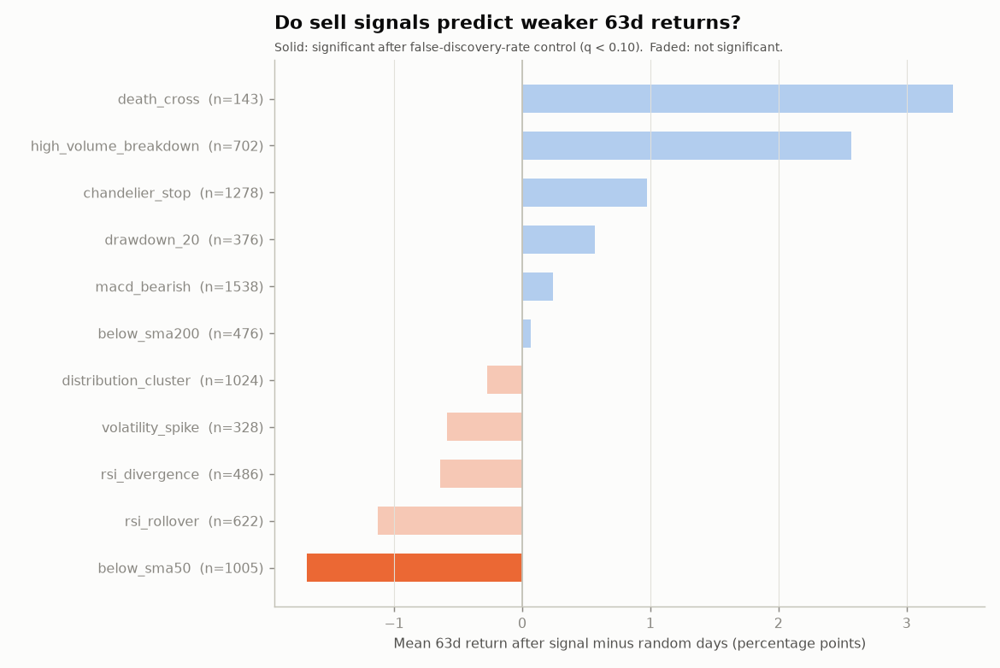
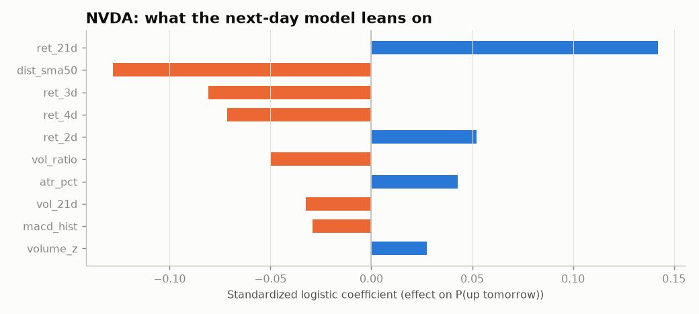
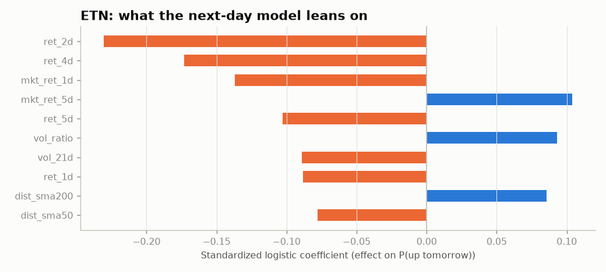

# stocklab report
Generated 2026-11-28 | data source: `yahoo` | history: 5 years | watchlist: ALAB, AMD, NVDA, MRVL, GOOG, FSLR, SKHY, ETN, TSLA, SPCX, AMZN, IBM, GEV, CEG, VST, DELL, TSM, BE

> Educational research code, not investment advice. Past results do not predict future returns.

## 1. Decision board

Data as of the 2026-11-27 close. `*` = provisional (under 200 trading days of history).

| ticker | action | close | 1 day | 1 month | buy rank | sell warnings | pullback entry | breakout | stop | why |
|---|---|---|---|---|---|---|---|---|---|---|
| AMZN | WATCH | 254.12 | +4.0% | -0.2% | 3/18 | 4/15 | 243.64 | 271.41 | 222.69 | +3% vs 200-day average; below 50-day, MACD bearish, distribution days, volatility spike |
| TSLA | WATCH | 400.00 | +5.2% | -1.0% | 6/18 | 4/15 | 381.98 | 404.63 | 342.61 | +5% vs 200-day average; death cross, distribution days, volatility spike |
| IBM | WATCH | 248.08 | +1.9% | -1.4% | 8/18 | 4/15 | 241.80 | 256.55 | 226.91 | +3% vs 200-day average; death cross, MACD bearish, 20%+ off high |
| AMD | REDUCE | 424.54 | +4.6% | -26.6% | 1/18 | 8/15 |  |  |  | -2% vs 200-day average; below 50-day, below 200-day, MACD bearish, 20%+ off high, volatility spike, below chandelier stop |
| DELL | REDUCE | 316.96 | +6.7% | -35.8% | 2/18 | 8/15 |  |  |  | -10% vs 200-day average; below 50-day, below 200-day, distribution days, 20%+ off high, volatility spike, below chandelier stop |
| MRVL | REDUCE | 140.54 | +7.3% | -44.2% | 5/18 | 8/15 |  |  |  | -26% vs 200-day average; below 50-day, below 200-day, distribution days, 20%+ off high, volatility spike, below chandelier stop |
| SPCX | REDUCE* | 133.59 | +4.8% | -8.0% | 7/18 | 4/10 |  |  |  | -9% vs 50-day average; below 50-day, MACD bearish, distribution days, 20%+ off high (provisional: 117 days of history) |
| BE | REDUCE | 163.02 | +6.6% | -28.5% | 15/18 | 8/15 |  |  |  | -27% vs 200-day average; below 50-day, below 200-day, MACD bearish, distribution days, 20%+ off high, below chandelier stop |
| ALAB | REDUCE | 206.84 | +8.7% | -30.4% | 16/18 | 8/15 |  |  |  | -20% vs 200-day average; below 50-day, below 200-day, distribution days, 20%+ off high, volatility spike, below chandelier stop |
| TSM | SELL | 353.34 | +3.2% | -19.6% | 4/18 | 9/15 |  |  |  | -12% vs 200-day average; below 50-day, below 200-day, MACD bearish, distribution days, 20%+ off high, volatility spike, below chandelier stop |
| ETN | SELL | 325.92 | +2.6% | -16.8% | 9/18 | 11/15 |  |  |  | -17% vs 200-day average; below 50-day, below 200-day, death cross, MACD bearish, distribution days, 20%+ off high, volatility spike, below chandelier stop |
| GEV | SELL | 735.31 | +2.8% | -16.3% | 10/18 | 10/15 |  |  |  | -23% vs 200-day average; below 50-day, below 200-day, death cross, MACD bearish, distribution days, 20%+ off high, below chandelier stop |
| GOOG | SELL | 272.44 | +0.5% | -15.4% | 11/18 | 10/15 |  |  |  | -18% vs 200-day average; below 50-day, below 200-day, death cross, distribution days, 20%+ off high, volatility spike, below chandelier stop |
| CEG | SELL | 238.10 | +1.2% | -7.6% | 12/18 | 10/15 |  |  |  | -14% vs 200-day average; below 50-day, below 200-day, death cross, MACD bearish, distribution days, 20%+ off high, below chandelier stop |
| NVDA | SELL | 150.49 | +0.8% | -30.1% | 13/18 | 11/15 |  |  |  | -26% vs 200-day average; below 50-day, below 200-day, death cross, MACD bearish, distribution days, 20%+ off high, volatility spike, below chandelier stop |
| VST | SELL | 122.65 | +1.1% | -14.1% | 14/18 | 11/15 |  |  |  | -18% vs 200-day average; below 50-day, below 200-day, death cross, MACD bearish, distribution days, 20%+ off high, volatility spike, below chandelier stop |
| SKHY | SELL* | 119.50 | +7.5% | -27.4% | 17/18 | 6/10 |  |  |  | -21% vs 50-day average; below 50-day, MACD bearish, distribution days, 20%+ off high, below chandelier stop (provisional: 99 days of history) |
| FSLR | SELL | 149.77 | +1.3% | -15.0% | 18/18 | 10/15 |  |  |  | -29% vs 200-day average; below 50-day, below 200-day, death cross, MACD bearish, distribution days, 20%+ off high, below chandelier stop |


**Trading the labels** (2022-02-23 to 2026-11-27): buy on BUY, exit on SELL, REDUCE or AVOID, reviewed weekly with next-day execution and 5 bp costs.

| strategy | CAGR | Volatility | Sharpe | Max drawdown | Time invested | Avg holdings |
|---|---|---|---|---|---|---|
| Board strategy | +35.1% | 34.3% | 1.05 | -39.1% | 98% | 6.4 |
| Equal-weight watchlist | +42.8% | 34.9% | 1.20 | -36.8% | 100% | 15.1 |
| SPY (buy & hold) | +13.4% | 17.5% | 0.81 | -22.1% |  |  |

Sharpe difference vs equal weight: -0.14, 95% block-bootstrap CI [-0.66, +0.27].

Forward 21-day return after each label, relative to the watchlist average on the same date (sampled every 21 days, t-test across dates):

| label | observations | dates | mean 21d excess return | hit rate | p_value |
|---|---|---|---|---|---|
| BUY | 216 | 51 | +1.0% | 53% | 0.39 |
| HOLD | 115 | 40 | +0.2% | 40% | 0.90 |
| WATCH | 187 | 51 | +0.4% | 49% | 0.66 |
| AVOID | 51 | 29 | -0.5% | 48% | 0.80 |
| REDUCE | 181 | 49 | -1.8% | 43% | 0.19 |
| SELL | 89 | 35 | +2.0% | 54% | 0.32 |


## 2. Sell check, stock by stock

```
ALAB  REDUCE  (score 8/15, close 206.84 on 2026-11-27)
  RSI 44 | -57.2% from 52-week high
  Triggered:
    - [trend] Close below the 50-day moving average (+1)
    - [trend] Close below the 200-day moving average (+2)
    - [volume] 5+ distribution days in the last 25 sessions (institutional selling) (+1)
    - [risk] 20%+ below the 52-week high (+1)
    - [risk] 21-day volatility 1.5x+ its 1-year median (+1)
    - [risk] Close below the chandelier stop (22-day high minus 3x ATR) (+2)
  Levels to watch:
    50-day SMA                 279.97  (price is below, -26.1%)
    200-day SMA                259.46  (price is below, -20.3%)
    Chandelier stop            223.32  (price is below, -7.4%)
```

```
AMD  REDUCE  (score 8/15, close 424.54 on 2026-11-27)
  RSI 41 | -34.6% from 52-week high
  Triggered:
    - [trend] Close below the 50-day moving average (+1)
    - [trend] Close below the 200-day moving average (+2)
    - [momentum] MACD line below its signal line (+1)
    - [risk] 20%+ below the 52-week high (+1)
    - [risk] 21-day volatility 1.5x+ its 1-year median (+1)
    - [risk] Close below the chandelier stop (22-day high minus 3x ATR) (+2)
  Levels to watch:
    50-day SMA                 545.94  (price is below, -22.2%)
    Chandelier stop            458.36  (price is below, -7.4%)
    200-day SMA                434.01  (price is below, -2.2%)
```

```
NVDA  EXIT  (score 11/15, close 150.49 on 2026-11-27)
  RSI 38 | -37.1% from 52-week high
  Triggered:
    - [trend] Close below the 50-day moving average (+1)
    - [trend] Close below the 200-day moving average (+2)
    - [trend] 50-day average below the 200-day average (+2)
    - [momentum] MACD line below its signal line (+1)
    - [volume] 5+ distribution days in the last 25 sessions (institutional selling) (+1)
    - [risk] 20%+ below the 52-week high (+1)
    - [risk] 21-day volatility 1.5x+ its 1-year median (+1)
    - [risk] Close below the chandelier stop (22-day high minus 3x ATR) (+2)
  Levels to watch:
    200-day SMA                202.43  (price is below, -25.7%)
    50-day SMA                 202.28  (price is below, -25.6%)
    Chandelier stop            181.30  (price is below, -17.0%)
```

```
MRVL  REDUCE  (score 8/15, close 140.54 on 2026-11-27)
  RSI 39 | -55.6% from 52-week high
  Triggered:
    - [trend] Close below the 50-day moving average (+1)
    - [trend] Close below the 200-day moving average (+2)
    - [volume] 5+ distribution days in the last 25 sessions (institutional selling) (+1)
    - [risk] 20%+ below the 52-week high (+1)
    - [risk] 21-day volatility 1.5x+ its 1-year median (+1)
    - [risk] Close below the chandelier stop (22-day high minus 3x ATR) (+2)
  Levels to watch:
    50-day SMA                 212.99  (price is below, -34.0%)
    Chandelier stop            204.95  (price is below, -31.4%)
    200-day SMA                189.64  (price is below, -25.9%)
```

```
GOOG  EXIT  (score 10/15, close 272.44 on 2026-11-27)
  RSI 37 | -31.6% from 52-week high
  Triggered:
    - [trend] Close below the 50-day moving average (+1)
    - [trend] Close below the 200-day moving average (+2)
    - [trend] 50-day average below the 200-day average (+2)
    - [volume] 5+ distribution days in the last 25 sessions (institutional selling) (+1)
    - [risk] 20%+ below the 52-week high (+1)
    - [risk] 21-day volatility 1.5x+ its 1-year median (+1)
    - [risk] Close below the chandelier stop (22-day high minus 3x ATR) (+2)
  Levels to watch:
    200-day SMA                333.69  (price is below, -18.4%)
    50-day SMA                 313.86  (price is below, -13.2%)
    Chandelier stop            289.21  (price is below, -5.8%)
```

```
FSLR  EXIT  (score 10/15, close 149.77 on 2026-11-27)
  RSI 37 | -52.9% from 52-week high
  Triggered:
    - [trend] Close below the 50-day moving average (+1)
    - [trend] Close below the 200-day moving average (+2)
    - [trend] 50-day average below the 200-day average (+2)
    - [momentum] MACD line below its signal line (+1)
    - [volume] 5+ distribution days in the last 25 sessions (institutional selling) (+1)
    - [risk] 20%+ below the 52-week high (+1)
    - [risk] Close below the chandelier stop (22-day high minus 3x ATR) (+2)
  Levels to watch:
    200-day SMA                209.59  (price is below, -28.5%)
    Chandelier stop            185.65  (price is below, -19.3%)
    50-day SMA                 174.75  (price is below, -14.3%)
```

```
SKHY  EXIT  (score 6/10, close 119.50 on 2026-11-27)
  RSI 43 | -39.8% from high since listing
  Only 99 trading days of history; not scored yet: below_sma200, death_cross, volatility_spike
  Triggered:
    - [trend] Close below the 50-day moving average (+1)
    - [momentum] MACD line below its signal line (+1)
    - [volume] 5+ distribution days in the last 25 sessions (institutional selling) (+1)
    - [risk] 20%+ below the high since listing (+1)
    - [risk] Close below the chandelier stop (22-day high minus 3x ATR) (+2)
  Levels to watch:
    50-day SMA                 152.18  (price is below, -21.5%)
    Chandelier stop            132.44  (price is below, -9.8%)
```

```
ETN  EXIT  (score 11/15, close 325.92 on 2026-11-27)
  RSI 41 | -28.9% from 52-week high
  Triggered:
    - [trend] Close below the 50-day moving average (+1)
    - [trend] Close below the 200-day moving average (+2)
    - [trend] 50-day average below the 200-day average (+2)
    - [momentum] MACD line below its signal line (+1)
    - [volume] 5+ distribution days in the last 25 sessions (institutional selling) (+1)
    - [risk] 20%+ below the 52-week high (+1)
    - [risk] 21-day volatility 1.5x+ its 1-year median (+1)
    - [risk] Close below the chandelier stop (22-day high minus 3x ATR) (+2)
  Levels to watch:
    200-day SMA                393.84  (price is below, -17.2%)
    50-day SMA                 385.97  (price is below, -15.6%)
    Chandelier stop            343.90  (price is below, -5.2%)
```

```
TSLA  WATCH  (score 4/15, close 400.00 on 2026-11-27)
  RSI 56 | -18.3% from 52-week high
  Triggered:
    - [trend] 50-day average below the 200-day average (+2)
    - [volume] 5+ distribution days in the last 25 sessions (institutional selling) (+1)
    - [risk] 21-day volatility 1.5x+ its 1-year median (+1)
  Levels to watch:
    200-day SMA                381.00  (price is above, +5.0%)
    50-day SMA                 377.84  (price is above, +5.9%)
    Chandelier stop            355.18  (price is above, +12.6%)
```

```
SPCX  REDUCE  (score 4/10, close 133.59 on 2026-11-27)
  RSI 46 | -36.8% from high since listing
  Only 117 trading days of history; not scored yet: below_sma200, death_cross, volatility_spike
  Triggered:
    - [trend] Close below the 50-day moving average (+1)
    - [momentum] MACD line below its signal line (+1)
    - [volume] 5+ distribution days in the last 25 sessions (institutional selling) (+1)
    - [risk] 20%+ below the high since listing (+1)
  Levels to watch:
    50-day SMA                 146.17  (price is below, -8.6%)
    Chandelier stop            121.36  (price is above, +10.1%)
```

```
AMZN  WATCH  (score 4/15, close 254.12 on 2026-11-27)
  RSI 49 | -10.5% from 52-week high
  Triggered:
    - [trend] Close below the 50-day moving average (+1)
    - [momentum] MACD line below its signal line (+1)
    - [volume] 5+ distribution days in the last 25 sessions (institutional selling) (+1)
    - [risk] 21-day volatility 1.5x+ its 1-year median (+1)
  Levels to watch:
    50-day SMA                 255.17  (price is below, -0.4%)
    200-day SMA                246.03  (price is above, +3.3%)
    Chandelier stop            243.91  (price is above, +4.2%)
```

```
IBM  WATCH  (score 4/15, close 248.08 on 2026-11-27)
  RSI 58 | -23.6% from 52-week high
  Triggered:
    - [trend] 50-day average below the 200-day average (+2)
    - [momentum] MACD line below its signal line (+1)
    - [risk] 20%+ below the 52-week high (+1)
  Levels to watch:
    200-day SMA                240.82  (price is above, +3.0%)
    50-day SMA                 235.89  (price is above, +5.2%)
    Chandelier stop            235.75  (price is above, +5.2%)
```

```
GEV  EXIT  (score 10/15, close 735.31 on 2026-11-27)
  RSI 41 | -37.4% from 52-week high
  Triggered:
    - [trend] Close below the 50-day moving average (+1)
    - [trend] Close below the 200-day moving average (+2)
    - [trend] 50-day average below the 200-day average (+2)
    - [momentum] MACD line below its signal line (+1)
    - [volume] 5+ distribution days in the last 25 sessions (institutional selling) (+1)
    - [risk] 20%+ below the 52-week high (+1)
    - [risk] Close below the chandelier stop (22-day high minus 3x ATR) (+2)
  Levels to watch:
    200-day SMA                949.82  (price is below, -22.6%)
    50-day SMA                 879.80  (price is below, -16.4%)
    Chandelier stop            770.52  (price is below, -4.6%)
```

```
CEG  EXIT  (score 10/15, close 238.10 on 2026-11-27)
  RSI 40 | -36.7% from 52-week high
  Triggered:
    - [trend] Close below the 50-day moving average (+1)
    - [trend] Close below the 200-day moving average (+2)
    - [trend] 50-day average below the 200-day average (+2)
    - [momentum] MACD line below its signal line (+1)
    - [volume] 5+ distribution days in the last 25 sessions (institutional selling) (+1)
    - [risk] 20%+ below the 52-week high (+1)
    - [risk] Close below the chandelier stop (22-day high minus 3x ATR) (+2)
  Levels to watch:
    200-day SMA                276.88  (price is below, -14.0%)
    50-day SMA                 264.34  (price is below, -9.9%)
    Chandelier stop            244.87  (price is below, -2.8%)
```

```
VST  EXIT  (score 11/15, close 122.65 on 2026-11-27)
  RSI 43 | -31.6% from 52-week high
  Triggered:
    - [trend] Close below the 50-day moving average (+1)
    - [trend] Close below the 200-day moving average (+2)
    - [trend] 50-day average below the 200-day average (+2)
    - [momentum] MACD line below its signal line (+1)
    - [volume] 5+ distribution days in the last 25 sessions (institutional selling) (+1)
    - [risk] 20%+ below the 52-week high (+1)
    - [risk] 21-day volatility 1.5x+ its 1-year median (+1)
    - [risk] Close below the chandelier stop (22-day high minus 3x ATR) (+2)
  Levels to watch:
    200-day SMA                150.29  (price is below, -18.4%)
    50-day SMA                 139.16  (price is below, -11.9%)
    Chandelier stop            126.42  (price is below, -3.0%)
```

```
DELL  REDUCE  (score 8/15, close 316.96 on 2026-11-27)
  RSI 41 | -46.1% from 52-week high
  Triggered:
    - [trend] Close below the 50-day moving average (+1)
    - [trend] Close below the 200-day moving average (+2)
    - [volume] 5+ distribution days in the last 25 sessions (institutional selling) (+1)
    - [risk] 20%+ below the 52-week high (+1)
    - [risk] 21-day volatility 1.5x+ its 1-year median (+1)
    - [risk] Close below the chandelier stop (22-day high minus 3x ATR) (+2)
  Levels to watch:
    50-day SMA                 451.06  (price is below, -29.7%)
    Chandelier stop            396.64  (price is below, -20.1%)
    200-day SMA                351.20  (price is below, -9.7%)
```

```
TSM  EXIT  (score 9/15, close 353.34 on 2026-11-27)
  RSI 42 | -27.3% from 52-week high
  Triggered:
    - [trend] Close below the 50-day moving average (+1)
    - [trend] Close below the 200-day moving average (+2)
    - [momentum] MACD line below its signal line (+1)
    - [volume] 5+ distribution days in the last 25 sessions (institutional selling) (+1)
    - [risk] 20%+ below the 52-week high (+1)
    - [risk] 21-day volatility 1.5x+ its 1-year median (+1)
    - [risk] Close below the chandelier stop (22-day high minus 3x ATR) (+2)
  Levels to watch:
    50-day SMA                 416.72  (price is below, -15.2%)
    200-day SMA                402.14  (price is below, -12.1%)
    Chandelier stop            374.10  (price is below, -5.5%)
```

```
BE  REDUCE  (score 8/15, close 163.02 on 2026-11-27)
  RSI 42 | -52.9% from 52-week high
  Triggered:
    - [trend] Close below the 50-day moving average (+1)
    - [trend] Close below the 200-day moving average (+2)
    - [momentum] MACD line below its signal line (+1)
    - [volume] 5+ distribution days in the last 25 sessions (institutional selling) (+1)
    - [risk] 20%+ below the 52-week high (+1)
    - [risk] Close below the chandelier stop (22-day high minus 3x ATR) (+2)
  Levels to watch:
    50-day SMA                 225.49  (price is below, -27.7%)
    200-day SMA                224.08  (price is below, -27.2%)
    Chandelier stop            169.43  (price is below, -3.8%)
```

## 3. Which sell signals actually work? (event study)

Panel: 46 stocks, 5 years. Null hypothesis: returns after a signal look like returns on random days from the same stocks.

| rule | horizon | events | mean_after_signal | mean_random_days | difference | p_value | q_value | drop10_after_signal | drop10_base_rate | verdict |
|---|---|---|---|---|---|---|---|---|---|---|
| below_sma50 | 5d | 1082 | +0.16% | +0.66% | -0.49% | 0.005 | 0.082 | 40% | 36% | useful |
| below_sma50 | 21d | 1061 | +2.09% | +3.06% | -0.98% | 0.008 | 0.093 | 40% | 36% | useful |
| below_sma50 | 63d | 1006 | +8.57% | +10.06% | -1.49% | 0.032 | 0.176 | 40% | 36% | weak (not significant) |
| below_sma200 | 5d | 525 | +0.28% | +0.60% | -0.32% | 0.110 | 0.445 | 39% | 36% | weak (not significant) |
| below_sma200 | 21d | 507 | +0.99% | +2.75% | -1.77% | 0.001 | 0.049 | 39% | 36% | useful |
| below_sma200 | 63d | 476 | +9.57% | +9.00% | +0.57% | 0.696 | 0.946 | 39% | 36% | no edge |
| death_cross | 5d | 156 | -0.25% | +0.65% | -0.89% | 0.038 | 0.179 | 43% | 36% | weak (not significant) |
| death_cross | 21d | 152 | +0.85% | +2.90% | -2.06% | 0.021 | 0.142 | 43% | 36% | weak (not significant) |
| death_cross | 63d | 142 | +14.55% | +9.49% | +5.06% | 0.984 | 1.000 | 43% | 36% | no edge |
| rsi_divergence | 5d | 503 | +0.43% | +0.75% | -0.32% | 0.121 | 0.445 | 37% | 36% | weak (not significant) |
| rsi_divergence | 21d | 496 | +3.17% | +3.45% | -0.28% | 0.324 | 0.765 | 37% | 36% | weak (not significant) |
| rsi_divergence | 63d | 487 | +10.94% | +11.55% | -0.60% | 0.301 | 0.764 | 37% | 36% | weak (not significant) |
| rsi_rollover | 5d | 648 | +1.83% | +0.72% | +1.10% | 1.000 | 1.000 | 33% | 36% | no edge |
| rsi_rollover | 21d | 641 | +3.67% | +3.35% | +0.32% | 0.727 | 0.946 | 33% | 36% | no edge |
| rsi_rollover | 63d | 624 | +10.39% | +11.42% | -1.03% | 0.165 | 0.544 | 33% | 36% | weak (not significant) |
| macd_bearish | 5d | 1638 | +0.73% | +0.68% | +0.05% | 0.638 | 0.946 | 36% | 36% | no edge |
| macd_bearish | 21d | 1605 | +3.25% | +3.20% | +0.05% | 0.563 | 0.946 | 36% | 36% | no edge |
| macd_bearish | 63d | 1543 | +11.11% | +10.67% | +0.44% | 0.745 | 0.946 | 36% | 36% | no edge |
| distribution_cluster | 5d | 1080 | +1.02% | +0.69% | +0.33% | 0.958 | 1.000 | 35% | 36% | no edge |
| distribution_cluster | 21d | 1067 | +2.91% | +3.21% | -0.29% | 0.253 | 0.695 | 35% | 36% | weak (not significant) |
| distribution_cluster | 63d | 1022 | +10.13% | +10.72% | -0.60% | 0.236 | 0.695 | 35% | 36% | weak (not significant) |
| high_volume_breakdown | 5d | 766 | +0.78% | +0.65% | +0.14% | 0.730 | 0.946 | 34% | 36% | no edge |
| high_volume_breakdown | 21d | 732 | +3.61% | +3.03% | +0.58% | 0.879 | 1.000 | 34% | 36% | no edge |
| high_volume_breakdown | 63d | 698 | +12.62% | +9.98% | +2.64% | 0.996 | 1.000 | 34% | 36% | no edge |
| drawdown_20 | 5d | 407 | +1.23% | +0.79% | +0.44% | 0.893 | 1.000 | 52% | 36% | no edge |
| drawdown_20 | 21d | 400 | +2.13% | +3.70% | -1.56% | 0.020 | 0.142 | 52% | 36% | weak (not significant) |
| drawdown_20 | 63d | 376 | +13.73% | +12.71% | +1.01% | 0.733 | 0.946 | 52% | 36% | no edge |
| volatility_spike | 5d | 352 | +0.89% | +0.73% | +0.16% | 0.691 | 0.946 | 47% | 36% | no edge |
| volatility_spike | 21d | 330 | +3.15% | +3.34% | -0.19% | 0.405 | 0.786 | 47% | 36% | weak (not significant) |
| volatility_spike | 63d | 328 | +10.77% | +11.26% | -0.49% | 0.374 | 0.786 | 47% | 36% | weak (not significant) |
| chandelier_stop | 5d | 1369 | +0.64% | +0.69% | -0.05% | 0.395 | 0.786 | 37% | 36% | weak (not significant) |
| chandelier_stop | 21d | 1342 | +3.33% | +3.20% | +0.13% | 0.648 | 0.946 | 37% | 36% | no edge |
| chandelier_stop | 63d | 1284 | +11.82% | +10.68% | +1.14% | 0.936 | 1.000 | 37% | 36% | no edge |

**3 of 33 rule-by-horizon tests** show significantly weaker returns after the signal (q < 0.10).



## 4. Strategy backtests

Not included: SKHY (only 99 trading days of history, needs 452); SPCX (only 117 trading days of history, needs 452).

### ALAB (2025-01-03 to 2026-11-27)

| strategy | Total return | CAGR | Max drawdown | Volatility | Sharpe | Round trips | Time in market | Sharpe vs B&H | 95% CI | p-value |
|---|---|---|---|---|---|---|---|---|---|---|
| Buy & Hold | +43.9% | +21.2% | -63.2% | +99.2% | 0.69 | 0 | 100% |  |  |  |
| 50/200 SMA cross | -68.4% | -45.6% | -74.0% | +90.2% | -0.22 | 2 | 76% | -0.91 | [-1.76, -0.22] | 0.02 |
| Close > 50-day SMA | +7.6% | +4.0% | -66.4% | +69.2% | 0.40 | 10 | 51% | -0.29 | [-1.35, +0.66] | 0.56 |
| MACD > signal | +32.7% | +16.1% | -70.4% | +67.8% | 0.56 | 23 | 50% | -0.13 | [-1.28, +1.06] | 0.82 |
| RSI 30/70 | +6.0% | +3.1% | -50.3% | +44.4% | 0.29 | 1 | 18% | -0.40 | [-2.06, +1.21] | 0.61 |
| Trailing stop 20% | -11.8% | -6.4% | -69.1% | +71.1% | 0.26 | 10 | 55% | -0.43 | [-1.45, +0.52] | 0.41 |
| Volume breakout | +91.8% | +41.1% | -55.7% | +62.5% | 0.86 | 4 | 40% | +0.17 | [-1.00, +1.26] | 0.77 |

### AMD (2022-09-14 to 2026-11-27)

| strategy | Total return | CAGR | Max drawdown | Volatility | Sharpe | Round trips | Time in market | Sharpe vs B&H | 95% CI | p-value |
|---|---|---|---|---|---|---|---|---|---|---|
| Buy & Hold | +453.5% | +50.4% | -63.0% | +59.2% | 0.98 | 0 | 100% |  |  |  |
| 50/200 SMA cross | +298.0% | +39.0% | -39.1% | +50.0% | 0.91 | 1 | 66% | -0.08 | [-0.60, +0.44] | 0.77 |
| Close > 50-day SMA | +147.4% | +24.1% | -49.9% | +44.0% | 0.71 | 37 | 54% | -0.28 | [-0.86, +0.37] | 0.37 |
| MACD > signal | +242.9% | +34.2% | -42.4% | +42.6% | 0.90 | 40 | 51% | -0.08 | [-0.60, +0.43] | 0.74 |
| RSI 30/70 | +23.1% | +5.1% | -54.7% | +34.1% | 0.31 | 3 | 34% | -0.67 | [-1.66, +0.18] | 0.15 |
| Trailing stop 20% | +103.4% | +18.5% | -58.9% | +50.9% | 0.59 | 12 | 72% | -0.40 | [-0.89, +0.06] | 0.12 |
| Volume breakout | +161.9% | +25.8% | -36.9% | +37.2% | 0.80 | 11 | 38% | -0.18 | [-0.82, +0.49] | 0.59 |

### NVDA (2022-09-14 to 2026-11-27)

| strategy | Total return | CAGR | Max drawdown | Volatility | Sharpe | Round trips | Time in market | Sharpe vs B&H | 95% CI | p-value |
|---|---|---|---|---|---|---|---|---|---|---|
| Buy & Hold | +1067.6% | +79.8% | -47.5% | +51.7% | 1.39 | 0 | 100% |  |  |  |
| 50/200 SMA cross | +481.2% | +52.2% | -47.5% | +46.6% | 1.13 | 1 | 85% | -0.26 | [-0.70, +0.14] | 0.21 |
| Close > 50-day SMA | +346.8% | +42.9% | -39.1% | +39.0% | 1.11 | 38 | 69% | -0.28 | [-0.89, +0.35] | 0.40 |
| MACD > signal | +152.9% | +24.8% | -46.7% | +34.4% | 0.81 | 40 | 51% | -0.57 | [-1.38, +0.19] | 0.14 |
| RSI 30/70 | +45.8% | +9.4% | -33.1% | +24.8% | 0.48 | 2 | 7% | -0.91 | [-1.79, +0.02] | 0.05 |
| Trailing stop 20% | +806.2% | +69.2% | -36.6% | +45.0% | 1.39 | 7 | 91% | +0.00 | [-0.40, +0.37] | 0.99 |
| Volume breakout | +211.5% | +31.1% | -19.8% | +26.3% | 1.16 | 7 | 31% | -0.23 | [-1.06, +0.58] | 0.61 |

### MRVL (2022-09-14 to 2026-11-27)

| strategy | Total return | CAGR | Max drawdown | Volatility | Sharpe | Round trips | Time in market | Sharpe vs B&H | 95% CI | p-value |
|---|---|---|---|---|---|---|---|---|---|---|
| Buy & Hold | +205.5% | +30.5% | -61.3% | +68.4% | 0.73 | 0 | 100% |  |  |  |
| 50/200 SMA cross | +36.8% | +7.8% | -65.2% | +59.0% | 0.42 | 2 | 69% | -0.31 | [-0.77, +0.12] | 0.17 |
| Close > 50-day SMA | +65.8% | +12.8% | -51.5% | +52.7% | 0.49 | 36 | 57% | -0.24 | [-0.86, +0.34] | 0.42 |
| MACD > signal | +101.6% | +18.2% | -62.5% | +50.2% | 0.58 | 44 | 51% | -0.15 | [-0.91, +0.48] | 0.69 |
| RSI 30/70 | +46.3% | +9.5% | -32.1% | +31.9% | 0.45 | 2 | 20% | -0.28 | [-1.15, +0.68] | 0.55 |
| Trailing stop 20% | +73.0% | +14.0% | -53.3% | +56.8% | 0.51 | 15 | 76% | -0.22 | [-0.71, +0.27] | 0.36 |
| Volume breakout | +76.0% | +14.4% | -46.2% | +42.0% | 0.53 | 11 | 36% | -0.20 | [-1.10, +0.58] | 0.62 |

### GOOG (2022-09-14 to 2026-11-27)

| strategy | Total return | CAGR | Max drawdown | Volatility | Sharpe | Round trips | Time in market | Sharpe vs B&H | 95% CI | p-value |
|---|---|---|---|---|---|---|---|---|---|---|
| Buy & Hold | +164.6% | +26.1% | -33.8% | +31.8% | 0.89 | 0 | 100% |  |  |  |
| 50/200 SMA cross | +151.5% | +24.6% | -29.4% | +25.9% | 0.98 | 2 | 76% | +0.09 | [-0.40, +0.58] | 0.71 |
| Close > 50-day SMA | +85.6% | +15.9% | -22.2% | +23.6% | 0.74 | 34 | 63% | -0.15 | [-0.80, +0.52] | 0.67 |
| MACD > signal | +27.9% | +6.1% | -25.4% | +21.9% | 0.38 | 43 | 50% | -0.51 | [-1.16, +0.16] | 0.13 |
| RSI 30/70 | +24.3% | +5.3% | -20.4% | +18.6% | 0.37 | 4 | 26% | -0.52 | [-1.25, +0.32] | 0.21 |
| Trailing stop 20% | +57.9% | +11.5% | -40.4% | +29.5% | 0.52 | 6 | 91% | -0.37 | [-0.82, -0.01] | 0.06 |
| Volume breakout | +105.6% | +18.8% | -17.4% | +19.4% | 0.98 | 8 | 46% | +0.09 | [-0.71, +0.93] | 0.82 |

### FSLR (2022-09-14 to 2026-11-27)

| strategy | Total return | CAGR | Max drawdown | Volatility | Sharpe | Round trips | Time in market | Sharpe vs B&H | 95% CI | p-value |
|---|---|---|---|---|---|---|---|---|---|---|
| Buy & Hold | +13.4% | +3.0% | -60.0% | +55.4% | 0.33 | 0 | 100% |  |  |  |
| 50/200 SMA cross | +6.5% | +1.5% | -51.1% | +41.6% | 0.24 | 4 | 58% | -0.09 | [-0.72, +0.45] | 0.78 |
| Close > 50-day SMA | +25.9% | +5.6% | -46.8% | +40.2% | 0.33 | 29 | 49% | +0.01 | [-0.58, +0.54] | 0.98 |
| MACD > signal | -60.5% | -19.9% | -74.1% | +40.7% | -0.34 | 48 | 49% | -0.67 | [-1.31, -0.05] | 0.04 |
| RSI 30/70 | +28.2% | +6.1% | -42.8% | +30.9% | 0.34 | 2 | 28% | +0.01 | [-0.92, +0.78] | 0.98 |
| Trailing stop 20% | -4.6% | -1.1% | -57.9% | +45.3% | 0.20 | 12 | 68% | -0.13 | [-0.63, +0.37] | 0.61 |
| Volume breakout | -18.0% | -4.6% | -53.8% | +31.5% | 0.01 | 13 | 35% | -0.32 | [-1.19, +0.45] | 0.43 |

### ETN (2022-09-14 to 2026-11-27)

| strategy | Total return | CAGR | Max drawdown | Volatility | Sharpe | Round trips | Time in market | Sharpe vs B&H | 95% CI | p-value |
|---|---|---|---|---|---|---|---|---|---|---|
| Buy & Hold | +145.0% | +23.8% | -34.5% | +34.4% | 0.80 | 0 | 100% |  |  |  |
| 50/200 SMA cross | +47.6% | +9.7% | -38.7% | +30.6% | 0.46 | 3 | 84% | -0.34 | [-0.73, +0.01] | 0.08 |
| Close > 50-day SMA | +35.3% | +7.5% | -37.5% | +24.4% | 0.42 | 44 | 65% | -0.38 | [-1.01, +0.29] | 0.24 |
| MACD > signal | +36.8% | +7.8% | -25.8% | +22.3% | 0.45 | 48 | 50% | -0.35 | [-1.09, +0.36] | 0.32 |
| RSI 30/70 | +15.7% | +3.5% | -18.6% | +11.5% | 0.36 | 1 | 5% | -0.44 | [-1.40, +0.66] | 0.39 |
| Trailing stop 20% | +178.3% | +27.7% | -23.6% | +30.8% | 0.95 | 2 | 94% | +0.15 | [-0.10, +0.44] | 0.28 |
| Volume breakout | +21.6% | +4.8% | -29.3% | +18.1% | 0.35 | 10 | 38% | -0.45 | [-1.26, +0.45] | 0.33 |

### TSLA (2022-09-14 to 2026-11-27)

| strategy | Total return | CAGR | Max drawdown | Volatility | Sharpe | Round trips | Time in market | Sharpe vs B&H | 95% CI | p-value |
|---|---|---|---|---|---|---|---|---|---|---|
| Buy & Hold | +31.6% | +6.8% | -65.0% | +58.6% | 0.40 | 0 | 100% |  |  |  |
| 50/200 SMA cross | -26.4% | -7.1% | -56.8% | +40.1% | 0.01 | 4 | 47% | -0.39 | [-1.20, +0.52] | 0.36 |
| Close > 50-day SMA | +38.5% | +8.1% | -41.1% | +38.6% | 0.39 | 43 | 52% | -0.01 | [-0.75, +0.82] | 0.98 |
| MACD > signal | +377.5% | +45.2% | -39.8% | +40.8% | 1.11 | 42 | 50% | +0.71 | [+0.01, +1.40] | 0.05 |
| RSI 30/70 | +55.3% | +11.1% | -52.7% | +40.9% | 0.46 | 4 | 43% | +0.06 | [-0.73, +0.78] | 0.89 |
| Trailing stop 20% | +34.2% | +7.3% | -47.9% | +45.4% | 0.38 | 11 | 71% | -0.02 | [-0.65, +0.60] | 0.95 |
| Volume breakout | +40.5% | +8.4% | -35.4% | +25.7% | 0.44 | 9 | 18% | +0.04 | [-0.88, +1.05] | 0.93 |

### AMZN (2022-09-14 to 2026-11-27)

| strategy | Total return | CAGR | Max drawdown | Volatility | Sharpe | Round trips | Time in market | Sharpe vs B&H | 95% CI | p-value |
|---|---|---|---|---|---|---|---|---|---|---|
| Buy & Hold | +101.1% | +18.1% | -35.2% | +34.1% | 0.66 | 0 | 100% |  |  |  |
| 50/200 SMA cross | +30.7% | +6.6% | -41.4% | +28.2% | 0.37 | 2 | 75% | -0.29 | [-0.89, +0.33] | 0.33 |
| Close > 50-day SMA | +23.9% | +5.2% | -43.9% | +23.3% | 0.34 | 35 | 63% | -0.32 | [-0.99, +0.38] | 0.38 |
| MACD > signal | -4.7% | -1.2% | -28.7% | +23.1% | 0.07 | 51 | 50% | -0.59 | [-1.35, +0.12] | 0.09 |
| RSI 30/70 | +94.0% | +17.1% | -22.0% | +21.6% | 0.84 | 4 | 33% | +0.18 | [-0.57, +0.91] | 0.62 |
| Trailing stop 20% | +75.6% | +14.4% | -27.1% | +30.4% | 0.59 | 3 | 88% | -0.07 | [-0.41, +0.25] | 0.70 |
| Volume breakout | +2.1% | +0.5% | -38.8% | +19.2% | 0.12 | 12 | 46% | -0.54 | [-1.44, +0.36] | 0.25 |

### IBM (2022-09-14 to 2026-11-27)

| strategy | Total return | CAGR | Max drawdown | Volatility | Sharpe | Round trips | Time in market | Sharpe vs B&H | 95% CI | p-value |
|---|---|---|---|---|---|---|---|---|---|---|
| Buy & Hold | +129.2% | +21.9% | -37.5% | +31.7% | 0.79 | 0 | 100% |  |  |  |
| 50/200 SMA cross | +67.7% | +13.1% | -28.7% | +22.7% | 0.66 | 3 | 72% | -0.13 | [-0.84, +0.56] | 0.71 |
| Close > 50-day SMA | +46.2% | +9.5% | -43.2% | +25.3% | 0.49 | 28 | 60% | -0.30 | [-0.79, +0.30] | 0.26 |
| MACD > signal | +112.3% | +19.7% | -43.1% | +23.9% | 0.88 | 30 | 50% | +0.09 | [-0.48, +0.89] | 0.81 |
| RSI 30/70 | +175.4% | +27.3% | -16.5% | +17.4% | 1.48 | 8 | 35% | +0.69 | [-0.26, +1.59] | 0.15 |
| Trailing stop 20% | +74.0% | +14.1% | -45.9% | +30.4% | 0.59 | 3 | 92% | -0.20 | [-0.46, +0.00] | 0.10 |
| Volume breakout | +54.7% | +11.0% | -30.2% | +17.2% | 0.69 | 11 | 40% | -0.10 | [-1.03, +0.82] | 0.83 |

### GEV (2025-01-13 to 2026-11-27)

| strategy | Total return | CAGR | Max drawdown | Volatility | Sharpe | Round trips | Time in market | Sharpe vs B&H | 95% CI | p-value |
|---|---|---|---|---|---|---|---|---|---|---|
| Buy & Hold | +93.0% | +42.1% | -40.4% | +56.4% | 0.91 | 0 | 100% |  |  |  |
| 50/200 SMA cross | +133.0% | +57.1% | -38.3% | +54.2% | 1.11 | 1 | 95% | +0.20 | [-0.03, +0.58] | 0.16 |
| Close > 50-day SMA | +79.1% | +36.5% | -32.7% | +43.3% | 0.94 | 15 | 62% | +0.03 | [-0.61, +0.65] | 0.91 |
| MACD > signal | +60.6% | +28.8% | -31.0% | +41.5% | 0.82 | 17 | 47% | -0.09 | [-0.87, +0.76] | 0.82 |
| RSI 30/70 | +14.5% | +7.5% | -40.4% | +36.0% | 0.38 | 1 | 33% | -0.53 | [-1.61, +0.62] | 0.37 |
| Trailing stop 20% | +44.2% | +21.6% | -45.9% | +49.5% | 0.64 | 5 | 85% | -0.26 | [-0.81, +0.32] | 0.33 |
| Volume breakout | +24.5% | +12.4% | -24.6% | +33.1% | 0.52 | 3 | 35% | -0.38 | [-1.52, +0.82] | 0.55 |

### CEG (2022-11-02 to 2026-11-27)

| strategy | Total return | CAGR | Max drawdown | Volatility | Sharpe | Round trips | Time in market | Sharpe vs B&H | 95% CI | p-value |
|---|---|---|---|---|---|---|---|---|---|---|
| Buy & Hold | +160.3% | +26.6% | -50.7% | +49.4% | 0.72 | 0 | 100% |  |  |  |
| 50/200 SMA cross | +96.8% | +18.2% | -50.7% | +43.3% | 0.60 | 3 | 71% | -0.12 | [-0.59, +0.28] | 0.56 |
| Close > 50-day SMA | +128.2% | +22.6% | -43.6% | +37.2% | 0.73 | 49 | 57% | +0.01 | [-0.51, +0.59] | 0.98 |
| MACD > signal | +18.2% | +4.2% | -48.1% | +37.1% | 0.29 | 42 | 49% | -0.43 | [-1.04, +0.20] | 0.17 |
| RSI 30/70 | +76.4% | +15.0% | -28.7% | +32.6% | 0.59 | 3 | 38% | -0.13 | [-0.88, +0.62] | 0.72 |
| Trailing stop 20% | +69.2% | +13.9% | -56.7% | +43.9% | 0.51 | 9 | 84% | -0.21 | [-0.63, +0.22] | 0.34 |
| Volume breakout | +86.0% | +16.6% | -30.0% | +30.5% | 0.65 | 9 | 39% | -0.07 | [-0.75, +0.65] | 0.84 |

### VST (2022-09-14 to 2026-11-27)

| strategy | Total return | CAGR | Max drawdown | Volatility | Sharpe | Round trips | Time in market | Sharpe vs B&H | 95% CI | p-value |
|---|---|---|---|---|---|---|---|---|---|---|
| Buy & Hold | +414.7% | +47.8% | -48.8% | +52.3% | 1.01 | 0 | 100% |  |  |  |
| 50/200 SMA cross | +412.0% | +47.7% | -48.8% | +43.9% | 1.11 | 3 | 67% | +0.10 | [-0.25, +0.52] | 0.60 |
| Close > 50-day SMA | +47.1% | +9.6% | -67.2% | +37.9% | 0.44 | 45 | 63% | -0.58 | [-1.22, +0.07] | 0.08 |
| MACD > signal | +61.8% | +12.2% | -49.0% | +37.2% | 0.50 | 48 | 51% | -0.51 | [-1.13, +0.16] | 0.12 |
| RSI 30/70 | +176.1% | +27.4% | -27.3% | +27.3% | 1.02 | 3 | 21% | +0.01 | [-0.89, +0.75] | 0.99 |
| Trailing stop 20% | +209.0% | +30.9% | -56.3% | +44.5% | 0.83 | 9 | 87% | -0.18 | [-0.63, +0.28] | 0.47 |
| Volume breakout | +278.5% | +37.4% | -31.2% | +31.4% | 1.18 | 9 | 43% | +0.16 | [-0.61, +1.12] | 0.71 |

### DELL (2022-09-14 to 2026-11-27)

| strategy | Total return | CAGR | Max drawdown | Volatility | Sharpe | Round trips | Time in market | Sharpe vs B&H | 95% CI | p-value |
|---|---|---|---|---|---|---|---|---|---|---|
| Buy & Hold | +814.0% | +69.6% | -59.6% | +59.6% | 1.18 | 0 | 100% |  |  |  |
| 50/200 SMA cross | +380.3% | +45.4% | -52.7% | +52.6% | 0.97 | 3 | 69% | -0.21 | [-0.68, +0.21] | 0.36 |
| Close > 50-day SMA | +1326.9% | +88.6% | -27.5% | +49.3% | 1.52 | 21 | 67% | +0.35 | [-0.15, +0.88] | 0.20 |
| MACD > signal | +141.4% | +23.4% | -57.7% | +43.1% | 0.69 | 45 | 52% | -0.48 | [-1.18, +0.13] | 0.17 |
| RSI 30/70 | +156.9% | +25.3% | -25.6% | +29.8% | 0.90 | 4 | 28% | -0.28 | [-1.15, +0.57] | 0.55 |
| Trailing stop 20% | +979.0% | +76.4% | -55.9% | +51.4% | 1.35 | 7 | 81% | +0.18 | [-0.26, +0.63] | 0.41 |
| Volume breakout | +378.1% | +45.3% | -37.8% | +43.2% | 1.07 | 11 | 45% | -0.11 | [-0.83, +0.52] | 0.74 |

### TSM (2022-09-14 to 2026-11-27)

| strategy | Total return | CAGR | Max drawdown | Volatility | Sharpe | Round trips | Time in market | Sharpe vs B&H | 95% CI | p-value |
|---|---|---|---|---|---|---|---|---|---|---|
| Buy & Hold | +381.0% | +45.5% | -36.8% | +40.4% | 1.13 | 0 | 100% |  |  |  |
| 50/200 SMA cross | +142.6% | +23.5% | -36.8% | +37.2% | 0.75 | 2 | 82% | -0.38 | [-0.90, +0.09] | 0.13 |
| Close > 50-day SMA | +190.3% | +29.0% | -28.8% | +31.5% | 0.96 | 37 | 68% | -0.17 | [-0.71, +0.38] | 0.58 |
| MACD > signal | +118.0% | +20.4% | -32.1% | +28.6% | 0.79 | 45 | 49% | -0.34 | [-0.96, +0.27] | 0.28 |
| RSI 30/70 | +29.4% | +6.3% | -23.0% | +19.3% | 0.41 | 3 | 13% | -0.72 | [-1.60, +0.24] | 0.12 |
| Trailing stop 20% | +217.3% | +31.7% | -30.6% | +36.8% | 0.93 | 6 | 91% | -0.20 | [-0.60, +0.18] | 0.30 |
| Volume breakout | +77.0% | +14.6% | -26.8% | +26.4% | 0.65 | 11 | 46% | -0.48 | [-1.28, +0.31] | 0.22 |

### BE (2022-09-14 to 2026-11-27)

| strategy | Total return | CAGR | Max drawdown | Volatility | Sharpe | Round trips | Time in market | Sharpe vs B&H | 95% CI | p-value |
|---|---|---|---|---|---|---|---|---|---|---|
| Buy & Hold | +529.8% | +55.1% | -66.9% | +90.8% | 0.92 | 0 | 100% |  |  |  |
| 50/200 SMA cross | +191.8% | +29.1% | -71.0% | +75.9% | 0.71 | 4 | 63% | -0.21 | [-0.81, +0.34] | 0.47 |
| Close > 50-day SMA | +351.5% | +43.3% | -51.6% | +69.5% | 0.84 | 31 | 51% | -0.08 | [-0.65, +0.43] | 0.80 |
| MACD > signal | +182.3% | +28.1% | -60.0% | +65.9% | 0.68 | 42 | 50% | -0.24 | [-0.96, +0.40] | 0.49 |
| RSI 30/70 | +147.7% | +24.2% | -61.8% | +47.0% | 0.69 | 4 | 47% | -0.23 | [-1.09, +0.70] | 0.61 |
| Trailing stop 20% | +148.9% | +24.3% | -65.7% | +73.6% | 0.64 | 19 | 60% | -0.28 | [-0.80, +0.24] | 0.27 |
| Volume breakout | +275.5% | +37.1% | -58.1% | +60.9% | 0.80 | 11 | 30% | -0.12 | [-0.93, +0.59] | 0.76 |


## 5. Next-day forecasts

Not included: SKHY (only 99 trading days of history, needs 452); SPCX (only 117 trading days of history, needs 452).

### ALAB

Walk-forward test on 224 unseen days (2026-01-07 to 2026-11-25).

| model | accuracy | always-majority accuracy | p (beats majority) | AUC | Brier | strategy Sharpe | buy & hold Sharpe |
|---|---|---|---|---|---|---|---|
| Majority class (baseline) | 0.518 | 0.518 | 0.527 | 0.461 | 0.25 | 0.765 | 0.765 |
| Logistic regression | 0.5 | 0.518 | 0.726 | 0.509 | 0.256 | 0.457 | 0.765 |
| Gradient boosting | 0.482 | 0.518 | 0.872 | 0.468 | 0.28 | 0.538 | 0.765 |

| model | RMSE (bps) | R2 out-of-sample vs zero | direction hit rate | DM p (beats zero) |
|---|---|---|---|---|
| Zero / random walk (baseline) | 673.5 | 0.0 |  |  |
| Ridge regression | 685.9 | -0.037 | 0.478 | 0.867 |
| Gradient boosting | 703.6 | -0.0914 | 0.455 | 0.988 |

Forecast for the next session:

```
  P(up) | Logistic regression      40.2%
  P(up) | Gradient boosting        45.6%
  P(up) | historical base rate     51.7%
  expected return (ridge)          +0.34%
  80% range low                    -11.93%
  80% range high                   +14.32%
  daily volatility                 +10.18%
```

Best out-of-sample AUC **0.509**; smallest p-value against a naive baseline 0.726, before correcting for the four models tested here and the other stocks (the corrected count is in the summary).


### AMD

Walk-forward test on 551 unseen days (2024-09-17 to 2026-11-25).

| model | accuracy | always-majority accuracy | p (beats majority) | AUC | Brier | strategy Sharpe | buy & hold Sharpe |
|---|---|---|---|---|---|---|---|
| Majority class (baseline) | 0.514 | 0.528 | 0.766 | 0.486 | 0.25 | 1.008 | 1.04 |
| Logistic regression | 0.492 | 0.528 | 0.96 | 0.489 | 0.257 | 0.414 | 1.04 |
| Gradient boosting | 0.514 | 0.528 | 0.766 | 0.497 | 0.267 | 1.031 | 1.04 |

| model | RMSE (bps) | R2 out-of-sample vs zero | direction hit rate | DM p (beats zero) |
|---|---|---|---|---|
| Zero / random walk (baseline) | 415.2 | 0.0 |  |  |
| Ridge regression | 418.8 | -0.0172 | 0.477 | 0.816 |
| Gradient boosting | 423.3 | -0.0392 | 0.488 | 0.969 |

Forecast for the next session:

```
  P(up) | Logistic regression      58.4%
  P(up) | Gradient boosting        61.2%
  P(up) | historical base rate     51.5%
  expected return (ridge)          +1.04%
  80% range low                    -9.36%
  80% range high                   +12.64%
  daily volatility                 +8.48%
```

Best out-of-sample AUC **0.497**; smallest p-value against a naive baseline 0.766, before correcting for the four models tested here and the other stocks (the corrected count is in the summary).


### NVDA

Walk-forward test on 551 unseen days (2024-09-17 to 2026-11-25).

| model | accuracy | always-majority accuracy | p (beats majority) | AUC | Brier | strategy Sharpe | buy & hold Sharpe |
|---|---|---|---|---|---|---|---|
| Majority class (baseline) | 0.517 | 0.517 | 0.517 | 0.51 | 0.251 | 0.487 | 0.487 |
| Logistic regression | 0.505 | 0.517 | 0.739 | 0.508 | 0.256 | 0.379 | 0.487 |
| Gradient boosting | 0.503 | 0.517 | 0.766 | 0.473 | 0.269 | 0.803 | 0.487 |

| model | RMSE (bps) | R2 out-of-sample vs zero | direction hit rate | DM p (beats zero) |
|---|---|---|---|---|
| Zero / random walk (baseline) | 309.6 | 0.0 |  |  |
| Ridge regression | 310.3 | -0.0044 | 0.51 | 0.558 |
| Gradient boosting | 315.5 | -0.0383 | 0.525 | 0.811 |

Forecast for the next session:

```
  P(up) | Logistic regression      33.9%
  P(up) | Gradient boosting        42.7%
  P(up) | historical base rate     53.5%
  expected return (ridge)          -1.49%
  80% range low                    -10.90%
  80% range high                   +8.91%
  daily volatility                 +7.83%
```

Best out-of-sample AUC **0.508**; smallest p-value against a naive baseline 0.558, before correcting for the four models tested here and the other stocks (the corrected count is in the summary).



### MRVL

Walk-forward test on 551 unseen days (2024-09-17 to 2026-11-25).

| model | accuracy | always-majority accuracy | p (beats majority) | AUC | Brier | strategy Sharpe | buy & hold Sharpe |
|---|---|---|---|---|---|---|---|
| Majority class (baseline) | 0.532 | 0.532 | 0.517 | 0.467 | 0.249 | 0.776 | 0.777 |
| Logistic regression | 0.528 | 0.532 | 0.585 | 0.548 | 0.251 | 0.809 | 0.777 |
| Gradient boosting | 0.55 | 0.532 | 0.209 | 0.565 | 0.256 | 0.899 | 0.777 |

| model | RMSE (bps) | R2 out-of-sample vs zero | direction hit rate | DM p (beats zero) |
|---|---|---|---|---|
| Zero / random walk (baseline) | 491.6 | 0.0 |  |  |
| Ridge regression | 494.3 | -0.011 | 0.543 | 0.742 |
| Gradient boosting | 499.3 | -0.0317 | 0.517 | 0.942 |

Forecast for the next session:

```
  P(up) | Logistic regression      33.0%
  P(up) | Gradient boosting        22.1%
  P(up) | historical base rate     52.3%
  expected return (ridge)          -1.59%
  80% range low                    -12.28%
  80% range high                   +10.39%
  daily volatility                 +8.97%
```

Best out-of-sample AUC **0.565**; smallest p-value against a naive baseline 0.209, before correcting for the four models tested here and the other stocks (the corrected count is in the summary).


### GOOG

Walk-forward test on 551 unseen days (2024-09-17 to 2026-11-25).

| model | accuracy | always-majority accuracy | p (beats majority) | AUC | Brier | strategy Sharpe | buy & hold Sharpe |
|---|---|---|---|---|---|---|---|
| Majority class (baseline) | 0.517 | 0.517 | 0.517 | 0.496 | 0.25 | 0.924 | 0.925 |
| Logistic regression | 0.534 | 0.517 | 0.234 | 0.528 | 0.253 | 0.084 | 0.925 |
| Gradient boosting | 0.515 | 0.517 | 0.551 | 0.541 | 0.261 | 0.466 | 0.925 |

| model | RMSE (bps) | R2 out-of-sample vs zero | direction hit rate | DM p (beats zero) |
|---|---|---|---|---|
| Zero / random walk (baseline) | 202.8 | 0.0 |  |  |
| Ridge regression | 204.8 | -0.0198 | 0.514 | 0.943 |
| Gradient boosting | 209.6 | -0.0682 | 0.517 | 0.998 |

Forecast for the next session:

```
  P(up) | Logistic regression      43.3%
  P(up) | Gradient boosting        43.9%
  P(up) | historical base rate     52.9%
  expected return (ridge)          -0.13%
  80% range low                    -4.60%
  80% range high                   +4.55%
  daily volatility                 +3.57%
```

Best out-of-sample AUC **0.541**; smallest p-value against a naive baseline 0.234, before correcting for the four models tested here and the other stocks (the corrected count is in the summary).


### FSLR

Walk-forward test on 551 unseen days (2024-09-17 to 2026-11-25).

| model | accuracy | always-majority accuracy | p (beats majority) | AUC | Brier | strategy Sharpe | buy & hold Sharpe |
|---|---|---|---|---|---|---|---|
| Majority class (baseline) | 0.517 | 0.517 | 0.517 | 0.468 | 0.25 |  | -0.087 |
| Logistic regression | 0.525 | 0.517 | 0.383 | 0.535 | 0.251 | 0.025 | -0.087 |
| Gradient boosting | 0.492 | 0.517 | 0.892 | 0.511 | 0.264 | -0.077 | -0.087 |

| model | RMSE (bps) | R2 out-of-sample vs zero | direction hit rate | DM p (beats zero) |
|---|---|---|---|---|
| Zero / random walk (baseline) | 362.8 | 0.0 |  |  |
| Ridge regression | 363.3 | -0.0033 | 0.506 | 0.601 |
| Gradient boosting | 371.9 | -0.0513 | 0.519 | 0.991 |

Forecast for the next session:

```
  P(up) | Logistic regression      46.3%
  P(up) | Gradient boosting        54.0%
  P(up) | historical base rate     48.9%
  expected return (ridge)          -0.56%
  80% range low                    -5.51%
  80% range high                   +4.66%
  daily volatility                 +3.99%
```

Best out-of-sample AUC **0.535**; smallest p-value against a naive baseline 0.383, before correcting for the four models tested here and the other stocks (the corrected count is in the summary).


### ETN

Walk-forward test on 551 unseen days (2024-09-17 to 2026-11-25).

| model | accuracy | always-majority accuracy | p (beats majority) | AUC | Brier | strategy Sharpe | buy & hold Sharpe |
|---|---|---|---|---|---|---|---|
| Majority class (baseline) | 0.521 | 0.521 | 0.517 | 0.472 | 0.25 | 0.282 | 0.282 |
| Logistic regression | 0.508 | 0.521 | 0.739 | 0.524 | 0.254 | 0.059 | 0.282 |
| Gradient boosting | 0.525 | 0.521 | 0.449 | 0.525 | 0.26 | 0.099 | 0.282 |

| model | RMSE (bps) | R2 out-of-sample vs zero | direction hit rate | DM p (beats zero) |
|---|---|---|---|---|
| Zero / random walk (baseline) | 251.7 | 0.0 |  |  |
| Ridge regression | 252.7 | -0.0078 | 0.525 | 0.662 |
| Gradient boosting | 259.5 | -0.063 | 0.506 | 0.985 |

Forecast for the next session:

```
  P(up) | Logistic regression      44.7%
  P(up) | Gradient boosting        48.4%
  P(up) | historical base rate     53.7%
  expected return (ridge)          -0.50%
  80% range low                    -6.33%
  80% range high                   +5.70%
  daily volatility                 +4.72%
```

Best out-of-sample AUC **0.525**; smallest p-value against a naive baseline 0.449, before correcting for the four models tested here and the other stocks (the corrected count is in the summary).



### TSLA

Walk-forward test on 551 unseen days (2024-09-17 to 2026-11-25).

| model | accuracy | always-majority accuracy | p (beats majority) | AUC | Brier | strategy Sharpe | buy & hold Sharpe |
|---|---|---|---|---|---|---|---|
| Majority class (baseline) | 0.488 | 0.501 | 0.739 | 0.461 | 0.25 | 0.426 | 0.726 |
| Logistic regression | 0.514 | 0.501 | 0.29 | 0.504 | 0.254 | 1.01 | 0.726 |
| Gradient boosting | 0.526 | 0.501 | 0.125 | 0.545 | 0.258 | 0.541 | 0.726 |

| model | RMSE (bps) | R2 out-of-sample vs zero | direction hit rate | DM p (beats zero) |
|---|---|---|---|---|
| Zero / random walk (baseline) | 371.9 | 0.0 |  |  |
| Ridge regression | 376.5 | -0.0249 | 0.494 | 0.96 |
| Gradient boosting | 377.4 | -0.0298 | 0.523 | 0.92 |

Forecast for the next session:

```
  P(up) | Logistic regression      45.1%
  P(up) | Gradient boosting        47.4%
  P(up) | historical base rate     50.6%
  expected return (ridge)          +0.21%
  80% range low                    -5.56%
  80% range high                   +6.33%
  daily volatility                 +4.63%
```

Best out-of-sample AUC **0.545**; smallest p-value against a naive baseline 0.125, before correcting for the four models tested here and the other stocks (the corrected count is in the summary).


### AMZN

Walk-forward test on 551 unseen days (2024-09-17 to 2026-11-25).

| model | accuracy | always-majority accuracy | p (beats majority) | AUC | Brier | strategy Sharpe | buy & hold Sharpe |
|---|---|---|---|---|---|---|---|
| Majority class (baseline) | 0.514 | 0.514 | 0.517 | 0.465 | 0.25 | 0.578 | 0.579 |
| Logistic regression | 0.543 | 0.514 | 0.093 | 0.55 | 0.25 | 0.951 | 0.579 |
| Gradient boosting | 0.523 | 0.514 | 0.351 | 0.523 | 0.264 | 0.367 | 0.579 |

| model | RMSE (bps) | R2 out-of-sample vs zero | direction hit rate | DM p (beats zero) |
|---|---|---|---|---|
| Zero / random walk (baseline) | 214.2 | 0.0 |  |  |
| Ridge regression | 216.3 | -0.0199 | 0.528 | 0.908 |
| Gradient boosting | 225.0 | -0.1029 | 0.515 | 1.0 |

Forecast for the next session:

```
  P(up) | Logistic regression      41.3%
  P(up) | Gradient boosting        52.4%
  P(up) | historical base rate     51.2%
  expected return (ridge)          -0.05%
  80% range low                    -3.83%
  80% range high                   +3.88%
  daily volatility                 +3.01%
```

Best out-of-sample AUC **0.550**; smallest p-value against a naive baseline 0.093, before correcting for the four models tested here and the other stocks (the corrected count is in the summary).


### IBM

Walk-forward test on 551 unseen days (2024-09-17 to 2026-11-25).

| model | accuracy | always-majority accuracy | p (beats majority) | AUC | Brier | strategy Sharpe | buy & hold Sharpe |
|---|---|---|---|---|---|---|---|
| Majority class (baseline) | 0.546 | 0.546 | 0.518 | 0.464 | 0.248 | 0.444 | 0.445 |
| Logistic regression | 0.544 | 0.546 | 0.552 | 0.476 | 0.253 | 0.792 | 0.445 |
| Gradient boosting | 0.501 | 0.546 | 0.985 | 0.497 | 0.266 | 0.263 | 0.445 |

| model | RMSE (bps) | R2 out-of-sample vs zero | direction hit rate | DM p (beats zero) |
|---|---|---|---|---|
| Zero / random walk (baseline) | 254.9 | 0.0 |  |  |
| Ridge regression | 256.7 | -0.0141 | 0.541 | 0.85 |
| Gradient boosting | 258.3 | -0.0269 | 0.512 | 0.903 |

Forecast for the next session:

```
  P(up) | Logistic regression      60.7%
  P(up) | Gradient boosting        67.7%
  P(up) | historical base rate     55.2%
  expected return (ridge)          +0.29%
  80% range low                    -2.37%
  80% range high                   +3.03%
  daily volatility                 +2.10%
```

Best out-of-sample AUC **0.497**; smallest p-value against a naive baseline 0.552, before correcting for the four models tested here and the other stocks (the corrected count is in the summary).


### GEV

Walk-forward test on 219 unseen days (2026-01-14 to 2026-11-25).

| model | accuracy | always-majority accuracy | p (beats majority) | AUC | Brier | strategy Sharpe | buy & hold Sharpe |
|---|---|---|---|---|---|---|---|
| Majority class (baseline) | 0.525 | 0.525 | 0.527 | 0.475 | 0.25 | 0.554 | 0.555 |
| Logistic regression | 0.498 | 0.525 | 0.811 | 0.507 | 0.259 | 0.266 | 0.555 |
| Gradient boosting | 0.525 | 0.525 | 0.527 | 0.523 | 0.272 | 0.855 | 0.555 |

| model | RMSE (bps) | R2 out-of-sample vs zero | direction hit rate | DM p (beats zero) |
|---|---|---|---|---|
| Zero / random walk (baseline) | 342.9 | 0.0 |  |  |
| Ridge regression | 349.6 | -0.0393 | 0.543 | 0.803 |
| Gradient boosting | 359.9 | -0.1012 | 0.525 | 0.958 |

Forecast for the next session:

```
  P(up) | Logistic regression      47.9%
  P(up) | Gradient boosting        32.7%
  P(up) | historical base rate     53.9%
  expected return (ridge)          -0.13%
  80% range low                    -6.05%
  80% range high                   +6.17%
  daily volatility                 +4.77%
```

Best out-of-sample AUC **0.523**; smallest p-value against a naive baseline 0.527, before correcting for the four models tested here and the other stocks (the corrected count is in the summary).


### CEG

Walk-forward test on 516 unseen days (2024-11-05 to 2026-11-25).

| model | accuracy | always-majority accuracy | p (beats majority) | AUC | Brier | strategy Sharpe | buy & hold Sharpe |
|---|---|---|---|---|---|---|---|
| Majority class (baseline) | 0.5 | 0.5 | 0.518 | 0.498 | 0.251 | 0.306 | 0.306 |
| Logistic regression | 0.471 | 0.5 | 0.914 | 0.501 | 0.259 | -0.066 | 0.306 |
| Gradient boosting | 0.477 | 0.5 | 0.864 | 0.47 | 0.275 | -0.127 | 0.306 |

| model | RMSE (bps) | R2 out-of-sample vs zero | direction hit rate | DM p (beats zero) |
|---|---|---|---|---|
| Zero / random walk (baseline) | 352.2 | 0.0 |  |  |
| Ridge regression | 359.8 | -0.0439 | 0.475 | 0.981 |
| Gradient boosting | 362.1 | -0.0569 | 0.514 | 0.983 |

Forecast for the next session:

```
  P(up) | Logistic regression      55.4%
  P(up) | Gradient boosting        52.1%
  P(up) | historical base rate     51.9%
  expected return (ridge)          -0.30%
  80% range low                    -5.42%
  80% range high                   +5.09%
  daily volatility                 +4.11%
```

Best out-of-sample AUC **0.501**; smallest p-value against a naive baseline 0.864, before correcting for the four models tested here and the other stocks (the corrected count is in the summary).


### VST

Walk-forward test on 551 unseen days (2024-09-17 to 2026-11-25).

| model | accuracy | always-majority accuracy | p (beats majority) | AUC | Brier | strategy Sharpe | buy & hold Sharpe |
|---|---|---|---|---|---|---|---|
| Majority class (baseline) | 0.51 | 0.51 | 0.517 | 0.497 | 0.251 | 0.545 | 0.545 |
| Logistic regression | 0.497 | 0.51 | 0.739 | 0.492 | 0.257 | 1.119 | 0.545 |
| Gradient boosting | 0.505 | 0.51 | 0.617 | 0.531 | 0.264 | 0.741 | 0.545 |

| model | RMSE (bps) | R2 out-of-sample vs zero | direction hit rate | DM p (beats zero) |
|---|---|---|---|---|
| Zero / random walk (baseline) | 393.0 | 0.0 |  |  |
| Ridge regression | 393.9 | -0.0047 | 0.495 | 0.594 |
| Gradient boosting | 402.1 | -0.047 | 0.501 | 0.973 |

Forecast for the next session:

```
  P(up) | Logistic regression      46.6%
  P(up) | Gradient boosting        54.6%
  P(up) | historical base rate     52.5%
  expected return (ridge)          -1.18%
  80% range low                    -7.68%
  80% range high                   +5.78%
  daily volatility                 +5.31%
```

Best out-of-sample AUC **0.531**; smallest p-value against a naive baseline 0.594, before correcting for the four models tested here and the other stocks (the corrected count is in the summary).


### DELL

Walk-forward test on 551 unseen days (2024-09-17 to 2026-11-25).

| model | accuracy | always-majority accuracy | p (beats majority) | AUC | Brier | strategy Sharpe | buy & hold Sharpe |
|---|---|---|---|---|---|---|---|
| Majority class (baseline) | 0.515 | 0.515 | 0.517 | 0.468 | 0.25 | 1.022 | 1.022 |
| Logistic regression | 0.505 | 0.515 | 0.71 | 0.496 | 0.256 | -0.246 | 1.022 |
| Gradient boosting | 0.512 | 0.515 | 0.585 | 0.497 | 0.268 | 0.216 | 1.022 |

| model | RMSE (bps) | R2 out-of-sample vs zero | direction hit rate | DM p (beats zero) |
|---|---|---|---|---|
| Zero / random walk (baseline) | 423.5 | 0.0 |  |  |
| Ridge regression | 430.0 | -0.0306 | 0.483 | 0.987 |
| Gradient boosting | 440.1 | -0.0797 | 0.474 | 0.999 |

Forecast for the next session:

```
  P(up) | Logistic regression      54.2%
  P(up) | Gradient boosting        49.2%
  P(up) | historical base rate     51.6%
  expected return (ridge)          -0.51%
  80% range low                    -10.79%
  80% range high                   +10.96%
  daily volatility                 +8.51%
```

Best out-of-sample AUC **0.497**; smallest p-value against a naive baseline 0.585, before correcting for the four models tested here and the other stocks (the corrected count is in the summary).


### TSM

Walk-forward test on 551 unseen days (2024-09-17 to 2026-11-25).

| model | accuracy | always-majority accuracy | p (beats majority) | AUC | Brier | strategy Sharpe | buy & hold Sharpe |
|---|---|---|---|---|---|---|---|
| Majority class (baseline) | 0.505 | 0.53 | 0.892 | 0.47 | 0.25 | 0.631 | 1.029 |
| Logistic regression | 0.528 | 0.53 | 0.551 | 0.532 | 0.25 | 0.926 | 1.029 |
| Gradient boosting | 0.521 | 0.53 | 0.681 | 0.504 | 0.263 | 1.202 | 1.029 |

| model | RMSE (bps) | R2 out-of-sample vs zero | direction hit rate | DM p (beats zero) |
|---|---|---|---|---|
| Zero / random walk (baseline) | 274.3 | 0.0 |  |  |
| Ridge regression | 272.8 | 0.0105 | 0.526 | 0.327 |
| Gradient boosting | 280.5 | -0.0459 | 0.521 | 0.949 |

Forecast for the next session:

```
  P(up) | Logistic regression      31.8%
  P(up) | Gradient boosting        28.7%
  P(up) | historical base rate     51.5%
  expected return (ridge)          -0.65%
  80% range low                    -7.42%
  80% range high                   +6.61%
  daily volatility                 +5.50%
```

Best out-of-sample AUC **0.532**; smallest p-value against a naive baseline 0.327, before correcting for the four models tested here and the other stocks (the corrected count is in the summary).


### BE

Walk-forward test on 551 unseen days (2024-09-17 to 2026-11-25).

| model | accuracy | always-majority accuracy | p (beats majority) | AUC | Brier | strategy Sharpe | buy & hold Sharpe |
|---|---|---|---|---|---|---|---|
| Majority class (baseline) | 0.488 | 0.512 | 0.875 | 0.465 | 0.251 |  | 1.692 |
| Logistic regression | 0.483 | 0.512 | 0.92 | 0.455 | 0.269 | 0.957 | 1.692 |
| Gradient boosting | 0.505 | 0.512 | 0.649 | 0.468 | 0.271 | 1.353 | 1.692 |

| model | RMSE (bps) | R2 out-of-sample vs zero | direction hit rate | DM p (beats zero) |
|---|---|---|---|---|
| Zero / random walk (baseline) | 661.4 | 0.0 |  |  |
| Ridge regression | 683.3 | -0.0671 | 0.459 | 1.0 |
| Gradient boosting | 676.3 | -0.0453 | 0.475 | 0.992 |

Forecast for the next session:

```
  P(up) | Logistic regression      49.6%
  P(up) | Gradient boosting        27.4%
  P(up) | historical base rate     49.2%
  expected return (ridge)          -0.13%
  80% range low                    -10.80%
  80% range high                   +11.82%
  daily volatility                 +8.82%
```

Best out-of-sample AUC **0.468**; smallest p-value against a naive baseline 0.649, before correcting for the four models tested here and the other stocks (the corrected count is in the summary).


## 6. Stock screen and entry plans

| ticker | rank | score | passes_filters | close | momentum_12_1 | momentum_6m | volatility | off_52w_high | forward_pe | pullback_entry | breakout_trigger | stop | stop_% | shares | position_$ | max_loss_$ | filter_notes |
|---|---|---|---|---|---|---|---|---|---|---|---|---|---|---|---|---|---|
| V | 1 | +0.65 | True | 429.56 | +20.5% | +32.1% | +22.7% | -1.4% | 25.1 | 419.77 | 436.63 | 401.19 | -4.4% | 23 | 9655.0 | 427.0 |  |
| XOM | 2 | +0.59 | True | 160.18 | +62.1% | +11.7% | +27.2% | -13.9% | 12.8 | 156.31 | 186.45 | 148.56 | -5.0% | 63 | 9847.0 | 488.0 |  |
| KO | 3 | +0.57 | True | 97.40 | +29.7% | +24.8% | +17.4% | -2.1% | 27.6 | 96.85 | 99.68 | 93.24 | -3.7% | 103 | 9976.0 | 372.0 |  |
| LLY | 4 | +0.56 | True | 1392.38 | +16.6% | +26.3% | +29.2% | -3.5% | 27.3 | 1285.54 | 1446.39 | 1203.35 | -6.4% | 7 | 8999.0 | 575.0 |  |
| MSFT | 5 | +0.47 | True | 492.85 | +12.0% | +9.9% | +27.9% | -11.2% | 20.4 | 476.36 | 555.84 | 443.39 | -6.9% | 20 | 9527.0 | 659.0 |  |
| AAPL | 6 | +0.47 | True | 358.54 | +24.5% | +15.1% | +22.3% | +0.0% | 33.9 | 349.04 | 359.26 | 332.58 | -4.7% | 28 | 9773.0 | 461.0 |  |
| JNJ | 7 | +0.46 | True | 275.51 | +33.3% | +23.5% | +25.1% | -3.1% | 23.7 | 274.58 | 284.9 | 261.54 | -4.7% | 36 | 9885.0 | 469.0 |  |
| PG | 8 | +0.35 | True | 172.86 | +9.7% | +22.1% | +20.8% | -0.2% | 23.3 | 168.5 | 173.58 | 162.37 | -3.6% | 59 | 9941.0 | 361.0 |  |
| LIN | 9 | +0.24 | True | 532.61 | +26.3% | +7.7% | +16.7% | -2.2% | 27.2 | 518.94 | 533.68 | 499.31 | -3.8% | 19 | 9860.0 | 373.0 |  |
| COST | 10 | +0.18 | True | 1097.81 | +10.4% | +18.4% | +18.7% | +0.0% | 43.8 | 1052.37 | 1100.01 | 1015.8 | -3.5% | 9 | 9471.0 | 329.0 |  |
| AMT | 11 | +0.06 | True | 184.93 | +6.4% | +0.9% | +30.9% | -5.1% | 26.5 | 179.86 | 195.25 | 170.04 | -5.5% | 55 | 9892.0 | 540.0 |  |
| AMZN | 12 | -0.00 | True | 254.12 | +10.9% | -6.1% | +35.3% | -10.5% | 23.3 | 243.64 | 271.41 | 222.69 | -8.6% | 41 | 9989.0 | 859.0 |  |
| GE | 13 | -0.17 | True | 323.94 | +3.2% | +0.3% | +32.3% | -14.9% | 34.8 | 323.65 | 343.44 | 302.57 | -6.5% | 30 | 9709.0 | 632.0 |  |
| IBM | 14 | -0.33 | True | 248.08 | -15.1% | -15.5% | +30.7% | -23.6% | 18.7 | 241.8 | 256.55 | 226.91 | -6.2% | 41 | 9914.0 | 610.0 |  |
| TSLA | 15 | -0.44 | True | 400.00 | -3.6% | -8.2% | +53.7% | -18.3% | 184.9 | 381.98 | 404.63 | 342.61 | -10.3% | 25 | 9550.0 | 984.0 |  |

## 7. Portfolio construction

Not included: SKHY (only 99 trading days of history, needs 252); SPCX (only 117 trading days of history, needs 252).

Assets: ALAB, AMD, NVDA, MRVL, GOOG, FSLR, ETN, TSLA, AMZN, IBM, GEV, CEG, VST, DELL, TSM, BE, JPM, XOM, UNH, COST, TLT, GLD. Covariance: Ledoit-Wolf shrinkage on the last 252 trading days.

Weights and share of risk (%):

| asset | weight: Equal weight | weight: Inverse volatility | weight: Risk parity | weight: Minimum variance | risk share: Equal weight | risk share: Inverse volatility | risk share: Risk parity | risk share: Minimum variance |
|---|---|---|---|---|---|---|---|---|
| ALAB | 4.5 | 1.8 | 1.1 | 0.0 | 12.4 | 6.6 | 4.6 | 0.0 |
| AMD | 4.5 | 2.5 | 1.5 | 0.0 | 9.0 | 7.1 | 4.6 | 0.0 |
| NVDA | 4.5 | 3.6 | 2.4 | 1.4 | 5.3 | 6.2 | 4.7 | 1.6 |
| MRVL | 4.5 | 2.1 | 1.3 | 0.0 | 10.2 | 6.7 | 4.6 | 0.0 |
| GOOG | 4.5 | 5.5 | 4.5 | 4.4 | 2.0 | 4.2 | 4.8 | 4.9 |
| FSLR | 4.5 | 3.4 | 2.7 | 0.3 | 4.0 | 4.7 | 4.7 | 0.3 |
| ETN | 4.5 | 4.1 | 2.6 | 2.5 | 5.3 | 7.1 | 4.7 | 2.9 |
| TSLA | 4.5 | 3.9 | 2.5 | 0.0 | 4.6 | 6.1 | 4.7 | 0.0 |
| AMZN | 4.5 | 5.2 | 4.2 | 5.0 | 2.2 | 4.3 | 4.8 | 5.6 |
| IBM | 4.5 | 3.8 | 5.4 | 2.6 | 0.9 | 1.5 | 4.8 | 2.9 |
| GEV | 4.5 | 3.3 | 2.3 | 1.2 | 5.9 | 6.3 | 4.7 | 1.3 |
| CEG | 4.5 | 3.7 | 2.7 | 1.2 | 4.3 | 5.4 | 4.7 | 1.3 |
| VST | 4.5 | 3.5 | 2.4 | 0.3 | 5.2 | 5.9 | 4.7 | 0.3 |
| DELL | 4.5 | 2.2 | 1.6 | 0.0 | 8.1 | 5.6 | 4.6 | 0.0 |
| TSM | 4.5 | 4.0 | 2.1 | 0.0 | 5.8 | 7.6 | 4.7 | 0.0 |
| BE | 4.5 | 1.7 | 1.0 | 0.0 | 12.7 | 6.6 | 4.6 | 0.0 |
| JPM | 4.5 | 7.4 | 6.6 | 7.9 | 1.2 | 3.7 | 4.9 | 8.9 |
| XOM | 4.5 | 6.4 | 0.0 | 18.2 | -0.7 | -1.3 | -0.0 | 20.5 |
| UNH | 4.5 | 5.0 | 7.1 | 3.2 | 0.4 | 1.2 | 4.8 | 3.6 |
| COST | 4.5 | 8.2 | 22.2 | 17.7 | -0.8 | -1.3 | 5.2 | 19.9 |
| TLT | 4.5 | 12.7 | 18.5 | 30.0 | 0.2 | 1.5 | 5.4 | 21.3 |
| GLD | 4.5 | 6.0 | 5.1 | 4.1 | 1.9 | 4.3 | 4.8 | 4.6 |

| method | expected volatility | diversification ratio | effective number of bets | largest risk share | largest risk holder |
|---|---|---|---|---|---|
| Equal weight | 29.7% | 1.75 | 12.65 | 12.7% | BE |
| Inverse volatility | 19.6% | 2.09 | 16.64 | 7.6% | TSM |
| Risk parity | 14.6% | 2.41 | 20.96 | 5.4% | TLT |
| Minimum variance | 9.1% | 2.87 | 6.84 | 21.3% | TLT |

Concentration warnings:

- AMD and TSM have correlation 0.71: they tend to fall together
- NVDA and TSM have correlation 0.70: they tend to fall together
- ETN and GEV have correlation 0.74: they tend to fall together
- CEG and VST have correlation 0.80: they tend to fall together

Out-of-sample comparison, monthly rebalance (2025-04-01 to 2026-11-27):

| method | CAGR | Volatility | Sharpe | Max drawdown |
|---|---|---|---|---|
| Equal weight | +53.2% | +29.8% | 1.58 | -24.5% |
| Inverse volatility | +37.4% | +21.4% | 1.59 | -16.3% |
| Risk parity | +29.4% | +16.4% | 1.65 | -11.4% |
| Minimum variance | +12.7% | +10.2% | 1.22 | -6.8% |


## 8. Opening gaps: do pre-market moves carry into the day?

Across 19,079 stock-days (18 watchlist stocks, 2021-11-30 to 2026-11-27), each 1% of opening gap went with a -0.03% move from the open to the close (95% block-bootstrap CI [-0.09%, +0.02%]): no reliable relationship, so the size of a gap has not told you which way the session goes.

| opening gap | days | avg gap | avg open-to-close | closed above open |
|---|---|---|---|---|
| gap down 3%+ | 811 | -5.2% | +0.31% | 50% |
| down 1-3% | 2923 | -1.7% | +0.06% | 52% |
| within 1% | 10993 | +0.0% | +0.01% | 50% |
| up 1-3% | 3391 | +1.7% | +0.06% | 51% |
| gap up 3%+ | 961 | +5.6% | -0.20% | 47% |

## 9. Deciding before the open vs at the previous close

From 2022-02-24 to 2026-11-25 (239 weekly decisions, both traded at the open), labels set with the pre-market price returned +43.4% a year (worst drawdown -35.9%) against +38.4% (-41.3%) for labels set at the previous close; the two agreed on 88% of stock-weeks. Sharpe ratio difference +0.10 (95% block-bootstrap CI [-0.08, +0.30]): deciding before the open has been **not distinguishable from deciding on the previous close**.

| strategy | CAGR | Volatility | Sharpe | Max drawdown |
|---|---|---|---|---|
| Board on the previous close | +38.4% | 34.5% | 1.12 | -41.3% |
| Board on the pre-market price | +43.4% | 34.4% | 1.22 | -35.9% |
| Equal-weight watchlist | +44.9% | 35.9% | 1.21 | -40.7% |

The pre-market version uses the official opening price as a stand-in for the last pre-market trade (free pre-market history is only days long), which slightly flatters it.
